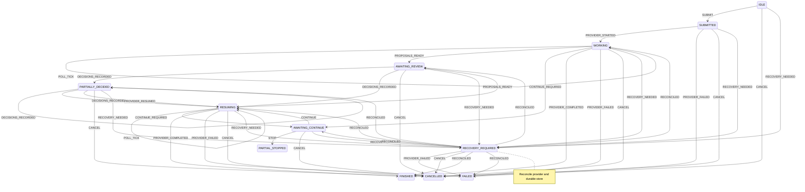

# Durable Review FSM

Built by **Ashutosh** for the SuperDocs engineering task, selected S3 card: reusable async
job/review state-machine library.

This is a working framework-neutral reducer plus two adapters: an atomic SQLite persistence/outbox
adapter and a FastAPI router binding. It models async start/poll, any number of proposal rounds,
item-level partial decisions, provider continuation prompts, cancellation, partial stop, terminal
states, restart recovery, and reconciliation against a durable provider job ID.

## Guarantees proved by tests

- `reduce(snapshot, event)` is pure; one declarative transition table drives both behavior and diagram.
- Every declared transition executes in the exhaustive matrix, and every undeclared transition fails
  closed.
- Duplicate event IDs have no second effect; deterministic command keys make the outbox idempotent.
- Optimistic versions reject concurrent stale transitions.
- A subset of item decisions remains `PARTIALLY_DECIDED` without discarding siblings.
- Continue/stop prompts are distinct from proposal approval.
- SQLite commits the event, snapshot and commands atomically and restores them in a new runtime.
- Reconciliation fetches actual provider state by the saved job ID; expired jobs stay explicitly in
  `RECOVERY_REQUIRED` instead of being guessed complete.
- The FastAPI binding creates, reads, dispatches and reconciles real review resources.

## Install and run

```powershell
python -m venv .venv
.\.venv\Scripts\python -m pip install -e ".[dev]"
.\.venv\Scripts\python -m pytest -q
```

Bind it to an application without coupling the reducer to a web framework:

```python
from fastapi import FastAPI
from review_fsm.fastapi_binding import create_review_router
from review_fsm import ReviewRuntime, SQLiteReviewPersistence

app = FastAPI()
persistence = SQLiteReviewPersistence("review.sqlite3")
app.include_router(
    create_review_router(
        lambda: ReviewRuntime(persistence),
        lambda: superdocs_job_provider,
    )
)
```

The provider adapter only needs `async get_job(job_id)`. An application maps durable outbox commands
to SuperDocs MCP `chat_async`, `get_job`, `approve_change`, continuation and cancellation tools.
Credentials never enter the state-machine package.

## Generated state diagram

`mermaid_state_diagram()` derives this diagram from `TRANSITION_RULES`; no second handwritten
transition list exists.



## Deliberate boundary

The library owns transition correctness and persistence semantics, not provider network calls. The
small `DurableJobProvider` protocol and durable outbox are the integration seams. SQLite is the included
production-shaped local adapter; horizontally scaled deployments should implement the same three-method
`ReviewPersistence` protocol on their transactional database.

## Automation disclosure

Ashutosh used AI-assisted coding, research, and test orchestration while building
this candidate project. Ashutosh is the sole applicant and is responsible for
source verification, security decisions, final review, submission, demo, and
live discussion. AI-assisted tooling prepared this project and, on Ashutosh's
explicit instruction, opened its GitHub contribution. It did not contact
prospects, send email or bug reports, submit the application, or impersonate a
human.
