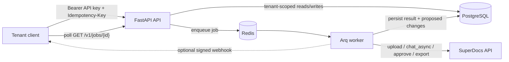
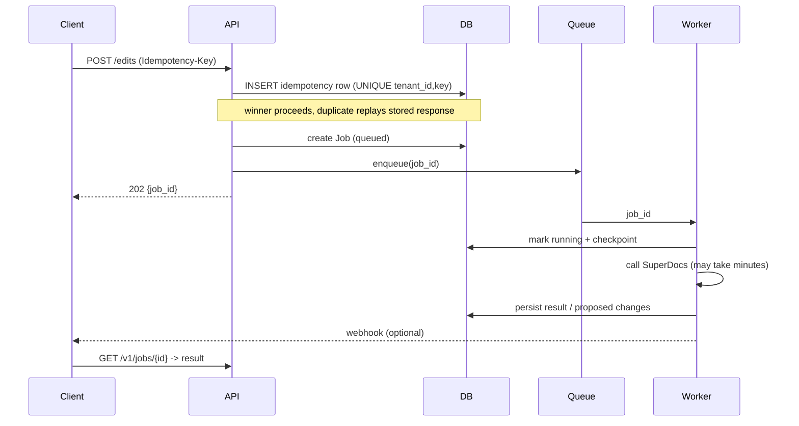

# Tenant Doc Gateway

A production-shaped, multi-tenant backend service that wraps the SuperDocs
document-AI contract — **upload -> chat/edit -> approve -> export** — behind a
clean REST API with real auth, hard tenant isolation, a job queue for
long-running work, idempotent writes, structured cost logging, and one-command
Docker deploy.

Built for a DevTools audience that needs a *working service*, not a snippet.

> Built by **vishnu vardhan** (GitHub [@Flutevishnu](https://github.com/Flutevishnu)).

---

## What it does, in plain language

SuperDocs edits documents with AI over an API. This gateway sits in front of it
so a company can safely expose that capability to **many end-customers
(tenants)** at once:

- Each tenant authenticates with its own API key.
- Every document, job, and proposed change is scoped to that tenant and is
  **provably unreachable** by any other tenant.
- Long edits (which can take 30s-minutes upstream) run as **background jobs**;
  the caller polls `GET /v1/jobs/{id}` or receives a signed **webhook**.
- Proposed changes are approved/rejected **one item at a time** — rejecting one
  does not discard the others.
- Every request is logged as structured JSON including an **ops cost** estimate,
  and money/token-costing operations are **idempotent** so retries never
  double-charge.

## SuperDocs features used

`upload_document` -> `chat_async` (HITL `approval_mode=ask_every_time`) ->
per-change approvals -> `export`. See
[app/integrations/superdocs/client.py](app/integrations/superdocs/client.py).

---

## Quickstart (clone -> running in under 10 minutes)

**Prerequisites:** Docker + Docker Compose.

```bash
git clone <your-fork-url>
cd extensions/Flutevishnu/tenant-doc-gateway
cp .env.example .env          # then set ADMIN_API_KEY (and SUPERDOCS_API_KEY for real edits)
docker compose up --build     # the one command: migrates the DB, then serves
```

That brings up **Postgres, Redis, the API, and the worker**. The API container
runs `alembic upgrade head` automatically before serving.

Open the interactive API docs at **http://localhost:8000/docs**.

### Create a tenant and make a call

```bash
# 1. Provision a tenant (returns an API key ONCE)
curl -s -X POST http://localhost:8000/v1/admin/tenants \
  -H "Authorization: Bearer $ADMIN_API_KEY" \
  -H "Content-Type: application/json" \
  -d '{"name":"Acme Corp"}'

# 2. Upload a document (streamed to disk in chunks). Idempotency-Key is required.
curl -s -X POST http://localhost:8000/v1/documents \
  -H "Authorization: Bearer <tenant-api-key>" \
  -H "Idempotency-Key: $(uuidgen)" \
  -F "file=@./mydoc.docx"

# 3. Ask for an edit (returns a job id)
curl -s -X POST http://localhost:8000/v1/documents/<document_id>/edits \
  -H "Authorization: Bearer <tenant-api-key>" \
  -H "Idempotency-Key: $(uuidgen)" \
  -H "Content-Type: application/json" \
  -d '{"instruction":"Add a confidentiality clause to section 3"}'

# 4. Poll the job, then review + approve/reject proposed changes item by item
curl -s http://localhost:8000/v1/jobs/<job_id> -H "Authorization: Bearer <tenant-api-key>"
```

**Note:** See `docs/screenshot.png` for a capture of the interactive Swagger UI.

---

## Run the tests (no API key, no cost)

The entire suite runs against an on-disk SQLite DB with the SuperDocs API mocked,
so **anyone can clone and run it with zero credentials**:

```bash
python -m venv .venv && source .venv/bin/activate    # Windows: .venv\Scripts\activate
pip install -r requirements-dev.txt
pytest
```

25 tests cover auth, tenant isolation (breach attempts that must fail),
sequential AND concurrent idempotency, chunked streaming uploads, the job flow,
per-item approvals, and the SuperDocs double-parse.

---

## Architecture



Request lifecycle for a costing operation:



### Why these choices

- **FastAPI + async SQLAlchemy + Arq + Redis + Postgres.** Async top to bottom;
  Arq is the lightest queue that fits an async FastAPI app (vs. Celery's
  heavier footprint).
- **One image for API and worker** ([Dockerfile](Dockerfile)) so worker and API
  code can never drift.
- **Repository layer owns tenant scoping** — see next section.
- **Portable types** (`sa.Uuid`, `sa.JSON`) so the exact same models/code run on
  Postgres in prod and SQLite in CI with no external services.

---

## Tenant isolation (decision + rationale)

**What it must NEVER do:** return, edit, export, or even confirm the existence of
another tenant's document, job, or proposed change.

**How it is enforced (not just asserted):**

1. Every tenant-owned row has a non-null `tenant_id`
   ([app/db/models.py](app/db/models.py)).
2. All tenant data access goes through repositories that **require a
   `TenantContext` and inject `WHERE tenant_id = ?` themselves**
   ([app/db/repositories.py](app/db/repositories.py)). A handler physically
   cannot run a tenant query without stating whose data it may touch, so a
   forgotten filter cannot leak data.
3. `tenant_id` is taken from the authenticated API key, **never** from client
   input — this closes IDOR ("pass another tenant's id") attacks.
4. Cross-tenant or missing ids return **404, not 403**, so there is no existence
   oracle: a real foreign id is indistinguishable from a random one.

**Proven by:**
[tests/test_tenant_isolation.py](tests/test_tenant_isolation.py) actively tries
to read/edit/export/poll another tenant's resources and asserts every attempt
fails with 404 (with a control showing the owner succeeds).

---

## Idempotency (decision + rationale)

**What it must NEVER do:** create two jobs or double-charge SuperDocs for one
logical request, even under two truly simultaneous calls.

**How it works** ([app/services/idempotency.py](app/services/idempotency.py)):

- Costing endpoints (upload, edit, export, approval decision) **require** an
  `Idempotency-Key` header.
- We **insert first** and let the DB's `UNIQUE(tenant_id, key)` constraint pick
  the single winner — no application lock, no check-then-act race window. The
  loser rolls back and **replays the winner's stored response**.
- Same key + **different** body -> `409` (never a silent wrong replay); the
  request body is hashed to detect this.
- The job row and the idempotency record commit in the **same transaction**, so
  they are atomic.

**Proven by:**
[tests/test_idempotency_concurrent.py](tests/test_idempotency_concurrent.py)
fires two identical requests with the same key via `asyncio.gather` and asserts
**exactly one** document and one job were created. Sequential replay and the
409-on-different-body cases are in
[tests/test_idempotency.py](tests/test_idempotency.py).

---

## Other guarantees

- **Streamed uploads:** files are read in bounded chunks and written straight to
  disk, with the size cap enforced mid-stream, so a large upload is never fully
  buffered in memory ([app/services/storage.py](app/services/storage.py),
  [tests/test_upload_streaming.py](tests/test_upload_streaming.py)).
- **Resumable jobs:** the worker checkpoints the upstream job id before/after
  calling SuperDocs, so a retried job resumes instead of re-issuing (and
  re-charging) the upstream call ([app/services/job_runner.py](app/services/job_runner.py)).
- **The double-parse:** SuperDocs returns proposed changes as a JSON-encoded
  *string*; we parse it twice. Missing this is the #1 cause of empty diffs — see
  `SuperDocsClient.parse_changes` and
  [tests/test_superdocs_parse.py](tests/test_superdocs_parse.py).
- **Graceful degradation:** upstream/webhook failures are surfaced on the job or
  logged, never crash the request.
- **Budget guard:** `SAMPLE_MODE` and `SAMPLE_MAX_SECTIONS` cap bulk work to
  protect the free operation allowance.
- **Cost logging:** every request logs `ops_cost` as structured JSON
  ([app/logging.py](app/logging.py)); secrets are never logged.

## Configuration

All config is environment-driven via `pydantic-settings`
([app/config.py](app/config.py)). See [.env.example](.env.example) for the full
list. Adding a tenant is a data operation (`POST /v1/admin/tenants` or
`scripts/seed_tenants.py`), not a code change.

## Load test

See [loadtests/RESULTS.md](loadtests/RESULTS.md) for real numbers and how to
reproduce (`loadtests/async_load.py`, plus an optional Locust file).

## Project layout

```
app/
  api/           # routers: health, admin, documents, edits, approvals, exports, jobs
  auth/          # API-key hashing + tenant/admin dependencies
  db/            # models, async session, tenant-scoped repositories
  integrations/  # SuperDocs client (double-parse), schemas, errors
  services/      # storage, idempotency, queue, cost, webhooks, job_runner
  workers/       # Arq worker settings + tasks
alembic/         # migrations
tests/           # pytest suite (SuperDocs mocked, no key needed)
loadtests/       # async load script + Locust file + RESULTS.md
scripts/         # seed a demo tenant locally
```

## License

MIT (inherits the repository license).
