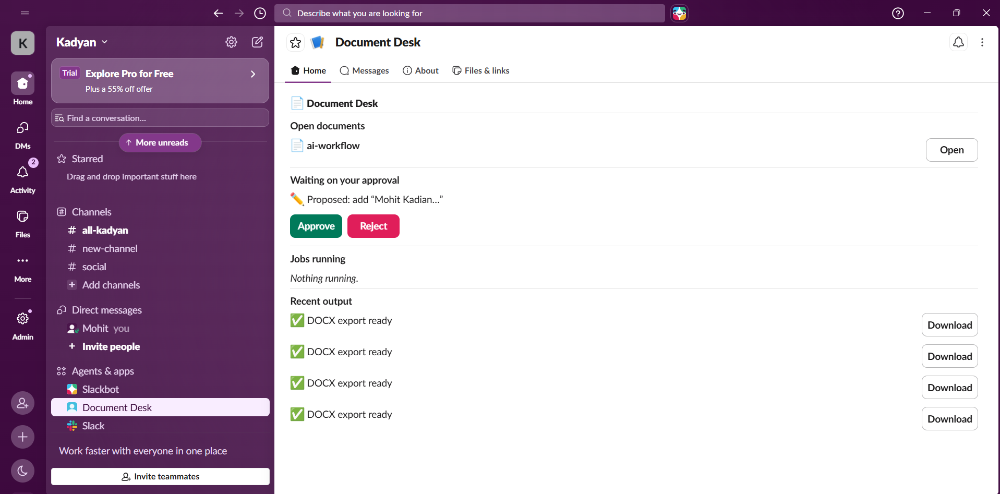

# Document Desk

A Slack Home tab that turns [SuperDocs](https://superdocs.app) into a personal document
desk: open documents, changes waiting on your approval, jobs still running, and recent
exports — all actionable with buttons, right inside Slack. There's no separate web
frontend; Slack's Block Kit is the entire UI.

Built on SuperDocs' REST API (upload → `chat_async` with human-in-the-loop approval →
`approve_change` → `export_document`), wrapped in a Slack Bolt backend.

> Built by **Mohit Kadyan** for the SuperDocs engineer task.



## SuperDocs features used

- **Document upload** (`/v1/documents/upload-base64`) — a file shared in a Slack channel is uploaded straight into the user's SuperDocs session.
- **Chat editing with human-in-the-loop approval** (`chat_async` with `approval_mode="ask_every_time"`) — an `@mention` instruction becomes a proposed change the user approves before it applies.
- **Approve / reject proposed changes** (`approve_change`) — the Approve/Reject buttons on the Home tab genuinely apply or discard the change in SuperDocs.
- **Job status polling** (`get_job`) — the desk reconciles each job's real state so a job that finished between visits shows up correctly, including after a restart.
- **Export** (`export_document`) — a completed job's finished file is exported and delivered directly to the user's Slack DM.

## What you can run right now, with zero credentials

The project lives in `extensions/Kadyan25/slack-document-desk/` in this repository. From
that folder:

```bash
cd extensions/Kadyan25/slack-document-desk
./start.sh
```

This boots Postgres + the FastAPI/Bolt backend in Docker (`docker-compose.yml`), applies
migrations automatically, and serves a health check at `http://localhost:8010/health`.
The whole backend logic — Home tab rendering, the approval gate's idempotency guard,
restart-accuracy reconciliation, export delivery — is unit/integration tested against a
fake SuperDocs client and the real (containerized) Postgres, no live key required:

```bash
docker compose exec -T backend python -m pytest tests/ -v
```

## What needs real credentials

Slack won't deliver events to a server it can't reach with a token it doesn't have, and
SuperDocs calls need a real API key. To see it working end to end in an actual Slack
workspace, you need:

1. **A Slack app** — create one at [api.slack.com/apps](https://api.slack.com/apps) on
   any free workspace, **in this order** (doing it out of order means reinstalling
   repeatedly):
   1. **Install the app first**, even with zero scopes — this creates the bot user.
   2. **OAuth & Permissions** → add bot token scopes `app_mentions:read`, `chat:write`,
      `files:read`, `files:write` (yes, both — `files:read` downloads shared files,
      `files:write` is what lets the bot DM the exported file back; easy to miss since
      only one shows up if you're just skimming the file_shared handler), `im:write`,
      `im:history`, `users:read`. Reinstall to grant them.
   3. **App Home** → toggle **Home Tab** on. Reinstall again.
   4. Confirm **Socket Mode** (left sidebar) is **off** — if it's on, Slack expects a
      WebSocket connection instead of calling your Request URL, and every event you
      configure below will verify fine but never actually arrive. This app doesn't use
      Socket Mode; it's built for the HTTP Events API.
   5. **Event Subscriptions** → toggle on, set the Request URL to
      `https://<tunnel>/slack/events`, wait for Verified, add bot events
      `app_home_opened`, `app_mention`, `file_shared`. Reinstall again.
   6. **Interactivity & Shortcuts** → toggle on, set the Request URL to the **same**
      `https://<tunnel>/slack/events` — this is a separate setting from Event
      Subscriptions and is what actually delivers button clicks (Approve/Reject/
      Download). Missing this step means the Home tab renders fine and events arrive,
      but every button silently does nothing. Reinstall one more time.
   7. Copy the **Bot User OAuth Token** (`xoxb-...`) and the **Signing Secret** (Basic
      Information).
2. **A tunnel** (e.g. `ngrok http 8010`, or `cloudflared tunnel --url http://localhost:8010`
   if ngrok hits a local TLS/certificate issue) so Slack's Request URLs can reach your
   local backend. ngrok's free tier keeps a stable subdomain across restarts if your
   account has one reserved; Cloudflare's quick tunnel issues a new random one every
   time, so both Request URL fields need re-registering after a restart.
3. **A SuperDocs API key** — from your account settings at
   [use.superdocs.app](https://use.superdocs.app).

Drop all three into `.env` (copy `.env.example` first), restart the stack, and point your
Slack app's Request URL at the tunnel. From there:

- Share a file in a channel the bot is in → it uploads into your Document Desk.
- `@Document Desk <instruction>` in that channel → sends an edit through `chat_async`.
- Open the bot's Home tab → see it land as a card waiting on your approval.
- Click Approve → it's applied in SuperDocs immediately, the desk re-publishes itself,
  and (once the job completes) the finished file is DMed to you directly and a Download
  button appears in case you want it re-sent.

## Honest limitations

- **A live demo needs your own Slack + SuperDocs credentials, and Slack's dashboard has
  sharp edges.** This isn't a fully offline system — the whole point is being embedded in
  Slack talking to a real SuperDocs account. The live path is real and proven: approve
  genuinely applies the change in SuperDocs, the desk re-publishes, and the finished file
  is genuinely DMed back. But getting there means threading three separate, non-obvious
  Slack dashboard settings correctly — Socket Mode off, Event Subscriptions' Request URL,
  and Interactivity & Shortcuts' *separate* Request URL — plus the `files:write` scope for
  DMing exports. Miss any one and it looks broken with no error message anywhere in reach;
  the README setup steps above are written in the order that avoids it. Everything short of
  live credentials (rendering, idempotency, restart accuracy, export delivery) is also
  covered by tests that need neither.
- **Restart accuracy covers jobs/documents we already have a local row for.** If the
  backend crashed in the narrow window between calling SuperDocs and committing the
  resulting row, that job/document would be orphaned — invisible until the user re-shares
  or re-mentions. Closing that fully would mean periodically reconciling against
  SuperDocs' `list_jobs`/`list_documents`, which wasn't in scope here.
- **Single-workspace bot token, not app-store OAuth.** Sideloading a bot token into one
  workspace is enough to demo this; multi-workspace distribution would mean adding Bolt's
  OAuth flow, a documented but unbuilt extension.

## Demo

<!-- Replace with the recorded walkthrough link before submitting. -->
Demo video: _link coming with the submission_.

The hero flow:

1. Share a short synthetic document (e.g. a project status report) in a Slack channel
   the bot is in. Bot acknowledges: *"Got it — *status.md* is open in your Document Desk."*
2. Open the bot's Home tab in the sidebar — the document appears under **Open documents**.
3. In that channel: `@Document Desk add a risk note about the vendor delay at the end`.
   Bot acknowledges it's working on it.
4. Reopen the Home tab — the proposed change appears under **Waiting on your approval**,
   with the AI's explanation and Approve/Reject buttons.
5. Click **Approve** — the Home tab re-publishes immediately; the change is gone from
   pending, the finished `.docx` is DMed to you automatically, and a **Download** button
   appears under **Recent output**.
6. Click **Download** — bot re-exports fresh and DMs the file again (SuperDocs' export
   returns the file's bytes directly, not a link, so there's nothing to cache — every
   click is a fresh export).
7. Kill the backend (`docker compose stop backend`), restart it, reopen the Home tab —
   state is unchanged, nothing shows as stuck or wrong.

---

Built for the [SuperDocs](https://superdocs.app) engineer task by Mohit Kadyan.
