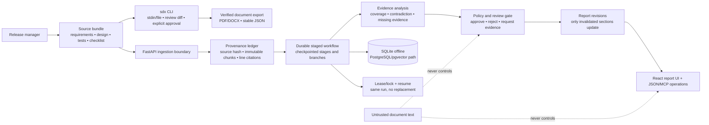

# Architecture diagram (one-page draft)

The diagram is intentionally a separate page from the project explanation. `sdx` and the Release Readiness Analyst are complementary projects, not a single service.

## Boundary notes

- The CLI performs local parsing, review presentation, explicit item decisions, and verified exports. Its offline fixture server proves the signed-storage path without requiring a live credential.
- FastAPI owns ingestion, validation, stage transitions, report revisions, and typed machine operations. The React surface reads the same run state and displays stage progress, evidence citations, decisions, and report JSON.
- Checkpoints and leases are durable in the offline implementation; the production data model is documented as PostgreSQL with pgvector. Signed URLs, credentials, and private document bytes are not placed in report output or recording material.
- Source text is evidence only. Prompt-like text from a source cannot change system instructions, policy, authorization, or tools.
- The workflow branches on missing evidence, contradictions, human decisions, and interruption. Resume continues a persisted run; it does not approve or silently create replacement work.
