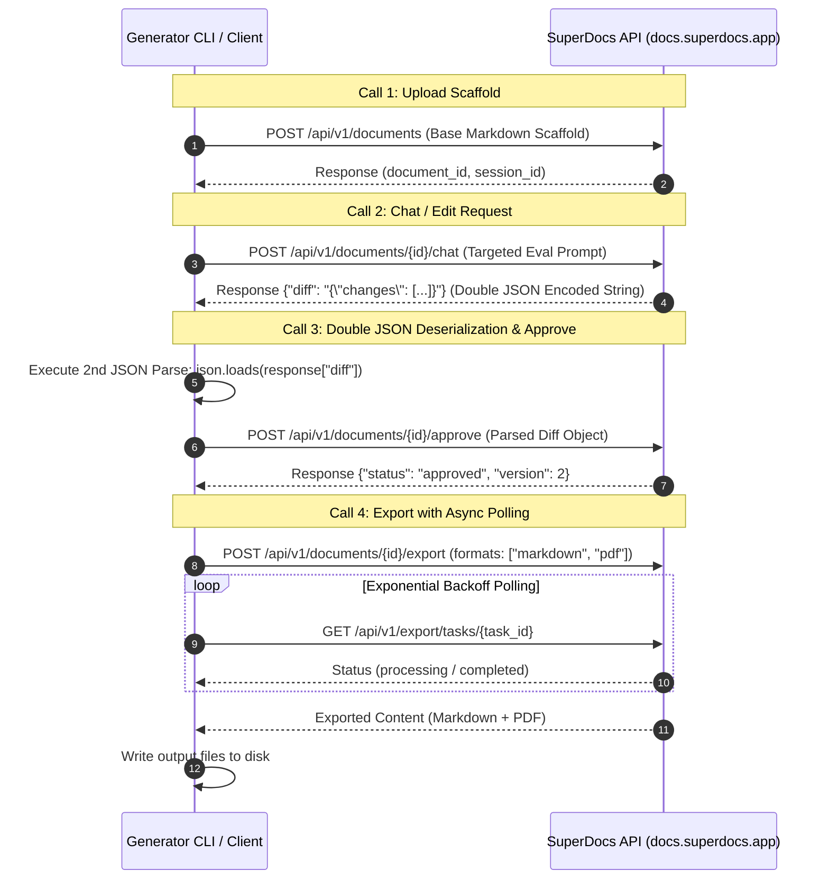

# SuperDocs Extension: Model and System Card Generator

[](https://python.org)
[](tests)
[](#)
[](#superdocs-4-call-document-lifecycle-architecture)
[](#model-context-protocol-mcp-interface)

A modular ML documentation engine built for ML engineers, research groups, and platform providers. Transforms structured model manifests and raw benchmark evaluation artifacts into publication-ready Model and System Cards in synchronized **Markdown (`.md`)**, **PDF (`.pdf`)**, and **HTML** formats.

Built with automated in-place evaluation table refreshes and native integration with the **SuperDocs 4-Call Document Lifecycle Contract**.

---

## 📋 Assigned Build Metadata

- **Assigned Build:** Model Card and System Card Generator
- **Difficulty Band:** `S2`
- **Who It Serves:** ML teams, research groups, and platform providers.
- **Surfaces Touched:** API (REST & MCP), Templates, Chat, Export.
- **Destination:** Pull request into public repository under `extensions/mr-ashad/model-card-generator/`.
- **Author / Builder:** Mahammad Ashad ([@mr-ashad](https://github.com/mr-ashad))

---

## 🌟 Key Capabilities

1. **Strict Completeness & Fallback Handling**
   - Ingests static metadata (`model_name`, `version`, `intended_purpose`, `limitations`, `out_of_scope_uses`, `maintenance_contact`, `training_data_summary`, `model_architecture`, `ethical_considerations`, etc.).
   - If any metadata field is missing, `None`, empty string `""`, empty list `[]`, or empty dict `{}`, it is explicitly marked as `"Not provided"`.
   - **Guaranteed Zero Hallucination**: Never invents or infers missing values.

2. **Automated In-Place Evaluation Refresh Engine**
   - Ingests machine-readable evaluation logs (`eval_results.json` or `.csv`).
   - Maps raw task IDs (`mmlu`, `gsm8k`, `humaneval`, `math`, `arc_challenge`, etc.) to human-readable capability domains using configurable dictionary mappings (`config/benchmark_mappings.json`).
   - Standardizes metric units and computes baseline deltas (`▲ +4.3%`, `▼ -2.1%`, `— 0.0%`).
   - Targets updates exclusively to designated evaluation and timestamp anchors (`<!-- EVALUATION_SECTION_START -->` / `<!-- EVALUATION_SECTION_END -->`).
   - **Guaranteed 100% Narrative Preservation**: All human-authored executive summaries, limitations, custom ethical notes, and markdown formatting outside the evaluation anchors remain 100% untouched across refresh cycles.

3. **SuperDocs 4-Call Document Integration Contract**
   Implements the 4-step document lifecycle adapter:
   - **Upload (`upload`):** Uploads base card markdown scaffold and initializes session/document ID.
   - **Edit (`chat`):** Sends targeted instructions to update evaluation tables and run timestamps.
   - **Approve (`approve`):** Applies proposed diffs.
     - *CRITICAL GOTCHA IMPLEMENTATION:* The proposed diff payload arrives as a **JSON-encoded string** inside the outer JSON response. The client performs a **second JSON parse** on this field before passing the approved object back to avoid `undefined` empty diff errors.
   - **Export (`export`):** Outputs synchronized, publication-ready Markdown and PDF files with exponential backoff async polling for long-running document transformations.

4. **Resilience, Budgeting & Guardrails**
   - **Async Exponential Backoff Polling:** Handles multi-minute document generation and export workflows gracefully without dropping connections.
   - **Sample Mode (`--sample-mode`):** Slices benchmark evaluation data to a lightweight 3-row metric sample for fast handshake validation.
   - **Offline / Local Mode (`--offline`):** Provides a full local simulation fallback when operating offline or in CI test environments.

---

## 📁 Directory Structure

```text
extensions/mr-ashad/model-card-generator/
├── config/
│   └── benchmark_mappings.json      # Maps benchmark task IDs to human-readable domains & metrics
├── schemas/
│   ├── manifest_schema.json         # JSON schema for static model metadata
│   └── eval_schema.json             # JSON schema for raw benchmark logs
├── src/
│   ├── __init__.py
│   ├── normalizer.py                # Schema validation & "Not provided" fallback handler
│   ├── tabulator.py                 # Metric table compiler & delta calculator
│   ├── updater.py                   # In-place section boundary replacement engine
│   ├── superdocs_client.py          # 4-call API adapter (Upload, Chat, Approve with 2x JSON parse, Export)
│   ├── mcp_adapter.py               # Model Context Protocol (MCP) server adapter
│   └── html_renderer.py             # HTML/PDF rendering engine
├── templates/
│   └── base_card_template.md        # Scaffold with distinct section anchors
├── tests/
│   ├── __init__.py
│   ├── conftest.py                  # Pytest fixtures and test paths
│   ├── test_schema_fallbacks.py     # Verifies missing keys resolve to "Not provided"
│   ├── test_double_json_parse.py    # Tests outer + inner JSON deserialization
│   ├── test_refresh_lifecycle.py    # Asserts non-eval text is untouched during refresh
│   ├── test_tabulator.py            # Tests metrics, deltas, and sample mode
│   ├── test_superdocs_client.py     # Tests 4-call lifecycle & polling timeouts
│   ├── test_mcp_adapter.py          # Tests MCP tool endpoints & lifecycle
│   └── test_html_renderer.py        # Tests HTML export generation
├── sample_data/
│   ├── sample_manifest.json         # Example manifest
│   ├── sample_eval_results.json     # Example evaluation JSON
│   └── sample_eval_results.csv      # Example evaluation CSV
├── ui/                              # Interactive Web Studio
│   ├── index.html                   # Studio UI markup
│   ├── styles.css                   # Studio dark/light design system
│   └── app.js                       # Client-side generator & SuperDocs simulator
├── cli.py                           # CLI entry point (generate, refresh, --sample-mode)
├── requirements.txt                 # Project dependencies
└── README.md                        # Setup and usage documentation
```

---

## 🚀 Installation & Setup

```powershell
# Navigate to extension directory
cd extensions/mr-ashad/model-card-generator

# Install dependencies
pip install -r requirements.txt
```

---

## 💻 CLI Usage

### 1. Generate Full Model Card
Generates a new Model Card in Markdown and PDF from a manifest and evaluation results:

```powershell
python cli.py generate `
  --manifest sample_data/sample_manifest.json `
  --eval-results sample_data/sample_eval_results.json `
  --output-dir ./output `
  --output-name nexus_70b_card
```

### 2. Fast Verification Handshake with Sample Mode (`--sample-mode`)
Slices benchmark evaluation to 3 rows to test the pipeline and API handshake quickly:

```powershell
python cli.py generate `
  --manifest sample_data/sample_manifest.json `
  --eval-results sample_data/sample_eval_results.json `
  --sample-mode `
  --output-dir ./output
```

### 3. In-Place Evaluation Table Refresh
Updates an existing card's benchmark tables and timestamp without touching human-written narrative text:

```powershell
python cli.py refresh `
  --card-file ./output/nexus_70b_card.md `
  --eval-results sample_data/sample_eval_results.csv `
  --export
```

### 4. Local Simulation / Offline Mode (`--offline`)
Runs entirely offline with zero network requests using the local simulation engine:

```powershell
python cli.py generate `
  --manifest sample_data/sample_manifest.json `
  --eval-results sample_data/sample_eval_results.json `
  --offline `
  --output-dir ./output
```

### 5. CLI Arguments Reference

| Flag | Subcommand | Description |
| :--- | :--- | :--- |
| `--manifest`, `-m` | `generate` | Path to static model manifest JSON. |
| `--eval-results`, `-e` | `generate`, `refresh` | Path to evaluation results file (JSON or CSV). |
| `--card-file`, `-c` | `refresh` | Path to existing card markdown file to refresh in-place. |
| `--sample-mode` | `generate`, `refresh` | Slice metrics to 3 rows for fast handshake testing. |
| `--output-dir`, `-o` | `generate`, `refresh` | Output directory for `.md`, `.html`, and `.pdf` files. |
| `--output-name`, `-n` | `generate` | Base filename (without extension) for output artifacts. |
| `--export` | `refresh` | Export updated Markdown, HTML, and PDF after in-place refresh. |
| `--offline`, `--local`| `generate`, `refresh` | Run offline with local simulation engine. |
| `--api-key` | `generate`, `refresh` | SuperDocs API key (or `SUPERDOCS_API_KEY` env var). |
| `--base-url` | `generate`, `refresh` | SuperDocs API base URL (default: `https://docs.superdocs.app`). |

---

## 🖥️ Interactive Web UI Studio

The extension includes a standalone web studio located at `ui/index.html`:

- **Zero Install Requirement:** Works in any browser without requiring node or a web server.
- **Dual-Pane Live Studio:** Real-time synchronized Markdown source editor and rendered HTML preview.
- **Live In-Place Refresh Demo:** Test updating evaluation benchmark tables dynamically while verifying narrative text remains 100% intact.
- **SuperDocs 4-Call Modal:** Visual step-by-step simulator for Upload, Edit (Chat), Approve (Double JSON parse), and Export lifecycle steps.
- **Theme Support:** Dark & Light mode toggle with accessible typography and clean styling.

---

## 🔄 SuperDocs 4-Call Document Lifecycle Architecture



---

## 🛠️ Model Context Protocol (MCP) Interface

The generator exposes standard MCP tools for integration into MCP-compatible agents and environments via `src/mcp_adapter.py`:

| Tool Name | Operation | Description |
| :--- | :--- | :--- |
| `superdocs_upload` | Call 1/4 | Uploads base card markdown scaffold. |
| `superdocs_chat` | Call 2/4 | Sends targeted edit instructions for evaluation updates. |
| `superdocs_approve` | Call 3/4 | Approves diffs with automated double JSON deserialization. |
| `superdocs_export` | Call 4/4 | Exports synchronized Markdown and PDF with backoff polling. |
| `generate_model_card` | High-Level | End-to-end card generation from manifest and evaluation logs. |
| `refresh_evaluation_tables`| High-Level | In-place evaluation refresh preserving narrative text. |

---

## 🧪 Running the Automated Test Suite

Run all automated unit and integration tests via `pytest`:

```powershell
python -m pytest tests -v
```

### Test Coverage Highlights (30 Tests Passing):
- **`test_schema_fallbacks.py`**: Validates missing keys, `None`, and blank lists resolve strictly to `"Not provided"` without hallucinations.
- **`test_refresh_lifecycle.py`**: Asserts 100% narrative text preservation across single and consecutive refresh cycles.
- **`test_double_json_parse.py`**: Tests outer + inner JSON deserialization for diff approvals.
- **`test_tabulator.py`**: Tests JSON & CSV loading, domain mapping, metric unit formatting, baseline deltas, and sample mode slicing.
- **`test_superdocs_client.py`**: Tests full 4-call document lifecycle and polling timeout guardrails.
- **`test_mcp_adapter.py`**: Tests Model Context Protocol tool bindings and execution.
- **`test_html_renderer.py`**: Verifies standalone HTML document generation for PDF exports.

---

## 📜 Attribution & Credits

- **Author**: Mahammad Ashad ([@mr-ashad](https://github.com/mr-ashad))
- Built for the **SuperDocs** Extension Ecosystem.
