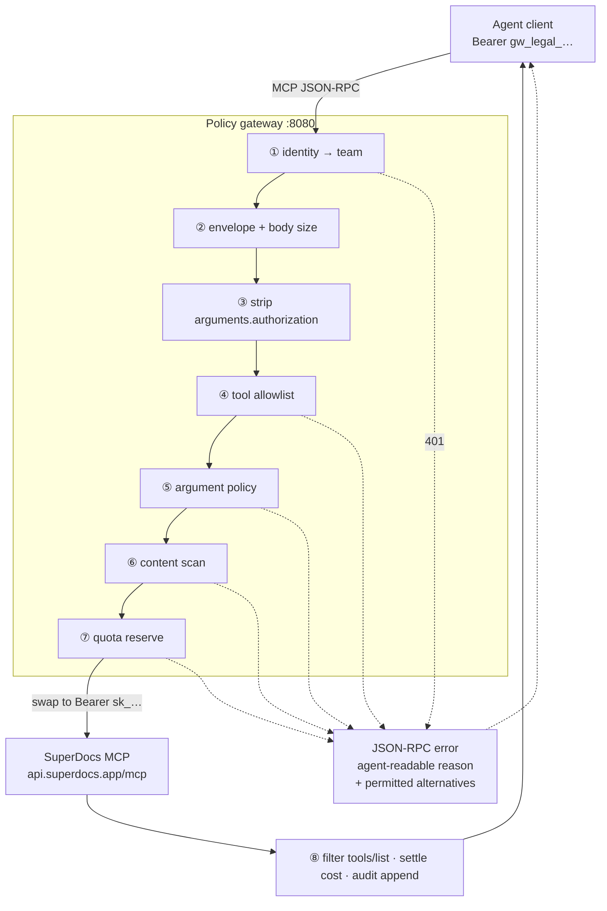

# Policy gateway in front of the document tools

> Open-task-list card p288 · BAND S3 · surfaces `MCP, API` · destination:
> a pull request into the public repository, `extensions/` folder.

A proxy that sits between an agent client and SuperDocs' MCP server and adds
organisational policy: a tool allowlist, a pre-send content scan, per-team
quotas, and a tamper-evident audit log of every call and its cost.
Configuration is a policy file. Deploys as a container.

---

## 1. Decisions (locked)

| # | Decision | Choice |
| --- | --- | --- |
| D1 | Identity | **Token exchange.** Gateway holds the real `sk_` key; teams get gateway tokens. |
| D2 | Pre-signed URL scan hole | **Deny `request_upload_url` / `request_download_url` by default**, document the trade-off. Data-plane rewriting is an explicit v1 non-goal. |
| D3 | Scan depth | **Regex + entropy + injection markers.** No ML. |
| D4 | Packaging | **Container + compose + latency benchmark.** No hosted instance. |

**Why D1 is the spine.** The agent never possesses the billing credential. A
compromised agent leaks a revocable, policy-scoped gateway token — not `sk_…`.
It also settles the card's *"documented failure mode when the proxy is down"*
without extra engineering: the system is **fail-closed by construction**. No
gateway, no key, no access. We document that as the intended posture plus a
break-glass procedure, rather than pretending to offer graceful degradation.

---

## 2. Protocol facts — measured 2026-08-17

Verified live against `api.superdocs.app/mcp`. These are why the build is
tractable. Re-check if upstream changes.

| Fact | Observed | Consequence |
| --- | --- | --- |
| No `Mcp-Session-Id` on `initialize` | absent | Server is **stateless at the transport layer** → plain request/response forwarder, no session state machine. |
| `content-type: application/json`, never chunked/SSE | all responses | **No SSE relay to implement** — the hardest part of MCP proxying does not apply. |
| `prompts/list` → 4 prompts; `resources/list` → `[]` | live | Forward both faithfully; prompts are filterable like tools. |
| Missing `Accept` header → **HTTP 406** | live | A proxy that drops `Accept` breaks every call. Conformance test. |
| Both `/mcp` and `/mcp/` accepted | live + docs | No redirect handling, no auth-dropping redirect hazard. |
| Upstream round trip ~440–490 ms | 5 samples | Overhead target <10 ms p95 ≈ 2%. The "little latency" claim is provable. |
| 38 tools | `tools/list` | Allowlist domain is a known, finite set. |
| **37 of 38 tools accept an `authorization` argument** | `tools/list` schemas | **Bypass vector.** See gate ③. Only `health` lacks it. |

---

## 3. The flow



---

## 4. What we check when an agent calls the MCP

Every inbound request runs the gate chain below. Gates are ordered
**cheapest-and-most-decisive first**: nothing touches the network until the
request has earned it.

### Gate ① — Identity

| Check | On failure |
| --- | --- |
| `Authorization` header present | `401` |
| Token hash matches a configured team | `401` (never say which part was wrong) |
| Token not revoked / not expired | `401` |

Tokens are stored **hashed** in the policy file. The gateway never logs a token.

### Gate ② — Envelope

| Check | On failure |
| --- | --- |
| Parses as JSON | `-32700` parse error |
| Valid JSON-RPC 2.0 envelope (`jsonrpc`, `method`, `id`) | `-32600` invalid request |
| `method` is one we proxy | `-32601` method not found |
| Body within the ~32 MB transport cap | `413`, refused before upstream |
| `Accept` header present and includes a type upstream accepts | normalised, not rejected — upstream 406s without it |

### Gate ③ — Strip `arguments.authorization` (the bypass)

**37 of the 38 tools expose an optional `authorization` argument.** An agent
that supplies its own key there would transact on *that* key while appearing to
flow through the gateway — escaping quota, attribution, and the audit trail
while inheriting the gateway's network position.

The gateway **removes `arguments.authorization` unconditionally** and records
that it did so. Presence of the field is itself an audit event worth alerting
on: a well-behaved client never sets it.

> Whether upstream actually honours the argument over the header is unverified —
> testing needs a second key. The gateway strips it regardless, because the cost
> of stripping is zero and the cost of being wrong is total policy bypass.

### Gate ④ — Tool allowlist

| Check | Detail |
| --- | --- |
| `params.name` present and a known tool | else `-32602` |
| Tool in the team's `allow_tools` (supports `*`) | |
| Tool not in `deny_tools` | **deny always wins over allow** |

Enforced at **two points**: `tools/list` responses are filtered so the agent
never learns a denied tool exists, and `tools/call` is checked anyway as defence
in depth against a cached or hardcoded tool list.

Denials are agent-readable so the model can adapt instead of retrying:

```
tool 'archive_document' is not permitted for team=legal.
permitted alternatives: rename_document, close_session_document
```

### Gate ⑤ — Argument policy

Tool-name allowlisting alone is too coarse. Several SuperDocs arguments change
the *risk* of a call, and these are the controls an enterprise actually wants:

| Argument | Control | Why |
| --- | --- | --- |
| `chat_async.approval_mode` | force `ask_every_time` | Regulated teams must review every AI edit before it lands. A policy that can *force* human-in-the-loop is the single most valuable control here. |
| `cross_session_memory`, `cross_session_search` | force `false` | Otherwise the model may carry context, or search across **other chats and documents in the same account** — a tenant-bleed risk. |
| `archive_document.force` | deny `true` | `force` overrides the "open in another session" guard. |
| `chat_async.model_tier` | cap at `pro` | Cost control; `max` is the expensive tier. |

Two modes per rule: **reject** the call, or **rewrite** the argument and
continue. Rewrites are recorded in the audit entry so the change is never
silent.

### Gate ⑥ — Content scan

Scan targets, measured from the live tool schemas rather than assumed:

| Tool | Fields |
| --- | --- |
| `chat`, `chat_async` | `message`, `document_html` |
| `export_document` | `html` |
| `upload_document_base64` | `file_base64` |
| `upload_attachment_base64` | `file_base64` |
| `upload_template_base64` | `file_base64` |
| `upload_image_base64` | `image_base64` |

**A `.docx` is a ZIP.** Regex over the base64, or over the decoded bytes, finds
nothing — the text is deflate-compressed inside `word/document.xml`. The scanner
must decode base64, unzip, and scan the extracted XML. Any implementation that
skips this silently passes every Word document through unscanned while
reporting success.

| Format | Extraction |
| --- | --- |
| `.docx` | unzip → `word/document.xml` (+ headers/footers) |
| `.pdf` | text extraction layer |
| `.txt` `.md` `.html` `.rtf` | direct |

Rules: `pii_email`, `pii_ssn`, `secret_api_key` (entropy-based),
`injection_markers`. Actions: `block` · `mask` · `warn`.

**Masking is only honest for text fields.** Rewriting text inside a `.docx`
means rebuilding the archive; v1 therefore supports `mask` on `message`,
`document_html` and `html`, and restricts binary uploads to `block` or `warn`.
Stated in the README rather than quietly degraded.

Egress scanning is configurable and off by default: `get_session_history`,
`get_job` and `return_html=true` responses can carry document content back into
the agent's context. Ingress protects the vendor boundary; egress protects the
agent's context window.

### Gate ⑦ — Quota

Only **`chat`, `chat_async` and chunk re-edit** bill. Upload, parse, export and
every read are free.

- Reserve against the team's `monthly_edits` **before** forwarding.
- **Release the reservation if the call fails** — failed operations bill 0
  upstream, so charging for them would drift from the real invoice.
- Large creations bill 1 per 25 sections; the settle step reconciles.

### Gate ⑧ — Response

| Step | Detail |
| --- | --- |
| Filter | `tools/list` and `prompts/list` reduced to the team's permitted set |
| Classify | upstream `401` vs `4xx` vs `5xx` vs transport failure, surfaced distinctly |
| Settle | actual cost recorded; reservation released on failure |
| Audit | append a hash-chained entry |

---

## 5. The pre-signed URL hole

`request_upload_url` returns a Google Cloud Storage pre-signed PUT URL; the
agent then PUTs bytes **directly to storage**, bypassing the gateway entirely.
`request_download_url` is the same in reverse.

**A gateway advertising a pre-send scan is therefore lying by default.**

v1 closes it by policy — both tools are in the default `deny_tools`, forcing
content through `upload_document_base64` where the proxy can read it. The cost,
stated plainly in the README:

- inline uploads are reliable to ~20 MB of file bytes (base64 inflates ~33%, and
  the transport caps bodies near 32 MB)
- teams needing larger documents accept an unscanned path, or wait for v2

**v2 sketch (out of scope):** the gateway rewrites the returned `upload_url` to
point at itself, streams the bytes through the scanner, then forwards to GCS.

---

## 6. Policy file

```yaml
version: 1

upstream:
  url: https://api.superdocs.app/mcp
  key_env: SUPERDOCS_API_KEY          # never inline

defaults:
  deny_tools: [request_upload_url, request_download_url]
  arguments:
    cross_session_memory: { force: false }
    cross_session_search: { force: false }
    "archive_document.force": { deny: true }
  scan:
    rules: [pii_email, pii_ssn, secret_api_key, injection_markers]
    on_match: mask                     # block | mask | warn
    egress: false

teams:
  legal:
    token_hash: "sha256:…"
    allow_tools: [chat_async, get_job, upload_document_base64,
                  export_document, approve_change]
    arguments:
      "chat_async.approval_mode": { force: ask_every_time }
      "chat_async.model_tier":    { max: pro }
    quota: { monthly_edits: 200 }
    scan: { on_match: block }

  marketing:
    token_hash: "sha256:…"
    allow_tools: ["*"]
    quota: { monthly_edits: 50 }
```

---

## 7. Audit log

Hash-chained: each entry embeds `sha256(prev_entry || canonical(this_entry))`.

- `gateway audit verify` walks the chain and reports the first break.
- The suite includes a **tamper test that must fail** after mutating a middle
  entry — proving the property rather than claiming it.
- **Document content excluded by default.** Entries record tool, team, decision,
  byte counts, payload SHA-256, argument rewrites, stripped-`authorization`
  flag, billed cost, latency — never the body.

---

## 8. Test plan

| Suite | Proves |
| --- | --- |
| Conformance | Proxied responses byte-identical to direct, per method. Catches protocol drift. |
| Headers | `Accept` preserved; missing-`Accept` 406 reproduced. |
| Bypass | A call carrying `arguments.authorization` has it stripped and flagged. |
| Policy matrix | Table-driven `(policy, request) → decision` against a fake upstream. |
| Scan corpus | PII/secret patterns; **a real `.docx` proving ZIP extraction works**; `fixtures/injection_pile/01_msa_with_injection.docx`. |
| Quota | Reserve/settle/release, including refund on upstream failure. |
| Audit | Verify passes clean; tamper test fails as required. |
| Benchmark | Direct vs proxied p50/p95, published in the README. |

The fake upstream means **the suite consumes zero SuperDocs quota**.

---

## 9. Reuse from this repo

| Needed | Existing |
| --- | --- |
| MCP server patterns | `backend/src/analyst/mcp/server.py` |
| Quota logic | `packages/core/src/doctask_core/superdocs/quota.py` |
| Policy/approval gating | `packages/core/src/doctask_core/superdocs/approval.py` |
| Masking rules | `extensions/redaction-pane` |
| Injection corpus | `fixtures/injection_pile/01_msa_with_injection.docx` |
| Container + CI | `Dockerfile`, `docker-compose.yml`, `Makefile`, pytest, ruff, uv |

---

## 10. Milestones

1. **Transparent passthrough + conformance suite.** Proxied == direct.
   Demoable alone; de-risks everything downstream.
2. Identity (token exchange) + `authorization` stripping + tool allowlist +
   `tools/list` filtering.
3. Argument policy + content scan (incl. docx extraction).
4. Quota reserve/settle/release + cost attribution.
5. Tamper-evident audit log + `audit verify`.
6. Container, compose, latency benchmark, failure-mode docs, policy matrix.

Milestone 1 is a working artifact on its own — which matters, because judging
compares within a band and *"a simple build done immaculately beats a hard one
left half-finished."*

---

## 11. Risks

| Risk | Control |
| --- | --- |
| Content scan scope creep | Cap at regex + entropy + named rulesets. Rules are data, not code. |
| Data-plane rewriting eats the schedule | Explicit v1 non-goal (D2). |
| Upstream protocol drift | Conformance suite diffs proxied vs direct. |
| Masking a `.docx` in place | Not attempted in v1; binary uploads are block/warn only. |
| Latency claim unproven | Benchmark is a milestone deliverable, not an afterthought. |
| Secret handling | Upstream key from env only; tokens stored hashed; audit excludes content. |

---

## 12. One note for the PR

The card says the proxy should be transparent — *"clients need only a URL
change."* With token exchange they also change the bearer value. That is
unavoidable: per-team policy requires per-team identity. It remains a
config-only change with no SDK or protocol modification. Worth a sentence in the
PR so a reviewer sees the tension was noticed rather than missed.
