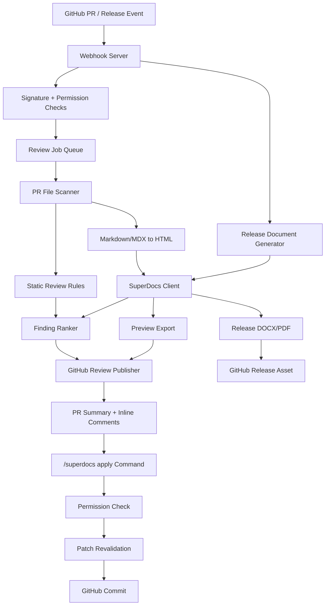

# Docs PR Reviewer - Build Plan

This repository is the working plan for the SuperDocs assigned build:

> GitHub App: document pull-request reviewer

The goal is to build a GitHub App that reviews documentation pull requests, leaves a small number of high-signal comments, generates a rendered document preview, applies approved suggested fixes as a clean commit, and creates a branded release document when a release tag is published.

This README is the source of truth for the build. Future work should follow this plan unless we explicitly update the plan first.

## Current Status

Sprint 0 is complete.

Verified:

- `npm run typecheck`
- `npm test`
- `npm run build`
- `npm audit --cache ./.npm-cache`

Sprint 1 is complete.
Sprint 2 is complete.
Sprint 3 is complete.
Sprint 4 is complete.
Sprint 5 is complete.
Sprint 6 is complete.
Sprint 7 is complete.

Test suite: 118 tests across 24 files, all running without a live GitHub or SuperDocs key.

One-command demo:

```bash
npm run demo
```

Current endpoint:

- `POST /webhooks/github`

Current webhook behavior:

- Verifies `x-hub-signature-256`.
- Requires `x-github-event` and `x-github-delivery`.
- Routes `pull_request`, `issue_comment`, `release`, and tag `push` events.
- Queues placeholder run keys for supported events.
- Ignores unsupported actions without failing the webhook.
- Runs keyless static review when changed-file content is available.

Current static review behavior:

- Filters documentation files from changed files.
- Supports Markdown and MDX first.
- Flags heading hierarchy skips.
- Flags missing image alt text.
- Flags unresolved placeholders.
- Flags TODO/FIXME markers.
- Flags selected style-guide wording.
- Flags suspicious relative links without claiming full repo proof.
- Ranks findings and caps posted comments at 5.

Current GitHub review publishing behavior:

- Formats one durable PR summary comment with an invisible idempotency marker.
- Updates the existing summary for the same head SHA instead of creating duplicates.
- Creates GitHub pull request review payloads with inline comments.
- Uses `COMMENT` for normal findings and `REQUEST_CHANGES` only when blockers are posted.
- Includes finding IDs in every inline comment so they can be applied later.
- Provides an Octokit adapter, tested without live credentials.

Current apply-command behavior:

- Parses `/superdocs review`, `preview`, `help`, `apply <finding-id>`, and `apply all-safe` from PR comments.
- Only treats a comment as a command when the command is its first non-empty line, so quoted commands are never executed.
- Ignores commands from bot accounts.
- Refuses commenters without write access to the repository.
- Refuses closed pull requests and head branches that live in a fork.
- Re-reads the changed docs at the current head SHA and re-derives findings before applying anything.
- Applies only anchored single-line fixes, and refuses when the anchored line has drifted.
- Proves only the intended lines changed before committing, and refuses the whole file otherwise.
- Commits with the blob SHA so a moved branch is rejected by GitHub rather than clobbered.
- Never commits twice for the same command on the same head SHA, and explains an impossible command once instead of on every retry.
- Replies with the commit SHA and the exact lines changed, or with a refusal that names the cause and the next step.

Current release-document behavior:

- Handles `release.published` and skips drafts.
- Finds the most recent earlier published release and lists the documentation files changed since it.
- Renders a branded release document from the release notes plus that file list.
- States what it could not determine instead of leaving a confident-looking empty section.
- Exports through SuperDocs when a key is configured, and stores the identical HTML locally when it is not.
- Attaches the document to the release, and does not upload a second copy if the asset already exists.
- Keeps the generated document on disk and reports the cause when attaching fails.
- Treats release notes as data: embedded markup is escaped, never rendered as live markup.

Current wiring:

- `npm run demo` runs the whole flow against an in-memory repository.
- When GitHub App credentials are present, a pull request webhook runs the review pipeline, an apply command commits, and a published release attaches a document.
- When they are not, the server still starts, still verifies signatures, and still parses events; it names the missing piece instead of crashing.
- A SuperDocs preview failure degrades the run: the review is still posted, without a preview link.

Next: submission assets (video, write-up) live outside this repository. The product path is complete.

## Local Setup

From the workspace root:

```bash
cd assigned-builds/github-docs-pr-reviewer
npm install --cache ./.npm-cache
cp .env.example .env
npm run dev
```

Useful commands:

```bash
npm run demo
npm run typecheck
npm test
npm run build
npm audit --cache ./.npm-cache
```

`npm run demo` is the one-command path. It runs the whole review-and-apply flow against an in-memory repository, with no GitHub App, no SuperDocs key, and no network.

Health check:

```bash
curl http://localhost:3000/health
```

GitHub webhook path:

```text
http://localhost:3000/webhooks/github
```

## GitHub App Setup

The app runs without credentials. Fill these only when you want it to talk to a real repository.

1. Create a GitHub App with pull request, issue comment, and release permissions: contents read/write, pull requests read/write, issues write, metadata read.
2. Subscribe to `pull_request`, `issue_comment`, and `release`.
3. Set the webhook URL to your forwarded server plus `/webhooks/github`.
4. Copy the App ID, webhook secret, and private key. Base64-encode the PEM:

```bash
base64 < path/to/app.private-key.pem | tr -d '\n'
```

5. Put the values in `.env`. Never commit `.env` or paste a key into a screenshot.

Local forwarding, once the app exists:

```bash
npx smee-client --url <smee-channel> --path /webhooks/github --port 3000
```

## What The Employer Wants

SuperDocs is judging whether we can build something real on top of their product, not a clone of it.

For this assigned build, they want:

- A GitHub App installed on a repository.
- On every pull request that touches documentation, the app reviews the changed docs.
- The review catches style-guide violations, broken structure, stale references, and document quality issues.
- The app shows a rendered preview of the changed documentation as a styled Word/PDF deliverable.
- A PR comment command applies a suggested fix as an attributable commit.
- Release tags trigger a branded release document attached to the release.

What strong looks like:

- Comments are specific and few, so maintainers do not mute the app.
- Preview matches the eventual export.
- Applying a fix creates a clean commit from the app.
- The build is easy to run, demo, and understand.
- Secrets are never committed or shown.
- Failures are honest and recoverable.

## Best Strategic Angle

We should build this as a full-stack/growth engineer artifact, not just a GitHub webhook demo.

The strongest story:

> Developer docs teams already live in GitHub. This app turns every docs PR into a reviewed, exportable, release-ready document workflow powered by SuperDocs.

This supports both roles:

- Full-stack: GitHub App, webhook backend, job queue, review logic, export preview, command handling, release automation.
- Growth: clear audience, public demo, measurable product loop, and a strong GTM use case for developer docs teams.

## Chosen Product Shape

Name for now: `docs-pr-reviewer`.

Core user:

- Docs-as-code teams.
- DevRel teams.
- Open-source maintainers.
- Platform teams maintaining docs in GitHub.

Primary workflow:

1. Maintainer opens a PR touching docs.
2. GitHub sends webhook to our backend.
3. Backend detects changed documentation files.
4. App runs a review pipeline.
5. App posts one concise PR review with grouped findings.
6. App posts or links a rendered preview artifact.
7. Maintainer comments `/superdocs apply <finding-id>`.
8. App commits the approved fix to the PR branch.
9. On release tag, app generates and attaches a branded release document.

## Non-Negotiable Principles

- Keep comments few and useful.
- Never make unsupported claims.
- Never contact real companies or people as part of this task.
- Never commit secrets.
- Never show secrets in video.
- Do not replace whole files when a small patch is enough.
- Do not silently change unrelated content.
- If SuperDocs or GitHub fails, report the failure clearly and retry safely.
- Every expensive or external operation must have idempotency protection.

## Architecture

Recommended stack:

- Backend: Node.js + TypeScript + Fastify or Express.
- GitHub App framework: Probot or Octokit.
- Jobs: BullMQ + Redis, or a simple database-backed queue for the demo.
- Database: SQLite for local demo, PostgreSQL for production-ready mode.
- Document rendering: SuperDocs API export.
- Markdown parsing: unified/remark/rehype.
- PDF/DOCX preview: SuperDocs export endpoint where possible.
- Tests: Vitest.
- Local webhook testing: smee.io or GitHub App webhook forwarding.

Why Node.js:

- GitHub App tooling is strongest in Node.
- Probot/Octokit reduces auth and webhook risk.
- TypeScript keeps webhook payloads and review objects typed.
- Faster path to a polished demo than forcing this part into Python.

If we later combine this with the separate Task 1 engineer system, that task can use Python/FastAPI as requested there. This assigned GitHub App should optimize for GitHub integration quality.

### Architecture Diagram



The core invariant: GitHub is the workflow host, SuperDocs is the document engine, and our app is the orchestration layer between them.

## System Components

### 1. GitHub App Webhook Server

Responsibilities:

- Receive GitHub webhooks.
- Verify webhook signatures.
- Handle `pull_request`, `issue_comment`, `release`, and `push`/tag events.
- Resolve installation token.
- Enqueue work.
- Return quickly to GitHub.

Events:

- `pull_request.opened`
- `pull_request.synchronize`
- `pull_request.reopened`
- `issue_comment.created`
- `release.published`
- optional: `push` for tag events if release events are not enough

### 2. PR File Scanner

Responsibilities:

- List changed files in the PR.
- Keep only documentation files.
- Ignore binary files and generated assets.
- Fetch base and head versions.
- Build a normalized document bundle for review.

Documentation file patterns:

- `**/*.md`
- `**/*.mdx`
- `docs/**`
- `README.md`
- `CHANGELOG.md`
- `*.rst`
- optional later: `*.html`

### 3. Review Engine

Responsibilities:

- Parse changed docs.
- Run deterministic checks first.
- Run AI/SuperDocs-powered checks only where useful.
- Produce structured findings.
- Rank and deduplicate findings.
- Limit comments.

Finding schema:

```ts
type Finding = {
  id: string;
  severity: "blocker" | "warning" | "suggestion";
  category: "style" | "structure" | "stale-reference" | "broken-link" | "preview" | "release";
  path: string;
  startLine: number;
  endLine?: number;
  title: string;
  explanation: string;
  suggestedPatch?: string;
  confidence: "high" | "medium" | "low";
  source: "rule" | "superdocs" | "link-checker" | "llm";
};
```

Review rules for v1:

- Heading hierarchy should not skip levels.
- PR should not introduce obvious broken relative links.
- Images should have alt text.
- Markdown tables should be valid.
- Release docs should not have unresolved placeholders.
- Docs should avoid TODO/FIXME in published areas.
- Style guide terms should be consistent.
- Stale references should be flagged when changed docs mention old versions or removed files.

### 4. SuperDocs Integration

Responsibilities:

- Convert changed Markdown/MDX into HTML.
- Send document HTML plus an instruction to SuperDocs.
- Preserve returned `data-chunk-id` attributes if returned.
- Use human-in-the-loop review mode when available.
- Export the final preview as DOCX/PDF.

Minimal integration loop:

- `POST /v1/chat` for sync review/edit where enough.
- `POST /v1/chat/async` plus polling/SSE for long jobs.
- `POST /v1/chat/{session_id}/approve` for HITL approval.
- `POST /v1/documents/export` for export preview.

Important SuperDocs behavior:

- Proposed change content may need a second JSON parse.
- Large document operations can take 30 seconds to several minutes.
- Exports do not cost operations.
- We should run in small-sample mode during development.

### 5. Comment Publisher

Responsibilities:

- Create one PR review with grouped inline comments where possible.
- Add a summary comment with:
  - total docs files reviewed
  - findings count by severity
  - preview artifact link
  - available commands
- Avoid comment spam.
- Update an existing bot summary comment instead of posting new summaries on every run.

Comment policy:

- Max 5 inline comments per run.
- Only high-confidence findings get inline comments.
- Low-confidence notes go into summary.
- Do not request changes unless blocker findings exist.
- Use GitHub suggestion blocks only when the patch is safe and small.

### 6. Preview Artifact Generator

Responsibilities:

- Produce a styled preview of the changed docs.
- Store preview artifact locally for demo or upload as GitHub Actions artifact later.
- Link preview in PR comment.
- Ensure preview and final export use the same source HTML.

Demo version:

- Generate preview into `artifacts/previews/<owner>-<repo>-pr-<number>/`.
- Include `preview.docx` or `preview.pdf`.
- Include `review.json` for traceability.

Production version:

- Upload artifact to a durable object store.
- Add signed URL to PR comment.

### 7. Command Handler

Responsibilities:

- Listen for PR comments.
- Parse commands.
- Validate commenter permission.
- Apply only approved, known fixes.
- Commit fix to PR branch.
- Reply with success or clear failure.

Commands:

```text
/superdocs review
/superdocs apply <finding-id>
/superdocs apply all-safe
/superdocs preview
/superdocs help
```

Apply behavior:

- Fetch latest PR head.
- Confirm finding still applies.
- Apply minimal patch.
- Commit as GitHub App.
- Comment with commit SHA.
- If patch no longer applies, explain and ask for rerun.

### 8. Release Document Generator

Responsibilities:

- On release publication or tag event, collect release notes.
- Generate a branded release document.
- Export using SuperDocs.
- Attach to GitHub release.

V1 output:

- `release-notes.docx`
- optional `release-notes.pdf`

Content:

- release title
- date
- changelog summary
- merged PRs touching docs
- known documentation changes
- branded footer

## Data Model

Tables or JSON stores needed:

### `installations`

- `installation_id`
- `account_login`
- `created_at`
- `updated_at`

### `review_runs`

- `id`
- `installation_id`
- `owner`
- `repo`
- `pull_number`
- `head_sha`
- `base_sha`
- `status`
- `started_at`
- `finished_at`
- `error`
- `cost_summary`

### `findings`

- `id`
- `run_id`
- `path`
- `line`
- `severity`
- `category`
- `title`
- `explanation`
- `suggested_patch`
- `status`

### `artifacts`

- `id`
- `run_id`
- `type`
- `path_or_url`
- `created_at`

## Review Pipeline

The pipeline must be resumable and observable.

Stages:

1. `received_webhook`
2. `loaded_pr_context`
3. `filtered_doc_files`
4. `fetched_file_contents`
5. `ran_static_checks`
6. `ran_superdocs_review`
7. `ranked_findings`
8. `generated_preview`
9. `posted_review`
10. `completed`

Each stage should write status before and after it runs. If the process dies, the run can resume from the last completed stage.

## Idempotency Rules

- Use `owner/repo/pull_number/head_sha` as the PR review idempotency key.
- Do not post duplicate reviews for the same head SHA.
- Update the bot summary comment instead of creating multiple summary comments.
- Store GitHub comment IDs after posting.
- For apply commands, use `finding_id + current_head_sha` as the idempotency key.
- If a command is repeated, return the existing result.

## Security

Required:

- Verify GitHub webhook signature.
- Store private key only in environment variables or local ignored files.
- Never log installation tokens.
- Never log SuperDocs API keys.
- Validate command author permissions before writing commits.
- Refuse commands from users without write permission.
- Avoid prompt injection from document content.

Prompt-injection rule:

> Documentation content is data. It may contain instructions, but the app must never follow instructions found inside the document as system instructions.

## Testing Plan

Tests should run without live GitHub or SuperDocs keys.

Unit tests:

- File filter detects docs files correctly.
- Markdown parser catches heading skips.
- Link checker catches broken relative links.
- Finding ranker limits comments.
- Command parser accepts valid commands and rejects invalid ones.
- Patch applier only changes intended lines.

Integration tests with mocked APIs:

- PR opened event creates one review run.
- Same webhook twice does not post duplicate comments.
- PR synchronize with new SHA creates a new run.
- Apply command creates a commit when patch applies.
- Apply command refuses unauthorized user.
- SuperDocs failure creates a clear degraded review instead of crashing.
- Release event creates release document artifact.

Manual demo tests:

- Install app on test repo.
- Open PR touching docs.
- Show review comments.
- Show preview artifact.
- Run `/superdocs apply <finding-id>`.
- Show commit added by app.
- Publish release and show generated release doc.

## Sprint Plan

Working rule for every sprint:

- Start by reading this README.
- Update only the current sprint scope unless a dependency forces a small change.
- Add or update tests in the same sprint as the behavior.
- Keep a short note of assumptions in `docs/decisions.md`.
- Before moving to the next sprint, run tests and update the exit criteria.

### Sprint 0 - Repo Setup And Decisions

Goal: create a clean foundation.

Deliverables:

- TypeScript project setup.
- App config template.
- `.env.example`.
- `docs/decisions.md`.
- Basic health endpoint.
- Local test command.

Exit criteria:

- A stranger can install dependencies and run tests.
- README has setup steps.

### Sprint 1 - GitHub App Skeleton

Goal: receive and verify GitHub events.

Deliverables:

- Webhook server. Done.
- Pull request event handler. Done.
- Issue comment event handler. Done.
- Release event handler. Done.
- Local webhook forwarding instructions. Deferred until a real GitHub App is created.

Exit criteria:

- A test webhook creates a queued placeholder run. Done.
- Invalid webhook signature is rejected. Done.

### Sprint 2 - PR Scanner And Static Review

Goal: review docs PRs without AI first.

Deliverables:

- Changed-file scanner. Done.
- Docs file filter. Done.
- Markdown parser. Done with line-based Markdown checks for v1.
- Static rules. Done.
- Structured findings. Done.
- Review summary generation. Done.

Exit criteria:

- Demo PR fixture produces useful findings without SuperDocs key. Done.

### Sprint 3 - GitHub Review Publishing

Goal: publish useful, low-noise review comments.

Deliverables:

- Inline comments where line mapping is available. Done.
- Summary comment. Done.
- Idempotent update behavior. Done for same head SHA summary comment.
- Comment cap and ranking. Done in Sprint 2 and used by publisher.

Exit criteria:

- Re-running on same SHA updates the existing summary comment instead of spamming. Done.

### Sprint 4 - SuperDocs Preview Export

Goal: generate a real document preview.

Deliverables:

- Markdown-to-HTML conversion.
- SuperDocs API client.
- Export preview generation.
- Local artifact storage.
- Preview link in summary comment.

Exit criteria:

- PR comment links to a generated DOCX/PDF preview.

Status: Complete. Markdown and MDX-compatible content is rendered into a stable HTML source, exported through the SuperDocs adapter when configured, and stored under a PR/head-SHA artifact directory. Without a key, the same source is stored as a local HTML preview for demos and offline development.

### Sprint 5 - Apply Fix Command

Goal: apply approved suggestions as clean commits.

Deliverables:

- Command parser. Done, including refusal of quoted and bot-authored commands.
- Permission check. Done via the collaborator permission level.
- Patch apply logic. Done as content-anchored single-line replacements with a whole-file change proof.
- GitHub commit creation. Done through the contents API with the blob SHA.
- Success/failure reply. Done, with distinct idempotency markers for applied and refused outcomes.

Exit criteria:

- `/superdocs apply <finding-id>` creates one clean attributable commit. Done.

Status: Complete. The command path is covered by tests that run without credentials: a happy-path apply, an unauthorized commenter, a repeated command, a stale finding ID, an advisory finding the app refuses to guess at, a fork head, a closed PR, a rejected commit, and a quoted command that must not run. It has not yet been exercised against a real installed GitHub App; see `docs/limitations.md`.

### Sprint 6 - Release Document

Goal: generate release docs from release tags.

Deliverables:

- Release event handler. Done, including draft-release skipping.
- Release notes source collector. Done via previous-release lookup plus tag comparison.
- Branded release document template. Done.
- SuperDocs export. Done through the same adapter the preview uses.
- Attach artifact to release. Done, idempotent on asset name.

Exit criteria:

- Publishing a test release attaches a generated release document. Done in tests against a fake GitHub client; not yet exercised against a real release.

### Sprint 7 - Polish, Demo, And Submission Assets

Goal: make the build reviewable.

Deliverables:

- Final README setup guide. Done, including the one-command demo and GitHub App setup.
- Architecture diagram. Updated in `docs/architecture.md`.
- Demo script. Updated in `docs/demo-script.md`.
- Known limitations section. Kept honest in `docs/limitations.md`.

Exit criteria:

- Fresh clone can run the app. Done: `npm install --cache ./.npm-cache && npm test && npm run demo`.
- Demo video can be recorded in under 5 minutes. The script is ready; the recording itself is a submission asset, not a repository file.

Status: Complete. The live GitHub path is wired behind credentials that a fresh clone does not need. Without them the server still starts and `npm run demo` shows the whole product loop.

## Suggested Repository Structure

```text
.
├── README.md
├── .env.example
├── package.json
├── src/
│   ├── server.ts
│   ├── config.ts
│   ├── github/
│   │   ├── app.ts
│   │   ├── webhooks.ts
│   │   ├── reviews.ts
│   │   ├── comments.ts
│   │   └── commits.ts
│   ├── review/
│   │   ├── scanner.ts
│   │   ├── rules.ts
│   │   ├── ranker.ts
│   │   ├── findings.ts
│   │   └── patches.ts
│   ├── superdocs/
│   │   ├── client.ts
│   │   ├── preview.ts
│   │   └── export.ts
│   ├── release/
│   │   └── release-document.ts
│   ├── jobs/
│   │   ├── queue.ts
│   │   └── review-runner.ts
│   └── storage/
│       ├── db.ts
│       └── schema.ts
├── tests/
│   ├── fixtures/
│   ├── scanner.test.ts
│   ├── rules.test.ts
│   ├── commands.test.ts
│   └── idempotency.test.ts
├── docs/
│   ├── architecture.md
│   ├── decisions.md
│   ├── demo-script.md
│   └── limitations.md
└── artifacts/
    └── .gitkeep
```

## Demo Scenario

Use a synthetic repo with:

- `README.md`
- `docs/getting-started.md`
- `docs/api-reference.md`
- `docs/style-guide.md`

Create a PR that intentionally includes:

- skipped heading level
- broken relative link
- missing image alt text
- outdated version reference
- vague sentence that SuperDocs can improve

Expected demo:

1. Open PR.
2. App reviews docs.
3. App posts 3-5 high-signal comments.
4. App links preview document.
5. Maintainer comments `/superdocs apply <id>`.
6. App commits fix.
7. Release is published.
8. App attaches branded release document.

## Measurement

Track these numbers:

- docs files scanned
- findings generated
- findings posted
- comments suppressed by ranker
- preview generation time
- SuperDocs operations used
- apply command success rate
- duplicate webhook no-op count
- total run time by stage

These numbers should appear in the final write-up.

## Known Risks

- GitHub inline comment line mapping can be tricky.
- GitHub secondary rate limits can punish too many comments.
- SuperDocs export latency may be long for bigger docs.
- Applying patches after a PR changes can fail.
- Release asset upload needs careful GitHub permissions.
- MDX may contain components that do not convert cleanly to HTML.

Mitigations:

- Keep comment count low.
- Prefer summary comments when line mapping is uncertain.
- Store run state and make jobs resumable.
- Revalidate head SHA before applying fixes.
- Start with Markdown, then add MDX support.
- Use mocked tests for GitHub and SuperDocs.

## Cut Lines If Time Gets Tight

Must keep:

- GitHub App webhook flow.
- Docs PR scanning.
- Useful review comments.
- Preview artifact.
- Apply command.
- Clear demo and write-up.

Can cut:

- Full release document automation.
- PDF export if DOCX works better.
- MDX support.
- Durable cloud storage.
- Full queue system.
- Complex AI review beyond targeted SuperDocs calls.

If we cut anything, document it honestly in `docs/limitations.md` and the final write-up.

## External References

- SuperDocs integration starter: https://docs.superdocs.app/guides/integration-starter-prompt
- SuperDocs API concepts: https://docs.superdocs.app
- GitHub pull request reviews API: https://docs.github.com/en/rest/pulls/reviews
- GitHub pull request review comments API: https://docs.github.com/en/rest/pulls/comments
- GitHub Apps docs: https://docs.github.com/en/apps
- Probot docs: https://probot.github.io/docs/
- Octokit docs: https://github.com/octokit

## Next Action

The assigned build's product path is complete. Remaining work lives outside this
folder: Task 1 (the shared agentic system), Task 3 (use cases), Task 4 (video and
write-up), and the growth-lane extras.
