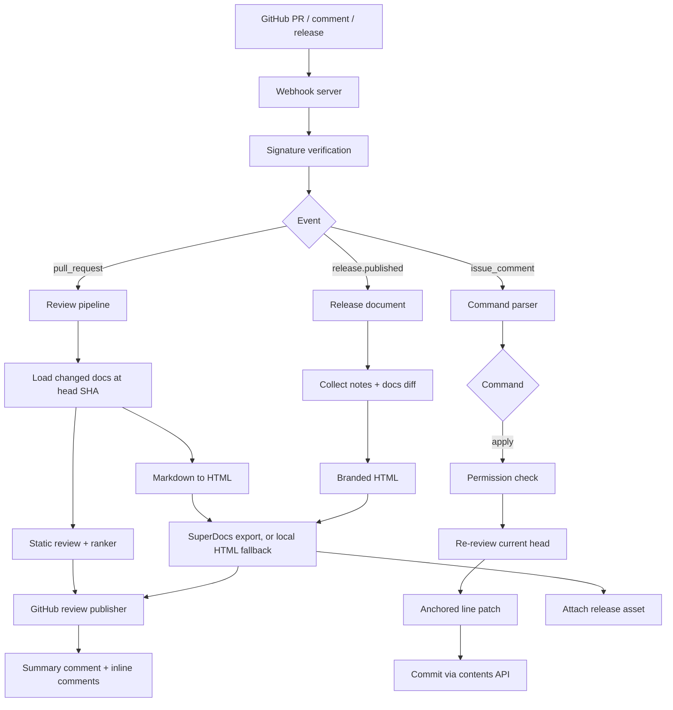

# Architecture

GitHub is the workflow host. SuperDocs is the document engine. This app is the
orchestration layer between them.

## Runtime Surface

- `GET /health`
- `POST /webhooks/github`

The webhook verifies `x-hub-signature-256` before parsing anything.

## What Runs Without Credentials

A fresh clone can:

- install, typecheck, test, and build
- run `npm run demo`, which drives the real review and apply pipeline against an in-memory repository

Without GitHub App credentials the server still starts. It verifies signatures and
parses events, and it names the missing piece instead of crashing. SuperDocs is
the same: without a key, previews and release documents are the same HTML a real
export would use, stored locally.

## Modules

Review:

- `src/review/scanner.ts` — which changed files are documentation
- `src/review/rules.ts` — deterministic Markdown checks
- `src/review/ranker.ts` — cap of five posted findings
- `src/review/patches.ts` — content-anchored single-line replacements

Commands:

- `src/commands/parser.ts` — `/superdocs ...` with injection-resistant parsing
- `src/commands/apply-runner.ts` — permission, revalidation, commit, reply

Preview and release:

- `src/preview/` — HTML conversion, artifact storage, SuperDocs export
- `src/release/` — notes collector, branded document, attach-to-release

GitHub:

- `src/github/events.ts` — routing
- `src/github/app-auth.ts` — installation tokens, never logged
- Octokit adapters behind interfaces, so tests never need a key

Pipeline:

- `src/pipeline/review-pipeline.ts` — one PR head, timed stages, preview degradation
- `src/pipeline/dependencies.ts` — composition root
