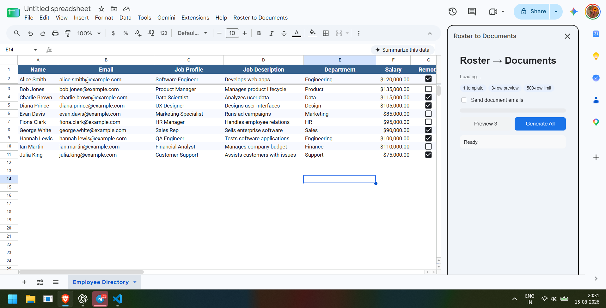
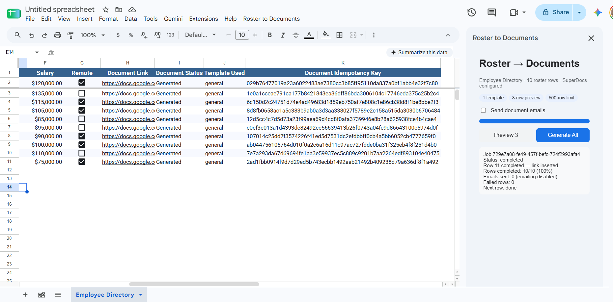

# Roster to Documents

Built by Purujeet for the SuperDocs task.

## Screenshots

The add-on running in Google Sheets with the roster data and generated document results:





A Google Sheets add-on that turns a roster into role-specific documents. It reads one record per row, routes each record to one of ten document templates, renders placeholders and conditional sections deterministically, sends the resulting HTML through SuperDocs for AI document refinement, exports the final document, writes the file link back to the originating row, and can email the recipient.

## What it does

1. Reads a roster from the active Google Sheet.
2. Uses deterministic aliases/keywords to choose one of ten job-family templates.
3. Renders placeholders and conditional sections without AI so repeated runs are predictable.
4. Uses SuperDocs chat editing for document refinement, including one-time generation/refinement of the ten role templates, and the SuperDocs export API for DOCX output.
5. Previews the first three rows before a full run.
6. Processes large jobs in resumable batches.
7. Writes each document link back to the exact source row.
8. Reports row-level failures instead of silently skipping them.
9. Optionally sends each generated document link by Gmail.

## SuperDocs features used

- Chat editing: `POST /v1/chat`
- Async job API: `POST /v1/chat/async` and `GET /v1/jobs/{job_id}`
- Approval endpoint: `POST /v1/chat/{session_id}/approve`
- Document export: `POST /v1/documents/export`

The integration keeps the SuperDocs API key server-side in Apps Script Script Properties.

## Local development

Requirements:

- Node.js 20+
- Google account
- `@google/clasp`

```bash
npm install
npm install -g @google/clasp
clasp login
npm run build
```

For local development, create a Google Sheet, open **Extensions → Apps Script**, and use that container-bound Apps Script project. Google documents container-bound Sheets scripts as a supported Apps Script project type. `clasp` can clone/pull/edit an existing bound project locally.

After creating the project, connect it to this folder with `clasp` and keep the generated `.clasp.json` local.

Push to Apps Script:

```bash
npm run push
```

## Configuration

Set the SuperDocs key from Google Sheets using **Extensions → Roster to Documents → Settings**. Paste the key into the textbox and choose **Save key**. It is stored in Apps Script Script Properties and is not included in the spreadsheet or source code.

For manual setup, use:

```javascript
PropertiesService.getScriptProperties().setProperty('SUPERDOCS_API_KEY', 'your-key-here');
```

Optional document defaults:

- `OUTPUT_FOLDER_ID` — Drive folder for generated documents.
- `TEMPLATE_FOLDER_ID` — Drive folder for AI-generated/refined templates. If omitted, the extension creates `Roster to Documents Templates` on first template generation.
- `ROSTER_TEMPLATE` — use `auto` for row-by-row routing, or set a specific template id (for example `software-engineer`) to force one template for every row. An empty or invalid value also falls back to automatic routing.
- In `auto` mode, the first preview scans distinct job profiles in the sheet, generates and caches a SuperDocs template for each profile, and routes matching rows to the cached template.
- `EMAIL_ENABLED` — `true` or `false`.

Never commit a real API key. The repository explicitly prohibits secrets. 

## Sheet contract

Row 1 contains headers. Common columns are:

- `Name`
- `Email`
- `Job Profile`
- `Job Description`
- `Department`
- `Salary`
- `Remote`
- `Document Link`
- `Document Status`
- `Template Used`

The add-on tolerates extra columns and will use whichever columns are available.

## Template syntax

Simple placeholders:

```text
{{Name}}
{{JobProfile}}
{{Department}}
```

Conditional sections:

```text
{{#if Department == "Engineering"}}
Engineering-specific content
{{/if}}
```

Supported condition operators are `==`, `!=`, `>`, `>=`, `<`, `<=`, plus truthiness checks such as `{{#if Remote}}`.

## Deployment notes

Google Apps Script projects can be developed locally with `clasp`. The generated Apps Script project should be the deployment source of truth for the add-on. Keep `.clasp.json` local and do not commit it.

## Status

This is the initial PR-ready MVP. The deterministic template engine, ten-template library, SuperDocs API wrapper, Sheets/Drive/Gmail integrations, preview flow, and resumable job state are implemented. The next hardening pass should add automated tests against a live Apps Script test spreadsheet and a SuperDocs sandbox account.
