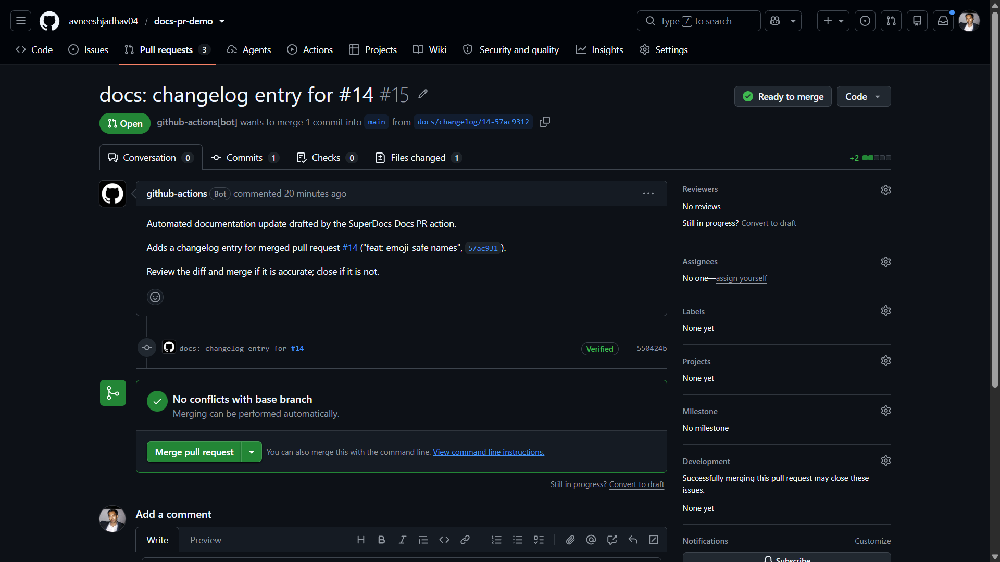
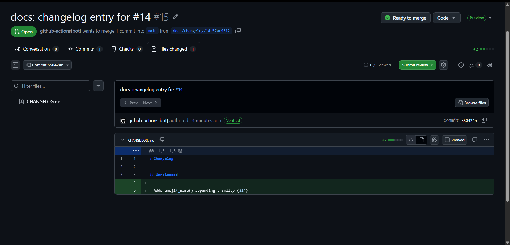

# SuperDocs Docs PR Action

A GitHub Action that drafts a documentation update with SuperDocs when a pull
request is merged, and opens a pull request with the diff for human review.
When nothing needs saying, it says nothing: the action skips entirely.

Built for the SuperDocs task (round 2, engineer track).

## What it does

On `pull_request` closed + merged:

1. Decides whether the merge needs a documentation update at all.
2. If yes, asks SuperDocs to add one changelog entry for the merged PR.
3. Approves the proposed change (the machine drives the review gate) and
   exports the finished file.
4. Opens a pull request containing only that diff, for a human to review.

## Screenshots

The docs PR the action opened automatically after merging PR #14 on the demo
repository, and the changelog diff it drafted via SuperDocs — one entry,
nothing else touched:





## When it skips

The action exits silently (success) when nothing needs saying:

- the merged PR changed only documentation (`.md`, `.rst`, `.txt`, `.adoc`,
  or anything under `docs/`, `documentation/`, `doc/`),
- the merged PR changed only the doc file itself,
- the PR title or body matches a skip pattern (`[skip-docs]`, `no-docs`, ...),
- SuperDocs produced no change (export byte-identical to the current file),
- the doc already mentions the merged PR number,
- a docs PR for this merge is already open (idempotency).

## How to use it

> **Setup requirement:** enable **Settings -> Actions -> General -> Workflow
> permissions -> "Allow GitHub Actions to create and approve pull requests"**.
> Without it, GitHub rejects the docs PR with 403.

```yaml
name: Draft documentation PR on merge

on:
  pull_request:
    types: [closed]

permissions:
  contents: write
  pull-requests: write

jobs:
  docs-pr:
    if: github.event.pull_request.merged == true
    runs-on: ubuntu-latest
    steps:
      - name: Draft documentation PR
        uses: avneeshjadhav04/superdocs-docs-pr-action@v1
        with:
          superdocs_api_key: ${{ secrets.SUPERDOCS_API_KEY }}
          github_token: ${{ secrets.GITHUB_TOKEN }}
          doc_path: CHANGELOG.md
```

### Inputs

| Input | Required | Default | Description |
| --- | --- | --- | --- |
| `superdocs_api_key` | yes | — | SuperDocs API key (`sk_...`). Store as a repository secret. |
| `github_token` | no | `github.token` | Token used to open the docs PR. Use a PAT if the PR must trigger other workflows. |
| `doc_path` | no | `CHANGELOG.md` | Documentation file the action maintains. |
| `base_branch` | no | merged PR's base | Branch the docs PR targets. |
| `skip_patterns` | no | `skip-docs,no-docs` | Comma-separated regexes; a match on the merged PR title/body skips the run. |
| `dry_run` | no | `false` | Print every decision without calling the API, writing files, or opening a PR. |

## How it works

- **SuperDocs surface:** REST API, the four-call contract — upload
  (`POST /v1/documents/upload`), edit instruction (`POST /v1/chat/async` with
  `approval_mode: ask_every_time`), approve (`POST /v1/chat/{session}/approve`),
  export (`POST /v1/documents/export`). The same four operations exist as MCP
  tools (`upload_document`, `chat_async`, `approve_changes`, `export_document`);
  the action uses REST because a CI runner has no MCP server dependency.
- **Review:** the machine approves the proposed change (the gate is an
  operation the flow exposes), and the human review is the pull request itself.
- **Prompt safety:** the merged PR's title and body are untrusted data. They
  are quoted into the instruction as data to summarize, never as instructions
  to follow, and the edit is scoped to a single changelog entry.
- **Cost:** one run is 1–2 operations (chat + export; exports are free).
  `dry_run: true` previews a run without spending anything.

## Development

```bash
pip install -r requirements.txt
python -m pytest tests/ -q
```

All tests run without a live API key: the SuperDocs client and the GitHub
client are mocked, and the decision logic is tested directly.

## Dependencies and licensing

The only runtime dependency is `requests` (Apache-2.0). GitHub operations
(branch, commit, PR) go through the GitHub REST API directly via
`src/github_client.py` — no PyGithub, no copyleft dependencies. The project
is MIT-licensed.

## What it does not do

- It does not edit code, open issues, or touch anything outside the doc file.
- It does not auto-merge the docs PR; a human reviews and merges it.
- It does not run on PRs that are closed without merging.
- It does not guarantee the changelog entry is accurate — SuperDocs summarizes
  the merged PR, and the human review is the safety net.

## Credits

Built by Avneesh Jadhav for the SuperDocs hiring task (round 2). Uses the
SuperDocs REST API (docs.superdocs.app).
