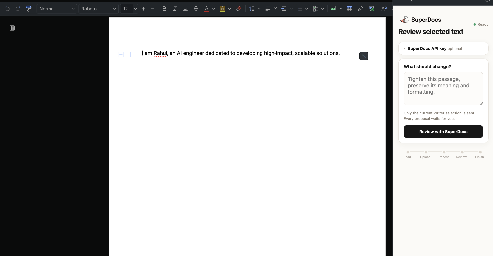
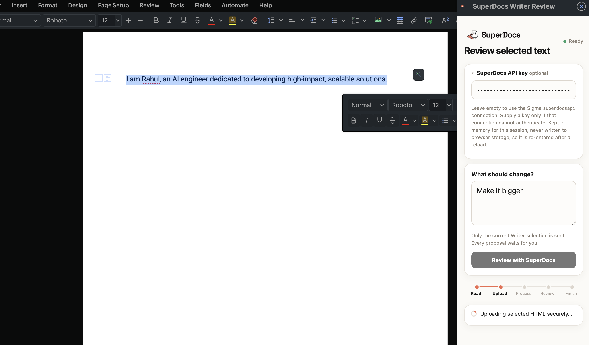
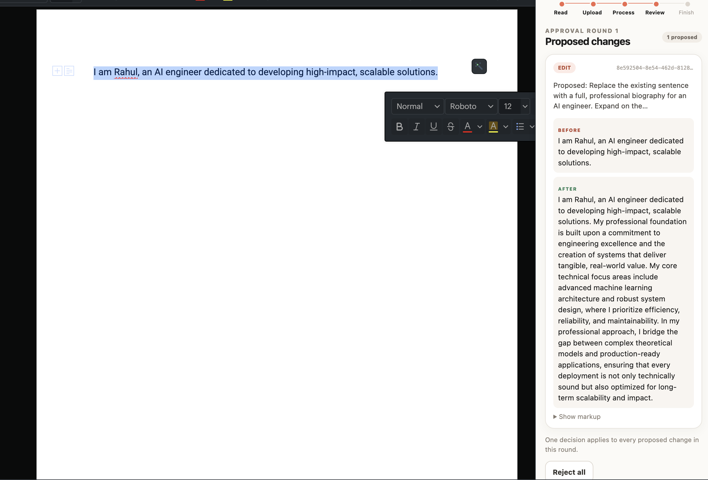

# SuperDocs Review for Zoho Writer

A narrow Zoho Writer right-sidebar extension for reviewing AI edits to the current selection. It uploads selected HTML, starts an asynchronous `ask_every_time` chat, polls the durable job, handles item-level mixed approval and continue prompts, and exports the approved SuperDocs session.

**Screenshot evidence:**

| Select and review | Uploading | Proposed change (before/after) |
| --- | --- | --- |
|  |  |  |

**Demo evidence:** [Watch the demo video](https://drive.google.com/file/d/1zP3ij-ZSX2ZqNcqIhvem2cQq_IvfET-a/view?usp=sharing)

## Current capability

- Persistent `writer.extensions` sidebar with visible Read → Upload → Process → Review → Finish stages.
- SuperDocs calls through `SigmaSDK.WRITER.request`, using the named `superdocsapi` connection by default and an in-memory user-supplied key as a documented fallback (see [Transport and the connection fallback](#transport-and-the-connection-fallback)).
- Item-level accept/reject cards, repeated approval rounds, and `metadata.awaiting_kind=continue_prompt`.
- Stage-aware retry and reload recovery: once a job ID exists, the extension stores only the opaque session/job IDs plus gate status and resumes that job without another upload/chat.
- Usage, progress, errors, DOCX export, and separately tested polling/SSE normalization.

Writeback into the document is attempted, guarded, and honestly reported —
see [Applying to the document](#applying-to-the-document). Nothing is written
unless the selection still holds exactly the passage that was reviewed.

## Exact setup

Prerequisites: Node.js `>=20.19 <21` or `>=22.12` (matching `package.json` and the locked Vite/jsdom toolchain), npm, a Zoho Sigma workspace with a Writer extension, and a SuperDocs API key.

1. Install and verify:

   ```bash
   npm install
   npm test
   npm run package:sigma
   ```

   The default command creates `release/zoho-writer-superdocs-source.zip`. This is a **source import bundle, not a directly installable configured extension**. For Sigma's ZIP importer, it places `plugin-manifest.json` at archive root and widget assets under `app/dist/`. It intentionally has no connector.

2. In Zoho Sigma, create or open a **Zoho Writer** extension.
3. In Sigma **Connections**, create a custom service named `superdocs`:
   - Base URL/domain: `https://api.superdocs.app`
   - Authentication type: API key
   - Request header: `Authorization`
   - Value format: `Bearer <key>`
   - Connection link name: `superdocsapi`
   - Use login-user credentials when each installed user supplies their own key.
4. Keep Sigma's generated connector configuration and credentials outside this repository:
   - export the target workspace's complete `connectors` array;
   - save `{ "connectors": [...] }` as ignored `config/connector.workspace.json`;
   - verify it contains `connectionLinkName: "superdocsapi"` and no API key/token fields.
5. Build a workspace-specific bundle:

   ```bash
   npm run package:sigma:workspace
   ```

   This creates `release/zoho-writer-superdocs-workspace.zip`. The packager merges the ignored overlay into the packaged manifest in memory, does not copy the overlay file, rejects credential-looking fields/values, and validates every manifest target.
6. Import the workspace bundle into Sigma. The packaged manifest is at archive root and uses Sigma's canonical `/app/index.html` path plus assets under `/app/img/`.
7. Confirm `https://api.superdocs.app` remains in `whiteListedDomains`, authorize the connection in Sigma, and run the extension.
8. Open a Writer document, select a passage, and open **SuperDocs Review** in the right sidebar.

The browser extension does not read `.env`. `.env.example` exists only for the opt-in Node live smoke test.

## Architecture

```text
Writer SelectedContent (HTML snapshot)
          │
          ▼
SigmaSDK.WRITER.request
  ├─ default: named connection "superdocsapi"
  └─ fallback: explicit Bearer header, then direct fetch
          │
          ├─ POST /v1/documents/upload
          ├─ POST /v1/chat/async (approval_mode: ask_every_time)
          ├─ GET  /v1/jobs/{id}
          ├─ POST /v1/chat/{session}/approve
          ├─ POST /v1/chat/{session}/continue
          └─ POST /v1/documents/export
                         │
                         ▼
      approved download (.docx, else .html — see below)

Writer host document: written only via a guarded selection replace
```

- `src/api.ts`: exact request contracts, URL encoding, transport selection (named connection or explicit key, with a direct-fetch fallback), upload, approve, continue, polling, and export.
- `src/normalizers.ts`: polling wrappers, encoded pending changes, operation allow-listing, continue prompts, usage, and separately framed/double-encoded SSE data.
- `src/workflow.ts`: durable active session/job context, approval and continue gates, resumable polling, and explicit host-writeback block policy.
- `src/state.ts`: validated browser persistence containing only session ID, job ID, active status, and optional awaiting kind.
- `src/view.ts`: proposal cards built with DOM APIs and `textContent`; no external field is interpolated into HTML. Each card shows the proposed *wording* (text extracted from the untrusted markup by parsing it in a detached document, which runs no scripts and is never attached) with the raw markup behind a "Show markup" toggle.
- `scripts/package.mjs`: creates and validates distinct source/workspace Sigma bundles in the documented layout.

## Transport and the connection fallback

The intended transport is the named `superdocsapi` connection, because the key
then never reaches the browser. In the workspace used for this build that path
could not authenticate, so the extension supports a second, explicit transport.

What was measured, in this one workspace:

- A connectionless `SigmaSDK.WRITER.request` to `https://api.superdocs.app/health`
  **succeeds**, so Sigma can reach the host and the domain allowlist is correct.
- Every request carrying `connectionLinkName: "superdocsapi"` **fails**, returning
  only `{message: "failed"}` with no status code.
- The same API key drives the full upload → chat → approve → export flow to
  completion **outside** Zoho over plain HTTPS, which is what isolates the failure
  to the connection's credential injection rather than the key, the account, the
  request shape, or the SuperDocs API.
- The connection reports **Connected**, its link name is exactly `superdocsapi`,
  and its service defines `Parameter Type: Header` with `Parameter Key:
  Authorization`. The value was tried both as `Bearer sk_…` and as a bare
  `sk_…`, and the connection was deleted and recreated with
  "Use credentials of login user" both on and off. None of that changed the result.

I could not find published documentation for how the widget-side request client
resolves a named connection, so I cannot say whether this is a misconfiguration I
have not found, a limitation of calling connections from a widget rather than a
server-side Deluge function, or a platform defect. It is reported to Zoho and
stated here as unresolved rather than diagnosed.

Given that, the sidebar accepts a SuperDocs API key:

- Leave it empty and the named connection is used exactly as before.
- Supply one and the `Authorization: Bearer …` header is set explicitly, the
  connection is not referenced, and if Sigma refuses to relay a client-supplied
  auth header the call is retried as a direct browser `fetch` (which is why
  `api.superdocs.app` is also listed in `cspDomains.connect-src`).

The honest trade-off: a key entered in the sidebar is readable by the widget's own
JavaScript, which the connection transport avoids. It is therefore opt-in, held in
a module variable, never written to browser storage, and re-entered after a reload.
Prefer the connection wherever it works.

## Applying to the document

The approved wording can be written back over the reviewed selection. Two design
choices matter here.

**Track Changes is the host's, not ours.** There is no reimplemented redline. Turn
on Writer's own Track Changes before applying and the replacement is recorded as a
native tracked change, reviewable with Writer's accept/reject controls and
surviving export. That is the whole point of writing through the host instead of
around it. Whether Writer's Track Changes *state* can be read or set from the
widget is not something I can confirm, so the extension asks rather than assumes.

**It refuses to write to the wrong place.** Immediately before writing, the current
selection is re-read and compared against the exact HTML that was reviewed. If it
differs by even one character — the cursor moved, the document was edited, a
different passage is selected — nothing is dispatched and the sidebar says so. A
run restored after a reload also cannot apply, because the reviewed selection is
deliberately not persisted; that path offers export instead.

The write event itself is not published anywhere I could find, so candidates are
tried replace-first (`ReplaceSelectedContent`, `SetSelectedContent`,
`ReplaceContent`, then the insert variants) and the accepted one is named in the
UI. After the write the selection is re-read: if the passage did not change, the
sidebar reports that the host accepted the call and did nothing rather than
claiming success, and no further event is tried — a second attempt after a silent
no-op is how you end up with the text inserted twice. Undo in Writer reverses an
applied change.

## Export format, and why it is not always .docx

The host relay decodes response bodies as UTF-8. A `.docx` is a zip, so every
byte above `0x7f` comes back as `U+FFFD` and the original value is gone. Measured
on one export of the same document:

| | |
| --- | --- |
| `.docx` fetched directly over HTTPS | 36,967 bytes |
| the same bytes after a UTF-8 decode | 35,215 characters, 14,713 replaced |

The relayed response was `{message, data, http_statuscode}` with `data` a
34,948-character string beginning `PK…` — the zip signature
intact and the compressed data destroyed. No decoder can rebuild that, so the
extension does not try to.

What it does instead: request `.docx`, verify the bytes are a complete zip
(signature *and* end-of-central-directory record), and if they are not, re-export
the same approved session as HTML, which is already valid UTF-8 and crosses the
relay unchanged. The sidebar then names the file it actually delivered and says
why it was not a `.docx`. Exports are not billed, so the extra call costs nothing.

A `.docx` still downloads intact from SuperDocs directly, outside the host; only
the in-Writer path is affected.

## Safety and limitations

- No API key or token is stored in source or package output. Generated connector metadata appears only in the workspace bundle created from the ignored local overlay; it is absent from Git and the default source bundle.
- Browser storage never contains selected HTML, instructions, proposals, exports, or credentials. Invalid/terminal state is cleared. A key typed into the sidebar stays in a module variable for that page session only; it is never persisted, and reloading clears it.
- Only the current selected HTML is uploaded.
- Proposed `old_html`/`new_html` is displayed as untrusted review data. It is not mapped against Writer HTML.
- Unknown operation names are normalized to `unknown` and rendered as text.
- Writeback replaces the reviewed selection as a whole using the approved document HTML SuperDocs returns. It does not map individual proposals onto separate document ranges: `create`, `delete`, and `insert_after_chunk_id` proposals would need a verified chunk/range host API, which is not available.
- Applying is guarded by an exact re-read of the selection and is refused if it moved. Whether the accepted host event replaces or merely inserts is reported from observed behaviour, not assumed.
- A failure before SuperDocs returns a job ID cannot be resumed safely. The UI says that starting again is a separate new run. Once an ID exists, retry and reload recovery preserve that job and do not create another billable request.
- Live behavior verified so far: the widget loads in Writer's right sidebar, reads the current selection, and reaches `api.superdocs.app` through Sigma; the SuperDocs upload → chat → approve → export flow completes against the live API outside Zoho. Authenticated transport *through the Sigma named connection* is unresolved, as recorded above. Host writeback is implemented and covered offline (guarded selection-match check, candidate write events, no-op detection — see [Applying to the document](#applying-to-the-document)); it has not been exercised against a live Writer document, since that requires the same authenticated Sigma path that remains unresolved.
- The exact credential-gated verification procedure and implementation gate are in [`docs/live-sigma-spike.md`](docs/live-sigma-spike.md).

## Tests

Offline tests require no key:

```bash
npm test
```

Coverage includes polling and separately double-encoded SSE normalization, operation validation, malicious rendering values, named-connection request shapes, encoded malicious path values, mixed approval with required top-level `approved`, repeated rounds, continue prompts, same-job retry/reload recovery without another upload/chat, safe persisted-state shape, and explicit structural-writeback blocking. Both packaging modes separately validate every manifest-referenced `app/` target and reject environment files or credential-looking manifest content.

Run the credential-gated, non-billable authentication smoke test explicitly:

```bash
SUPERDOCS_API_KEY=your-key-here npm run test:live
```

Without the variable, that test is skipped.

## Credit

I built this for the SuperDocs task.
