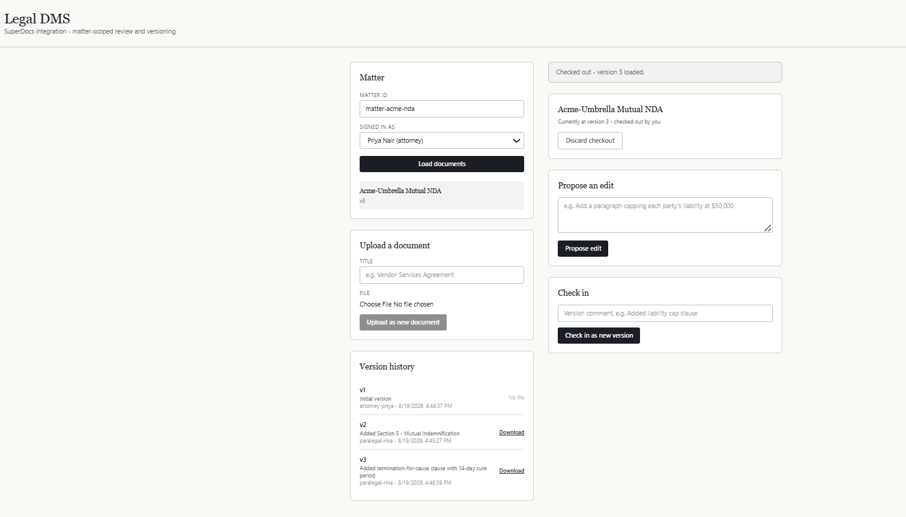
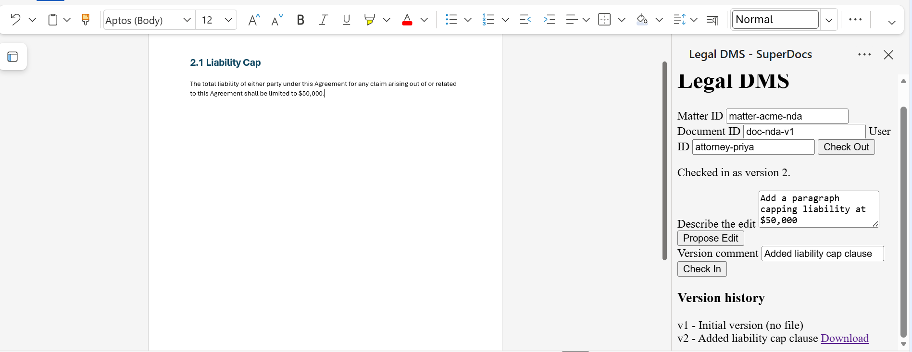
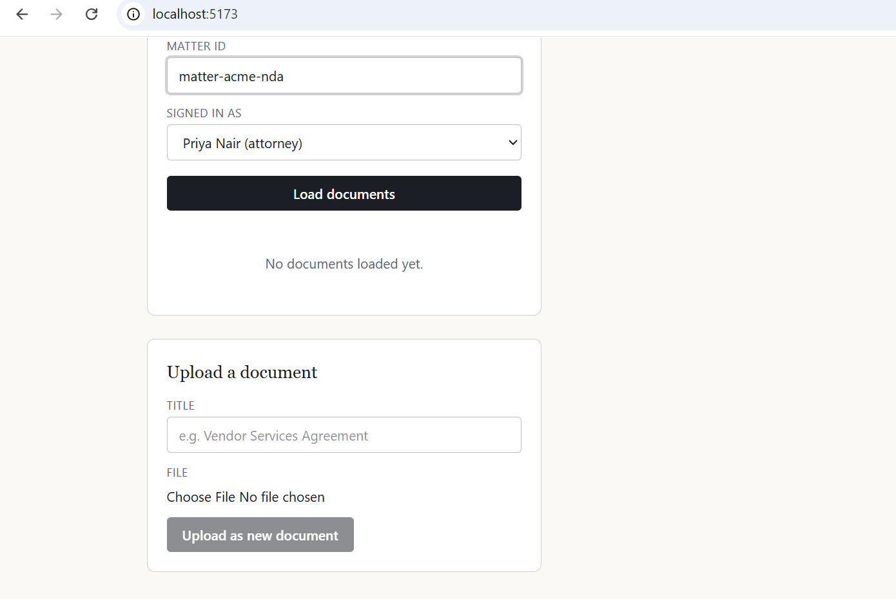
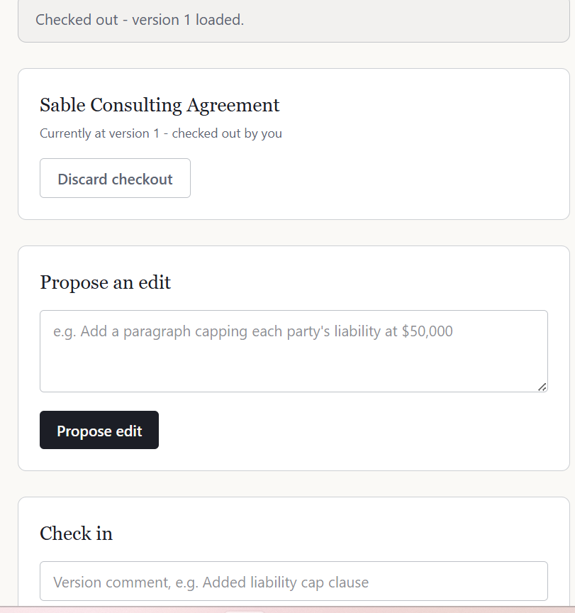
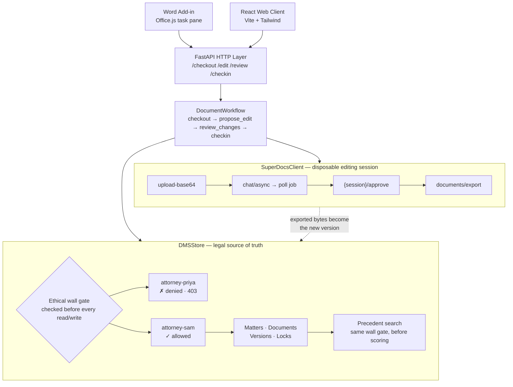
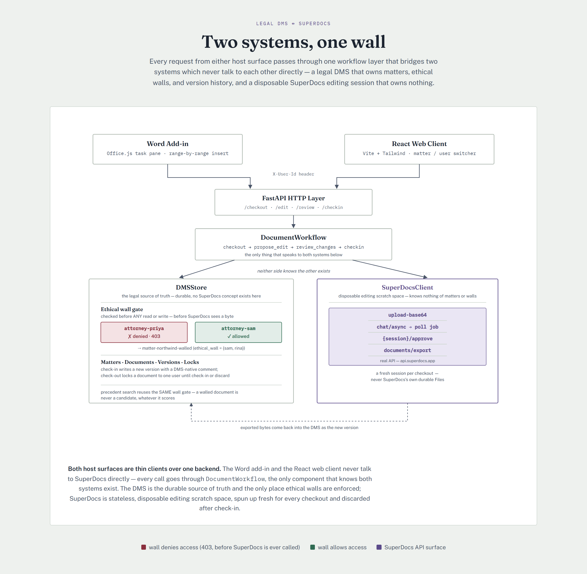

# Legal DMS ↔ SuperDocs Integration

Built for the SuperDocs Round 2 engineer task — assigned build: **Legal document-management
system integration** (S3). Built by Krisha Shah for the SuperDocs task.

## Demo videos

Two videos: a full walkthrough through the React web client, and a short continuation showing
the same backend through the Word add-in.

- **Legal DMS × SuperDocs — React Web Client Demo** — checkout, an AI-proposed redline reviewed
  and accepted, a versioned check-in, and ethical-wall access control blocking a walled matter
  before SuperDocs is ever called. _(https://youtu.be/qVoDBIfTyzo)_
- **Legal DMS × SuperDocs — Word Add-in Demo** — continuing from the React demo, the same
  backend as a Word add-in that writes an approved edit directly into the live, open document.
  _(https://youtu.be/w_surscZW9E)_

## Screenshots

**Word add-in — live edit landing directly in the open document, task pane on the right:**



**Word add-in — version history inside the task pane, each version downloadable:**



**React web client — version history with per-version download:**



**React web client — uploading a new document:**



## What this is

An integration layer between a legal DMS (matters, ethical walls, check-out/check-in,
version history) and SuperDocs's AI document-editing engine. SuperDocs supplies the editing;
this project supplies the legal-industry rules SuperDocs doesn't know about.

```
Lawyer → [this integration] → SuperDocs API (upload / chat / approve / export)
              │
              └── DMS (matters, ethical walls, locked check-outs, version history)
```

## What it does

- **Upload** a real file → becomes version 1, with the original bytes stored directly.
- **Check out** a document → locks it to one user, loads it into a fresh SuperDocs session.
- **Propose an edit** in plain English → SuperDocs returns a proposed change with an
  explanation, old/new content — nothing is applied yet.
- **Review** → accept or reject each change individually. Rejecting one never discards others.
- **Check in** → exports the approved result, saves it as a new version with a DMS-native
  comment and metadata, releases the lock.
- **Ethical walls** — a matter can restrict which users may see it at all. Enforced on every
  read/write, before SuperDocs ever sees a byte.
- **Precedent search** — searches across every matter a user can see, and only those.
- **Two host surfaces**: a React web client, and a Word add-in (Office.js task pane) that
  writes approved changes into the live document range-by-range, not as a full-file replace.

## Architecture

Both host surfaces are thin clients over one backend. Neither the DMS nor SuperDocs knows
the other exists — `DocumentWorkflow` is the only component that talks to both.



A presentation-sized version of this same diagram — used in the demo video — is here:



## Project layout

```
app/
├── dms/            Mock DMS - matters, ethical walls, locking, versions
├── superdocs/      SuperDocs API client (upload/chat/approve/export)
├── services/       workflow.py (the integration logic) + precedent_search.py
├── routers/        FastAPI HTTP endpoints
└── main.py         App entrypoint

web-client/         React + Vite + Tailwind frontend
word-addin/         Office.js task pane for Word
tests/              52 tests, all mocking SuperDocs - no live key needed
```

## Running it

**Backend:**

```
python -m venv .venv
.venv\Scripts\Activate.ps1
pip install -r requirements.txt
cp .env.example .env
uvicorn app.main:app --reload
pytest -v
```

**Web client:**

```
cd web-client
npm install
npm run dev
```

**Word add-in:**

```
npx office-addin-dev-certs install
cd word-addin
ws --port 3000 --https --cert "<path>\localhost.crt" --key "<path>\localhost.key" --directory .
```

Then in Word desktop: Insert → Add-ins → Upload My Add-in → `word-addin\manifest.xml`.

## Design decisions worth being explicit about

- **`cross_session_search`/`cross_session_memory` are never used.** Both are scoped to the
  API key owner, not to a matter — turning them on would let the AI reach across every matter
  on the account, bypassing the ethical wall this project exists to enforce.
- **Every checkout uploads a fresh SuperDocs session; we never reuse SuperDocs's own durable
  Files.** The DMS is the single source of truth for version history; SuperDocs is disposable
  scratch space for one checkout. Avoids two independent, potentially-drifting histories.
- **Auth is a plain X-User-Id header, not real login.** A real deployment sits behind the
  DMS's own SSO; building a password screen on top of an unverified header would be theater,
  not real security.
- **A denied-only checkout still creates a new version, byte-identical to the last.** Gives an
  honest audit trail ("reviewed, nothing accepted") rather than silently vanishing.

## Known limitations, told honestly

- **Precedent search ranking is keyword-overlap, not embeddings.** Access control is exact and
  tested; ranking quality wasn't the priority given the time budget.
- **No real iManage/NetDocuments connector.** Out of scope for a take-home; the workflow layer
  doesn't know or care that the DMS is mocked.
- **Version-1 seed/demo documents have no real exported file behind them** (fictional text, not
  a real upload) — download correctly 404s with an explanation. Real uploads always have a
  file from version 1.

## Three bugs found via live testing, and their fixes

An earlier revision of this README listed an unresolved bug: check in an approved edit, get
HTTP 200 and a new version number, and find the new version byte-identical to the previous
one. Version 1 → 2 landed the edit; 2 → 3 silently didn't. That description was accurate; the
root cause it guessed at ("SuperDocs session state after an approval") was not. All three bugs
below were ours, found by testing successive versions against the real API rather than trusting
a single edit working once, and all three are now fixed and locked in by tests.

### 1. Non-singleton workflow wiring

`DocumentWorkflow` holds per-checkout state that has to survive four separate HTTP requests
(checkout → edit → review → checkin). `app/main.py` built a **new `DocumentWorkflow` on every
request**, so that state was empty every time it was read:

```python
def get_workflow() -> DocumentWorkflow:
    return DocumentWorkflow(get_dms(), get_superdocs())   # new instance, every request
```

`checkin()` decided whether anything had been approved by diffing two cached HTML strings,
`latest != baseline`. With the cache empty that comparison always read "unchanged", which
routed check-in into the branch that reuses the current version's `exported_bytes`
**verbatim** — filing the previous version's file as a new version.

This is why the failure looked version-dependent rather than constant. The reuse branch only
triggers when the current version *has* `exported_bytes`:

| | `exported_bytes` on the source version | branch taken | result |
|---|---|---|---|
| **v1 → v2** (seed doc) | `None` — `add_document` never sets it | export from session | edit lands ✅ |
| **v2 → v3** | set by the v1→v2 check-in | reuse bytes | **stale** ❌ |

Every version after v2 was a byte-for-byte copy. **Uploaded** documents were worse:
`create_document` sets `exported_bytes` on version 1, so for those even v1 → v2 was already
broken — confirmed live via MD5 diffing two exported versions of an uploaded document (those
files were removed from the repo once the fix was confirmed; they were bug artifacts, not
fixtures).

**Why 35 passing tests didn't catch it.** `tests/conftest.py` wires its `TestClient` with
`get_workflow=lambda: workflow` — a singleton — while production handed out a fresh instance
per request. The bug lived in the gap between the two, so no test could see it. That gap is
the real lesson here: the test harness was quietly more correct than the app.

**Fix:** `get_workflow()` is a singleton. `review_changes()` now **records** approvals in
`_approved_sessions`; `checkin()` reads that flag instead of re-deriving it from an HTML diff —
two HTML strings can compare equal for reasons that have nothing to do with the lawyer's
decision. Check-in also **refuses** (`CheckoutStateLostError` → HTTP 409) when the workflow has
no record of a checkout the DMS still holds a lock for — "I can't tell" must never quietly
resolve to "file the old bytes." Recovery is discard-checkout and redo.
Locked in by `tests/test_app_wiring.py` and `tests/test_successive_versions.py`.

### 2. Check-in's own export raced SuperDocs's propagation lag

Fixing bug 1 wasn't the end of it. `review_changes()` already fetches and verifies the
post-approval HTML — either from the job's own `result.document_changes.updated_html`, or by
retrying `export_document` until it visibly changes, because SuperDocs's job can report
`status="completed"` before the session's actual document content has caught up server-side.
But `checkin()` threw that verified HTML away and made its **own, separate, unretried**
`export_document(session_id=...)` call — exactly the same race, one layer up. Confirmed live: a
single-edit checkout landed *different* bytes from the previous version (so not bug 1) that
still lacked the newly-approved clause.

**Fix:** `checkin()` now reuses the HTML `review_changes()` already fetched and verified,
instead of re-querying the session. Locked in by
`test_checkin_survives_a_lagging_export_after_approval`.

### 3. An already-decided change, echoed back, got approved twice

SuperDocs's approve response can still list the change_id that was **just decided in that same
call**, as an eventual-consistency echo rather than a new proposal. `review_changes()` was
re-adding everything in that response to its "still needs review" tracking unconditionally, so
the same change came back looking undecided. A reviewer approving it again re-ran the "create"
operation — since that's an append, the same content landed twice. Confirmed live: a "General
Release" section with its heading and paragraph both duplicated, traced back to one change_id
approved twice by the (correctly, since nothing told it otherwise) reviewer.

**Fix:** `review_changes()` now excludes any change_id that was part of *that same call's*
decisions before treating the response's remaining `pending_changes` as real — both for what it
hands back to the caller and for what it tracks internally. Separately, `checkin()` now refuses
(`UnresolvedChangesError` → HTTP 409) if the active session has *any* undecided proposed change
at all, regardless of whether a given client noticed it — both the web client and the Word
add-in were also fixed to stop dropping a review response's `remaining_pending_changes` on the
floor. Locked in by `test_a_just_decided_change_echoed_back_is_not_offered_for_re_approval` and
`tests/test_unresolved_changes.py`.

## Corrections made after live API testing

Both `client.py` and `workflow.py` were originally written against the OpenAPI schema alone.
Live Postman testing surfaced two confirmed bugs, both fixed: `chat_async` wasn't sending
`document_html` (the AI silently couldn't see the document, no error raised); and real
`pending_changes` fields are `change_id`/`operation`/`old_html`/`new_html`/`ai_explanation`,
not the originally-guessed `summary`/`diff_html`.

## Tests

`pytest -v` — 52 tests, `tests/mocks.py` provides a `FakeSuperDocsClient` replicating real
API behavior so the whole suite runs with no network access and no API key.
