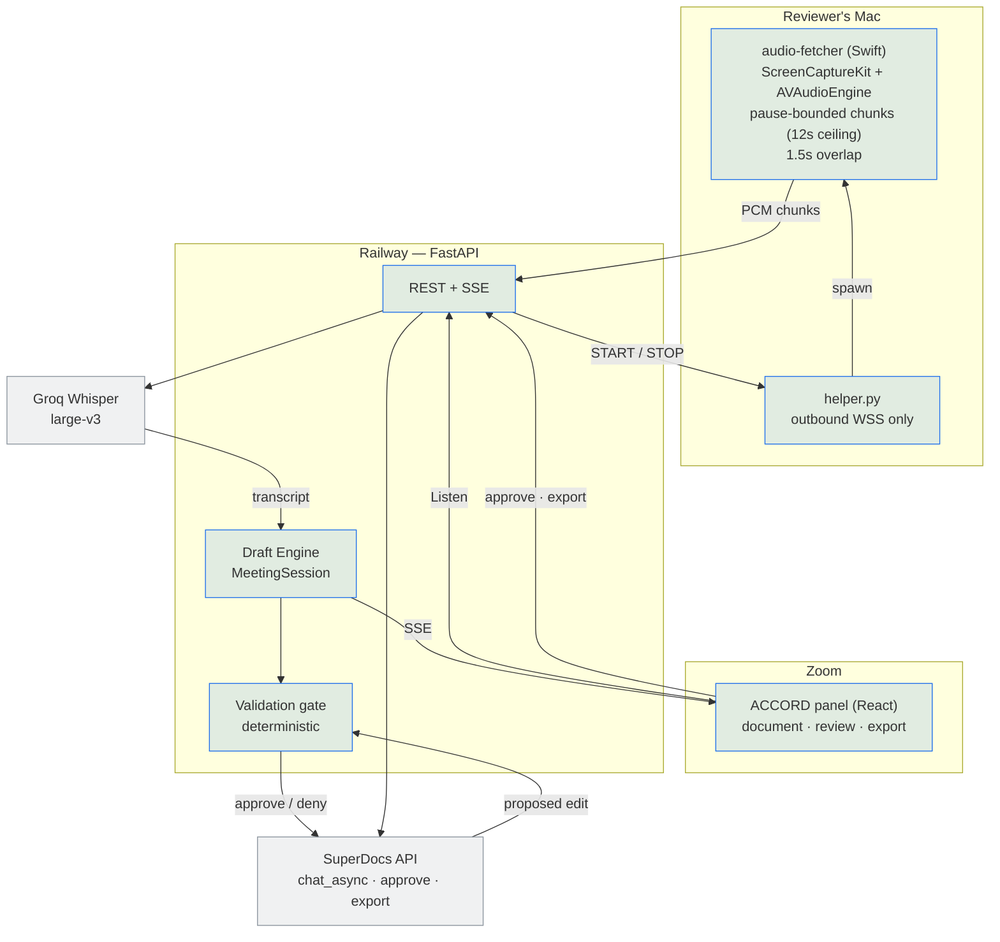
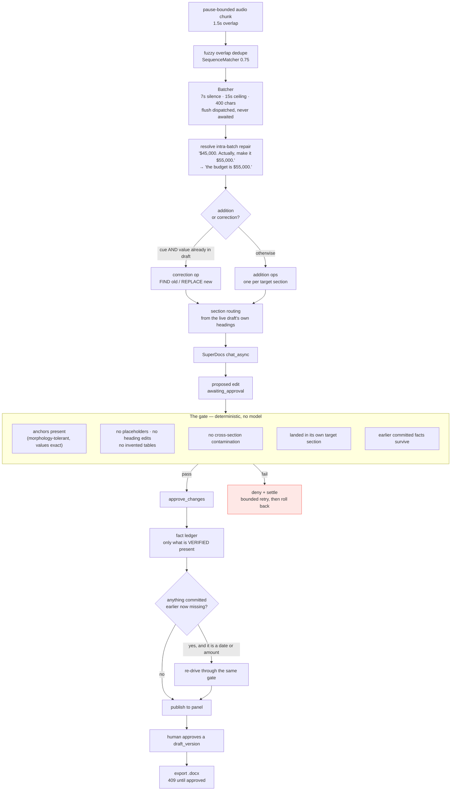

# ACCORD — architecture

A Statement of Work that writes itself while the meeting happens, on the
firm's own template, with a human approving every change before the file
leaves.

---

## 1. System topology

Audio never touches a third party except the transcriber. The SuperDocs key
lives only on the server; the panel and the helper never see it.



**Why the helper exists.** Zoom's RTMS needs a purchased Developer Pack this
account does not have — verified with Zoom, documented in `PROGRESS.md`. The
helper is the honest workaround: it connects **outbound** over WSS, so there
is no inbound port and no tunnel, and it holds no credentials of its own
beyond a rotatable token.

---

## 2. The drafting pipeline

This is the part that matters. SuperDocs proposes; **our code decides**.



---

## 3. The three ideas worth defending

**The gate never calls a model.** Every check is HTML parsing, anchor
matching and set arithmetic. A model deciding whether a model's output is
acceptable adds a second thing that can be wrong. Failures are then
deterministic and explainable: `missing expected content anchors: ['$55,000']`
names the reason, not a confidence score.

**The ledger records only what was verified present.** It would be easier to
record what each batch *asked* to commit. But then "this is gone now" proves
nothing, and recovery chases content that was never there. The distinction
between requested and observed is what makes the reconciliation pass safe.

**Recovery is more conservative than the gate.** The gate refuses content;
recovery *adds* it on its own initiative, so a false positive duplicates a
paragraph. It therefore acts only on dates and amounts — evidence strong
enough to be sure of — logs everything else, and tries each fact once.

---

## 4. What this architecture does not do

- **No live multiplayer.** One reviewer per meeting.
- **In-memory session state.** A redeploy clears in-progress meetings.
- **One session, one document, strictly serialized.** Concurrent
  `chat_async` on a session returns 409, so every edit is sequential. This is
  the single largest contributor to end-to-end latency, and it is a platform
  constraint rather than a choice.
- **The helper is a local process.** No installer, no login item; it needs
  Screen Recording and Microphone permission granted ahead of time.
- **`demo.py` exists precisely because of that.** A reviewer with no Mac, no
  Zoom account and no API key can drive the identical pipeline in one command.

---

## 5. Verifying it without a meeting

```bash
python3 demo.py --correction        # mid-sentence repair
python3 demo.py --late-correction   # correct a value already written
```

Feeds the same transcript endpoint the live capture feeds, so it exercises
batching, classification, routing, the gate, approval and export. It asserts
export is refused with 409 *before* approval — demonstrating the gate rather
than asserting it.

`383 tests` run with no network and no API key.
