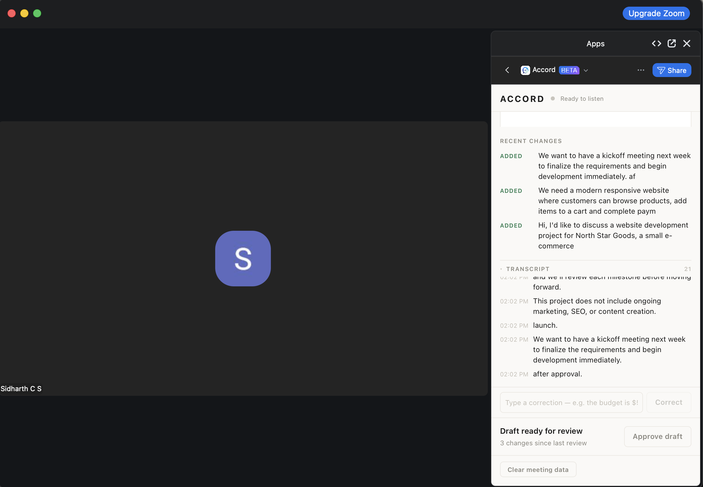
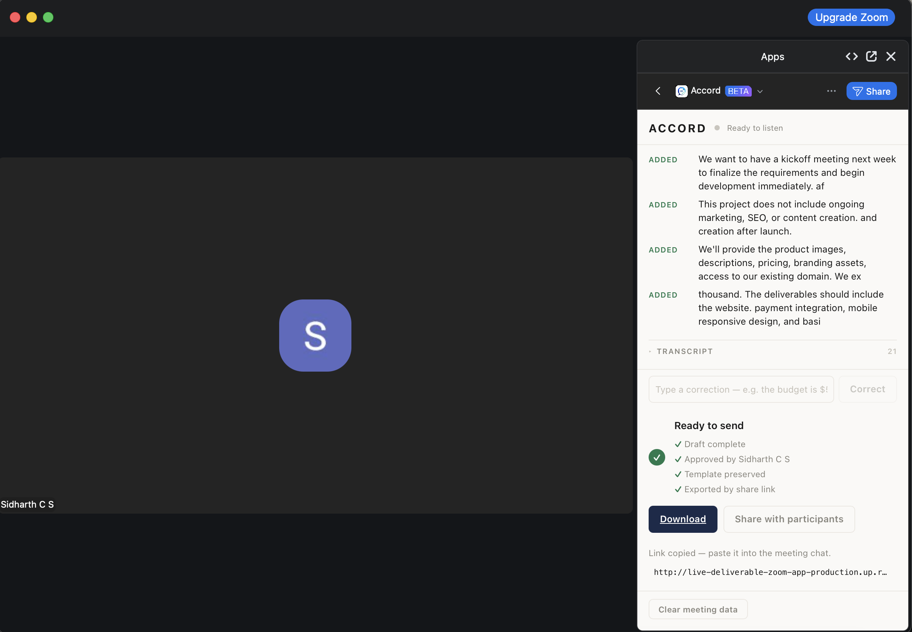
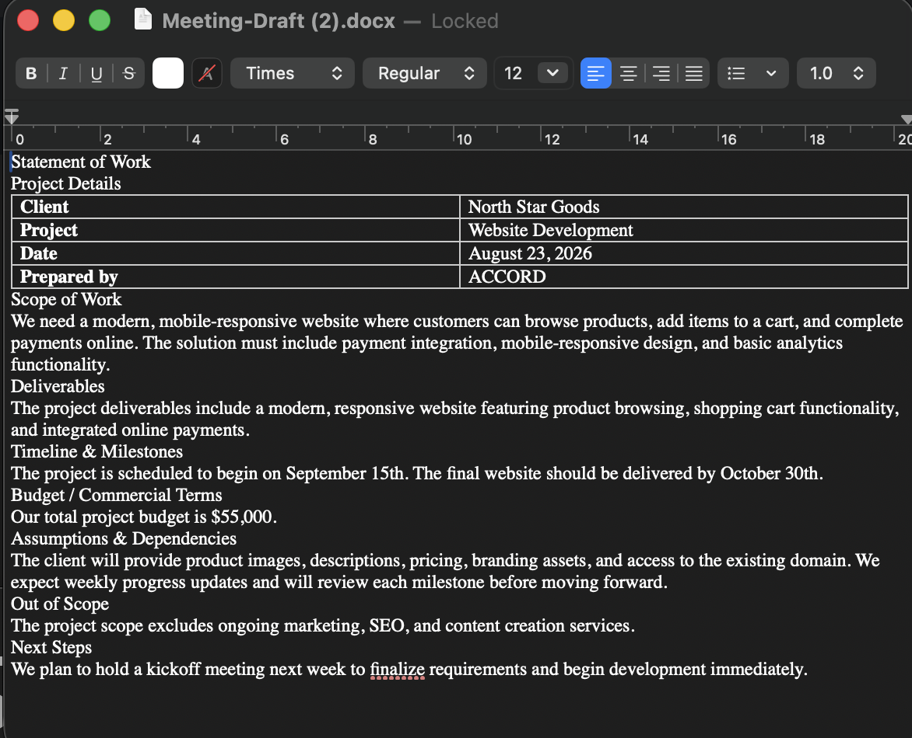
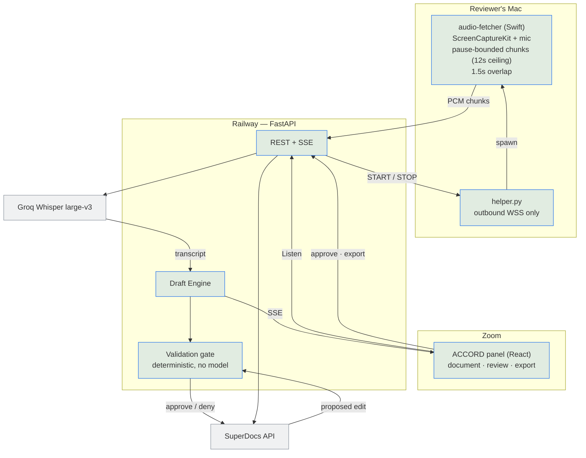

# ACCORD — the document writes itself while the meeting happens

A Zoom side panel that drafts a business document **live, during the call**,
on your firm's own template, with a human approving every change before the
file leaves.

Say *"the budget is forty-five thousand"* and it lands under Budget. Say
*"actually, make it fifty-five"* a minute later and it **replaces** the old
figure rather than adding a second one. Nothing is exported until a named
reviewer approves it.

Built for the SuperDocs Full-Stack AI Engineer task (Round 2, assigned build
S3). Five templates: Statement of Work, Meeting Minutes, Proposal / Offer,
Advice Note, Requirements List — or upload your own `.docx` and it drafts
into that.

**Live:** https://live-deliverable-zoom-app-production.up.railway.app

Open that in any browser and you get the real panel, running against the real
backend, with a document you can drive — see the one command below. What you
will **not** get there is live audio capture: that needs the Zoom side panel
on a Mac, and the Zoom app is still in beta review, so only its author can
install it. The panel says so itself rather than pretending otherwise, and
nothing else about the system depends on it.

---

## What it looks like

The panel, mid-meeting. Recent changes accumulate as people speak, the full
transcript stays one tap away, and the draft cannot be exported until
somebody approves this specific version — "3 changes since last review" is
the gate, not decoration.



After approval. The checklist states only what is actually true of the
document right now — approved, by whom, template intact — and the share link
puts the finished file in the meeting chat while the call is still open.



The exported `.docx`, opened from that link. Every section filled from
speech, on the firm's template, with the corrected budget figure — the
speaker said forty-five thousand first.



---

## Try it in one command — no Zoom, no Mac, no API key

The live path needs macOS and screen-recording permission. You do not need
any of that to see what the system does:

```bash
python3 demo.py --correction        # a repair spoken mid-sentence
python3 demo.py --late-correction   # correct a value already written
```

Standard library only, nothing to install — verified on a stock Homebrew
Python with no `certifi` and no virtualenv. (A Python without a CA bundle
cannot verify HTTPS at all; the script borrows `curl`'s trust store rather
than asking you to fix your Python first. Verification stays on.) It feeds the same transcript
endpoint the live capture feeds, so it exercises the identical pipeline —
batching, classification, section routing, the validation gate, SuperDocs
edits, approval and export. It prints a `?meeting=<id>` URL: open that in a
browser to watch the document build while the script talks.

It also asserts that export is **refused with 409 before approval** —
demonstrating the review gate rather than claiming it.

---

## What it does

1. **Captures** meeting audio locally — the call itself via ScreenCaptureKit,
   plus this machine's microphone unless you pass `--no-mic` — in
   pause-bounded chunks with 1.5s overlap, so a chunk ends at a pause rather
   than mid-word. Fixed-length slices made Whisper invent endings for the
   half-sentences it was handed.
2. **Transcribes** via Groq Whisper `large-v3`, de-duplicating the overlap.
3. **Batches** speech into coherent units — a 7s silence gap, a 15s ceiling,
   or 400 characters — never mid-clause.
4. **Classifies** each batch as an addition or a correction, requiring two
   independent signals before it will treat something as a repair.
5. **Routes** each fact to a section, from the live document's own headings.
6. **Gates** every proposed edit deterministically before approving it.
7. **Reconciles** — content that landed and later vanished is restored.
8. **Exports** `.docx`, but only after a human approves a specific version.

## How it is wired

Audio never leaves your machine except to the transcriber. The SuperDocs key
lives only on the server — the panel and the helper never see it.



The drafting pipeline itself — correction resolution, section routing, the
five gate checks, the fact ledger and the reconciliation pass — is diagrammed
in [ARCHITECTURE.md](ARCHITECTURE.md).

## What SuperDocs features it uses

| Feature | How |
|---|---|
| `chat_async` + job polling | every drafting edit |
| `approve_changes` | the gate's verdict, approve **and** deny |
| `revert_session` | rollback when a batch fails |
| Upload (`return_html`) | the firm's own `.docx` becomes the template |
| Document structure read | free check that headings survived |
| Export | final `.docx`, gated on approval |
| Review mode | `approval_mode="ask_every_time"` on every call |

---

## The idea worth defending

**SuperDocs proposes. Our code decides.**

The gate never calls a model — it is HTML parsing, anchor matching and set
arithmetic. A model judging another model's output only adds a second thing
that can be wrong. Every rejection names its reason:

```
GATE REJECT op=Budget / Commercial Terms
  failures=["proposal is missing expected content anchors: ['$55,000']"]
```

Five checks run on every proposed edit: content anchors present (tolerant of
paraphrase, exact on dates and amounts), no placeholder text, no heading or
table structure changes, no content from another section, and every
previously committed fact still intact.

See [ARCHITECTURE.md](ARCHITECTURE.md) for the diagrams.

---

## Run it locally

```bash
make setup                 # venv + dependencies
cp .env.example .env       # fill in the placeholders below
make dev                   # serves the panel and API on :8010
make test                  # 383 tests, no network or API key needed
```

`.env` (never committed — placeholders only):

```
SUPERDOCS_API_KEY=your-key-here
GROQ_API_KEY=your-key-here
ZOOM_WEBHOOK_SECRET_TOKEN=your-token-here
```

**For live capture** (macOS only) you also need the helper running, which
connects outbound over WSS and holds no key of its own:

```bash
export HELPER_AUTH_TOKEN=your-token-here
.venv/bin/python helper/helper.py
```

It needs Screen Recording and Microphone permission granted in System
Settings first.

---

## What does not work, stated plainly

- **Run-to-run variance.** Identical input can produce materially different
  output. The cause is upstream, not in this pipeline — documented with
  reproductions in [SUPERDOCS_BUGS.md](SUPERDOCS_BUGS.md), which also covers
  review mode being bypassed and a gate denial that landed anyway.
  Concretely, and worth knowing before you run `demo.py`: a run can end with
  `batch failed: ... edit did not settle after approval`. That is SuperDocs
  accepting an approval whose job never reaches a terminal state for us; the
  session refuses further edits rather than guessing at remote state. **Run
  it again** — the second run is usually clean. The script says which
  happened instead of pretending, which is the behaviour the gate exists
  for.
- **Latency.** One session allows one live document, and concurrent
  `chat_async` returns 409, so every edit is strictly sequential. This is the
  largest contributor to end-to-end latency.
- **The helper is a manual local process.** No installer, no login item.
- **In-memory session state.** A redeploy clears in-progress meetings.
- **Zoom RTMS is unavailable on this account** — it needs a purchased
  Developer Pack, confirmed with Zoom. `RTMSTranscriptProvider` is
  implemented and selectable for when it is granted; the Mac helper is the
  honest workaround in the meantime.
- **No authentication on the API routes.** Fine for a demo, wrong for
  production.

---

## Layout

```
backend/app/
  drafting/     session · batcher · classifier · validator (the gate)
  superdocs/    API client · integrity checks
  transcript/   provider protocol · Vexa · RTMS · manual
  api/          REST, SSE, audio ingest, helper control channel
frontend/       React panel (document · review · export)
audio-fetcher/  Swift capture (ScreenCaptureKit + AVAudioEngine)
helper/         local WSS helper that spawns the capture
demo.py         drive the whole pipeline with no Zoom and no Mac
benchmarks/     reproducible runs against real audio
docs/           screenshots used above
```

`PROGRESS.md` logs every assumption and decision, including the ones that
turned out wrong.

---

Built by **Sidharth C S** for the SuperDocs Full-Stack AI Engineer task.
