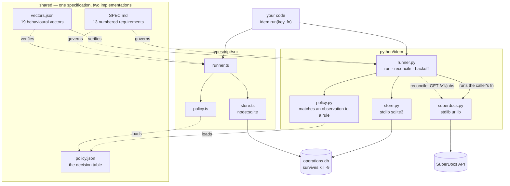
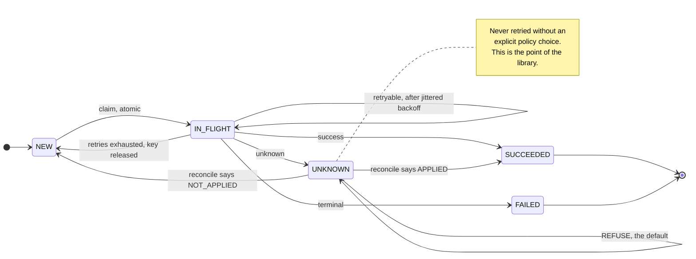
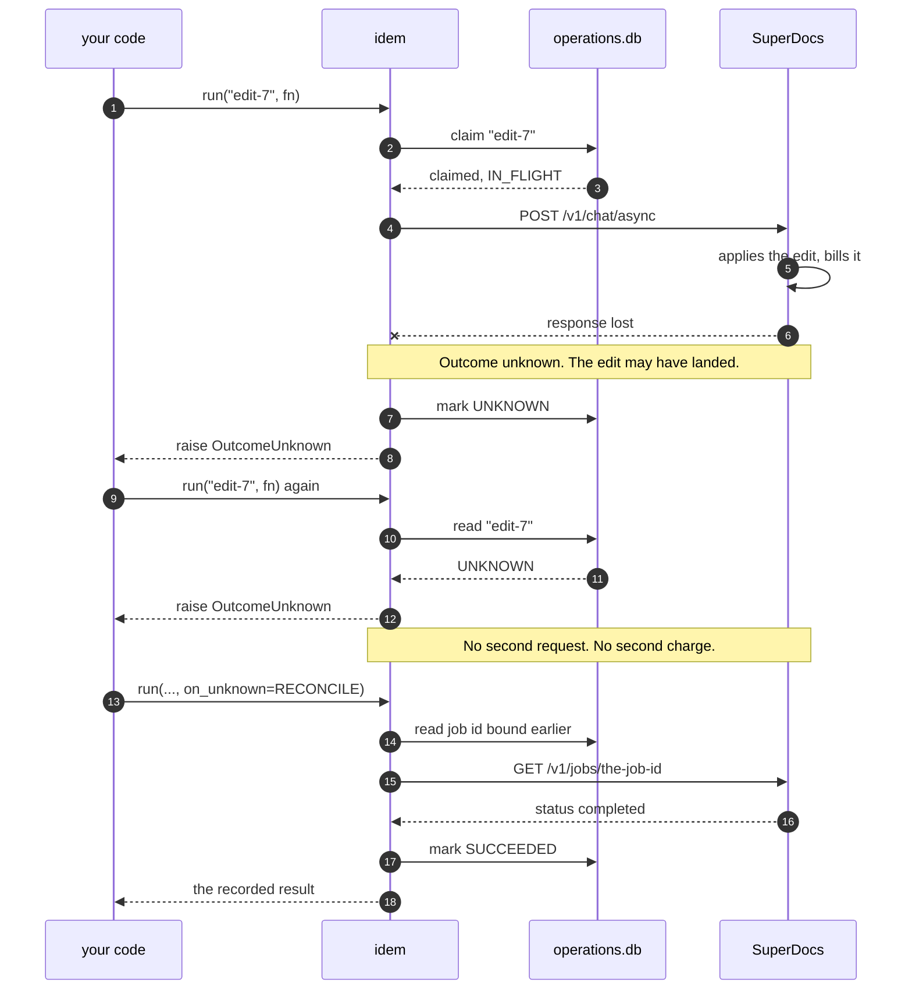
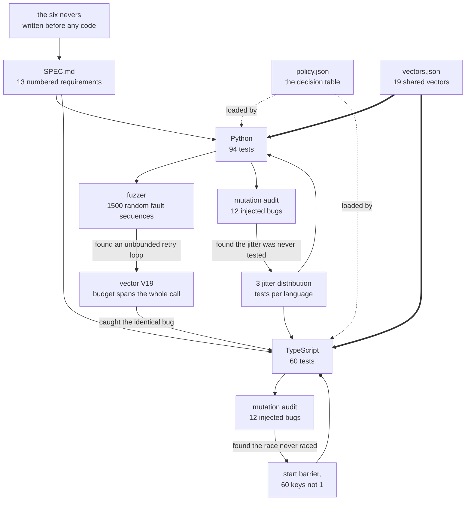

# idem-superdocs — idempotency and safe-retry middleware

A small library, in **Python and TypeScript from one written specification**,
that makes SuperDocs document operations safe to retry.

Built by **Sidharth C S** for the **SuperDocs Full-Stack AI Engineer task** —
the open task list card *"Idempotency and safe-retry middleware"* (p322,
band S3). Optional extra-credit build. Self-contained: it imports nothing from
the author's other task builds.

**SuperDocs features used:** the REST API (`/v1/chat/async`,
`/v1/chat/{session_id}/approve`, `/v1/jobs/{job_id}`,
`/v1/documents/upload-base64`, `/v1/documents/export`,
`/v1/sessions/{id}/revert`, `/v1/documents/{id}`), async chat editing, and the
Review approval flow with `approval_mode="ask_every_time"` — including its job
lifecycle, which is what reconciliation reads to decide whether an operation
actually happened. All three surfaces are exercised live; see section 12.

---

## 1. What it does, in plain language

When you send a document edit and the network drops the answer, you are stuck
with a genuinely hard question: **did it happen or not?**

Retry, and you may apply the edit twice and pay for it twice. Don't retry, and
you may have silently lost the edit. Most retry libraries answer this by
guessing, and they guess "retry" — which is the wrong guess for anything that
costs money or changes a document.

This library refuses to guess.

```python
from idem import Idempotent, Policy, UnknownPolicy

idem = Idempotent("operations.db", Policy.load("policy.json"))

result = idem.run(
    "edit-paragraph-7:session-abc",          # you name the operation
    lambda: superdocs.chat_async(...),        # it runs it at most once
)
```

- Give every operation a **key you choose**. Submit it twice, ten times, from
  ten processes — it executes once and everyone gets the same answer back.
- Failures are classified by a **decision table that lives in a JSON file**, not
  by conditionals scattered through the code. Every row says why it decides what
  it decides.
- Failures that provably never reached the server are retried with **jittered
  backoff**. Failures that might have been applied are **not retried at all**.
- An operation whose outcome is unknown **stops**, and stays stopped, until you
  make an explicit policy choice or **reconcile** it against the server's job
  state.
- The record is on disk, so this survives `kill -9`.

## 2. Why I built this

I spent two weeks building a live Zoom document-drafting app on the SuperDocs
API — around 200 real drafting runs between 2026-08-05 and 2026-08-19 — and hit
exactly this problem. From my own logs:

- A request that times out client-side has an **unknown** state. Operations are
  metered, so retrying risks both a double charge and a double edit. I traced
  **eight duplicate paragraphs** in one document to retries after an ambiguous
  failure.
- `approve_changes(job_id, True)` returned success, the post-approval poll never
  reached terminal, the next `chat_async` returned **409 Conflict**, and
  `revert_session` returned **409** too. Cannot proceed, cannot roll back,
  cannot recover. Reverting a session that had just settled a denial wedged it
  entirely. My retry logic looped about six minutes before I made it fail fast.
- `revert_session` failed two different ways under load: **8× 409 Conflict** and
  **7× 400 Bad Request** across runs.
- Identical input produces materially different output run to run, so *"did the
  retry work?"* is not answerable from a single observation.

I put "idempotency keys on `chat_async`" at the top of the *what would have
helped most* section of a bug report I sent the founder on 2026-08-22. This
build is the follow-through.

It is also a correction of my own work. The retry policy in that app is
scattered conditionals — a `_is_conflict()` helper, and an `_unrecoverable` flag
set at four separate points inside one long method, with the reasoning living in
a comment beside each branch. Answering "what do we do on a 409?" means reading
the helper and all four branches and hoping you found them all. Here it is one
row in one file.

## 3. What it must never do

Written before the code, in this order. Every row is a real test.

| # | The system must NEVER | Proven by |
|---|---|---|
| N1 | Execute the same operation key twice | `test_completed_key_replays_recorded_result` |
| N2 | Retry an unknown outcome without an explicit policy choice | `test_unknown_refuses_by_default` |
| N3 | Report a success it did not observe | `test_never_synthesises_success` |
| N4 | Lose the record of an in-flight operation across a process restart | `test_process_restart` |
| N5 | Retry a failure the decision table marks terminal | `test_terminal_is_not_retried` |
| N6 | Let two concurrent callers both execute the same key | `test_duplicated_request` |

N3 is what makes the other five checkable: a library allowed to invent a success
can satisfy every other rule and still be useless.

## 4. How it fits together



The two implementations are siblings, not a port and its original. Both are
written from `SPEC.md`, both load the same `policy.json`, and both are checked
against the same `vectors.json`. Neither one is the reference.

Everything inside `runner` is bookkeeping around a call the caller makes. The
library never opens a socket itself: `fn` is the caller's function, and
`superdocs.py` is an optional adapter that exists so the reconciliation probes
have something real to ask.

## 5. How it decides



`UNKNOWN` is the point of the library. Everything else is bookkeeping.

The classification is entirely in [`policy.json`](policy.json):

| Observation | Outcome | Why |
|---|---|---|
| 2xx | success | Observed. |
| connect timeout, DNS failure, refused | **retryable** | The request never left the client, so nothing can have been applied. The only timeout that is safe. |
| read timeout, connection reset | **unknown** | Sent, no answer. The metered edit may have happened. |
| 5xx | **unknown** | The server received it. Nothing distinguishes "failed before applying" from "applied, then failed to answer". |
| 429 | retryable | The server explicitly declined to process it. Honours `Retry-After`. |
| 409 | **terminal** | The remote state rejects the call. Retrying is guaranteed to fail again *and* signals a dirty session. |
| other 4xx | terminal | A defect in the request. It will be rejected identically forever. |
| anything else | **unknown** | Fail closed. |

The single most important field is not the status code — it is whether the
request was **sent**. A connect timeout and a read timeout are both "a timeout"
to most code, and they are opposites here.

### The policy really is data, and that is tested

A test greps the runner and the policy loader in both languages for HTTP status
literals and for every error class name the table mentions, and fails if it
finds one. The runner branches on the four abstract outcomes and on nothing
else. The loader also **refuses to start** if any non-success rule is missing
its `why`.

## 6. Unknown outcomes: three choices, and refusing is the default

```python
result = idem.run(key, operation, on_unknown=UnknownPolicy.RECONCILE, probe=...)
```

| Choice | Behaviour |
|---|---|
| `REFUSE` (default) | Raise `OutcomeUnknown`. A human decides. |
| `RECONCILE` | Ask the server what happened, then act on the answer. |
| `RETRY_ANYWAY` | Retry regardless — **also** requires `naturally_idempotent=True`, and logs at WARNING every time it fires. |

`reconcile(key, probe)` is public and callable on its own. It returns one of
three verdicts, and the third one is the important one:

| Verdict | Effect |
|---|---|
| `APPLIED` | Record becomes succeeded. The operation is never re-run. |
| `NOT_APPLIED` | Key released. A retry is now justified rather than assumed. |
| `INCONCLUSIVE` | Record stays unknown. **Still refused.** |

A two-verdict probe would force "I could not find out" into either "it happened"
or "it did not", and both are lies.

## 7. Where this stops — and why that is a platform problem

Reconciliation needs something to reconcile against. The library binds
`key → job_id` the moment a job id is first seen, and asks the server about that
job.

**When the first call is the one that times out, there is no job id yet**, and
SuperDocs offers no lookup by operation key. The server may well have created a
job; the client cannot find out. `reconcile()` returns `INCONCLUSIVE` and the
operation stays refused.

A client library can make retries safe exactly up to the point where the server
can say what happened. Closing the last gap requires the server to accept the
operation key and return the original outcome on a repeat — the platform feature
at the top of my bug report, and the reason this card exists.

Both states are in the test suite, because the gap is part of the design:

- `test_network_partition_stays_refused_when_the_server_cannot_answer` — today
- `test_network_partition_resolves_when_the_server_can_answer` — the moment the
  server can answer

## 8. The fault-injection harness

The scenario the harness exists for, start to finish — an edit that lands while
the answer is lost, and the two ways out:




Three scenarios, the three the card names. Each runs against a fake server that
counts its own applies, so the tests measure what actually happened on the far
side rather than what the library believes happened. **The assertion is always
`applies == 1`.**

| Scenario | What is injected | Result |
|---|---|---|
| **Network partition** | The server applies the edit, then the response is lost | 1 apply. Refused, and stays refused across five resubmissions. |
| **Duplicated request** | The same key 10× sequentially, and 12 OS processes racing at once | 1 apply. Exactly one executes; the rest replay or are told to wait. |
| **Process restart** | The owner is `SIGKILL`ed between applying the edit and recording it | 1 apply. The new process surfaces UNKNOWN instead of silently redoing the work. |

The restart child kills itself with `SIGKILL` (Python: `os._exit`) — no cleanup
handlers, no flushing, no unwinding. It is the closest thing to pulling the
power cord that a test can do.

The measured difference this makes, from a run of the harness:

```
after the crash                                      applies = 1
what a library with no durable record would leave    applies = 2
what this library leaves                             applies = 1  (refused: OutcomeUnknown)
```

## 9. How I know the tests are worth anything

A green suite proves nothing on its own. So the suite was attacked: twelve
plausible bugs injected into the real source, one at a time, to see which ones
the tests would notice.



The arrows that point *backwards* are the ones worth reading. Each is a defect
the verification found in the thing it was verifying.

**Both implementations now catch 12/12.** Getting there found four real
problems. The audit is in the repo, so you can re-run it rather than take my
word for it:

```bash
make audit     # injects 12 bugs into both sources, reports what is caught
```

**The jitter was never tested.** The vectors assert `0 <= delay <= ceiling`, and
a constant `delay == ceiling` satisfies that — so deleting the jitter entirely
left everything green. The card asks for jittered backoff specifically. Fixed
with three distribution tests per language: the delays must vary across 400
draws, must reach both ends of the range, and must average half the ceiling.

**The racing callers were not racing — in both languages.** Twelve TypeScript
processes were spawned to contend for one key, but spawn overhead staggered them
by tens of milliseconds and they rarely collided, so weakening
`BEGIN IMMEDIATE` to `BEGIN DEFERRED` went undetected entirely. Fixed with a
start barrier and by racing across sixty keys instead of one.

The Python equivalent had the same weakness in a subtler form, and it took
*measuring* rather than eyeballing to see it: twenty threads on a single key
detected the same weakened claim in only **9 of 12 trials**. A test that catches
a broken atomic claim three times in four is not a test of the atomic claim.
Fixed the same way — sixty keys, a barrier per key — and re-measured at
**12/12**.

**One test was passing by accident.** The Python suite detected a broken
reconciliation verdict incidentally, and stopped detecting it the moment an
unrelated fix changed the control flow. An incidental catch is not a test; both
suites now assert it explicitly.

**The fuzzer found an unbounded retry loop, and then a file-descriptor leak.**
See below.

### The fuzzer

`test_fuzz.py` generates what I did not think of: random operation sequences,
random faults at random attempts, random process deaths, random reconciliation
outcomes. 400 scenarios per run by default, 5000 under `make fuzz`, asserting
three invariants that must hold
whatever happened:

```
INV1  no operation key is ever applied more than once
INV2  a key reported SUCCEEDED was applied exactly once — never zero
INV3  a key reported FAILED was never applied
```

It failed on its first execution, with a `RecursionError`. Resolving an unknown
outcome releases the key, which resets the record's attempt count — so a
reconciliation that kept answering `NOT_APPLIED` started a **fresh retry budget
every cycle** and `run()` never returned. Unbounded retry is the precise failure
this library exists to prevent, and it was sitting in the middle of it.

Fixed by threading the attempt count through the unknown-resolution path, and
pinned as vector **V19** so both implementations must satisfy it. That vector
then caught the identical bug in TypeScript — a `RangeError` on the first run.
Which is the clearest answer I have to whether writing the second implementation
was worth it.

The fuzzer also carries a test that the fuzzer can fail: it drives the same
faults through a caller that ignores the library, and confirms the invariant it
checks is one a broken client actually breaks.

It then found a second, worse one. `with sqlite3.connect(...) as conn` is a
*transaction* context manager — it commits, it does not close. With a
connection per call, **every store operation leaked a file descriptor**: 335 of
them over 200 operations, measured. Any long-running caller would eventually
hit its limit and see every subsequent operation fail with `unable to open
database file`.

Nothing in the hand-written suite would ever have caught it, because no
hand-written test runs thousands of operations in one process. The fuzzer was
the first thing that did. Fixed with `contextlib.closing`, and pinned by a test
that counts open descriptors across 300 operations.

```bash
make fuzz                                   # 5000 scenarios
IDEM_FUZZ_SEED=99 IDEM_FUZZ_RUNS=50000 make fuzz
```

The seed is fixed by default so a failure reproduces exactly. The suite runs
400 scenarios so `make test` stays quick; `make fuzz` turns it up to 5000.

## 10. Two implementations, one specification

[`SPEC.md`](SPEC.md) is normative — 13 numbered requirements and the nevers
table. Neither implementation is the specification.

[`vectors.json`](vectors.json) is the cross-language contract: 19 behavioural
vectors, each naming the requirement it pins and why it exists. **Both
implementations execute the same file.** If the two suites ever disagree, the
specification is ambiguous and SPEC.md is what gets fixed.

| | Python | TypeScript |
|---|---|---|
| Tests | 94 | 60 |
| Shared vectors | 19 | 19 |
| Runtime dependencies | **0** (stdlib `sqlite3`, `json`, `random`, `urllib`) | **0** (`node:sqlite`) |
| Dev dependencies | `pytest` | `typescript`, `@types/node` |

Backoff delays are asserted **by bound**, never by value — seeded RNGs are not
portable across languages, so pinning exact delays would pin one
implementation's RNG rather than the specified behaviour.

### What the second implementation actually caught

Worth stating plainly, since "two implementations" could easily be twice the
work for nothing. It paid for itself once, concretely.

Twelve processes racing at one key, and TypeScript children died intermittently
with `database is locked` — about one run in three. `node:sqlite` sets no busy
timeout by default; Python's `sqlite3` takes one as a *connect argument*, so it
is in force before any statement runs. My first fix added the pragma but placed
it after `PRAGMA journal_mode=WAL`, and setting the journal mode needs an
exclusive lock — so two processes opening the database together still threw,
before the schema even existed.

Two things worth recording:

1. **The safety property held throughout.** `applies` stayed at 1 in every run,
   including the failing ones — the contended caller failed loudly rather than
   double-applying. Fail-closed working under a fault I had not anticipated.
2. Python's API makes the mistake unavailable, so the Python suite could not
   have found it.

Fixed, and verified across 20 consecutive runs of the fault harness.

## 11. How to run it

Nothing below needs an API key or a network connection.

```bash
make setup     # a venv, and the one dev dependency
make test      # both implementations against the same vectors
```

Individually:

```bash
make test-py      # pytest — 94 tests, incl. 400 fuzz scenarios
make test-ts      # node --test — 60 tests, same vectors.json
make typecheck    # tsc --noEmit
make audit        # mutation-test both suites (12 injected bugs each)
make fuzz         # randomised fault injection
```

### Using it as a library

It installs and imports like anything else — no runtime dependencies:

```bash
pip install ./python
```

```python
from idem import Idempotent, Policy

idem = Idempotent("my-app.db", Policy.load("policy.json"))
result = idem.run(f"charge:{invoice_id}", lambda: billing.charge(invoice_id))
```

Nothing about it is SuperDocs-specific except the optional adapter. The same
three lines protect a payment, a webhook handler, or any other operation that
must not happen twice.

Requirements: Python 3.11+, Node 22.6+ (for `node:sqlite` and native TypeScript
execution — Node 24 recommended).

### Poking at it by hand

There is no UI — it is a library. To actually *watch* it work, without a key or
a network:

```bash
python3 demo.py        # six scenarios
python3 demo.py 2      # just one
```

Each scenario runs against a fake server that counts what it really did, so the
number at the end is measured, not narrated. Scenario 2 is the one that matters:
the edit lands, the response is lost, five retries follow, and the server still
shows **one** apply.

Scenario 6 changes a single field in `policy.json` and the behaviour changes
with no Python edited. Edit `policy.json` yourself and rerun — that is the
fastest way to confirm the policy really is data.

### Using it

```python
from idem import Idempotent, Policy, UnknownPolicy
from idem.superdocs import SuperDocs

api  = SuperDocs(api_key=os.environ["SUPERDOCS_API_KEY"])
idem = Idempotent("operations.db", Policy.load("policy.json"),
                  job_probe=api.job_settled_probe)

job = idem.run(
    f"{session_id}:edit-7",
    lambda: api.chat_async(message="Tighten the closing paragraph.",
                           session_id=session_id),
    on_unknown=UnknownPolicy.RECONCILE,
)
```

```typescript
import { Idempotent, Policy, UnknownPolicy } from "./typescript/src/index.ts";

const idem = new Idempotent("operations.db", Policy.load("policy.json"));
const job = idem.run(`${sessionId}:edit-7`, () => chatAsync(...), {
  onUnknown: UnknownPolicy.RECONCILE,
});
```

### Environment variables

Only the optional live smoke test reads these. See
[`.env.example`](.env.example) — placeholders only, never real values.

```
SUPERDOCS_API_KEY=your-key-here
SUPERDOCS_BASE_URL=https://api.superdocs.app
IDEM_SMOKE_MAX_OPERATIONS=25
```

## 12. Live verification, and what it cost

`make smoke` is the only thing here that touches the real API, and it spends
metered operations. It counts every billable call before making it and
**hard-stops at the cap** rather than continuing past it.

**Run on 2026-08-22 against the live API. Actual spend: 5 metered operations**
(cap 25), plus 6 calls that cost nothing because they errored or were
read-only.

| Phase | Spend | What happened |
|---|---|---|
| **A. wire shapes** | 0 | Both documented shapes returned **422**, re-confirming the table below. Errored requests are not billed. |
| **B. happy path** | 2 | Upload, then `chat_async` → job `da158409…`. **Resubmitting the same key returned the recorded result and spent nothing** — N1, live. |
| **C. partition** | 0 | A second call on a busy session returned **409** before the timeout could fire. Classified terminal: 1 attempt, state `failed`, zero backoff. A retry loop would still have been going. |
| **D. conflict** | 0 | Same 409 again on a fresh key. Terminal, zero retries, zero backoff. |
| **E. Review** | 3 | `ask_every_time` → the job paused at `awaiting_approval` with 2 real `change_id`s. The approval ran through the middleware, and **resubmitting its key spent nothing**. The job settled `completed`. |

Reconciliation was then verified against the real `GET /v1/jobs/{job_id}`,
which is a free read:

```
live job da158409-b661-4c70-b991-ba5d1154fa7e -> status "completed"
metadata.pending_changes                      -> null   (not [], as documented)
job_settled_probe                             -> APPLIED
job_exists_probe                              -> APPLIED
job id that does not exist                    -> NOT_APPLIED

an operation stuck UNKNOWN, reconciled against the live server:
  before: state=unknown
  after:  state=succeeded   — and the operation never re-ran
```

Phase E is the Review surface end to end, on its own session:

```
job 23ba922a-e5ce-401e-83b4-38473f86ea24
  status                        -> awaiting_approval    (the Review gate opened)
  metadata.pending_changes      -> list of 2 change_ids
  approve via idem.run(...)     -> {"batch_complete": true}
  replay of the same key        -> recorded result, 0 operations spent
  post-approval poll            -> completed
  job_settled_probe             -> APPLIED
```

An approval is as billable and as state-changing as an edit, and approving
twice is as wrong as editing twice. This run shows the key protecting it.

**What did and did not reproduce, stated precisely.** The 409s in phases C and
D are the *serialization* constraint — a second `chat_async` against a session
with a job still in flight. That is item 10 in my report, and it is a
documented constraint rather than a defect.

The wedge itself — an `approve` that returns success while the job never
settles — **did not reproduce**. Phase E ran the Review flow clean:
`awaiting_approval` → approve → `completed`, with `batch_complete: true`. On
this evidence that failure looks fixed, and I am not going to claim otherwise
from one clean run.

The library's behaviour is the same either way, which is the point worth making:
it classified the 409 terminal and stopped after one attempt, where the retry
loop it replaces spent six minutes discovering the same thing. Phases A–D cost 2
operations rather than the ~15 budgeted, precisely *because* it refused to retry
into a session that was rejecting calls. Not retrying is cheaper, which is the
whole argument in one number.

The first attempt at this run failed on a TLS certificate error and spent
nothing — but it surfaced a real defect: the adapter reported a failed
handshake as *sent*, so the library refused an operation that provably could
not have happened. Safe, and still wrong. `ssl.SSLError` now joins
connection-refused and DNS failure as attested never-sent, with a test. Live
testing earning its keep on a run that never reached the server.

> On this machine the Python install has no CA bundle of its own, so the run
> needs `SSL_CERT_FILE=/etc/ssl/cert.pem`. Using the system bundle rather than
> adding `certifi` keeps the zero-dependency claim honest.

The run is designed so that non-determinism cannot flatter the result. Identical
input produces materially different output run to run, so the assertion is never
about document content — it is a count: **applied edits == distinct operation
keys**, read from `GET /v1/documents/{id}`, the structure endpoint, which is a
free never-billed read. Nondeterministic content cannot invalidate a cardinality
check. Same assertion shape as the offline harness.

Wire shapes encoded here were verified live on 2026-08-21 and re-confirmed in
this run, where the published documentation and the server disagreed:

| Documented | Actual |
|---|---|
| `document_base64` | **`file_base64`** |
| approve takes `{changes: [...]}` | `{job_id, approved}` are the required fields — the changes-only shape **422s**. With real `change_id`s in hand, sending `changes: [{change_id, approved}]` alongside them is what returns `batch_complete: true`. |
| `metadata.pending_changes` returns `[]` | returns **`null`** when nothing has changed — a real list of `change_id`s when something has, confirmed in phase E |

## 13. Layout

```
SPEC.md                        the one written specification — normative, 13 requirements
DECISIONS.md                   every decision with its reasoning, including the rejected ones
policy.json                    the decision table (data)
vectors.json                   19 behavioural vectors, executed by both implementations
demo.py                        six runnable scenarios — no API key, no network

python/idem/                   policy.py · store.py · runner.py · superdocs.py
python/tests/test_nevers.py    the six nevers, plus the jitter distribution tests
python/tests/test_vectors.py   runs vectors.json
python/tests/test_faults.py    partition · duplicate · restart · Review
python/tests/test_fuzz.py      randomised fault injection, 400 scenarios (5000 via make fuzz)
python/scripts/mutation_audit.py   injects 12 bugs, checks the suite catches them
python/scripts/smoke_live.py   the capped live run

typescript/src/                policy.ts · store.ts · runner.ts · index.ts
typescript/tests/              the same suites against the same vectors
typescript/mutation_audit.py   the same 12 bugs against the TypeScript source
```

## 14. Known limitations

- **The live run never exercised a real client-side timeout.** The session
  wedged with a 409 before the one-second ceiling could elapse, so the
  partition path was proven by the offline harness and by reconciling a real
  job, not by a live timeout. Reproducing one needs a slower operation than the
  cap allowed.
- **`urllib` cannot distinguish a connect timeout from a read timeout.** It uses
  one timeout for both, so the adapter reports every timeout as *sent* — the
  fail-closed answer. The cost is a refused retry the caller can reconcile,
  rather than a duplicate edit. Swapping to `httpx` fixes it and needs **no
  policy change**, which is the point of keeping the policy in data.
- **Reconciliation cannot resolve a first-call timeout** without a
  caller-supplied probe. Section 7; it is a platform gap, not an oversight.
- **The loser of a concurrent claim raises rather than waiting** for the winner.
  Honest — from its point of view the outcome genuinely is not known yet — and
  executions still stay at one. Waiting would add deadlock and poll-interval
  failure modes for no gain in the property that matters.
- **The TypeScript is closer to a transliteration than an independent
  derivation.** Written by the same author straight after the Python, so it
  cannot claim the full value of an independent second reading of the spec. It
  earned its place anyway: it found the SQLite busy-timeout ordering bug, it
  caught the unbounded-retry bug through vector V19, and it now passes the same
  12-mutation audit — so it is constrained by the specification, not merely
  shaped like its sibling.
- **Both implementations are synchronous.** The library's work is bookkeeping
  around a call the caller makes; the caller's function can do whatever it likes.

## 15. Credit

Built by **Sidharth C S** for the **SuperDocs Full-Stack AI Engineer task**,
from the open task list card *"Idempotency and safe-retry middleware"* (p322,
band S3). MIT licensed, as per the repository.
