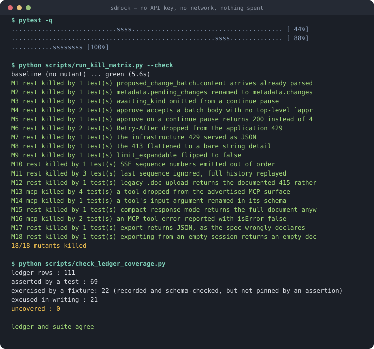

# sdmock — an offline mock and contract-test suite for SuperDocs

Point any SuperDocs integration — REST client or MCP agent — at this mock, and your CI runs
the full **upload → edit → review → export** loop, including the SSE review stream and every
documented failure mode, with **no API key, no quota, and no flake**.

Then run the same contract suite against the live service to prove the two still agree.

```bash
docker compose up -d
curl -H "Authorization: Bearer sk_test_anything" http://localhost:8080/health
```



*Real captured output, rendered to SVG by `scripts/` — every number above is reproducible
with the commands shown.*

REST answers at `/v1/*` and MCP at `/mcp/`, on one port with one bearer token — the same
layout `api.superdocs.app` uses, so you change one base URL and both halves of your stack
follow.

---

## What it is

- A **replay server** serving responses recorded from the live SuperDocs API, on both
  transports, from one process.
- A **contract suite** that runs identical assertions against the mock and against live, so
  drift between them fails a test instead of surprising a user.
- **12 scenarios** switched by a request header, so one mock covers many test cases.
- A **record mode** that captures new scenarios from the live service, scrubbed on write.

## What it is not

It reproduces SuperDocs' shapes, statuses, headers, framing and timing faithfully. It does
**not** reproduce the AI: it will never propose an edit you did not record. It tests your
integration, not the model's judgement.

It is built *on* SuperDocs and is not a copy of it — there is no document engine here and it
cannot edit anything.

---

## Three ways to run it

**Container** — for CI in any language.

```bash
docker compose up -d                       # or: docker run -p 8080:8080 ghcr.io/tohin003/superdocs-mock
```

**Library** — for Python integrators. Installing it is the whole setup; the fixture appears
with no conftest entry.

```python
def test_my_upload(superdocs_mock):          # fixture ships with the package
    client = MyClient(base_url=superdocs_mock.url, api_key="sk_test")
    ...                                      # or point an MCP client at .mcp_url
```

**CLI** — for poking at it by hand.

```bash
sdmock serve                # REST + MCP on :8080
sdmock catalogue            # what each scenario returns
sdmock routes               # every route the pinned spec describes
```

## Choosing a scenario

```bash
curl -H "Authorization: Bearer sk_test_anything" \
     -H "X-Mock-Scenario: capacity-refusal" \
     -X POST http://localhost:8080/v1/documents/upload
```

The full catalogue, generated from the fixtures themselves, is in
[`docs/scenarios.md`](docs/scenarios.md). Also useful: `X-Mock-Run` for independent cursors
when two jobs share a mock, `X-Mock-Latency: realistic` to replay the recorded inter-event
timings against your "still processing" UI, and `POST /__sdmock__/reset` to rewind.

## Recording something new

```bash
export SUPERDOCS_API_KEY=your-key-here
python scripts/record_scenarios.py --list
python scripts/record_scenarios.py styled-document
```

Recording proxies to the live service and scrubs every interaction on write. It refuses to
run without a key rather than quietly capturing a cassette full of `401`s, and it enforces a
hard operation budget so a recording session cannot run away with your quota.

---

## The evidence

Everything below is a committed artifact you can re-run, not a claim.

| Claim | Where it is proven |
|---|---|
| The contract suite genuinely catches drift | [`docs/kill-matrix.md`](docs/kill-matrix.md) — **18 of 18** deliberate defects caught, each naming the test that caught it |
| The mock and the live service agree | [`docs/evidence/`](docs/evidence/) — the suite run unchanged against `api.superdocs.app`: **120 passed / 0 failed** over REST, **98 passed / 0 failed** over MCP |
| It starts in under a second | [`docs/benchmarks/`](docs/benchmarks/) — median **160 ms** to full readiness, p95 188 ms, max 242 ms, N=20, every sample committed |
| Fixtures carry no real content | `contract/test_fixtures_are_clean.py` and `test_scrubber_has_teeth.py` — the gate is shown rejecting eight specific leak shapes |
| Responses are deterministic | `test_full_journey_is_byte_identical_across_runs` |
| Every documented behaviour is defended | `scripts/check_ledger_coverage.py` — **110 behaviours, 0 uncovered** |

Run them yourself:

```bash
pip install -e '.[test]'
pytest                                   # against the mock, free, no key
python scripts/run_kill_matrix.py        # break the mock 18 ways, prove the suite notices
python scripts/benchmark_startup.py      # re-derive the startup numbers on your hardware
pytest --target live --allow-billing     # against api.superdocs.app (spends operations)
```

### Startup, measured

Method first: cold `sdmock serve` process, fresh port each time, timed to the first
accepted socket, then to `HTTP 200 /health`, then to a served MCP `tools/list`. N=20.
Raw per-run samples in [`docs/benchmarks/startup.csv`](docs/benchmarks/startup.csv).

| Measurement | median | p95 | max |
|---|---|---|---|
| process start → socket accepts | 156 ms | 185 ms | 234 ms |
| process start → `200 /health` | 157 ms | 186 ms | 240 ms |
| process start → MCP `tools/list` | 160 ms | 188 ms | 242 ms |
| `docker run` → `200 /health` (N=5) | ~500 ms | — | 607 ms |

Measured on the author's machine (Apple silicon, Python 3.14); your numbers will differ, and
the script is there so you can produce your own rather than take mine.

**On the Starlette-over-FastAPI decision**, since I said I would substantiate it rather than
assert it: FastAPI costs **195 ms** to import against Starlette's **75 ms** on this machine.
Honestly, that means Starlette bought headroom rather than saved the bar — FastAPI would
still have cleared a second. The mock does not need request-time validation, because
validation belongs in the contract suite where a reviewer can see it, so the leaner
dependency was free to take.

---

## Where this build can fail

Stated here rather than left to be discovered.

1. **A mock is a snapshot.** Cassettes are true as of their recording date, stamped on each
   one. The live-target run and the surface watcher are the answer, and neither is
   instantaneous — drift is caught on the next scheduled run, not the moment it ships.
2. **Coverage is deliberately partial.** 12 scenarios across the four-call contract, the job
   lifecycle and a subset of the MCP tools — not all 81 routes. Everything else returns an
   honest `501` naming the scenario that does have it, never a plausible-looking invention.
3. **Three scenarios are synthesised, not recorded**, and say so on every response via
   `X-Mock-Synthesised: true`. A quota `429` would cost the account's entire balance to
   observe; the surge `429` cannot be induced by one caller at all; and a `continue_prompt`
   pause did not occur even on a real 400-section edit. Each carries a note explaining why.
4. **The AI's content is fixture, not intelligence.** See "What it is not".
5. **`--target live` spends operations.** Guarded by a budget and an explicit flag, but it
   is real money on somebody's quota.
6. **Parity has a floor.** REST and MCP return the same data in different envelopes; the
   parity test normalises before comparing, and the normaliser is itself a place a real
   difference could hide. The rules are in the test file rather than buried in a helper.

---

## Findings

Building this turned up six divergences between what SuperDocs publishes and what it does,
written up in [`docs/findings.md`](docs/findings.md) with repro steps. The most serious:

**SSE `sequence` numbers are not strictly increasing** — an `intermediate` and the `final`
were both emitted as `11`. A client that follows the documented resume advice (store the
highest sequence, reconnect with `last_sequence`) never receives `final` after a dropped
connection, and waits forever for a job that has already completed. The mock **reproduces
this faithfully rather than tidying it away**, and a test asserts the failure mode still
reproduces — so you can regression-test your workaround against a fixture instead of against
production.

One earlier finding was **wrong and has been retracted in place** rather than deleted; the
retraction is in the same file.

---

## How it works

- `spec/openapi.json` is pinned to a commit and does real work at runtime: it supplies the
  route table *and* path templating, so a cassette recorded against `sdmock-review-001`
  replays for a client using `tenant_9.prod`.
- `spec/mcp-tools.json` pins the MCP surface separately, because SuperDocs serves its tools
  **live from the backend** — that surface can move with no release anywhere.
- Both transports resolve through one replay core, which is what makes the parity test
  meaningful rather than circular.
- `docs/behaviours.md` is the behaviour ledger: 110 rows, each with a source citation. Every
  contract test names the row it asserts, and CI fails on a gap in either direction.

More: [`TASK.md`](TASK.md) for how to work in the repo, [`PROGRESS.md`](PROGRESS.md) for the
decision log including every bug I found in my own code along the way.

---

MIT. Built by **Tohin Majumder** for the SuperDocs task.
