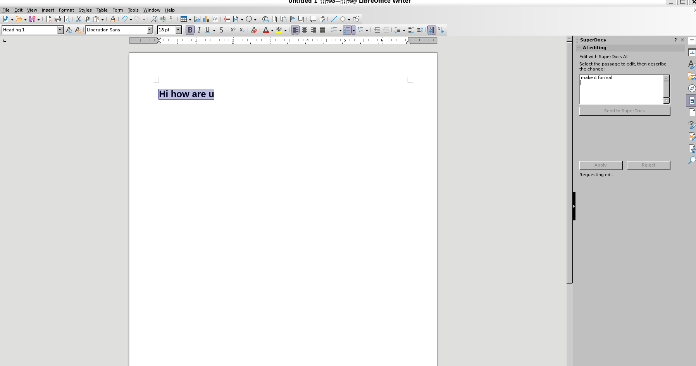
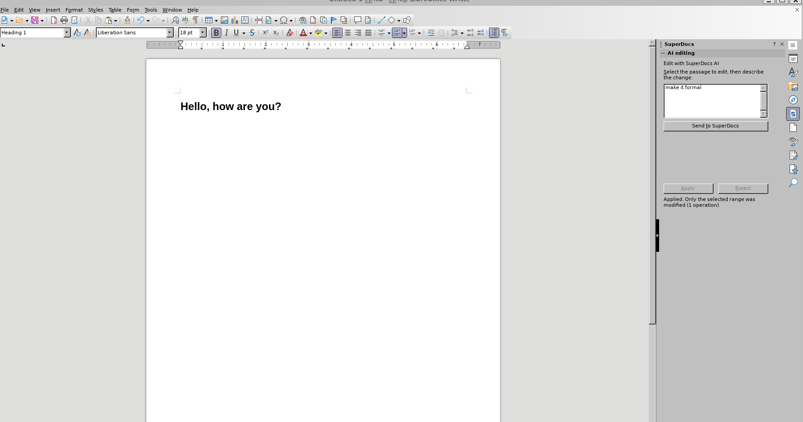

# SuperDocs Writer Sidebar

A native LibreOffice Writer extension: a sidebar panel for sending the current
selection (or the whole document) to SuperDocs with a natural-language editing
instruction, reviewing the proposed changes, and applying approved ones back
into the document **range by range** — untouched text is never rewritten, and
existing paragraph/character styles are respected.

> **Status: v0.3.1 — selection, whole-document, and drafting modes, validated
> on Linux and Windows.** Selection mode: select a passage, describe the edit,
> review, Apply → only the selected range changes, styles intact.
> Whole-document mode (tick the checkbox): the doc is exported as .docx through
> the host's own filter and uploaded; every approved change is located by its
> original text in the live document and replaced range by range — a change
> that can't be found, or that matches more than one place, is **skipped and
> reported, never guessed at**. Drafting: when the instruction makes SuperDocs
> *create* content instead of editing ("create a gym plan"), the API applies it
> server-side with **zero pending changes** — creation bypasses the
> `ask_every_time` approval gate entirely (reported as a bug during this
> project). The sidebar closes that gap locally: the draft becomes a reviewable
> proposal, Apply inserts it at the cursor, Reject discards it — nothing lands
> in your document without a decision. Current limits, stated honestly:
> write-back and draft insertion are plain text into styled ranges (formatting
> *inside* a proposal isn't carried yet); whole-doc write-back covers body
> paragraphs, not table-cell content (those changes are reported as skipped,
> and the approved SuperDocs copy still has them).

## Screenshots (Linux, WSLg)

| Sending a selection | Applied in place |
|---|---|
|  |  |

A `Heading 1` paragraph edited via the sidebar: the text changed, the heading
style survived untouched.

## Build

```bash
python build.py        # -> dist/superdocs-writer-sidebar.oxt
```

Stdlib-only build; the source layout under `src/` is the .oxt layout.

## Install (Linux)

```bash
sudo apt install libreoffice-writer python3-uno   # python3-uno = Python component loader
unopkg add -f dist/superdocs-writer-sidebar.oxt
```

Then open Writer → **View → Sidebar** → the **SuperDocs** deck appears in the
tab rail. (Windows note for development: use `unopkg.com`, not `unopkg.exe` —
the latter detaches from the console and can fail silently.)

## How it talks to SuperDocs

- The selection goes up as passage text (`/v1/documents/upload-base64` into a
  fresh session) — SuperDocs takes documents, never raw XML. In whole-document
  mode the doc is exported via the host's own filter (`storeToURL`, MS Word
  2007 XML) and uploaded as a file, per the host-app integration contract.
- `POST /v1/chat/async` with `approval_mode: "ask_every_time"`; the panel polls
  the job and previews the **actual proposed content** (`new_html`, tag-stripped)
  rather than the AI's self-description, which can paraphrase.
- Approvals always send the explicit `changes` array — a bare
  `{job_id, approved:true}` is a silent no-op in the API (discovered and
  reported during this project).
- Selection write-back: the approved result (plain-text export of the session)
  goes through the stored UNO text range with `setString`, inheriting the
  range's current styles. Whole-document write-back (`writeback.py`): each
  approved change's `old_html` is reduced to plain-text paragraphs, located as
  one consecutive paragraph run in the live document, and replaced with a
  style-preserving `setString` — no hard formatting, no whole-file replacement,
  untouched text is never rewritten. Not-found and ambiguous matches are
  skipped and named in the status line.
- All network work runs on a background thread; UI and document updates are
  marshaled to the office main thread via `AsyncCallback`.
- API key: `SUPERDOCS_API_KEY` environment variable, else
  `~/.superdocs/agent_credentials.json`. Never hardcoded, never in this repo.

## Tests

All harnesses (Linux) start a throwaway headless LibreOffice on an isolated
profile; they never touch your normal LibreOffice or its profile.

- `tests/run_style_test.sh` — builds a document with a Heading 1, a bullet
  list, and a table, edits one body paragraph through the exact client +
  write-back path the panel uses, and asserts the heading/list/table styles and
  content all survived. Costs 1 operation. Ends with `STYLE TEST: ALL PASS`.
- `tests/run_whole_doc_test.sh` — **offline, no API key, 0 operations.**
  Drives `writeback.apply_changes` with synthetic changes against a real Writer
  doc and proves the write-back invariants: unique match applied in place
  (entities decoded, inline tags stripped), a multi-paragraph run replaced as
  one range, ambiguous and not-found changes skipped with both copies
  untouched, table content untouched. Ends with
  `WHOLE-DOC WRITE-BACK TEST: ALL PASS`.
- `tests/run_whole_doc_live_test.sh` — the same flow end to end against the
  real API: UNO doc → .docx export → `request_doc_edit` → approve → write-back
  from the actual returned `old_html`/`new_html`. Costs 1 operation. Ends with
  `WHOLE-DOC LIVE TEST: ALL PASS`.
- `tests/draft_live_test.py` — plain HTTP, no LibreOffice needed, ≤1 operation.
  Sends a drafting instruction and verifies the client surfaces the created
  content as `draft_html` on a completed zero-pending job (the approval-gate
  bypass). If the model happens to propose in-place edits instead, they are
  rejected (free) and the run reports SKIPPED honestly — model choice between
  editing and creating is nondeterministic.

(Portability note discovered by this test: LibreOffice 26 dropped the classic
"List Bullet" paragraph-style family — bullets are now "List 1".."List 5" — so
the test discovers style names at runtime instead of assuming them.)

## Files

| Path | Role |
|------|------|
| `src/description.xml` | Extension identity/version |
| `src/META-INF/manifest.xml` | Declares the two .xcu configs + Python component |
| `src/config/Sidebar.xcu` | Registers the SuperDocs deck + panel in Writer's sidebar |
| `src/config/Factories.xcu` | Maps the panel's resource URL to the Python factory |
| `src/panel.py` | UNO component: panel factory, panel, threading, both modes |
| `src/panel.xdl` | Panel UI (whole-doc checkbox, instruction box, Send, preview, Apply/Reject, status) |
| `src/pythonpath/superdocs_client.py` | Stdlib SuperDocs client (upload → async chat → approve → export) |
| `src/pythonpath/writeback.py` | Whole-doc write-back: HTML→paragraphs, unique-run matching, range-by-range apply, draft insertion |
| `src/icons/superdocs_24.png` | Sidebar deck icon |

Built by Karthik Vanam for the SuperDocs hiring round, with AI-assisted
development (Claude Code).
