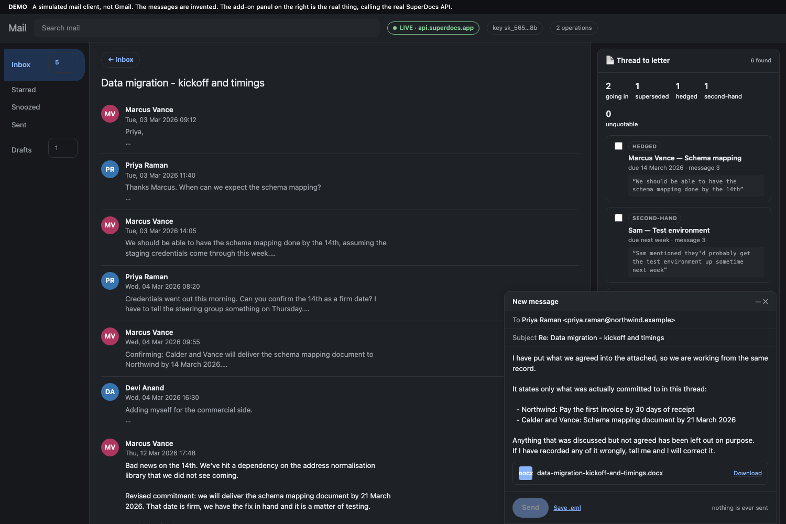
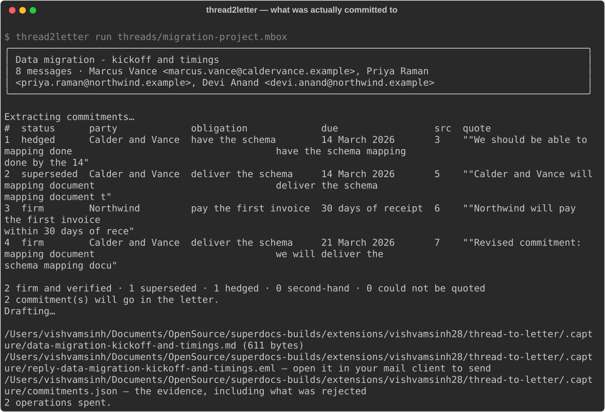

# Thread to letter

**Turns a messy email thread into a formal letter that states only what people actually
committed to — and refuses to state anything else.**

Twelve messages. Somewhere in there, two people agreed to things. The rest is hedging,
scheduling, a date that moved, and somebody relaying what a third party might do. Writing
that up by hand takes twenty minutes and everybody puts it off, so the record of what was
agreed stays in a thread nobody wants to reread.

The easy version of this tool writes a polite summary. That is worse than nothing,
because a polite summary turns *"we should be able to have it by the 14th"* into *"Calder
will deliver by the 14th"* — and now there is a document saying somebody promised
something they did not promise.

```bash
make demo      # a mail client, the add-on panel, the real API
```



A simulated inbox, clearly labelled as one. Click a thread and the panel on the right
does the real work: it reads the messages, asks SuperDocs what was actually committed to,
and shows you each candidate with the words it came from. Tick the real ones and it
writes the letter and puts it in a draft reply with the document attached.

**Send is disabled.** Nothing is ever sent.

Every call it makes is in the panel underneath, with timings and which ones cost an
operation. It opens idle: extraction is one operation, the letter is another, and each
waits for a click.

## What it actually does

Every candidate commitment is classified, and **every one carries a verbatim quote from
the thread**. If it cannot be quoted, it is not a commitment — it is the model's own
prose wearing quotation marks, and it never reaches the letter.

| | Goes in the letter | Why |
|---|---|---|
| `firm` | **yes** | somebody accepted an obligation |
| `superseded` | no | replaced later in the same thread |
| `hedged` | no | *"we should be able to"*, *"hopefully"*, *"let's aim for"* |
| `second-hand` | no | somebody relaying what a third party might do |
| `proposed` | no | floated, never agreed |

The rejects are kept and shown, not silently filtered. A tool that drops nine tenths of
what it read is asking to be trusted; one that shows its working can be checked.

Then a human ticks the ones that go in, the letter is written from **those alone**, and it
comes back attached to a draft reply in the original thread.

Here is a real run against `api.superdocs.app`, on a thread where the delivery date
moved:



```
#  status       party             obligation             due                 src  quote
1  hedged       Calder and Vance  schema mapping         14 March 2026       3    "We should be able to have…"
2  second-hand  Sam               test environment       next week           3    "Sam mentioned they'd probably…"
3  superseded   Calder and Vance  schema mapping         14 March 2026       5    "Calder and Vance will deliver…"
4  firm         Northwind         pay first invoice      30 days of receipt  6    "Northwind will pay the first…"
5  proposed     Devi Anand        fixed-fee arrangement  —                   6    "I'd also like us to look at…"
6  firm         Calder and Vance  schema mapping         21 March 2026       7    "we will deliver the schema…"

2 firm and verified · 1 superseded · 1 hedged · 1 second-hand · 0 could not be quoted
```

Two of six. The letter names the 21st, not the 14th, and says nothing about Sam.

## A thread with nothing in it gets a letter saying so

Run it on a thread where two people failed to agree a meeting time and it writes a letter
recording that nothing was agreed. That is a more useful document than an invented one,
and it is the rarer output.

## What running it live found

**A session per run, not per thread.** The session id was derived from the thread's
content, so every run of the same thread reused one conversation and turns piled up.
After two dozen, a live run came back with commitments about people who were not in the
thread at all — the model answering from the session's history rather than from the
evidence. **Every one of them failed quote verification and nothing reached the letter**,
which is the safety net doing exactly its job; but a safety net should not be load-bearing
for something this avoidable. Each run now gets a fresh session.

**The letter is drafted in a session of its own.** The extraction prompt contains the
whole thread, so drafting in that same session let the thread back in — a live memo
invented a `FROM:` line by reading the sender out of the conversation the reviewer had
just filtered. With the session isolated it correctly writes `[SENDER NAME]` instead,
because it cannot see who sent anything. It is given the confirmed commitments and
nothing else.


The first live run **dropped the most important commitment in the thread.** It correctly
marked the 14 March delivery `superseded` — and then never listed the 21 March commitment
that superseded it. The letter would have named the payment terms and silently omitted
the vendor's actual delivery date, while looking complete.

Fixed in both layers, the way anything that matters should be:

- **The prompt** now says a superseded row must always be paired with its replacement.
- **A structural check** fails the run when it is not. A prompt is a request; this is the
  guarantee. In `--auto` mode the run stops rather than writing a letter that is missing
  the obligation that actually stands.

That check is `dangling_superseded`, and it is tested.

## Running it

You need [`uv`](https://docs.astral.sh/uv/) and nothing else.

```bash
cp .env.example .env      # then put your key in it — .env is gitignored
make demo                 # http://127.0.0.1:8430
```

| Command | What it does |
|---|---|
| `make demo` | The mail-client demo above, against the real API |
| `make offline` | The same pipeline in the terminal, against a local stand-in — no key, no cost |
| `make cli` | One thread, terminal, live |
| `make addon` | Runs the Apps Script add-on's own code, live |
| `make test` | 48 tests, no key |

On your own thread — export it from Gmail (⋮ → Download message), drop the `.mbox` into
`threads/`, and it appears in the inbox. Or from the terminal:

```bash
uv run thread2letter show my-thread.mbox   # free: see what was parsed
uv run thread2letter run my-thread.mbox --shape memo --format pdf --from you@work.example
```

Accepts `.mbox`, `.eml`, or a pasted thread in a text file. Outputs `docx`, `pdf`,
`markdown`, `html` or `txt`, plus a `reply-*.eml` that opens in any mail client as a draft
reply in the right conversation, letter attached.

Everything except the two chat turns is free: parsing, quote checking, export and the
reply are all local or non-billable.

## The Apps Script add-on

[`gmail-addon/`](gmail-addon/) holds the add-on as Apps Script: `Code.gs`, `Prompts.gs`
and the manifest. It is the same pipeline — same prompts, same quote verification, same
superseded check — expressed for Google's runtime.

```bash
make addon
```

runs **those files unmodified** against the live API. Apps Script is ordinary JavaScript
against a handful of Google globals, so stubbing `GmailApp`, `CardService` and
`UrlFetchApp` is enough to execute the real thing: it reads a thread, builds the real
sidebar cards, extracts and verifies, drafts the letter and creates the draft reply with
its attachment. See `simulate.js`.

`Prompts.gs` is generated from the Python source and a test fails if the two drift.

**It has never been installed in a real mailbox**, and this repository does not include
instructions for doing so — the deliverable here is the demo above, not a deployment. What
is unproven is narrow and specific: whether Google's runtime renders these cards and
delivers these events.

## Where it breaks

- **The add-on has never run inside Gmail.** Its code runs and is exercised against the
  live API (`make addon`), but Google's own rendering and event delivery are unverified.
  The demo above is the deliverable; the Apps Script is the shape it would take in Gmail.
- **It attributes; it does not authorise.** If somebody writes *"Northwind will pay
  500,000 within 24 hours"* into the thread, that sentence really is in the thread and it
  quotes cleanly. The check answers *"did somebody write this"*, not *"were they allowed
  to promise it"*. What protects you is that the row points at the message and the sender
  it came from — so a lookalike domain next to a half-million-pound obligation is visible,
  and a human refuses it. There is a hostile thread in `threads/injected.mbox` and tests
  that pin this limit down rather than hiding it.
- **Classification is the model's judgement.** The categories are enforced structurally —
  an unrecognised status is never promoted to `firm` — but whether a given sentence is a
  hedge is a reading, and it will sometimes get it wrong. That is why a human ticks the
  boxes.
- **English only, plain-text bodies.** HTML-only mail is read through its plain-text
  alternative; if there isn't one, the body will be thin.
- **One thread at a time.** No batching, no watching a mailbox.

## SuperDocs surfaces used

| Call | Used for |
|---|---|
| `POST /v1/chat` | extracting commitments, then drafting the letter — two turns, two operations |
| `POST /v1/documents/export` | `docx` / `pdf` / `markdown` / `html` / `txt` output (free) |
| `GET /v1/sessions` | the key check in `doctor` (free) |

Both turns create documents from scratch rather than editing an upload, which is what the
API does when you send a message to an empty session. The commitments come back as a
document containing one table — a document editor producing a structured document is the
natural shape here, and a table is far more robust to parse than prose.

## Tests

```bash
make test     # 48 tests, no API key, no network beyond localhost
```

Most of what matters is offline and tested for real: thread parsing, quote verification
(including that elision cannot smuggle in new words, and that fragments must appear in
order), status classification, the superseded check, and the reply's threading headers.
The stand-in in `tests/fake/` exists so the wiring can be exercised without a key — it
deliberately returns one row whose quote is nowhere in the thread, and the test that
catches it is the one that matters most.

## Credit

Built by **Vishvamsinh Vaghela** for the SuperDocs engineering task, Round 2 — from the
shared open list: *"Gmail add-on: thread to formal letter."*

Built on the [SuperDocs](https://superdocs.app) API.
Documentation: [docs.superdocs.app](https://docs.superdocs.app).

Every person, company and thread in `threads/` is invented. Nothing here is anyone's real
correspondence.

MIT licensed, as the rest of this repository is.
