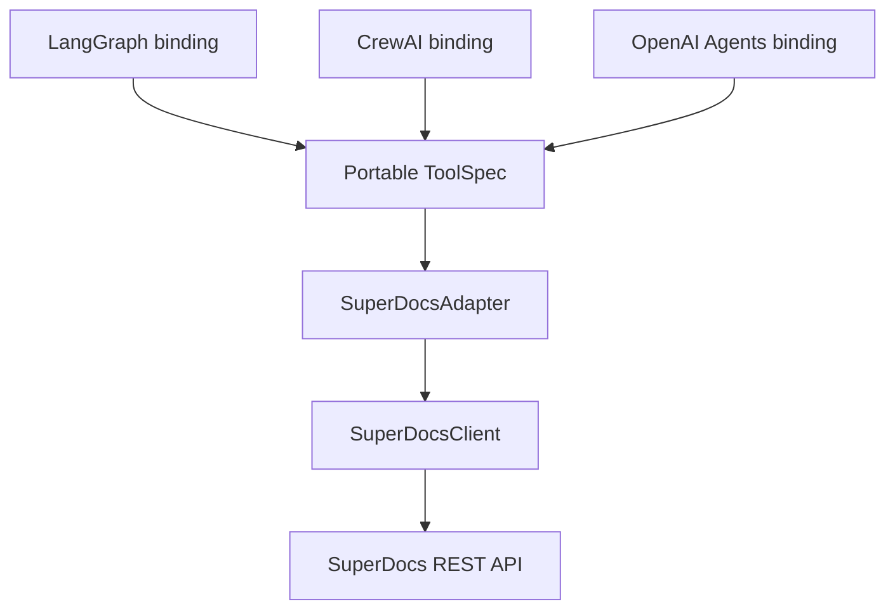

# SuperDocs Agent Adapter

One maintained, framework-independent Python core for SuperDocs, with thin bindings
and comparable quickstarts for LangGraph, CrewAI, and the OpenAI Agents SDK.

Every quickstart performs the same reviewed workflow:

1. Upload the same document.
2. Send the same edit instruction.
3. Wait for and approve the proposed changes.
4. Export the finished document as text.
5. Return the same canonical result shape.

The adapter uses the SuperDocs REST API. Agent frameworks are optional integrations;
none are imported by the core package.

## Why this exists

Framework-specific examples are useful, but separately implementing HTTP, polling,
approval, parsing, and export for every framework creates drift. This project keeps
that behavior in one core. A binding only translates the portable tool specification
into a framework-native tool.



## Assignment coverage

| Requirement | Implementation |
|---|---|
| Framework-independent core | `src/superdocs_adapter/`; no framework dependencies |
| Three popular frameworks | LangGraph, CrewAI, OpenAI Agents SDK |
| Same task and output | Shared fixture/instruction plus `test_binding_parity.py` |
| Clean-clone runnable | Locked dependencies and commands below |
| Fourth binding process | [`docs/adding-a-binding.md`](docs/adding-a-binding.md) |
| Hosted server vs wrapper note | [`docs/mcp-vs-wrapper.md`](docs/mcp-vs-wrapper.md) |
| Versioned releases | Semantic version, lockfile, and [`CHANGELOG.md`](CHANGELOG.md) |
| SuperDocs surfaces | Upload, async chat, approval, job polling, export |

## Repository layout

```text
superdocs-agent-adapter/
├── src/superdocs_adapter/       # Framework-free core
│   └── bindings/                # Optional thin framework translations
├── quickstarts/                 # Three comparable runnable examples
├── examples/                    # Shared input and expected output
├── tests/                       # Unit, HTTP contract, parity and live tests
├── docs/                        # Decisions and extension instructions
├── pyproject.toml               # Package metadata and optional extras
└── uv.lock                      # Reproducible dependency lock
```

## Requirements

- Python 3.10+
- [`uv`](https://docs.astral.sh/uv/) recommended
- A SuperDocs API key for live runs

The test suite does not require an API key unless live tests are explicitly enabled.

## Clean-clone setup

From this project directory:

```bash
uv sync --all-extras
uv run pytest -m "not live"
```

Set the live credential in your shell. Never add it to a file committed to Git.

```bash
export SUPERDOCS_API_KEY="your-key-here"
```

PowerShell:

```powershell
$env:SUPERDOCS_API_KEY="your-key-here"
```

## Run the three quickstarts

Each command uses the same `sample-policy.txt`, instruction, export format, and
canonical response. It invokes the framework's native tool boundary directly, so no
second model-provider key or additional agent-model call is required.

```bash
uv run --extra langgraph python -m quickstarts.langgraph.app
uv run --extra crewai python -m quickstarts.crewai.app
uv run --extra openai-agents python -m quickstarts.openai_agents.app
```

Each prints this stable shape (runtime paths and byte sizes reflect the actual run):

```python
{
    "status": "completed",
    "approved_changes": 1,
    "export_format": "txt",
    "filename": "superdocs-output.txt",
    "size_bytes": 161,
    "output_path": "quickstarts/<framework>/output/superdocs-output.txt",
}
```

## Verify identical output

The default parity test uses a recorded core result and crosses each real framework
tool boundary. It proves the bindings pass identical arguments into the core and
write byte-identical exports without spending SuperDocs operations.

```bash
uv run pytest tests/test_binding_parity.py -v
```

The opt-in live parity test performs three small SuperDocs operations and compares
normalized text exports with the checked-in expected file:

```bash
RUN_LIVE_SUPERDOCS=1 uv run pytest -m live -v
```

This explicit flag is the operation-budget stopping rule: live tests never run by
accident, and one invocation performs at most one run per supported framework.

## Use the core without a framework

```python
import os

from superdocs_adapter import ExportFormat, SuperDocsAdapter, SuperDocsClient

with SuperDocsClient(os.environ["SUPERDOCS_API_KEY"]) as client:
    adapter = SuperDocsAdapter(client, timeout=600)
    result = adapter.edit_and_export(
        "contract.docx",
        "Change the governing law to Maharashtra. Do not change anything else.",
        export_format=ExportFormat.DOCX,
    )
    result.export.save("output/reviewed-contract.docx")
```

## Core design choices

- `chat/async` with `approval_mode="ask_every_time"` preserves the required human
  approval boundary.
- Compact polling avoids repeatedly downloading large result bodies. A full job is
  fetched only at approval and completion boundaries.
- Proposed-change content receives the documented second JSON parse. Completed job
  results remain objects and are not decoded a second time.
- Timeouts and terminal failures are explicit exceptions; slow jobs are never treated
  as crashed merely because they are still processing.
- Unique session IDs prevent collisions between framework runs.
- Binary exports support both direct bytes and SuperDocs signed download URLs.
- Framework packages are optional extras and imported only inside binding modules.

See [`docs/architecture.md`](docs/architecture.md) for boundaries and trade-offs.

## Tests

```bash
uv run pytest -m "not live" -v
uv run pytest --cov=superdocs_adapter --cov-report=term-missing
uv build
```

Coverage includes orchestration, double parsing, portable tools, real framework
bindings, HTTP error handling, signed-URL exports, and cross-framework parity.

## Release policy

This project follows semantic versioning:

- Patch: fixes that do not change tool schemas.
- Minor: backward-compatible tools, bindings, or fields.
- Major: incompatible tool schema or public Python API changes.

See [`CHANGELOG.md`](CHANGELOG.md) for released behavior.

## Author

Built by **Vrutansh Patel** for the SuperDocs engineering build round.

## License

MIT, matching the parent repository.
