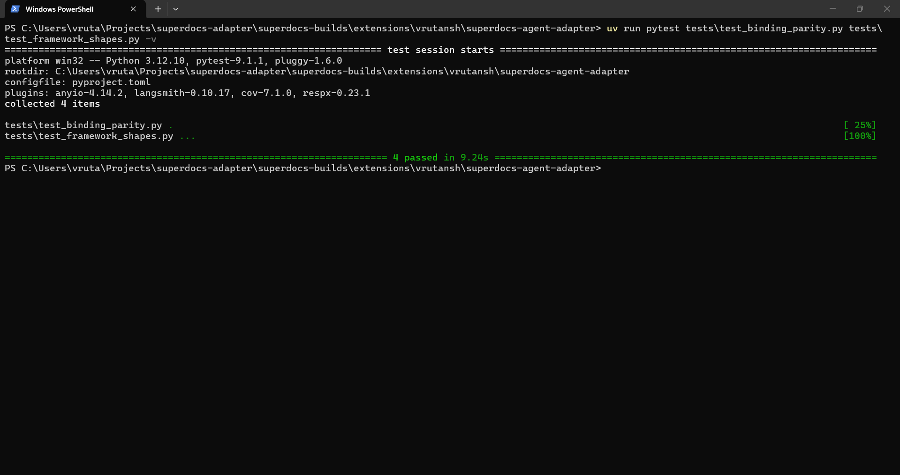
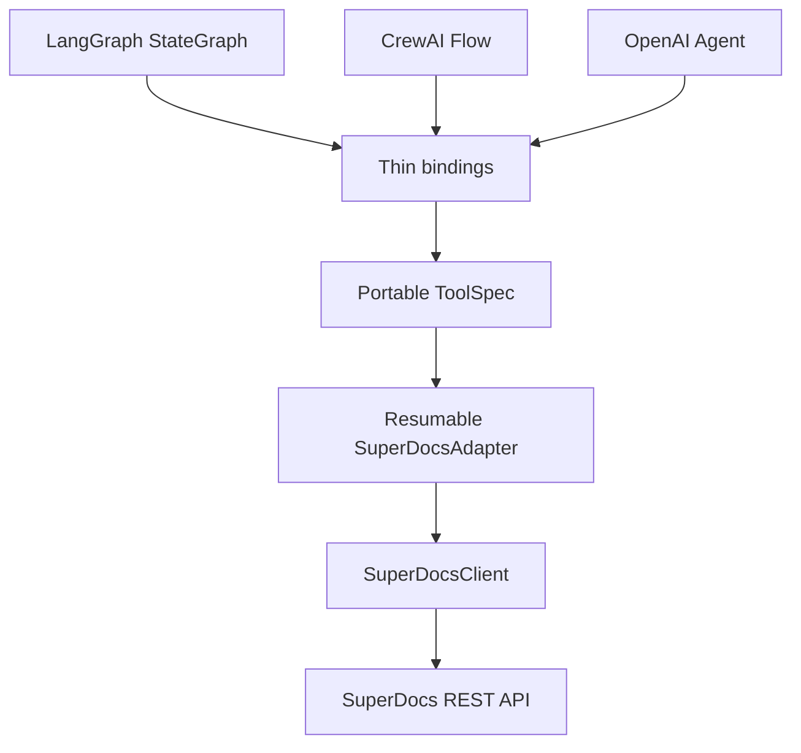

# SuperDocs Agent Adapter

One maintained Python core that exposes SuperDocs document editing to LangGraph,
CrewAI, the OpenAI Agents SDK, and future agent frameworks through thin bindings.

All three quickstarts run the same reviewed task against the same document and return
the same canonical result. The framework changes; the SuperDocs behavior does not.

> Built by **Vrutansh Patel** for the SuperDocs engineering task.

## Verified result

| Proof | Result |
|---|---:|
| Framework-independent core | Verified by isolated import test |
| Framework bindings | LangGraph, CrewAI, OpenAI Agents SDK |
| Live output parity | 3/3 frameworks matched the expected export |
| Non-live suite | 31 tests, no SuperDocs key required |
| Coverage | 91% |
| Clean-copy install/test/build | Passed |
| Distribution | Wheel and source archive build successfully |
| Live operation guard | Explicit opt-in; maximum three edits per parity run |

### Framework parity proof



The zero-operation verification crosses the LangGraph, CrewAI, and OpenAI Agents
binding boundaries and validates their native framework shapes.

The final hardened live parity run completed in **70.93 seconds on Windows/Python
3.12.10**. This is one observed small-document run, not a general latency claim.

## Why this exists

Implementing upload, async polling, change parsing, approval, recovery, and export in
every framework example creates drift. This adapter keeps those rules in one core and
translates only the portable tool boundary.



The core package has no framework dependency. Installing another framework is an
optional extra, and importing `superdocs_adapter` does not import `langgraph`,
`crewai`, or `agents`.

## Assignment coverage

| Assignment requirement | Evidence |
|---|---|
| One framework-agnostic adapter | `src/superdocs_adapter/` |
| Three popular frameworks | Native quickstarts for LangGraph, CrewAI, OpenAI Agents |
| Same task, identical output | Mock parity plus opt-in live parity test |
| Clean-clone runnable | Locked dependencies and clean-copy verification |
| Fourth binding in an afternoon | [`docs/adding-a-binding.md`](docs/adding-a-binding.md) |
| Hosted server vs wrapper guidance | [`docs/mcp-vs-wrapper.md`](docs/mcp-vs-wrapper.md) |
| Versioned releases | Semantic version, changelog, release procedure |
| Four-call minimum contract | Upload, async chat, approval, export |
| Proposed-change second parse | Isolated parser and contract test |
| Long-operation handling | Compact polling, progress callback, timeout with resume guidance |
| Operation budget | Checkpoints, re-entry, explicit live-test flag |

## Framework comparison

| Quickstart | Native shape | Best fit |
|---|---|---|
| LangGraph | Compiled `StateGraph` and `StructuredTool` | Stateful graphs, branching, interrupts |
| CrewAI | Native deterministic `Flow` and CrewAI tool | Crew/flow-based applications |
| OpenAI Agents | `Agent` with attached `FunctionTool` | SDK-managed tool loops and handoffs |

The quickstarts invoke their native tool deterministically. This avoids requiring a
second model-provider key and makes output parity a test of the adapter rather than a
test of three different planners. The generated tools can still be attached to normal
agent loops; each quickstart README shows the intended integration shape.

## Clean-clone setup

Requirements: Python 3.10+, [`uv`](https://docs.astral.sh/uv/), and a SuperDocs API
key only for live calls.

```bash
uv sync --all-extras
uv run pytest -m "not live"
```

Set the key in the shell, never in committed source:

```bash
export SUPERDOCS_API_KEY="your-key-here"
```

```powershell
$env:SUPERDOCS_API_KEY="your-key-here"
```

## Run the quickstarts

```bash
uv run --extra langgraph python -m quickstarts.langgraph.app
uv run --extra crewai python -m quickstarts.crewai.app
uv run --extra openai-agents python -m quickstarts.openai_agents.app
```

Each uses `examples/input/sample-policy.txt`, the same exact instruction, review mode,
and TXT export. Progress is printed only when status or percentage changes. A completed
run returns:

```python
{
    "status": "completed",
    "approved_changes": 1,
    "export_format": "txt",
    "filename": "superdocs-output.txt",
    "size_bytes": 161,
    "resumed": False,
    "output_path": "quickstarts/<framework>/output/superdocs-output.txt",
}
```

Runtime IDs are deliberately excluded from this public shape so framework results are
comparable without hiding meaningful content differences.

## Prove identical output

The default parity test crosses each installed framework's real tool boundary using a
recorded core result. It spends no SuperDocs operations:

```bash
uv run pytest tests/test_binding_parity.py -v
```

The live test performs exactly one small edit per framework and compares all three
normalized exports to `examples/expected/expected-output.txt`:

```bash
RUN_LIVE_SUPERDOCS=1 uv run pytest tests/test_live_parity.py -m live -v -s
```

Without `RUN_LIVE_SUPERDOCS=1`, it is skipped. Stop after one run unless runtime code
changed; exports are free, but the three edits are not.

## Crash-safe re-entry

Every high-level tool call writes a small atomic JSON checkpoint under its ignored
output directory. The checkpoint contains only:

- An input fingerprint (document bytes + instruction + settings)
- Session and job IDs
- Current phase
- Approved change IDs

It never stores the API key, document content, proposed content, or exported bytes.

Recovery behavior:

| Last durable phase | Re-entry action |
|---|---|
| Uploaded | Find the existing job in the unique session, or start one if none exists |
| Editing | Resume compact polling of the same job |
| Awaiting/approved | Continue the same approval lifecycle |
| Completed | Repeat only export, which is non-billable |

The checkpoint fingerprint prevents accidentally resuming a run with changed input.
Atomic replace prevents readers from observing a partially written checkpoint.

## Large documents

Small documents stream through multipart upload. Files above 20 MiB automatically use
the documented pre-signed upload flow:

1. Request a short-lived upload URL.
2. Stream the file directly to storage without loading it into memory.
3. Ask SuperDocs to parse it into the unique session.
4. Continue the same edit/review/export workflow.

Inputs above SuperDocs' 100 MB limit fail locally with an actionable message before a
network call.

## Use the core directly

```python
import os

from superdocs_adapter import ExportFormat, SuperDocsAdapter, SuperDocsClient

with SuperDocsClient(os.environ["SUPERDOCS_API_KEY"]) as client:
    adapter = SuperDocsAdapter(client, timeout=600)
    result = adapter.edit_and_export(
        "contract.docx",
        "Change the governing law to Maharashtra. Do not change anything else.",
        export_format=ExportFormat.DOCX,
        checkpoint_path="output/contract-run.json",
    )
    result.export.save("output/reviewed-contract.docx")
```

## System invariants

- Framework bindings never implement HTTP, polling, approval, or export logic.
- A costly edit is associated with one unique session and durable checkpoint.
- Re-entry never uploads again when a valid checkpoint exists.
- Proposed-change content is parsed twice; completed results are parsed once.
- Compact polling never mistakes slow processing for a crash.
- Export failure never repeats the edit.
- Credentials and document content never enter checkpoints or logs.
- Large-file bytes stream through the upload path rather than agent context or memory.

See [`docs/architecture.md`](docs/architecture.md) for detailed ownership and runtime
sequences.

## Honest limitations

- The quickstarts auto-approve changes so their output is comparable. Applications
  requiring a human decision should use the lower-level job and approval methods to
  show each proposed change before submitting decisions.
- A crash before the initial upload response cannot be resumed because no session ID
  exists locally yet. Upload is non-billable, so retrying does not repeat an edit.
- TXT parity proves content equality, not DOCX/PDF byte identity. Office containers can
  differ in metadata while rendering identically.
- The adapter intentionally exposes one guarded edit workflow, not all SuperDocs tools.
- This project validates Python 3.10+ contracts; the recorded environment evidence is
  Windows Python 3.12.10 and Linux Python 3.12.13.

## Tests and package checks

```bash
uv run pytest -m "not live" -v
uv run pytest -m "not live" --cov=superdocs_adapter --cov-report=term-missing
uv run ruff check .
uv run ruff format --check .
uv build
```

The suite covers parsing, HTTP contracts, native framework shapes, dependency
isolation, resumability, operation recovery, large uploads, signed exports, timeouts,
terminal failures, and framework parity.

## Repository map

```text
superdocs-agent-adapter/
├── src/superdocs_adapter/
│   ├── client.py              # REST and large-upload transport
│   ├── adapter.py             # Reviewed, resumable orchestration
│   ├── checkpoints.py         # Atomic non-secret recovery journal
│   ├── tools.py               # Portable tool specification
│   └── bindings/              # Thin optional framework translations
├── quickstarts/               # Three native framework examples
├── examples/                  # Shared input and expected export
├── tests/                     # Offline contracts and opt-in live parity
├── docs/                      # Architecture and extension decisions
├── TASK.md                    # Scope, invariants, and definition of done
├── PROGRESS.md                # Assumptions and verified evidence
├── pyproject.toml
└── uv.lock
```

## Release policy

The project follows Semantic Versioning. A release requires the offline suite, package
build, clean-copy verification, changelog update, Git tag, and GitHub release notes.
See [`CHANGELOG.md`](CHANGELOG.md).

## License

MIT, matching the parent repository.
