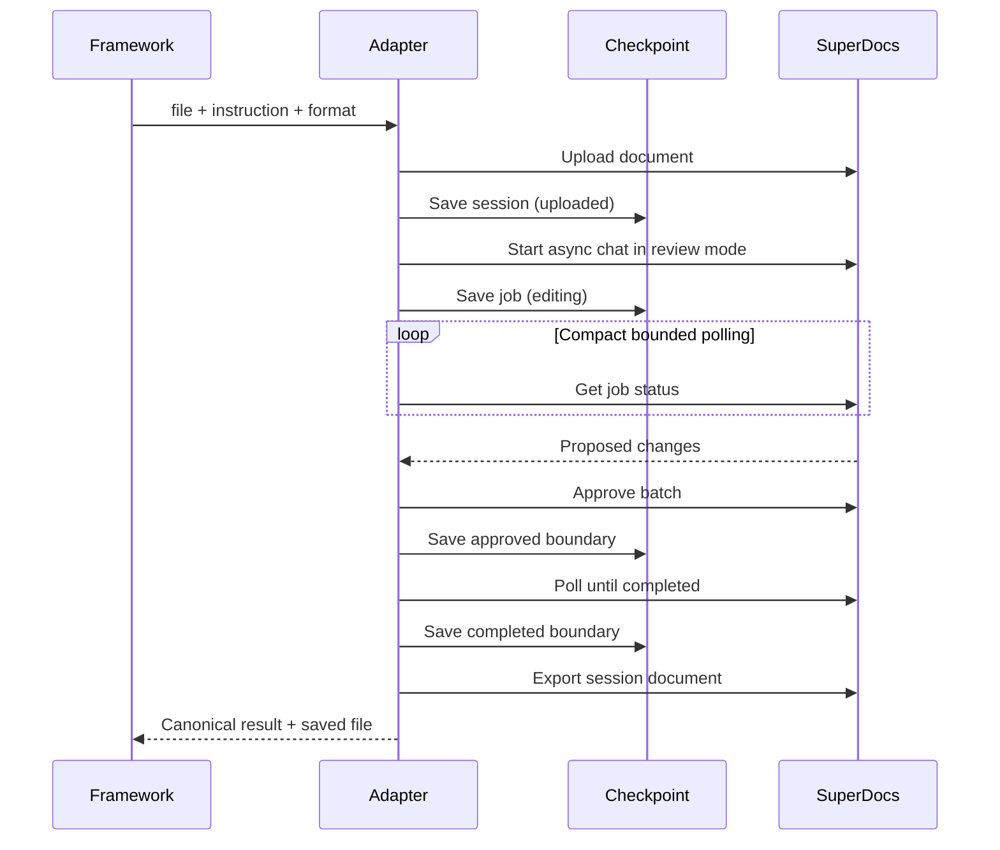
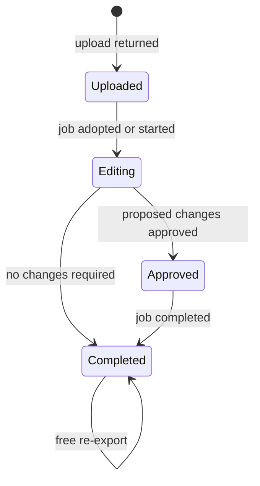
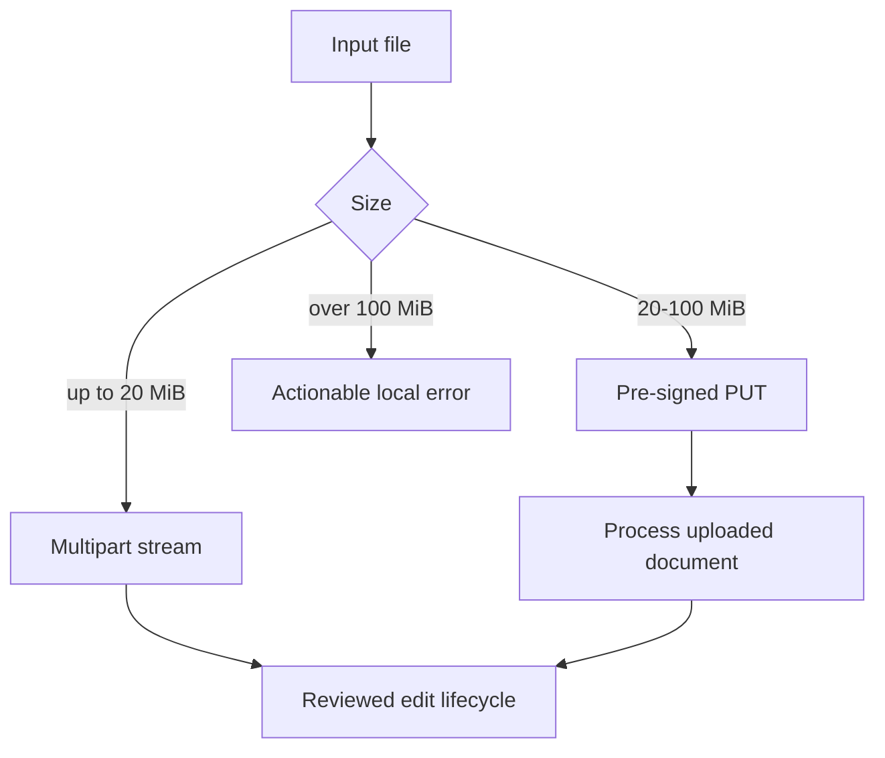

# Architecture

## Design goal

Keep SuperDocs behavior stable while frameworks evolve independently. Intelligence
decides the document edit inside SuperDocs; this adapter executes a guarded,
recoverable lifecycle around that work.

## Ownership boundaries

| Layer | Owns | Must not own |
|---|---|---|
| `SuperDocsClient` | HTTP, auth, endpoint shapes, streaming uploads, export bytes | Polling policy, framework types |
| `SuperDocsAdapter` | Upload/edit/review/export lifecycle, re-entry, timeout policy | Framework imports, UI rendering |
| `FileCheckpointStore` | Atomic non-secret recovery state | API calls, documents, credentials |
| `SuperDocsToolset` | Portable name, JSON schema, canonical output | Framework-native objects |
| `bindings/*` | Translation to one framework's native tool/workflow | HTTP, recovery, approval, export |
| `quickstarts/*` | Runnable comparison and output location | Duplicated business logic |

The dependency arrow points inward: quickstarts depend on bindings; bindings depend on
the portable toolset; the core never imports outward.

## Fresh execution

## Re-entry state machine

The operation fingerprint includes source bytes, instruction, export format, model
tier, and thinking depth. It excludes the path, so moving the same input file does not
invalidate recovery. Changed content or behavior settings do invalidate it.

The unique session closes the narrow crash window between `chat/async` returning and
the job ID reaching disk. On re-entry from `uploaded`, the adapter asks SuperDocs for
that session's newest job. It adopts an existing job; only an empty job history permits
a new edit.

## Large-input routing

Both supported routes stream from disk. Large bytes do not enter agent context or a
single in-memory buffer.

## Output parity

Session, document, job, filesystem, and checkpoint identifiers differ naturally and
are excluded from the canonical comparison. Parity checks:

- Stable public result fields.
- Arguments delivered to the shared adapter.
- Byte-identical TXT exports in the offline binding test.
- Normalized exported text against a checked-in expected document in the live test.
- Preservation of the untouched surrounding text.

Raw DOCX/PDF hashes are intentionally not claimed: generated containers may carry
different metadata while rendering the same content.

## Review policy

The high-level comparison tool retrieves proposed changes and auto-approves them so
three unattended runs remain comparable. The approval call is explicit and tested; it
is never replaced with auto-apply mode. A product UI can use `get_job` and
`approve_changes` directly to place a person between proposal and application.

## Failure behavior

| Failure | Behavior |
|---|---|
| Missing/invalid key | Fail before work, name the environment variable |
| Unsupported or empty input | Fail locally before a request |
| Rate limit | Surface wait-and-retry guidance |
| Slow job | Time out locally while retaining resumable session/job state |
| Provider/server failure | Surface server cause; retain checkpoint |
| Export/download failure | Retry export only; never repeat edit |
| Malformed checkpoint | Refuse unsafe guessing and name the file to inspect/remove |
| Changed inputs on resume | Refuse the checkpoint rather than mix two operations |

## Why REST is the core transport

REST gives precise control over async status, approval, recovery, and binary downloads
without assuming a framework has an MCP client. The hosted MCP server remains the
better zero-wrapper option for native MCP hosts. Bindings depend on `SuperDocsToolset`,
not HTTP details, so a future MCP transport does not require rewriting frameworks.

## Contract references

- [Async chat and HITL workflow](https://docs.superdocs.app/api-reference/v1/start-a-long-running-or-hitl-approved-ai-edit%3B-returns-a-job_id-to-poll-for-results)
- [Session-scoped job recovery](https://docs.superdocs.app/api-reference/v1/list-all-async-chat-jobs-for-a-specific-session-most-recent-first)
- [Batch approval](https://docs.superdocs.app/api-reference/v1/approve-or-deny-ai-proposed-document-changes-one-by-one-or-in-batch-hitl-workflow)
- [Pre-signed large upload](https://docs.superdocs.app/api-reference/uploads/get-a-pre-signed-url-to-upload-large-files-docxpdfhtmlmdrtf-without-bloating-agent-context)
- [Process a pre-signed upload](https://docs.superdocs.app/api-reference/uploads/parse-an-uploaded-file-into-structured-html-with-chunk-ids-for-targeted-ai-editing)
