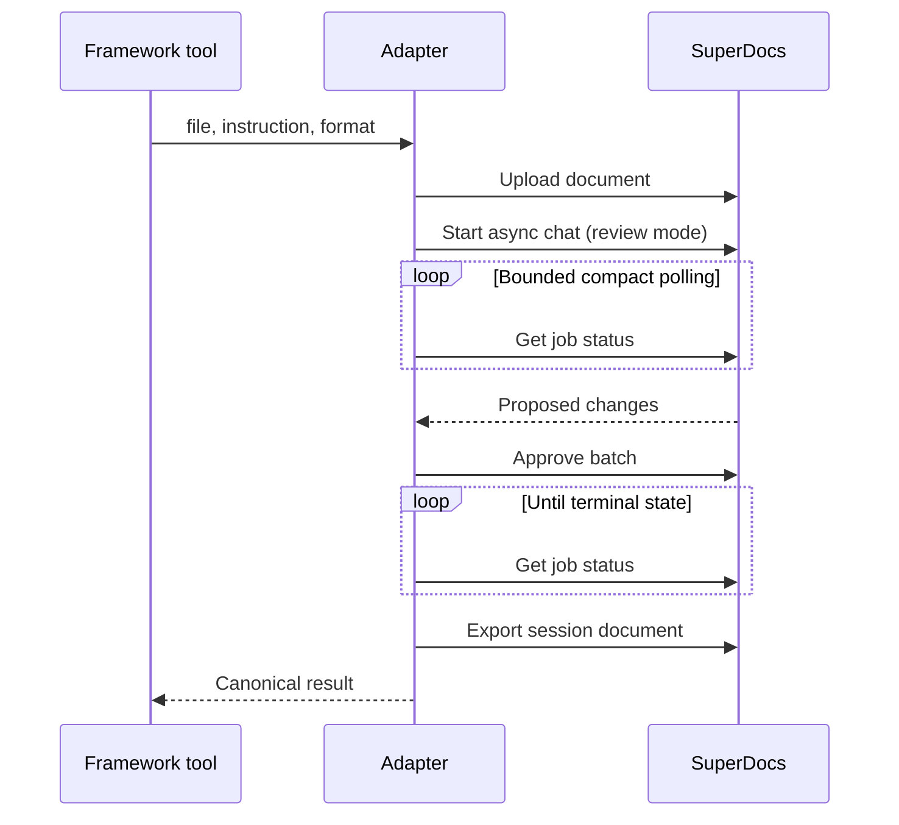

# Architecture

## Goal

Keep SuperDocs behavior stable while allowing agent frameworks to change independently.
The core owns document workflow semantics. Bindings own only framework translation.

## Boundaries

| Layer | Owns | Must not own |
|---|---|---|
| `SuperDocsClient` | HTTP, authentication, endpoint shapes, export bytes | Polling policy, framework types |
| `SuperDocsAdapter` | Four-call lifecycle, polling, approval, timeouts | Framework imports, UI decisions |
| `SuperDocsToolset` | Portable name, description, schema, canonical output | Framework-native objects |
| `bindings/*` | Conversion into native framework tools | HTTP, polling, approval logic |
| `quickstarts/*` | Runnable comparison and output location | Duplicate workflow code |

## Runtime sequence

## Why REST is the core transport

The minimum workflow needs precise control over asynchronous status, approvals, and
export bytes. REST is supported by every Python environment, is straightforward to
mock, and does not assume the host framework implements MCP. The design does not block
a future MCP transport because framework bindings depend on `SuperDocsToolset`, not on
HTTP details.

## Output parity

Session, document, job, and filesystem identifiers naturally differ across runs. They
are intentionally excluded from the canonical output. Framework parity compares:

- Stable public result fields.
- Arguments received by the shared adapter.
- Normalized exported text.
- Exact expected edit and preservation of untouched text.

Raw DOCX or PDF byte hashes are not a valid parity signal because container metadata
can differ even when rendered content is identical.

## Approval policy

The assignment requires approval. The high-level convenience tool currently approves
all pending changes after retrieving them. Applications needing a user decision can
use the lower-level client methods and submit per-change decisions. The approval call
is never skipped silently.
