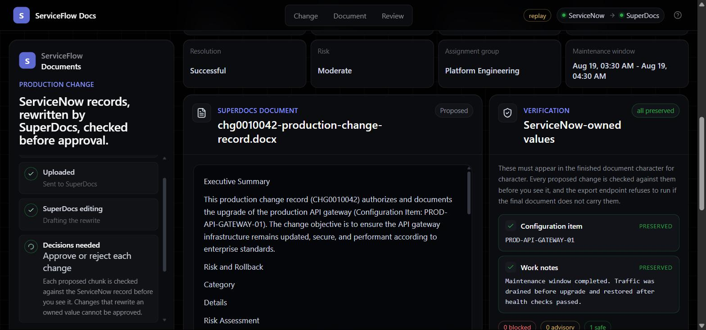
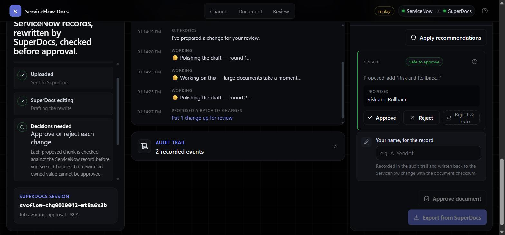

# ServiceFlow Docs

**ServiceNow doc-automation app, built on SuperDocs.** Built by Abhinay Yendoti for the
SuperDocs engineering task.

Turns a closed ServiceNow change request into an approved, exported production change
record — with a human gate a model cannot talk its way past.

**Who it serves.** Enterprise IT and ITSM teams. Change records, policy updates and
knowledge articles start life as raw ServiceNow ticket fields and get rewritten by hand
into something an auditor can read. That rewriting is what this automates, without letting
the rewrite quietly change what the ticket actually said.

**The non-obvious part.** The document is written by a live LLM API, but ServiceNow owns
certain values in it and they have to survive character for character. The model does not
reliably respect that. Asked for an executive summary, the live API has rewritten
`PROD-API-GATEWAY-01` as `API-GW-PROD-01`, turned the resolution code `Successful` into a
sentence, and written "the configuration item identified as the production API gateway"
without ever quoting the value.

So every proposed edit is checked against the source record before a reviewer sees it, the
server refuses to approve one that rewrites an owned value even if the browser asks, and
the export endpoint re-checks the finished document and refuses to run if it has drifted.

That gate — not the document generation — is the product.



Every proposed change carries a verdict, and the reviewer decides each one. Approval and
export are separate acts, and both re-check the document.



## What is real

| Layer | Implementation |
| --- | --- |
| **SuperDocs** | Live. Every document operation is a real call to `api.superdocs.app`. No hand-written mock, no offline fallback. Missing key, missing document. |
| **ServiceNow** | Reached over the **Table API** — basic auth, encoded queries, `sysparm_*`, PATCH write-back. Backed by a mock instance served in-process; pointing at a real tenant is a base URL and a credential. |
| **The human gate** | Enforced server-side. The UI reflects it; it does not implement it. |
| **The export** | DOCX bytes from the SuperDocs export endpoint. Nothing is rendered locally. |

## The SuperDocs contract

The task's minimum contract is upload → edit instruction → approve → export. All four are
real REST calls, in `server/superdocs.js`:

| Step | This app | SuperDocs |
| --- | --- | --- |
| **1. Upload** | `POST /api/documents/upload` | `POST /v1/documents/upload-base64` |
| **2. Edit instruction** | `POST /api/documents/edit` | `POST /v1/chat/async` with `approval_mode: "ask_every_time"` |
| **3. Approve** | `POST /api/documents/decide` (one) · `/decide-batch` (many) | `POST /v1/chat/{session}/approve` |
| **4. Export** | `POST /api/documents/export` | `POST /v1/documents/export` → DOCX bytes |

Plus the parts a real run needs: `GET /v1/agents/whoami` for quota before starting,
`GET /v1/chat/{session}/stream` (SSE) with `GET /v1/jobs/{job}` as the polling fallback,
`POST /v1/chat/{session}/continue` for the large-edit pause, and
`POST /v1/sessions/{sid}/chunks/{cid}/re-edit` to redo one rejected section.

`approval_mode: "ask_every_time"` is what makes this human-in-the-loop rather than a
generator: the job parks at `awaiting_approval` with proposed chunk changes instead of
applying them.

## ServiceNow input shape

Record type: **change request** (`change_request`), state `3` (Closed). The queue is a real
`state=3^ORDERBYDESCsys_updated_on` query, which is why open changes never appear in it.

Four fields are required before anything is sent anywhere — an incomplete record is
rejected by `/api/documents/upload` with a 422 naming the missing fields:

```jsonc
{
  "number":              "CHG0010042",
  "short_description":   "Upgrade production API gateway",
  "configuration_item":  "PROD-API-GATEWAY-01",     // required, verbatim
  "work_notes":          "Maintenance window completed. Traffic was drained before upgrade and restored after health checks passed.",  // required, verbatim
  "resolution_code":     "Successful",
  "status":              "Closed",
  "requester":           "Asha Rao",
  "assignment_group":    "Platform Engineering",
  "risk":                "Moderate",
  "planned_start":       "2026-08-18 22:00:00",
  "planned_end":         "2026-08-18 23:00:00"
}
```

Read from the Table API as `cmdb_ci`, `work_notes`, `close_code`, `state` and normalized in
`server/servicenow/source.js`. All fixture data is fictional
(`server/servicenow/fixtures.js`).

**Output:** a formatted production change record, exported from SuperDocs as **DOCX** (the
endpoint also accepts `pdf`, `html`, `markdown`).

## Example output

The exported document for the payload above — headings mapped one-for-one from ServiceNow
fields, with an Executive Summary and Risk and Rollback section added by SuperDocs:

```
Production Change Record
Change ID            CHG0010042
Change Summary       Upgrade production API gateway
Configuration Item   PROD-API-GATEWAY-01
Work Notes           Maintenance window completed. Traffic was drained before upgrade
                     and restored after health checks passed.
Resolution           Successful
Status               Closed
Requester            Asha Rao
Assignment Group     Platform Engineering
...
Executive Summary    This production change record (CHG0010042) authorizes and documents
                     the upgrade of the production API gateway (Configuration Item:
                     PROD-API-GATEWAY-01). ...
Risk and Rollback    ...
```

The configuration item and the work notes appear **character for character** under their
own headings. That is asserted on the proposed edits, again on the finished document before
approval, and a third time at export.

## Quickstart

```bash
npm install
cp .env.example .env.local     # add SUPERDOCS_API_KEY
npm start                      # build + serve on http://127.0.0.1:8787
```

For UI work, run the two halves separately:

```bash
npm run server                 # API + mock ServiceNow instance on :8787
npm run dev                    # Vite on :5173, proxying /api
```

**No SuperDocs key?** Set `SUPERDOCS_REPLAY=replay` and the whole flow runs off a recorded
cassette — real bytes a real run produced, no key, no quota. This is how CI runs it, and
how a reviewer can drive the full upload → edit → approve → export path:

```bash
SUPERDOCS_REPLAY=replay npm run server
```

See [Development § Working without a key](docs/DEVELOPMENT.md#working-without-a-key).

```bash
npm test                       # 80 tests, no key required
npm run typecheck
```

## Driving it from the API

The whole contract, without the browser:

```bash
# 1. upload — validates the record, maps it verbatim, sends it to SuperDocs
curl -sX POST localhost:8787/api/documents/upload \
     -H 'Content-Type: application/json' -d '{"number":"CHG0010042"}'

# 2. edit — one instruction naming the values that must survive
curl -sX POST localhost:8787/api/documents/edit \
     -H 'Content-Type: application/json' -d "{\"sessionId\":\"$SID\"}"

# poll until awaiting_approval
curl -s "localhost:8787/api/documents/job/$JOB?sessionId=$SID"

# 3. approve — per proposed change, each with a verdict already attached
curl -sX POST localhost:8787/api/documents/decide \
     -H 'Content-Type: application/json' \
     -d "{\"sessionId\":\"$SID\",\"jobId\":\"$JOB\",\"changeId\":\"$CID\",\"approved\":true}"

# sign off on the finished document — re-verified server-side
curl -sX POST localhost:8787/api/documents/approve \
     -H 'Content-Type: application/json' -d "{\"sessionId\":\"$SID\",\"reviewer\":\"A. Reviewer\"}"

# 4. export — re-verified once more, returns DOCX bytes
curl -sX POST localhost:8787/api/documents/export \
     -H 'Content-Type: application/json' -d "{\"sessionId\":\"$SID\"}" -o change-record.docx
```

## Product surface vs. implementation

The reviewer sees one thing: **ServiceNow, connected.** The queue, the record, the
verification and the write-back are all presented as the integration they are. How a system
is reached is an operational concern, not a reviewer's, and it does not belong in a payload
every browser tab fetches.

Behind that surface, ServiceNow is a mock instance served in-process as a real Table API
([Decisions §2](docs/DECISIONS.md)). None of that reaches the browser:

- `/api/health` reports **whether** each system is answering, never how — no base URLs, no
  instance addresses, no deployment topology.
- ServiceNow connectivity is genuinely probed, so a green dot means the queue will load.
- The shipped bundle contains zero references to the implementation.

Pointing at a real tenant is one environment variable and changes nothing the reviewer
sees — which is the entire reason the mock was built as an API rather than a fixture array.

The one thing the UI will always tell you about itself: a **replayed** run is labelled as
one. A recorded run must never be presentable as a live one.

## The flow

1. Pick a closed change. The queue is a real `state=3^ORDERBYDESCsys_updated_on` query,
   which is why open changes never appear in it.
2. Validate. An incomplete record is rejected before anything reaches SuperDocs.
3. Map the record verbatim and upload it.
4. SuperDocs proposes chunk-level edits in batches and waits. Each one is verified against
   the ServiceNow record and given a verdict.
5. Approve or reject each. Blocked edits cannot be approved. A rejected one can be handed
   back for that section to be redone.
6. Sign off on the finished document — re-verified server-side, and attributed.
7. Export. The change record gets a work note naming the document and its checksum.

## Where to look

| Question | Document |
| --- | --- |
| How is this put together, and where do I change things? | [Architecture](docs/ARCHITECTURE.md) |
| Why is it built this way? What was rejected? | [Decisions](docs/DECISIONS.md) |
| What exactly does the gate check, and what has it caught? | [Verification](docs/VERIFICATION.md) |
| How do I run it, configure it, and debug it when it breaks? | [Operations](docs/OPERATIONS.md) |
| How do I work on it without spending quota? | [Development](docs/DEVELOPMENT.md) |

## Assumptions and trade-offs

Where the task was open-ended, the call taken and why:

- **Node + Express, not Python + FastAPI.** The task document prefers Python for Task 1;
  Task 2B asks for an API-driven app and accepts REST or MCP. This build was already
  TypeScript/Node end to end, and rewriting a working, tested integration into another
  language would have bought nothing the task asks for. The SuperDocs contract is plain
  REST either way.
- **Change request, not problem record or KB draft.** The task allows any of the three. One
  record type carried all the way through — validation, mapping, verification, write-back —
  is worth more than three sketched. `FIELD_MAPPING` in `server/documentMapping.js` is where
  a second type would be added.
- **Two fields are blocking, three are advisory.** `configuration_item` and `work_notes` are
  the ones the task names, so a proposed edit that rewrites them cannot be approved at all.
  `number`, `resolution_code` and `status` are ServiceNow-owned too, but a reviewer may
  accept a rewrite of those — a resolution code discussed in prose is ordinary writing, not
  drift.
- **The mock ServiceNow tenant is an HTTP API, not a fixture array.** It costs more to build
  and it is the only reason the real Table API client — auth, encoded queries, projection,
  PATCH — is exercised by the tests at all ([Decisions §2](docs/DECISIONS.md)).
- **No hand-written SuperDocs mock.** Tests and the key-free demo replay bytes a real run
  recorded. A mock written from the docs would only ever prove the app agrees with my
  reading of the docs ([Decisions §1](docs/DECISIONS.md)).
- **Verification is textual, not semantic.** The gate checks that owned values appear
  verbatim in the finished text. It does not check that they appear in a *sensible* place —
  that is what the reviewer is for.

## Known limits

This is a single-node application with no authentication. Reviewer identity is
self-asserted, run state is file-backed and local, and rate limiting is per-process. None
of that is hidden — see [Operations § Limits](docs/OPERATIONS.md#limits) for the full list
and what each one would take to fix.

Two more worth naming here:

- **The mock instance holds state in memory.** A write-back changes the record's work notes,
  so replaying the same change twice in one process no longer matches the cassette. Restart
  to reset, or set `SERVICENOW_WRITE_BACK=false`.
- **The cassette is one recorded shape.** Materially change the edit instruction or the
  mapping and replay will run past the end of what was recorded; re-record with
  `SUPERDOCS_REPLAY=record` against a live key.
