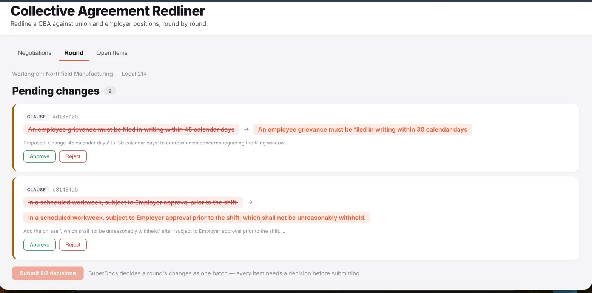
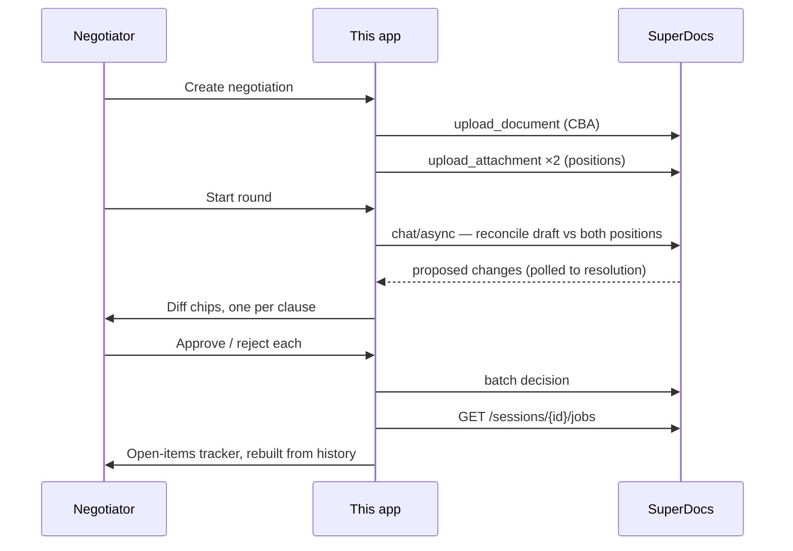

# Collective Agreement Redliner

Redlines a collective bargaining agreement against each side's position, tracking every
open item accurately across many negotiation rounds.

Built **on** SuperDocs — the editing engine, AI reasoning, diff generation and approve/deny
mechanics are all theirs. This is the labour-relations layer on top.



**Demo video:** _(link)_

---

## Contents

- [Quick start](#quick-start)
- [What it does](#what-it-does)
- [How a round flows](#how-a-round-flows)
- [The design: reconciliation, not duplication](#the-design-reconciliation-not-duplication)
- [Six API discrepancies found](#six-api-discrepancies-found)
- [Stack choices](#stack-choices)
- [Limitations](#limitations)
- [Verified against the real API](#verified-against-the-real-api)

---

## Quick start

```bash
cp .env.example .env              # add SUPERDOCS_API_KEY
cd backend
python -m venv .venv && source .venv/bin/activate
pip install -r requirements.txt
python scripts/init_db.py
python scripts/seed_documents.py  # synthetic CBA + two position papers
cd .. && make dev                 # backend :8001, frontend :5174
```

Tests are offline by default — **no API key needed**:

```bash
cd backend && source .venv/bin/activate
pytest tests/ -v          # 24 passing
pytest tests/ -v -m live  # one live test, needs a key (see below)
```

All seed documents are synthetic. No real collective bargaining agreement, and no real
party's paperwork, appears anywhere in this repository.

---

## What it does

Labour negotiations run in rounds. A draft moves back and forth, each side files a
position, clauses get contested, reconciled and re-opened — and the thing that actually
matters, *which items are still open*, drifts out of sync with the document almost
immediately.

**SuperDocs surfaces used:**

| Surface | Use |
|---|---|
| Multi-document sessions | CBA as the editable document, union + employer positions as attachments |
| Chat editing, HITL | `approval_mode: ask_every_time` — nothing lands unreviewed |
| Per-item approve/reject | Each proposed clause change decided individually, batched per round |
| Export | Current agreement state to `.docx` |
| Job history | `GET /v1/sessions/{id}/jobs` — the load-bearing one |

---

## How a round flows



Polling matters here: a round can take from thirty seconds to several minutes with no
visible progress. The flow polls server-side to resolution rather than timing out.

---

## The design: reconciliation, not duplication

The obvious build is a local table of clause states updated as decisions come in. That
creates a second source of truth alongside SuperDocs' own, and the two drift the first time
anything is decided out-of-band, retried, or interrupted.

SuperDocs already persists a durable audit trail per session. So the tracker doesn't own
state — it **reconciles** against that history.

| Owner | Responsibility |
|---|---|
| **SuperDocs** | The document, AI reasoning, diff generation, approve/deny mechanics, per-job history |
| **This layer** | Domain semantics SuperDocs can't know — which side's position drove a proposal, and whether a clause is still contested *across* rounds. Their history is job-scoped; a negotiation needs clause-scoped |

**Tested property:** wipe the local database entirely and the tracker rebuilds correct
clause states from SuperDocs' job history alone. That test is `@pytest.mark.live` — it runs
against the real API, because a mocked version would prove nothing.

**What it costs:** coupling to the job-history response shape, and to `chunk_id` staying
stable for a clause across a session. Both documented behavior. The trade buys a materially
smaller and more reliable build than re-deriving change tracking.

---

## Six API discrepancies found

Found by building against the live platform rather than reading docs. All reported to
SuperDocs separately, per the task brief. The three with the largest blast radius:

1. **Batch-approve rejects the documented request shape** with a 422; the working shape
   differs from the reference.
2. **The `jobs` endpoint wraps its list** rather than returning it bare — one more unwrap
   than documented.
3. **`ask_every_time` doesn't reliably force review on identical inputs.** Resubmitting the
   same instruction against the same document can resolve without producing a review step —
   which matters a great deal for a build whose entire premise is that a human gates every
   change.

Point 3 shaped the design: "nothing to review" is a real, rendered state rather than an
error, because it genuinely happens.

---

## Stack choices

**FastAPI + SQLite, sync SQLAlchemy.** No vector search is needed here. Sync deliberately —
the recurring bug class in my Task 1 build was async-engine-per-event-loop issues, and this
build sidesteps that category rather than re-fighting it.

**REST, not MCP.** The assigned card's surfaces (Review, Multi-document, export) are all
REST-shaped, and the brief's guidance is to build against the four core calls first. My
Task 1 build ships a real MCP server, so this is scoping, not avoidance.

---

## Limitations

- **No `GET /negotiations` endpoint exists on the platform**, so the Negotiations tab lists
  only negotiations from the current browser session. A real platform limitation, surfaced
  in the UI rather than hidden.
- **No cross-session memory.** A negotiation spanning weeks would plausibly want it. Out of
  scope for the assigned card.
- **No auth, no multi-user.** Two negotiators working simultaneously is a real thing labour
  relations does; this build doesn't address it.
- **REOPENED is not verified live.** APPROVED and REJECTED were both confirmed against real
  API data in a browser. REOPENED renders through the identical code path and has two
  passing tests, but I could not reproduce it live and will not claim I saw it.

---

## Verified against the real API

Not "it compiles." What was actually observed, end to end:

- Negotiation created with a real `upload_document` and two real `upload_attachment` calls
- A real two-item round: diff chips rendered, per-item toggles worked, batch submit applied
  both decisions
- The "nothing to review" empty state hit four times — an intentional state, not a broken
  screen
- Open Items showed APPROVED and REJECTED matching what was just decided, read live
- Export produced a valid 37KB `.docx`, verified outside the browser
- Zero JavaScript console errors throughout

**Three UI bugs found and fixed during that walkthrough**, none visible from reading the
code: a failed round showed two contradictory messages at once; "nothing to review" and
"just finished deciding everything" collapsed into the same misleading state; and there was
no way to start a second round after submitting decisions — which, in a tool whose entire
purpose is multi-round negotiation, was the worst of the three.

---

Built by Aditya Medidala for the SuperDocs Round 2 engineering task.