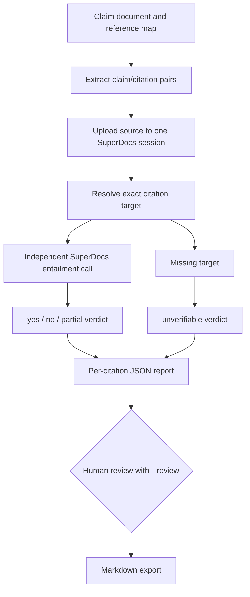

# Citation verification pass

## Purpose

For academic and journalism workflows where a citation can exist but fail to
support the sentence it is attached to.

## Workflow

1. Parse inline claim/citation pairs such as `The term is 30 days.[A]`.
2. Upload the source document into one persistent SuperDocs session.
3. Resolve each citation target in the supplied multi-document reference map.
4. Search reference text for useful review context without changing citation identity.
5. Ask SuperDocs for an independent entailment verdict per citation.
6. Review every finding explicitly when `--review` is supplied.
7. Write JSON findings and export a Markdown copy of the session document.

The claim-generation step and entailment step are separate. A citation marker
is never treated as proof, and a missing source is never silently substituted
with another reference.

## Architecture



The source lookup is local and exact. SuperDocs supplies an independent
entailment opinion; it does not get to decide whether a missing citation is
valid.

## Failure behavior

- Missing API configuration exits with status `2`.
- Missing references are reported as `unverifiable`.
- Unknown entailment verdicts fail validation.
- Malformed or unsupported model payloads fail closed.
- Partial support remains `partial`.
- The API key is never printed.

## Run

From `use-cases/Anjali-Yadav`, set `SUPERDOCS_API_KEY` in the environment or
in `citation-verifier/.env`, then run:

```powershell
python citation-verifier\main.py input\article.txt `
  --refs input\references.json `
  --out output\citation_report.json `
  --review
```

The command writes JSON containing both extracted pairs and independent
findings, and creates `output\citation_report.md`. The entailment calls are
billable; upload and export are free.

## Tests

```powershell
.\.venv\Scripts\python.exe -m pytest citation-verifier/tests -q
```

Coverage includes extraction, independent per-citation findings, missing
references, report orchestration, export invocation, and missing-key handling.

## Tradeoffs and review limits

Inline citation parsing intentionally supports the task’s simple marker format;
complex footnotes, DOI resolution, bibliography parsing, and journal-specific
styles require additional adapters. A human should still review borderline
paraphrases and confirm the reference set is complete.
