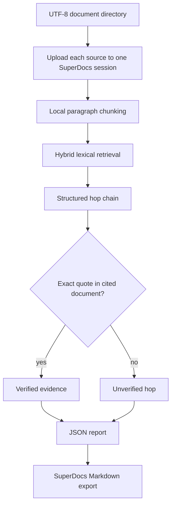

# Multi-hop QA across a document set

## Purpose

For research and diligence questions that require combining facts from several
documents. The build returns the answer together with the source document and
quoted evidence for every hop.

## Workflow

1. Read a directory of UTF-8 `.txt` source documents.
2. Upload every source into one persistent SuperDocs session.
3. Retrieve candidate passages locally using stable document/chunk IDs.
4. Build a structured multi-hop answer.
5. Verify every quote against the exact source document, not the whole corpus.
6. Write JSON evidence and export a Markdown copy from the same session.

The deterministic local grounding check is authoritative. SuperDocs is not
allowed to turn an unsupported quote into a supported fact.

## Architecture



The API session provides document persistence and export. Retrieval, hop
construction, deduplication, and quote verification remain deterministic and
auditable locally.

## Failure behavior

- Empty document sets fail clearly.
- Empty source files are rejected before upload.
- Missing evidence returns `could_not_answer: true`.
- Duplicate document/quote hops are removed.
- A quote from the wrong document is marked unverified.
- The API key is never printed.

## Run

From `use-cases/Anjali-Yadav`, set `SUPERDOCS_API_KEY` in the environment or
in `multihop-qa/.env`, then run:

```powershell
python multihop-qa\main.py "What payment and shipping terms apply?" `
  --docs-dir input\documents `
  --out output\multihop_answer.json
```

The command uploads the sources, writes JSON evidence, and creates
`output\multihop_answer.md`. Upload and export are free; API chat/entailment
operations are billable when used by the configured workflow.

## Tests

```powershell
.\.venv\Scripts\python.exe -m pytest multihop-qa/tests -q
```

Coverage includes exact-document grounding, retrieval relevance, deduplication,
no-answer behavior, empty inputs, upload/session reuse, and export invocation.

## Tradeoffs and review limits

Paragraph chunking and lexical retrieval are deterministic and easy to audit,
but they are not a replacement for a domain-tuned semantic retriever. A human
must still decide whether the selected evidence is sufficient and whether the
final synthesis is an appropriate conclusion.
