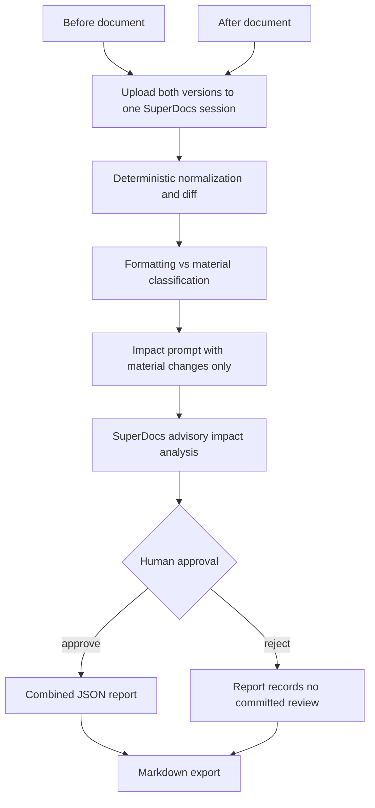

# Material-change analysis between versions

## Purpose

For legal and procurement review of two document versions. The build separates
mechanical substance from formatting noise, then asks SuperDocs for a reviewable
impact opinion about who benefits and what to push back on.

## Workflow

1. Read two UTF-8 document versions.
2. Upload `before` and `after` into one persistent SuperDocs session.
3. Classify changes mechanically before any model call.
4. Remove formatting-only noise from the impact prompt.
5. Ask SuperDocs for beneficiary, commercial/operational impact, and negotiation
   pushback analysis.
6. Write the combined JSON report and export Markdown.

The mechanical diff is the source of truth for what changed. The model provides
an opinion about impact; it does not get to invent changes that were not found.

## Architecture



The model sees candidate material changes, not an unconstrained request to
invent differences. Approval is human-gated unless `--approve-all` is supplied
explicitly for unattended automation.

## Failure behavior

- Both versions must contain text.
- Empty or identical versions produce no material-change report.
- Whitespace-only changes are classified as formatting.
- Cross-reference changes remain substantive even when small.
- The impact prompt treats document text as untrusted data.
- The API key is never printed.

## Run

From `use-cases/Anjali-Yadav`, set `SUPERDOCS_API_KEY` in the environment or
in `version-diff/.env`, then run:

```powershell
python version-diff\main.py input\before.txt input\after.txt `
  --out output\version_diff.json
```

The command uploads both versions, runs deterministic classification, requests
impact analysis, requests approval, writes JSON, and creates
`output\version_diff.md`. Use `--approve-all` only for explicit unattended
automation. Chat and review operations are billable; upload and export are
free.

## Tests

```powershell
.\.venv\Scripts\python.exe -m pytest version-diff/tests -q
```

Coverage includes identical documents, formatting-only changes, substantive
wording changes, cross-reference changes, empty inputs, workflow upload,
impact-prompt generation, and export invocation.

## Tradeoffs and review limits

The classifier is deliberately conservative and heuristic-based; legal meaning
can depend on definitions and surrounding clauses that a short diff cannot
capture. Beneficiary and pushback analysis is advisory and must be reviewed by
the appropriate legal or procurement owner.
