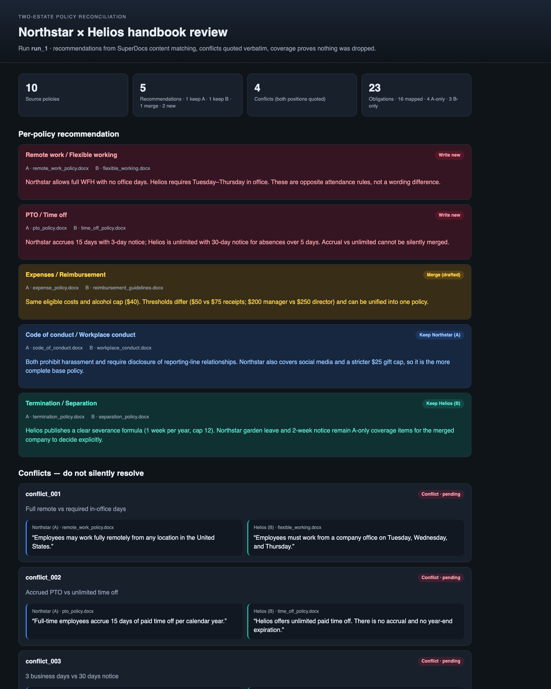

# Two-estate policy reconciliation

Two companies are merging. Each has a full HR / employee-handbook. This CLI uploads both estates to [SuperDocs](https://superdocs.app), matches policies by **content** (not filenames), and produces:

1. A **per-policy recommendation** — keep Northstar (A), keep Helios (B), merge (drafted), or write new — with evidence.
2. A **coverage list** — every extracted obligation tagged mapped / gap-A-only / gap-B-only, so nothing is dropped.
3. A **conflict list** — opposite requirements with **both source excerpts quoted verbatim**. Nothing is silently resolved.

Review happens in a static `review.html` plus a `decisions.yaml` you edit. `apply` plays those decisions back through SuperDocs HITL approve/deny and exports the final `.docx` set.

Built for the SuperDocs engineering task.



Screenshot shows the intended review UI (keep / merge / new mix + verbatim conflicts), rendered from committed fixtures so it does not depend on a live SuperDocs key. Re-run `reconcile` for a live `review.html`.

## How to run

```bash
cd use-cases/Ayyanaruto/policy-reconciliation
python3 -m venv .venv && source .venv/bin/activate
pip install -r requirements.txt
cp .env.example .env
# put your key in .env — never commit it
# SUPERDOCS_API_KEY=sk_your-key-here
```

Sample estates are already committed under `sample_data/`. To regenerate them:

```bash
python generate_sample_data.py
```

Reconcile (uploads, extracts, matches, drafts merges):

```bash
python reconcile.py reconcile \
  --estate-a sample_data/company_a \
  --estate-b sample_data/company_b \
  --output outputs/run_1
```

Open `outputs/run_1/review.html` in a browser. Edit `outputs/run_1/decisions.yaml` (`pending` → `keep_a` / `keep_b` / `merge` / `new` for conflicts, `approve` / `reject` for merges). Then:

```bash
python reconcile.py apply --decisions outputs/run_1/decisions.yaml
```

Final files land in `outputs/run_1/final/`.

### Ops-safe flags

```bash
# No SuperDocs calls. Lists the estate inventory only — matching did NOT run.
python reconcile.py reconcile --estate-a sample_data/company_a --estate-b sample_data/company_b \
  --output outputs/run_dry --dry-run

# Smoke-test on N documents per estate before a full run.
python reconcile.py reconcile --estate-a sample_data/company_a --estate-b sample_data/company_b \
  --output outputs/run_smoke --limit 1
```

If `usage.monthly_remaining` drops below 20 (override with `SUPERDOCS_MIN_REMAINING`), the pipeline hard-stops instead of partially completing.

Tests (no live key):

```bash
pytest -q
```

## SuperDocs features used

| Surface | Where |
|---|---|
| Upload (`POST /v1/documents/upload?index=true`, `open_mode=replace` then `new_focused`) | Both estates as tabs in one compare session |
| Multi-document + search (`index=true` + cross-doc `chat_async`) | Match by meaning across all open policies |
| Review (`approval_mode=ask_every_time` + `POST /v1/chat/{session}/approve`) | Merge drafts never commit without `apply` |
| Export (`POST /v1/documents/export`, format `docx`) | Approved merged policies |

Matching intelligence lives in SuperDocs, not in a local embedding layer. Filenames are deliberately different (`pto_policy.docx` vs `time_off_policy.docx`) so title-string matching would fail.

## Code layout

```
reconcile.py              # CLI
superdocs_client.py       # REST wrapper
report.py                 # review.html + decisions.yaml
generate_sample_data.py   # synthetic Northstar / Helios .docx
pipeline/
  run.py                  # orchestrator (reconcile + dry-run)
  ingest.py               # upload both estates as tabs
  extract.py              # SuperDocs extract + EXTRACT_PROMPT
  match.py                # SuperDocs match + MATCH_PROMPT / retry
  classify.py             # decide, conflicts (verbatim), coverage
  drafts.py               # HITL merge drafts + MERGE_PROMPT
  apply.py                # play back decisions.yaml
  common.py               # shared helpers
```

Each SuperDocs prompt lives in the same file as the stage that sends it.

## Output layout

```
outputs/run_1/
  mapping.json          # per-policy keep / merge / new
  conflicts.json        # opposite obligations, verbatim excerpts
  coverage.json         # every obligation + disposition
  obligations.json      # extract trace (document_id + filename)
  merged_drafts/        # pre-approval HTML previews
  review.html           # the review surface
  decisions.yaml        # you edit this
  run.json              # SuperDocs session/job ids for apply
  final/                # after apply
```

## Assumptions (documented, overridable)

- **Demo size:** 5 policies per estate (10 documents). `--limit` scales down.
- **Ops shape:** one compare session. Extract is one `chat_async` (`core`) **per source policy**. Empty/non-JSON extract replies retry once then skip that file. Match is SuperDocs-only (ids/topics, not full quotes — a full quote dump can trip the safety filter). One smaller SuperDocs retry; no local/heuristic classify. Merge drafts re-upload the two sources into a small extra session (`pro` + HITL).
- **No keyword pre-filter.** 5×5 is small enough to send all open docs to SuperDocs. `--limit` is the ops control.
- **Conflicts never auto-merge.** Opposite requirements (WFH vs office days, accrual vs unlimited) are conflicts → `new`. Numeric thresholds on the same rule ($50 vs $75 receipts) are merge material. `detect_conflicts` copies excerpts from extract, not SuperDocs paraphrase. `decide()` will not return `merge` when SuperDocs also marked the pair a genuine conflict.
- **`run.json`** holds session/job/change ids. `decisions.yaml` stays human-readable.
- **Dry-run** makes zero SuperDocs calls and states clearly that content-based matching did not run.
- Model tiers: `core` for extract/match, `pro` for merge drafts. `SUPERDOCS_MIN_REMAINING` defaults to 20.

## Sample estate (what the reviewer should see)

Northstar (A) vs Helios (B), different names and wording:

| Topic | A | B | Expected shape |
|---|---|---|---|
| Remote / flexible | Full WFH | 3 office days | **Conflict** → write new |
| PTO / time off | 15-day accrual, 3-day notice | Unlimited, 30-day notice | **Conflict** → write new |
| Expenses | $50 receipt / $200 manager | $75 receipt / $250 director | **Merge** |
| Conduct | $25 gifts + social media | $75 gifts, no social media | **Keep A** + gift **conflict** + A-only gap |
| Termination | Garden leave, no formula | Severance 1 week/year | **Keep B** + A/B gaps |

## Credit

Built by Ayyanaruto for the SuperDocs engineering task.
