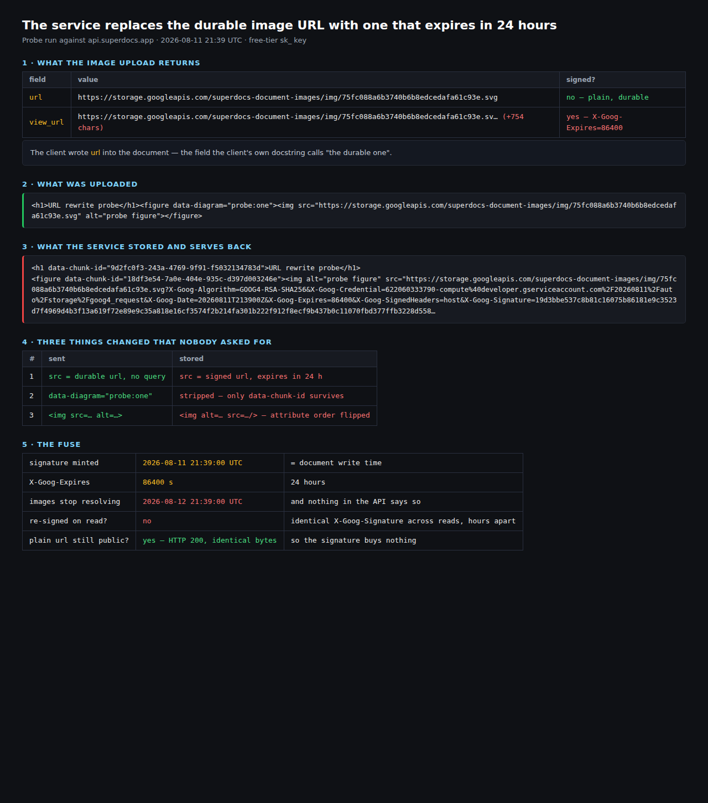
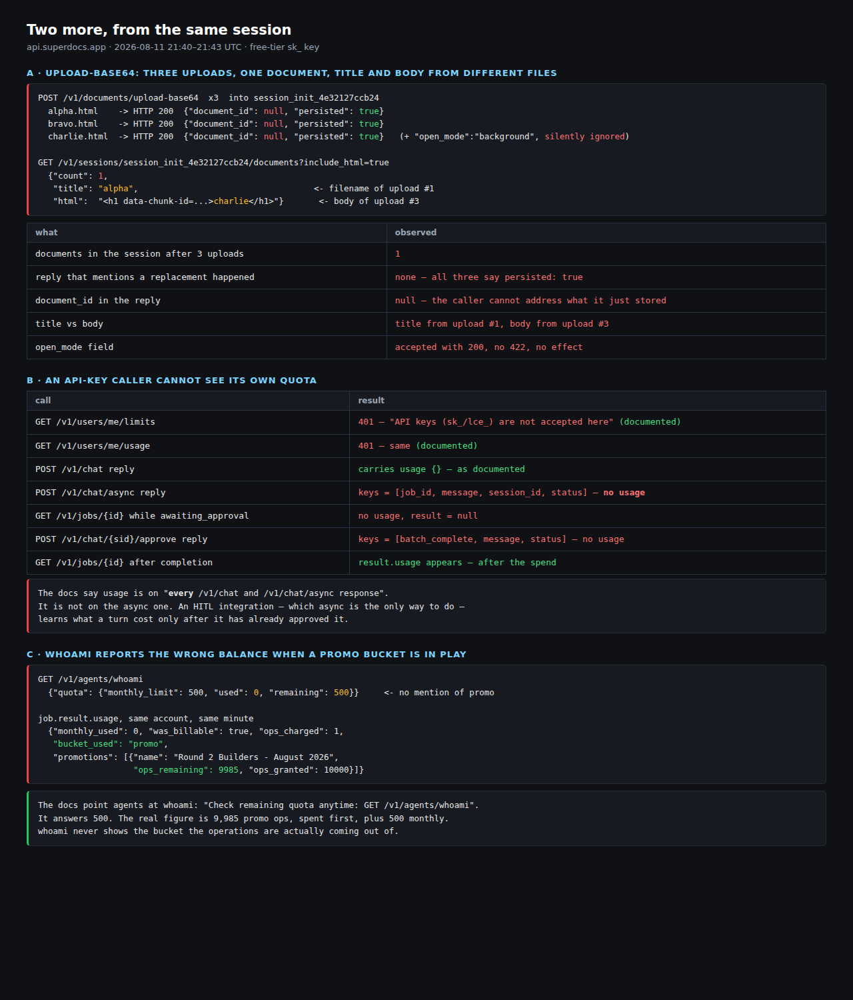

# BUGS.md

Bugs and rough edges hit while building on the SuperDocs API, in the shape the
task document asks for: what I did, what I expected, what happened instead, how
badly it blocked, and how to reproduce it.

All of these were found against `https://api.superdocs.app` with a free-tier
`sk_` API key, while building the Product Manual and Quick-Start Builder in this
folder. Items 1–7 are from **2026-08-11**; items 8–13 from **2026-08-12** — 8–10
while getting the diagram-refresh path to complete one clean run, and 11–13
while building `verify`, the command that reads the published documents back and
checks them. Items 14–19 are from a deliberate second pass on **2026-08-12**,
made after reading `https://docs.superdocs.app` end to end rather than working
from `/openapi.json` alone. Item 20 is from **2026-08-13**, found while adding
a test that parks and denies a real batch to prove the busy-session guard
against the live service rather than a mock of it. Item 21 is from
**2026-08-14**, found by watching a real, narrated run of this build's own
commands rather than by testing any one of them in isolation. Item 22 is from
**2026-08-25**, found the same way — by watching that narrated run fail its own
verification stage, on a pair of documents that turned out to be correct. Item
23 is from that same run, one stage later: the pair really had come apart, on
one passage, and nothing in this build noticed until `verify` did. Item 24 is
from **2026-08-27**, and cost three `sync` runs to see whole.

They live next to the build that found them, so anyone reading the code can see
what the service actually did while it was being written. The submission form
collects the same list.

**Every item says whose it is.** All twenty-four are SuperDocs, because this
build talks to nothing else — but five of them are the *model's* behaviour reached
through the API rather than a defect in the API itself, and calling those bugs
would be unfair to the service. They are marked as such. The sibling build in
`extensions/CulturalProfessor/runbook-reconciler` carries the Confluence Cloud
findings, and labels its items the same way.

No key appears in this file. Every snippet uses `$SUPERDOCS_API_KEY`.

Items 1–7 are ranked by how much they cost me; 8–24 are appended in the order
they turned up rather than renumbering the list. Item 13 is an observation
without a reproduction, and says so.

**Read [Corrections](#corrections-after-reading-the-documentation) first.** That
second pass found the documentation says things this file originally claimed it
did not, and four items are weakened or retracted there. They are corrected in
place rather than deleted, because a bug report that quietly edits away its
mistakes is not one anybody should trust.

**Items 2, 10, 20 and 22 are not the latency work.** The known-issues note in
the task document says latency is being worked on next, and these four are easy
to misread as the same thing because they are also about timing. They are not:
a slow call is one that takes a while and then answers correctly; these are
calls that answer immediately and *incorrectly* for a short window — a write
returns `200` and a different read endpoint (session focus, document export,
a session's job list, a document read by id) disagrees with it until it catches
up. Four different endpoint pairs, the same shape each time. Making every call faster would not
obviously close that window; only making the read agree with the write it
follows would.

---

## 1. `upload-base64` silently replaces the focused document

**Whose:** SuperDocs API

**Severity: high — destroys a document, reports success.**

**What I did.** Uploaded two documents into one session, one after the other,
through `POST /v1/documents/upload-base64`, so a manual and its quick-start card
would both be open in the same session.

**What I expected.** Two documents in the session. The multipart sibling,
`POST /v1/documents/upload`, takes an `open_mode` form field documented as
`replace` / `new_focused` / `background`, so I expected either the same field or
the additive behaviour by default.

**What happened.** Both calls returned `200` with `"persisted": true`. The
second upload overwrote the first: one durable document, at `version: 2`, whose
title was still the *first* document's filename and whose `chunks_count` was the
*second* document's. Nothing in either reply said a document had been replaced.

`Base64UploadRequest` has no `open_mode` field at all — the asymmetry with the
multipart endpoint is not in the OpenAPI schema and not in the multi-document
guide, which documents `open_mode` only for `POST /v1/documents/upload`.

**Reproduce.**

```bash
SID=$(curl -sX POST https://api.superdocs.app/v1/sessions/init \
  -H "Authorization: Bearer $SUPERDOCS_API_KEY" \
  -H 'Content-Type: application/json' -d '{}' | jq -r .session_id)

for NAME in first second; do
  curl -sX POST https://api.superdocs.app/v1/documents/upload-base64 \
    -H "Authorization: Bearer $SUPERDOCS_API_KEY" \
    -H 'Content-Type: application/json' \
    -d "{\"filename\":\"$NAME.html\",\"session_id\":\"$SID\",
         \"file_base64\":\"$(printf '<h1>%s</h1>' $NAME | base64 -w0)\"}" | jq '.persisted'
done

curl -s "https://api.superdocs.app/v1/sessions/$SID/documents" \
  -H "Authorization: Bearer $SUPERDOCS_API_KEY" | jq '.documents | length'   # 1, not 2
```

**Cost to me.** It was only caught because the surviving document's title and
chunk count disagreed with each other. An integrator uploading a second document
into a session loses the first one and gets a success reply.

**Suggested fix.** Add `open_mode` to `Base64UploadRequest` with the same three
values and the same default as multipart; failing that, return
`"replaced_document_id"` in the reply so the caller can see what happened.

---

## 2. Two endpoints disagree about which document is in a slot

**Whose:** SuperDocs API

**Severity: medium — the API's own views contradict each other.**

**What I did.** Opened a second document into an existing session with
`POST /v1/sessions/{session_id}/documents/open`, then immediately read the
session back.

**What I expected.** One consistent answer about what is in the session.

**What happened.** Within the same second, three views disagreed:

| Call | Says `doc_primary` is |
|---|---|
| `POST /v1/sessions/{id}/documents/open` (reply body) | the quick-start card |
| `GET /v1/sessions/{id}/documents` | the manual, 54 chunks |
| `POST /v1/sessions/{id}/documents/{doc}/focus` | `"title": "Halyard M1 — Product Manual"` |

After a 2-second wait, `GET .../documents` changed its answer to the card — so
part of this is a propagation delay that is not surfaced anywhere, and part is
`focus` returning a different document's title than the one it was asked to
focus.

**Reproduce.** Upload document A into a session, then
`POST /v1/sessions/{id}/documents/open` with document B's durable id, and read
`GET /v1/sessions/{id}/documents` immediately and again after two seconds.

**Cost to me.** It read as a race in my own code, and that is where I looked.

**Suggested fix.** Either make the read consistent after the write returns, or
document the delay and give the read a way to say "not settled yet".

---

## 3. `/v1/poll/{session_id}` rejects API keys the rest of the surface accepts

**Whose:** SuperDocs API

**Severity: low — clear once you hit it, but the message points the wrong way.**

**What I did.** Called `GET /v1/poll/{session_id}` with the same `sk_` key that
`POST /v1/chat`, `GET /v1/sessions/{id}/jobs` and `GET /v1/documents` had all
just accepted.

**What I expected.** `200`, or an error saying this endpoint needs a different
credential.

**What happened.** `401 {"detail": "Invalid API key"}`. The key is not invalid —
it works everywhere else, including the chat call that created the job I was
polling for. `GET /v1/users/me/limits` gets this right and says so plainly:
*"This endpoint requires a signed-in user session; API keys (sk_/lce_) are not
accepted here."* `/v1/poll` should say the same thing rather than casting doubt
on a working key.

**Reproduce.**

```bash
curl -si "https://api.superdocs.app/v1/poll/$SID" \
  -H "Authorization: Bearer $SUPERDOCS_API_KEY" | head -1
```

**Cost to me.** Small, and it would have been nothing with the message
`/v1/users/me/limits` already uses.

---

## 4. "Change nothing else" changed something else

**Whose:** the model, through SuperDocs

**Severity: medium — a correctness surprise in the edit path, mitigated by review mode.**

**What I did.** One turn, on a 54-chunk manual, with the instruction:

> In the rails step, change the rail torque figure from 1.2 N·m to 1.6 N·m.
> Change nothing else.

**What I expected.** One proposed change, in the rails step.

**What happened.** Two proposed changes. The second one edited the **gantry**
step, which legitimately also reads `1.2 N·m` — it is a different fastener with
the same torque figure. Both explanations read `"Parallel edit: Change the rail
torque specification…"`, so the second change describes itself as the first.

This is exactly what review mode is for and it was caught there — nothing was
approved. Recording it because the instruction was explicit, and because a
reviewer scanning forty diffs with identical explanations will approve the
second one.

**Reproduce.** Upload a document containing the same figure in two places, then
send an instruction naming one of them and forbidding other changes.

**Suggested fix.** Where a turn matches a pattern in more than one chunk, say so
in the explanation — "also found in 1 other section" — rather than giving both
changes the same sentence. The information is clearly there; it just does not
reach the reviewer.

---

## 5. A parked approval blocks its session, and the block is invisible until the next turn

**Whose:** SuperDocs API

**Severity: medium — a stalled review locks the conversation it is in.**

**What I did.** Sent one instruction to two documents: turn one against the
manual, turn two against the card, both in the same session, both with
`approval_mode: "ask_every_time"`.

**What I expected.** Two turns, two batches parked, then one review covering
both.

**What happened.** Turn one parked at `awaiting_approval`. Turn two came back
`409 session_busy`. The first turn's batch holds the session, so a pair of
documents in one session can never have both halves proposed at the same time —
and the failure surfaces on the *second* turn, after the first has already
spent an operation.

The 409 body is genuinely helpful (it names `list_jobs`, `cancel_job`, and
using another session), which is more than most APIs do. Two things around it
are not:

- **`cancel_job` cannot cancel the thing that is blocking.** A job parked at
  `awaiting_approval` returns `400 "Job cannot be cancelled"`. The only way out
  is to approve it with every change denied. That is discoverable but backwards:
  the suggested action names a call that does not apply to the state you are in.
- **The two views disagree about whether anything is active.**
  `GET /v1/sessions/{id}/jobs` showed nothing in an active state while
  `/v1/chat/async` was still answering `session_busy` with `active_jobs: 1`.

**Reproduce.** Open a session, send an async chat with
`approval_mode: "ask_every_time"`, wait for `awaiting_approval`, then send a
second chat in the same session.

**Cost to me.** An architecture change: one session per document instead of one
session per pair.

**Suggested fix.** Let `cancel_job` resolve an `awaiting_approval` job, or say
in the 409 that denying it is how it is cleared.

---

## 6. Uploads lose `data-*` attributes, silently

**Whose:** SuperDocs API

**Severity: medium — an integrator's anchors disappear with no error.**

**What I did.** Uploaded HTML whose figures carried `data-diagram="step:laser"`,
so a later edit could point at a specific drawing without depending on wording.

**What I expected.** Attributes I put on an element to still be there. Nothing
in the docs says otherwise.

**What happened.** Every `data-*` attribute was stripped and replaced with the
service's own `data-chunk-id`. A figure comes back as
`<figure data-chunk-id="…"></figure>` with nothing on it
naming which drawing it is. Attribute order changes too — `alt` before `src`,
where the upload had `src` before `alt` — which breaks a regex written against
the sent markup.

**Cost to me.** A redesign of how the diagram-swap step identifies a figure: it anchors on the caption now, which survives.

**Suggested fix.** Either preserve `data-*` on elements the service does not own,
or document the strip. If the strip is deliberate — and it is defensible —
saying so in the upload docs saves everyone this.

---

## 7. Stored image URLs come back signed, with a 754-character query

**Whose:** SuperDocs API

**Severity: low, once you know — but it looks exactly like a wrong URL.**

**What I did.** Uploaded an SVG via `POST /v1/documents/images/upload-base64`,
put the returned `url` into a document, and later compared what the service
proposed against what I had uploaded.

**What happened.** The `src` that comes back is the same file path with a
754-character signed query appended (`X-Goog-Algorithm`, `X-Goog-Expires`, and a
512-character signature). A check comparing URLs as strings refuses a perfectly
correct swap, which is what mine did on the first live run.

Two related things worth stating in the docs: the image upload reply carries
both a `url` and a `view_url`, and it is not obvious which is durable; and if
the served signature carries an expiry, a document stored today references an
image URL that may stop resolving later.

**Suggested fix.** Say which of `url` and `view_url` is durable, and note that
served `src` values are re-signed so integrators compare paths rather than
strings.

---

## 8. A session's memory re-proposes a change that was rejected in it

**Whose:** the model, through SuperDocs

**Severity: medium–high — a mechanical instruction inherits an unrelated
conversation, and there is no way to opt out except to open a new session.**

**What I did.** In a session where an earlier turn had proposed a torque change
and had had part of it **rejected** at review, I later sent a purely mechanical
instruction into the same session: a list of `` substitutions, prefixed
with *"Make exactly these substitutions and nothing else — do not reword,
reformat, or renumber anything."*

**What I expected.** The substitutions, and nothing else. That is what the
instruction says, and there is nothing in it referring to any earlier turn.

**What happened.** The turn proposed the image swaps *and* re-proposed the
torque edit that had been rejected in that session earlier — the specific change
a human had already declined. My guard compares each proposed chunk against the
one it replaces with the image URLs masked out, so it refused the whole batch;
it did that on every attempt, and the diagram-refresh path could not complete a
single clean run until I worked out why.

Reasonable behaviour for a chat assistant, and wrong for an automated operation.
The real problem is that there is **no way to send a context-free turn**. Chat
requires a `session_id`, a session is a conversation and it accumulates, and
nothing on `POST /v1/chat/async` says "ignore the history" — no `system`
override, no `fresh`/`stateless` flag, no way to scope a turn to just this
message.

**Workaround.** Call `POST /v1/sessions/init` with the document's **durable**
id, giving a session with no history, and send the turn there. This works and is
what the build does now. It costs an extra call per document per operation, it
abandons the old session, and the fix is not discoverable from the chat docs —
you have to already believe the history is the problem.

**Reproduce.** In one session: send an edit, reject one of its proposed changes
at approval, then send an unrelated mechanical instruction in the same session
and read `metadata.pending_changes`.

**Cost to me.** The worst on this list, mostly spent suspecting my own
instruction wording, because a re-proposed change looks like a model being sloppy rather
than a model being well-informed.

**Suggested fix.** A per-turn flag on `/v1/chat` and `/v1/chat/async` that scopes
the turn to the message and the document, ignoring prior turns. Failing that,
one sentence in the chat docs saying the session is conversational and that
automated callers should open a fresh session per operation.

---

## 9. A turn that asks a clarifying question is indistinguishable from a turn with nothing to do

**Whose:** SuperDocs API

**Severity: high — the caller cannot tell "done, no change needed" from "I did
nothing and would like to talk about it".**

**What I did.** Sent the same substitution list to two documents in one
operation: a manual holding 8 figures, and a quick-start card holding 1 of those
8. The instruction listed all 8 captions.

**What I expected.** The card to make the one substitution that applies to it,
and ignore the seven figures it does not contain. Or, failing that, an error.

**What happened.** The card's job went to `status: "completed"` with
`metadata.pending_changes: []`, and `result.response` reading:

> "I haven't received the full list of substitutions, and I only see one image
> in the current document (Halyard M1 parts breakdown) […] Could you please
> provide the complete list of substitutions […]?"

So it changed nothing and asked a question. Nothing in the job's *status* says
so — `completed` with an empty change list is exactly what a document that
needed no changes returns. My code read it as "no changes proposed", approved
the manual's 8, and produced precisely the outcome the whole build exists to
prevent: the manual pointing at the new diagrams, the card still pointing at the
old one, and a run that reported 8 clean swaps. Every statement it printed was
true.

**Reproduce.** Send an instruction naming several elements to a document that
contains only some of them, and read `status` and `metadata.pending_changes` on
the resulting job.

**Cost to me.** Hard to find, and it is the one on this list I would most
want fixed — it is silent, it looks like success, and a caller doing exactly
what the docs suggest hits it.

**Suggested fix.** Distinguish the two states. A terminal status like
`awaiting_clarification`, or a boolean on the job saying the turn asked a
question rather than acting. Anything that lets a caller branch without
string-matching the prose. Partial application — do the parts that apply, report
the parts that do not — would also be a defensible answer, but the caller
knowing which happened matters more than which one is chosen.

---

## 10. `export` immediately after `approve` returns the pre-approval document

**Whose:** SuperDocs API

**Severity: medium — verification reads stale bytes and reports them as current.**

**What I did.** Approved a batch of 9 changes across two documents
(`POST /v1/chat/{session_id}/approve`, all 9 approved, `200`), then in the same
shell command called `POST /v1/documents/export` for both documents to check
that the approved edits had landed.

**What I expected.** The exported documents to contain the approved changes, or
some indication that they were not settled yet.

**What happened.** Both exports came back with the documents exactly as they
were *before* the approval — the previous round's image URLs in all 9 places.
No error, no staleness marker, correct-looking files of the expected size.
Re-exporting a few seconds later returned the correct, post-approval content.

Worth being precise about the evidence: I have this as **one clean observation**,
plus a contrasting one. An earlier run in the same session did `approve` and
`export` as two separate commands, seconds apart, and that export was correct.
The run that chained `approve && export` with no gap was stale. That is
consistent with a short propagation delay after approval, and I have not
measured how long it is or confirmed the exact boundary, because doing so costs
operations.

This is the same shape as item 2 — a write that returns before the reads agree
with it — on a different pair of endpoints.

**Reproduce.** Approve a batch and export the same document in the same breath,
with no delay between the two calls; compare against an export taken a few
seconds later.

**Cost to me.** Brief, but it looked as though a fix I had just made had not
worked.

**Suggested fix.** Make export consistent with an approval that has already
returned, or have the approve reply carry the resulting document version so a
caller can wait for it. Both would also fix the honest version of the problem,
which is that right now the only way to be sure is to sleep and hope.

**Update, 2026-08-25.** The same window is on `GET /v1/documents/{id}` — the
read this build uses precisely *because* it is not export, and the one the
service's own agent guide recommends for verification. See item 22, which has
the second observation this item was missing.

---

## 11. A session is not a handle on a document, and export is keyed by session

**Whose:** SuperDocs API

**Severity: high — a read silently returns a different document than the one
asked for.**

**What I did.** Published a manual and a quick-start card, each into its own
session, and recorded which session held which document. Later, exported both
by session id — `POST /v1/documents/export` — to check the published pair.

**What I expected.** Each session to still serve the document it was created
holding, or an error saying otherwise.

**What happened.** The card's session returned **the manual**. Same session id,
same call, a different document, no error and no warning. My verification step
then reported the card as having eight figures instead of one and as disagreeing
with the manual — both true of the document it was handed, and nothing to do
with the card.

Export renders what the session is *focused* on, and focus is not owned by the
integration that created the session. Opening the pair in the web interface and
clicking the other tab is enough to repoint it. `GET /v1/sessions/{id}/documents`
confirmed it: the session recorded for the card was holding a document with the
manual's `document_id`, a durable id belonging to neither published document,
and 78 chunks against the manual's 54.

The published documents were both intact the whole time. Nothing was lost. What
broke was the assumption — mine, and one the docs invite — that a session is a
stable handle on a document.

**Reproduce.** Upload a document into its own session, note the session id, open
that document in the web interface alongside another one, focus the other, then
export by the original session id.

**Cost to me.** A verification step that confidently reported on the wrong
document. That is the part worth flagging: the failure mode is not an
error, it is a *plausible answer about something else*.

**Workaround.** Before reading, check `GET /v1/sessions/{id}/documents` actually
returns the expected `document_id`, and if it does not, open a fresh session on
the **durable** id. That is what the build does now.

**Suggested fix.** Let export name a `document_id` instead of inferring one from
session focus. Failing that, return the exported document's id in a header or
alongside the file so a caller can tell it got what it asked for.

---

## 12. Every entry in Chat History is timestamped "just now"

**Whose:** SuperDocs API

**Severity: low — cosmetic, but it makes the history unusable for finding anything.**

**What I did.** Opened the Chat History panel in the web interface on an account
with sessions going back three weeks.

**What I expected.** Relative times, the way the *Your files* list on the same
screen shows them ("28m ago", "2h ago").

**What happened.** All fifteen sessions read **"just now"**, including one from
2026-07-18 — twenty-four days old.

The data is correct at the API, so this is purely a rendering fault.
`GET /v1/sessions` returns a populated, distinct `last_activity` for every one:

```
2026-08-11 20:31:33   msgs=2    'raise the rail torque to 1.6 N·m'
2026-08-11 18:37:37   msgs=10   'Change the rail torque figure in the rails ste…'
2026-08-06 18:35:23   msgs=2    'In section 2 change the hourly rate to USD 135…'
2026-07-18 19:29:58   msgs=4    'can you summarise the doc'
```

The `preview` strings match the panel exactly, so the panel is reading this
endpoint and dropping the timestamp on the way to the screen.

**Reproduce.** Open Chat History on any account with a session older than a few
minutes.

**Suggested fix.** Render `last_activity`. The *Your files* list on the same
screen already formats the same kind of value correctly.

---

## 13. Two documents exist that nothing I ran created

**Whose:** SuperDocs API

**Severity: unknown — recorded because the evidence is solid even though the cause is not.**

**What I saw.** `GET /v1/documents` lists 28 documents on this account. Every one
the integration uploaded is titled with the **filename** it was uploaded under —
`halyard-m1-manual`, `halyard-m1-quickstart`. Two are not:

| Created (UTC) | Title | Version | `session_count` |
|---|---|---|---|
| 2026-08-11 19:52:46 | `Halyard M1 — Product Manual` | 4 | 0 |
| 2026-08-11 20:05:02 | `Halyard M1 — Quick Start` | 1 | 0 |

Those two are titled from the documents' `<h1>` headings. The client never
uploads under those names, and the account owner does not recall creating them.
The first of them, `35753835-93f5-4d47-8390-5c9d10146df9`, is the document that
had displaced the card in its session in item 11 above.

That copy is also **damaged** relative to what was published, in ways that all
point at a Word round trip:

- its `` tags carry `class="docx-image"`; the published manual's carry no class
- the breakdown figure appears **five times** instead of once
- the symptom cell of each troubleshooting row contains its text **three times**
- every `-` (U+002D) has become `‑` (U+2011, non-breaking hyphen) — which is why a
  text comparison against the published document reported the two as disagreeing
  while they looked identical on screen

`source` reads `ai_created` for all 28 documents, so that field does not
distinguish these from anything else and offers no clue about origin.

**What I could not establish.** What created them. Two things are ruled out, by
snapshotting `GET /v1/documents` before and after: opening the *Your files* list
creates nothing, and **opening a document in the editor creates nothing** — no
new document, no version bump. So it is not browsing and it is not viewing.

What remains untested is the Word download path, an AI turn taken from inside
the editor, and the **Revert** control that appears above a chat message there.
The timing is at least suggestive of the last two: the copies appeared at
19:52:46 and 20:05:02, two and a half minutes after an API edit was sent to that
pair and while the editor was open on it with a completed turn and its *Revert*
button on screen. The manual copy then reached `version: 4` — something edited
it three more times after creating it — while the card copy stayed at `version: 1`.
That is a correlation and not a reproduction, which is why it is written here as
one.

**Why it is here anyway.** Whatever the cause, an integrator ends up with copies
of their documents that they did not create, under different titles, one of
which was bound to a session the integration was actively using. That is worth
knowing about even without a reproduction.

**Suggested fix.** Make `source` mean something — distinguish an API upload from
a UI action from a format conversion — so a caller can tell its own documents
from copies. And if a Word round trip is in this path anywhere, the image
duplication, the tripled table cells and the U+2011 substitution are each a bug
on their own.

---

## 14. A stored document's image URLs expire 24 hours after they are written

**Whose:** SuperDocs API

**Severity: high — every diagram in a published manual goes dead after a day.**

**What I did.** Uploaded an SVG through `POST /v1/documents/images/upload-base64`,
took the `url` from the reply — the field that comes back *without* a signature,
and the one this client has always treated as the durable one — put it in an
``, and uploaded the document.

**What I expected.** The document to hold the URL I put in it.

**What happened.** The service **rewrote the `src`**. What it stored, and what it
serves back on every read, is the *signed* variant — the same file path with
`X-Goog-Expires=86400` and a 512-character signature appended. The signature is
minted once, at write time, and never refreshed: two reads of the same document
an hour apart return a byte-identical `X-Goog-Signature` and the same
`X-Goog-Date`. So the images in a document written today stop resolving 24 hours
from the moment it was written.

The published manual in this folder was written at `20:26:39Z` and its eight
diagrams expire at `20:26:39Z` the next day. Nothing in any reply says so.

And the signature is not buying anything: the same URL with the whole query
stripped returns `200` and identical bytes. The bucket object is public.



**Reproduce.**

```bash
UP=$(curl -sX POST https://api.superdocs.app/v1/documents/images/upload-base64 \
  -H "Authorization: Bearer $SUPERDOCS_API_KEY" -H 'Content-Type: application/json' \
  -d "{\"filename\":\"probe.svg\",\"content_type\":\"image/svg+xml\",
       \"image_base64\":\"$(printf '<svg xmlns="http://www.w3.org/2000/svg" width="10" height="10"/>' | base64 -w0)\"}")
PLAIN=$(echo "$UP" | jq -r .url)     # no signature on this one

SID=$(curl -sX POST https://api.superdocs.app/v1/sessions/init \
  -H "Authorization: Bearer $SUPERDOCS_API_KEY" \
  -H 'Content-Type: application/json' -d '{}' | jq -r .session_id)

printf '<h1>probe</h1><figure></figure>' "$PLAIN" > probe.html
curl -sX POST https://api.superdocs.app/v1/documents/upload \
  -H "Authorization: Bearer $SUPERDOCS_API_KEY" \
  -F "file=@probe.html;type=text/html" -F "session_id=$SID" -F "open_mode=new_focused" >/dev/null

DUR=$(curl -s "https://api.superdocs.app/v1/sessions/$SID/documents" \
  -H "Authorization: Bearer $SUPERDOCS_API_KEY" | jq -r '.documents[0].durable_document_id')

# The src that comes back is not the src that went in:
curl -s "https://api.superdocs.app/v1/documents/$DUR?include_html=true" \
  -H "Authorization: Bearer $SUPERDOCS_API_KEY" | jq -r .html | grep -o 'X-Goog-Expires=[0-9]*'
# X-Goog-Expires=86400

# And the plain url the service told us was durable is publicly readable anyway:
curl -so /dev/null -w '%{http_code}\n' "$PLAIN"    # 200
```

**Cost to me.** None yet, and that is the point — the manual published yesterday
looks perfect and its diagrams have hours left. This is the failure that arrives
after the integrator has stopped watching.

**Suggested fix.** Store the `src` the caller supplied. If the rewrite is
deliberate, either re-sign on read — which is what item 7 assumed was happening
— or use a lifetime that outlives a document. A 24-hour signature on a URL
persisted inside a document is a broken image with a delay on it.

---

## 15. `upload-base64` returns `document_id: null`, and leaves a document whose title and body come from different files

**Whose:** SuperDocs API

**Severity: high — this is item 1, re-run, and it is worse than item 1 said.**

**What I did.** Three base64 uploads into one session — `alpha.html`,
`bravo.html`, `charlie.html` — repeating item 1's reproduction with one more
document and reading the body back this time.

**What happened.** All three returned `200` with `"persisted": true`. The session
holds **one** document. Its `title` is `alpha` — the filename of the *first*
upload. Its body is `<h1>charlie</h1>` — the content of the *third*. The title
and the content belong to different files, and a caller listing the session sees
a document that is lying about what is in it.

Two things beyond item 1:

- **The reply carries `"document_id": null`.** Not a wrong id — no id. A caller
  cannot address what it just stored, which is why this build uses the multipart
  endpoint instead.
- **`open_mode` is accepted and ignored.** Sending `"open_mode": "background"`
  returns `200`, no `422`, and changes nothing. The field is not in
  `Base64UploadRequest`, and the service does not say so.



**Reproduce.** The snippet under item 1, with a third upload, then
`GET /v1/sessions/{id}/documents?include_html=true` and compare `title` against
`html`.

**Suggested fix.** Return the `document_id` of whatever was stored. Reject
`open_mode` with a `422` rather than accepting it silently. And when a document
is replaced, carry the replaced id in the reply — the same fix item 1 asks for.

---

## 16. `usage` is missing from the async chat reply, so an approval workflow cannot see what it is spending

**Whose:** SuperDocs API

**Severity: medium — the documented way to read quota does not work on the path
human-in-the-loop forces you onto.**

**What I did.** Followed the documentation. *Plans & Usage* says, plainly:

> the `/v1/users/me/usage` and `/v1/users/me/limits` endpoints … reject `sk_` /
> `lce_` API keys with a `401`. From an API-key context, read usage straight off
> the `usage` block returned in **every** `/v1/chat` and `/v1/chat/async`
> response.

**What happened.** `POST /v1/chat` does carry it. `POST /v1/chat/async` does not:

```
POST /v1/chat        -> keys: [document_changes, hint, response, session_id, usage]
POST /v1/chat/async  -> keys: [job_id, message, session_id, status]
```

Nor does anything downstream of it until the work is already done and paid for:

| call | `usage` |
|---|---|
| `POST /v1/chat/async` reply | absent |
| `GET /v1/jobs/{id}` while `awaiting_approval` | absent, `result` is `null` |
| `POST /v1/chat/{session_id}/approve` reply | absent |
| `GET /v1/jobs/{id}` once `completed` | `result.usage`, at last |

`approval_mode: "ask_every_time"` only ever parks a job on the **async** path —
the synchronous endpoint's job goes straight to `completed` and cannot be
approved. So every integration that puts a human in front of its edits is on the
one path where usage is invisible until after the human has approved.

**Reproduce.** Send `POST /v1/chat/async` and read the reply's keys.

**Suggested fix.** Put `usage` on the async reply, or on the job while it is
parked. Either one lets a caller decide whether to approve a batch knowing what
it costs.

---

## 17. `whoami` reports the monthly bucket only, and operations come out of a different one

**Whose:** SuperDocs API

**Severity: medium — the number the docs tell an agent to trust is the wrong number.**

**What I did.** `GET /v1/agents/whoami`, which the *Agent Editing Playbook*
recommends: *"Check remaining quota anytime: `get_account_status` /
`GET /v1/agents/whoami`"*.

**What happened.** It answers:

```json
{"tier":"free","monthly_limit":500,"used":0,"remaining":500,"resets_at":"2026-09-01T00:00:00+00:00"}
```

`used: 0` — on an account that had run dozens of billable turns that day. It
stays at 0 through a full chat-plus-approve cycle. The reason is in the job's own
reply, and it is not a bug:

```json
{"monthly_used":0,"was_billable":true,"ops_charged":1,
 "bucket_used":"promo",
 "promotions":[{"name":"Round 2 Builders - August 2026","ops_remaining":9985,"ops_granted":10000}]}
```

Credits are drawn down before the monthly allowance — documented, and working
correctly. The bug is that **`whoami` cannot see the bucket the operations are
actually coming from.** It reports 500 remaining to an account with 9,985 promo
operations plus 500 monthly. An agent budgeting against it under-counts by
twenty times, and an agent watching it for exhaustion watches a counter that
will not move until the credits are gone.

`GET /v1/users/me/promotions` does accept an `sk_` key and returns the real
balance, so the data is reachable — just not from the endpoint agents are told
to use.

**Reproduce.** Redeem a promo code, run one billable turn, and compare
`GET /v1/agents/whoami` against `result.usage` on the job.

**Suggested fix.** Put the promo bucket in `whoami`'s `quota` object — an
`effective_remaining` that sums the buckets, or the `promotions` array the chat
reply already carries.

---

## 18. `metadata.awaiting_kind` is documented, and never sent

**Whose:** SuperDocs API

**Severity: medium — it is the field that would have prevented item 9.**

**What I did.** *Async Jobs → Job statuses* says of `awaiting_approval`:

> The job is paused for your input — check `metadata.awaiting_kind`. **Change
> review** (HITL): read `metadata.pending_changes`, call `/approve`. **Continue
> prompt** (large edit): read `metadata.continue_prompt`, call `/continue`.

So I branched on it.

**What happened.** It is not there. A genuine HITL pause — `status:
"awaiting_approval"`, one real change in `metadata.pending_changes` — carries
these metadata keys and no `awaiting_kind` among them:

```
content_type, cumulative_tokens, document_html_provided, file_size, filename,
initial_doc_version, intermediate_responses, last_real_progress_ts, message,
model_tier, pending_changes, request_message, response_mode, session_id,
thinking_depth, user_id, user_turn_index_pre_inserted
```

A caller doing what the documentation says gets `None` and has to fall back to
guessing from which of `pending_changes` / `continue_prompt` happens to be
populated. Which is exactly the guessing item 9 is about: an `awaiting_approval`
job with an empty change list is a large edit paused for a continue prompt, or a
turn that asked a clarifying question, or a turn with nothing to do, and
`awaiting_kind` is the field that would tell them apart.

**Reproduce.** Any `chat/async` turn with `approval_mode: "ask_every_time"`; read
`.metadata | keys` off the parked job.

**Suggested fix.** Send the field. The documentation is already right.

---

## 19. `409 session_busy` is not documented anywhere

**Whose:** SuperDocs API

**Severity: low as a defect, high as a cost — it is the error that decided this
build's architecture.**

**What I did.** Searched for it after the fact, having spent an hour on item 5.

**What happened.** `session_busy` appears **zero times** in
`docs.superdocs.app/llms-full.txt` (555 KB, the whole documentation set), zero
times in `llms.txt`, and zero times in `/openapi.json`. `POST /v1/chat/async`
documents exactly two responses, `200` and `422`. The 409 that a second turn in a
busy session reliably returns is in neither.

The *Error Codes* page lists 409 with one cause — *"Revert blocked because a chat
job is currently running on the same session"* — which is a different call
failing for a related reason, and reads as though revert is the only thing that
can hit it.

The response body itself is genuinely good: it names `list_jobs`, `cancel_job`
and using another session. It is the only place this behaviour is written down,
and you have to trigger it to read it.

**Reproduce.** `grep -c session_busy llms-full.txt openapi.json` → `0`, `0`.

**Suggested fix.** One row in the Error Codes table, and a `409` in the OpenAPI
responses for `/v1/chat` and `/v1/chat/async`. That a session takes one turn at a
time is an architectural fact about the API; an integrator should not have to
discover it by being refused.

---

## 20. `GET /v1/sessions/{id}/jobs` can still list a job as active seconds after `approve` resolved it

**Whose:** SuperDocs API

**Severity: low — a caller polling the wrong endpoint sees the session as busy
after it has actually freed up.**

**What I did.** Parked a batch (`chat_async`, one document, one edit, real
`awaiting_approval`), denied every change in it
(`POST /v1/chat/{session_id}/approve` with every `approved: false`), and
immediately called `GET /v1/sessions/{session_id}/jobs` to confirm the session
was free — the same read `active_jobs()` in this client uses, and the same
one the busy-session guard in `session.edit_each` relies on before sending a
new turn.

**What I expected.** The job gone from the active set, since `approve` had
already returned `200`.

**What happened.** The job was still listed with a status inside
`ACTIVE_JOB_STATUSES`, timed at effectively the same instant `approve`
returned. `GET /v1/jobs/{job_id}` — the single-job endpoint, not the session's
list — already read `"status": "completed"` with the change correctly marked
`"status": "denied"` inside it at that same moment, so the two views of the
same job disagreed with each other exactly the way items 2 and 10 describe for
a document's focus and an export. This is the same shape on a third pair of
endpoints: `POST /v1/chat/{id}/approve` is a write that returns before
`GET /v1/sessions/{id}/jobs` — though not `GET /v1/jobs/{id}` — agrees with it.

Three clean back-to-back reproductions closed the gap in 0.82s, 1.72s and
1.74s; the run that first surfaced it (inside the actual test, not an isolated
timing script) took longer than that — it was still listed active when I
queried it again from a separate process moments later. So the delay is real
and short on average, and I have not pinned an upper bound, in the same honest
shape item 10 already admits to for export.

**Reproduce.**

```bash
SID=$(curl -sX POST https://api.superdocs.app/v1/sessions/init \
  -H "Authorization: Bearer $SUPERDOCS_API_KEY" -H 'Content-Type: application/json' \
  -d '{}' | jq -r .session_id)

# upload a one-line document into $SID, open_mode=new_focused, note $DOC

JOB=$(curl -sX POST https://api.superdocs.app/v1/chat/async \
  -H "Authorization: Bearer $SUPERDOCS_API_KEY" -H 'Content-Type: application/json' \
  -d "{\"message\":\"change something\",\"session_id\":\"$SID\",\"document_id\":\"$DOC\",\"approval_mode\":\"ask_every_time\"}" \
  | jq -r .job_id)

# poll GET /v1/jobs/$JOB until status is awaiting_approval, then:

curl -sX POST "https://api.superdocs.app/v1/chat/$SID/approve" \
  -H "Authorization: Bearer $SUPERDOCS_API_KEY" -H 'Content-Type: application/json' \
  -d "{\"job_id\":\"$JOB\",\"approved\":false,\"changes\":[]}" >/dev/null

curl -s "https://api.superdocs.app/v1/sessions/$SID/jobs" \
  -H "Authorization: Bearer $SUPERDOCS_API_KEY" | jq '.jobs[] | {job_id, status}'
# may still show an active status here, immediately after approve returned 200
```

**Cost to me.** One failed test, and the work of telling a real propagation
delay apart from a real bug in the crash-recovery test this
was found while writing. The fix on my side was one bounded retry loop instead
of one assertion; see `tests/test_live_reentry.py`.

**Suggested fix.** Either make `GET /v1/sessions/{id}/jobs` consistent with
`GET /v1/jobs/{id}` before `approve` returns, or document the delay the way
`/v1/documents/export` deserves it in item 10 — a caller checking "is this
session free yet" against the session's job list currently gets a
plausible-looking wrong answer instead of an error.

---

## 21. A wrong answer in a session's memory steers a later, unrelated edit into fabricating content

**Whose:** the model, through SuperDocs

**Severity: high — a document can end up internally self-contradicting, and
every guard in this build passes it anyway.**

**What I did.** Built `ask`, a read-only command for asking one document a
question, and had it reuse the same per-document session `edit` later uses —
reasonable-looking at the time: one conversation per document, and a later
`edit` might even benefit from remembering an earlier question. In the same
session, in order: asked *"what is the rated laser wavelength, and what
torque does the rail step call for?"*, then sent *"raise the rail torque to
1.6 N·m."*

**What I expected.** The question answered, then the rails step's own
sentence — *"…then to 1.2 N·m with the 2.5 mm key"* — found and edited, the
way the card's turn (a fresh session, sharing nothing) correctly did in the
same run.

**What happened.** The answer was wrong: *"the document does not specify a
torque value for the rail steps"* — false, the sentence is right there in the
step body. The very next turn, in that same session, took its own wrong
answer at its word: it left that sentence untouched and instead **added a new
row to the Specifications table**, `Rail step torque | 1.6 N·m`, that never
existed in the source. Approved, the manual would have shipped reading 1.2
N·m in the assembly instructions and 1.6 N·m in its own specifications table —
disagreeing with itself, not just with the card — and every guard this build
has would have passed it: `assert_touched_both_or_absent` only asks whether
both documents proposed *something*, and `verify`'s pair check only compares
the manual against the card, never a document against its own other page.
Both are entirely correct at the job they check; neither was built to catch a
document contradicting itself, because nothing before this suggested it
needed to.

I do not think the reasoning tier caused the wrong answer: the same question,
asked fresh (see below), was answered correctly at `thinking_depth` `fast`,
`balanced` and `deep` alike, all three times. The likelier explanation is
ordinary sampling variance — an LLM can simply be wrong sometimes, on any
tier — and that is precisely why this matters more, not less: the failure
mode is not "use a smarter tier," it is "do not let one turn's mistake become
the next turn's premise."

**Reproduce.** In one session: ask a question whose true answer is a specific
figure the document does state; get a wrong "not specified" answer to it;
send an unrelated instruction that references the same figure into the same
session; read what chunk the reply actually touched.

**Cost to me.** The wrong answer alone read as a plausible model slip; realizing the *next* turn had acted on it, in a
document that would have quietly shipped self-contradicting, was the part that
mattered.

**Workaround.** `ask` now opens a session of its own for every call —
`client.init_session([durable_id])`, never recorded on the publication — the
same shape item 8 already forced onto `sync`'s diagram swap, for the same
underlying reason. Re-run with the fix: the question was answered correctly,
and the edit that followed found and updated a real sentence — this time the
troubleshooting table's own *"re-torque the rails alternately to 1.2 N·m,"*
which also legitimately shares the figure. Which real sentence a vague
instruction lands on is the ambiguity item 4 already documents and review
mode exists for; a *fabricated* sentence is not that, and is what this item is
actually about.

**Suggested fix.** This is the same request item 8 makes, sharper for having
a second, worse consequence behind it: a per-turn way to scope a turn to the
message and the document, ignoring session history, so an integrator does not
have to discover — by shipping it — that a stray wrong answer earlier in a
session can become a fabricated fact two turns later.

---

## 22. A document read by id lags an approval too, and `verify` calls a correct pair wrong

**Whose:** SuperDocs API

**Severity: medium — the free verification path this build is built around
reports a correct pair as wrong, in the one command whose whole job is to be
believed.**

**What I did.** Ran the narrated demo end to end. `sync` re-rendered the eight
diagrams, uploaded them, and proposed nine `` swaps across the two
documents; `approve` accepted all nine (`POST /v1/chat/{session_id}/approve`,
`200`, two turns); then — one keypress later, several seconds — `verify` read
both documents back with `GET /v1/documents/{durable_id}?include_html=true`.

**What I expected.** Item 10 is this shape on `export`, and `verify` reads by id
rather than exporting for an unrelated reason (a session serves whatever it is
focused on; a durable id names the document). I expected the read the service's
own agent guide points at — *"Verify for free — never export just to check"* —
to agree with an approval that had already returned.

**What happened.** All nine figures came back pointing at the *previous*
drawings, and `verify` reported, in red, that the documents on the service were
not what this program recorded publishing. They were. The same command, re-run
later with nothing whatsoever done in between, passed 18 of 18 — every figure
on the new drawing.

One detail makes this sharper than a plain snapshot read: the torque edit
approved two stages *earlier* in the same run **was** visible in that same stale
response. So the read is not pinned to some older version of the document — the
earlier write had settled and the recent one had not, in one body.

Same precision as item 10: one clean observation of the failing window plus its
passing re-read. I have not measured how long the window is, and measuring it
properly costs operations. What I can say is that it outlasted a human pressing
Enter between two commands, which is the interval any narrated run or shell
one-liner will have.

**Reproduce.** Approve a multi-chunk batch, then `GET
/v1/documents/{durable_id}?include_html=true` for each edited document within a
few seconds and compare each chunk against the `new_html` that was approved for
it. Re-read a minute later.

**Cost to me.** The demo's own verification stage failed, in front of whoever is
watching it, about a pair of documents that were entirely correct — and the
failure it prints is the most alarming one this build has.

**Workaround.** `approve` now waits for the read side before it returns:
`session.settle()` re-reads each edited document by durable id — free, no quota
— until every approved chunk's content is actually being served, giving up after
30s with a warning rather than a silent pass. Images are compared by URL *path*,
because the query is a fresh signature on every read (item 7). `verify` also
buys one free re-read before it reports a failure, since it is run on its own as
well, and says which read it is reporting.

**Suggested fix.** Item 10's, with a second endpoint behind it now: have the
approve reply carry the resulting document version, so a caller can wait for
that version instead of sleeping and hoping. Failing that, the read-by-id path
is the one worth making consistent first — it is what the documentation tells
integrators to verify with, so it is the one whose disagreement gets believed.

---

## 23. One instruction finds three occurrences in one document and two in the other

**Whose:** the model, through SuperDocs

**Severity: high — the two documents end up disagreeing, and every guard this
build had passed the batch that did it.**

**What I did.** Sent one instruction — *"raise the rail torque to 1.6 N·m"* —
as two turns, one per document, which is the only shape the service offers
(there is no call that edits two documents at once; see the top of
`session.py`). Both turns are `POST /v1/chat/async`, both park at
`awaiting_approval`, and approval is one decision covering both.

**What I expected.** The same instruction against two documents that share
their wording to find the same passages in both — or, failing that, for
something to notice that it had not.

**What happened.** The manual's turn proposed **three** changes: the rails
step, the gantry step, and the troubleshooting table's own *"re-torque the
rails alternately to 1.2 N·m"* row. The card's turn proposed **two**: the rails
step and the gantry step. The card carries that same troubleshooting fix, word
for word, and its turn left it alone. Approved, the pair shipped with the
manual reading 1.6 N·m in troubleshooting and the card reading 1.2 N·m in the
same sentence — the exact failure this build exists to prevent, arrived at
through the path built to prevent it.

Every guard passed it, and each of them was right about the question it asks.
`assert_touched_both_or_absent` asks whether both documents proposed
*something* — both did. `assert_only_the_image_changed` is about diagram
swaps. `verify` caught it afterwards, correctly, on documents that were
already published that way.

This is the model, not the API: the service applied precisely what was
approved. It is in this file anyway, because it is a property of building a
pair-consistency product on a per-document chat turn, and any integrator doing
the same thing will meet it.

**Reproduce.** Publish two documents that share a passage verbatim, where the
fact to change appears in three places in one and three in the other. Send the
same instruction to each as its own turn. Compare the two change lists by
passage rather than by count.

**Cost to me.** One demo run's pair, and the realisation that "both documents
changed" is a much weaker claim than it reads as.

**Workaround.** `approve` now compares the pair passage by passage the moment
the batch lands — on the served documents, by durable id, free — and any shared
passage that moved in one document and not the other is repaired rather than
reported: the document that was left behind is sent one more turn containing
the other document's exact new wording verbatim, and what comes back is checked
to be that substitution and nothing else (`assert_only_the_lagging_passage_moved`)
before it is approved. It costs one operation, and only when the pair has
actually come apart. `approve --no-repair` reports and stops. Where both
documents moved and moved *differently*, there is no straggler and no way to
tell which wording was meant, so it refuses and says so rather than picking one.

**Suggested fix.** For the service: a way to run one turn against several
documents that actually edits all of them, so "the same edit in both" is one
operation with one outcome instead of two turns that can disagree. Failing
that, a reply that says which passages a turn considered and rejected would
make the gap visible without a second read.

---

## 24. The only way to change an `` is a chat turn, and the turn reaches for a tool that cannot do it

**Whose:** the model, through SuperDocs

**Severity: medium — the diagram-refresh path fails on roughly half its runs,
in two different ways, and one of them would have destroyed a caption.**

**What I did.** Ran `sync`: eight drawings re-rendered and re-uploaded, then one
turn per document asking for the `` substitutions, naming each figure
by its caption. A document already on the service cannot be re-uploaded without
becoming a different document, so a chat turn is the only surface there is for
this.

**What I expected.** A `src` attribute to change.

**What happened — twice, differently.** The first run left one figure alone and
said so only when asked: *"⚠️ That didn't work — that file isn't one of this
session's attachments. Notes: I can only replace an image with one you've
attached to this chat. Attach the new image first, then ask me to swap."* The
turn had reached for an image-replacement tool that only accepts files attached
to that chat, and the drawings are uploaded to the service's own image storage,
not attached to a session. It hit the manual on one run and the card on the
next, so which path a turn takes is not stable.

Told in as many words that this was a text edit to an attribute and not an
image operation, the next run did something worse: it put an `` into the
*caption paragraph*. The service stores a figure as `<p></p>` and
its caption as a **separate** paragraph containing the same words X — so "the
figure whose caption is X" matches a block of plain text as readily as it
matches the image. `assert_only_the_image_changed` refused the batch, which is
the only reason this is a story about a refusal rather than about a manual that
silently lost a caption.

**Reproduce.** Upload an image with `POST /v1/documents/upload-image`, then ask
a chat turn to point an existing figure at the returned URL, identifying the
figure by its caption. Repeat: the failure is not deterministic.

**Cost to me.** Three `sync` runs and about six operations, and it is the second
time this build has paid for the fact that a turn which refused and a turn which
had nothing to do come back identical (see #9).

**Workaround.** Three changes, all on this side. The instruction now anchors on
`data-chunk-id` — read free off the document first — rather than on the
caption, which is the one identifier in the document that is *not* ambiguous.
It says plainly that this is an attribute edit, that the drawings are already
hosted, and that a block holding only text is a caption and not a figure. And
when a refresh is refused, `sync` prints what each turn actually said, because
that sentence about attachments was sitting in the reply the whole time with
nothing printing it. First run with the chunk-id anchor: nine clean swaps, both
guards passed, no retry.

**Suggested fix.** An endpoint that sets an image URL on a block, or an image
tool that accepts a URL already in the service's own storage. Everything about
this operation is mechanical — a model is in the path only because there is no
other way in, and the tool it reaches for cannot see the file the same API just
stored.

---

## Corrections, after reading the documentation

The first thirteen items were written against `/openapi.json`, which this file
called *"the best documentation on the site"*. It is not — `docs.superdocs.app`
carries guides that the schema does not, and `llms-full.txt` serves all of them
in one request. Reading them properly weakens four items above.

**Item 1 — the asymmetry is documented, and I said it was not.** Item 1 claims
the `open_mode` asymmetry is *"not in the OpenAPI schema and not in the
multi-document guide"*. The first half is true. The second half is wrong. The
Multi-Document Sessions guide has an explicit note on it:

> **`open_mode` is on the multipart upload only.** … The agent-facing upload
> tools — `upload_document_base64` and the pre-signed
> `process_uploaded_document` — don't take `open_mode`; they load the file as the
> focused document (replacing the current one).

So the replacement is intended and written down, and item 1 should not have said
otherwise. What survives is narrower and still stands: a call that destroys a
document should not report `"persisted": true` with nothing naming what it
replaced, and it should not hand back `document_id: null` (item 15).

**Item 3 — documented behaviour, undocumented message.** `GET /v1/poll/{id}` is
described in the schema as *"Long-poll for real-time job updates on a session
(B2B organizations only)"*. A free-tier `sk_` key is supposed to be refused. The
finding is therefore only about the message: `{"detail": "Invalid API key"}` is
false about a key that works everywhere else, and the same service already has
the right sentence — `/v1/users/me/limits` answers *"This endpoint requires a
signed-in user session; API keys (sk_/lce_) are not accepted here."* Both were
re-run for this pass and both still answer exactly that.

**Item 7 — the mechanism was wrong.** Item 7 assumed the service *re-signs image
URLs when it serves them*, and recommended comparing paths rather than strings.
Comparing paths is still right, and it is what `verify` does. But the signing does
not happen on read — it happens **once, at write**, and item 14 has the
measurement. Item 7's closing worry, that *"a document stored today references an
image URL that may stop resolving later"*, turns out to be the actual bug rather
than an aside. Its other question is now answered: `url` is the durable field and
`view_url` is the signed one, confirmed against the live reply — the client had
this right.

**Item 11 — the complaint stands, the conclusion drawn from it was too broad.**
Export really is keyed by session: `ExportRequest` takes `session_id` or inline
`html` and has no `document_id`, so a session that has been re-focused elsewhere
really will export a different document than the one asked for. But item 11 goes
on to treat that as the only way to read a published document back, and it is
not. `GET /v1/documents/{document_id}?include_html=true` returns the full stored
HTML **by durable id**, with no session, no focus, and no billing — and the
*Agent Editing Playbook* is blunt that this is the intended path: *"Verify for
free (never export just to check)."* The bug is real; the corner this build
painted itself into was avoidable, and `verify` should be reading documents by
id. See [Are we calling the right API?](#are-we-calling-the-right-api) below.

**Item 9 gets sharper, not weaker.** The docs promise the discriminator it asks
for — `metadata.awaiting_kind` — and the service does not send it. That is item
18.

---

## Are we calling the right API?

The API has an **agent-facing surface** alongside the web-app one, and the
difference is not cosmetic: several endpoints exist specifically because an
`sk_` key cannot use the web-app equivalents. This build was using the web-app
shape in three places.

| Job | What this build used | What the agent surface offers |
|---|---|---|
| Read a published document back | `POST /v1/documents/export` — keyed by **session**, needs the session re-bound first (item 11) | `GET /v1/documents/{id}?include_html=true` — keyed by **durable id**, free, no session |
| Check an edit landed | export, then parse the file | `GET /v1/documents/{id}` → `structure`: headings, `section_count`, `block_count`, `media.images`; never billed |
| Read remaining quota | nothing — `/v1/users/me/limits` 401s on `sk_` keys | `GET /v1/agents/whoami` (but see item 17), `GET /v1/users/me/promotions` |
| Move large files | inline base64 / multipart | `POST /v1/uploads` → pre-signed PUT, `POST /v1/downloads` → pre-signed GET |
| Hit the quota cap | fail | `POST /v1/agents/handoff`, `POST /v1/agents/request-upgrade` |
| Get an account at all | a human signs up | `POST /v1/agents/signup` |

Verified live for this pass, on the published manual:

```
GET /v1/documents/b97ad85a-…?include_html=true   -> 200, 22 659 bytes,
      8 , all eight paths equal to the URLs out/published.json recorded
GET /v1/agents/whoami before and after           -> used: 0 → 0  (free)
```

Against a `POST /v1/documents/export` of the same document: also `200`, also
free, but routed through a session whose focus this integration does not own.
**Both are free; only one of them is addressed by document.**

**This one is now fixed.** `verify` reads each document by durable id and no
longer exports; it makes no session call at all, so there is nothing to re-bind
and nothing for a re-focus to redirect. Same eighteen checks, same result
against the live pair. `ensure_sessions()` stays for `export`, which really is
keyed by session and where a re-focused session is a live risk rather than an
avoidable one.

Three further mismatches between this client and the documented API were found
in the same pass. All three are now fixed; they are kept here because each one
was a wrong guess that a passing test suite had no way to catch.

- **`upload_template()` called a multipart endpoint with a JSON body.**
  `POST /v1/templates/upload` takes `multipart/form-data`; the client sent
  `{"name", "content_base64"}` and got
  `422 {"detail":[{"type":"missing","loc":["body","file"],"msg":"Field required"}]}`.
  The JSON sibling is `POST /v1/templates/upload-base64` and it takes
  `{"filename", "file_base64"}`, returning `{"id", "name", "status":"ready"}`.
  `GET /v1/templates` had been guessed correctly. Both are now exercised against
  the live service rather than merely unverified.
- **`wait_for_job` did not treat `cancelled` as terminal.** It returned on
  `awaiting_approval`, `completed`, `failed` and `error` only, so a cancelled
  job was polled for the full 600 seconds and then reported as one that never
  finished.
- **`wait_for_job` did not handle a continue prompt.** A very large edit pauses
  at `awaiting_approval` with `metadata.continue_prompt` and an *empty*
  `pending_changes` — the same status a batch parked for review uses. Read as a
  review, that says "this turn proposed nothing", which is false: it proposed
  half a document and is waiting to be told to finish. It now answers
  `POST /v1/chat/{session_id}/continue` and keeps polling, because stopping
  keeps the half. Item 18 is why the branch cannot be written the documented
  way — `metadata.awaiting_kind` would say which kind of pause it is, and the
  service does not send it, so the code branches on which of the two fields is
  populated. No document in this project is large enough to provoke one, so that
  path has offline tests and no live run behind it, and the client says so.

Smaller, and listed for completeness: `format` on export is a strict enum
(`docx|pdf|html|markdown|txt`) and the CLI's `--format` help names only two of
them, so `--format md` reaches the service and returns `422`; `export_bytes`
sends the top-level `filename`, which the schema marks **DEPRECATED** in favour
of `options.filename`; `QuotaExceeded` reads the `detail` string, which the docs
say to ignore in favour of the `Retry-After` and `X-Usage-Remaining` headers; and
jobs are purged one hour after creation, so `status` and `approve` on a batch
parked longer than that will 404 rather than reporting a stale proposal.

---

## Not bugs, but things that cost time and are not written down anywhere

- **`POST /v1/chat` requires `session_id`,** and takes a singular `document_id`.
  Reasonable, but the quickstart's shape suggests a document-first flow, and the
  multi-document guide's "AI can work across documents in one turn" reads as
  though one turn can *edit* several. It cannot: one turn targets one document.
  That distinction decides an integrator's whole architecture and deserves one
  explicit sentence.
- **`POST /v1/chat/{session_id}/approve` requires a `job_id`** that the
  synchronous chat reply does not contain. It is available from
  `GET /v1/sessions/{session_id}/jobs`, which took a while to find.
- **Pending changes live in two places.** `document_changes.pending_changes` on
  the synchronous reply, `metadata.pending_changes` on the job object. Both are
  already-parsed lists; the JSON-encoded string only appears on the streaming
  path.
- **`GET /openapi.json` is not the best documentation on the site, and an earlier
  version of this file said it was.** It has every shape and none of the
  behaviour: `open_mode`'s asymmetry, the free `structure` read, `awaiting_kind`,
  the promo bucket and the 30-minute cap are all in the prose and none of them
  are in the schema. `https://docs.superdocs.app/llms-full.txt` is the whole
  documentation set in one 555 KB request and is the thing to read first —
  it is also not linked from the docs' navigation. Between them they still do not
  mention `session_busy` (item 19).
- **A document has two ids.** The session-scoped `doc_c8c07c4a91` is what a chat
  turn names; the durable UUID underneath is what opens it in another session.
  Passing the session-scoped one to `/v1/sessions/init` returns *"None of the
  requested documents were found"*, which reads like the document is gone.
- **A turn will edit a second place it found the same figure in.** Told to change
  one torque value and nothing else, it also changed a different step that
  legitimately shares the number — twice, in separate runs. Review mode catches
  it, which is the point of review mode; it is worth knowing that "change
  nothing else" is not a constraint the turn enforces on itself.
