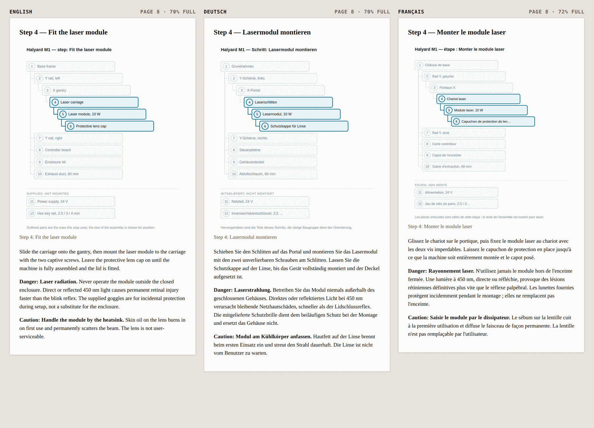

# Product Manual and Quick-Start Builder

A product manual and its quick-start card, generated from one structured spec.

Neither document is authored. The torque figure, the laser wavelength and the
wording of every safety notice live in `spec/halyard_m1.yaml`, and both documents
are projections of it — so there is no second copy of anything to go stale. The
diagrams are rendered from the parts graph, not drawn, so an edit regenerates
them instead of asking a model to redraw something that looks nearly the same.

Built on [SuperDocs](https://superdocs.app) for the SuperDocs task, by Vinayak
Sharma. Everything about the Halyard M1 is fabricated; there is no such machine.



*Page 8 of the manual in three languages. Same page, same diagram, same step —
and the percentages are how full that page is, which is the number that decides
whether the next translation still fits. Generated by `build`; the page
boundaries are the ones `check` asserts.*

## The problem it is aimed at

Every product ships a long manual and a short card, and they disagree within two
revisions. Someone corrects a torque figure in the manual, the card keeps the old
one, and the card is the one taped to the workbench. Nobody notices until a
customer follows it.

The usual fix is a process — a checklist, a reviewer, a diff. This is a
structural fix: the card cannot contradict the manual because neither of them
contains the figure.

## Try it

One command, from a fresh clone, with nothing installed:

```bash
./selftest
```

It builds the virtualenv on first use, then runs everything this project can be
asked to prove — cheapest first, and no quota spent by any of it.

```
==> unit tests (no network, no key)
    PASS
==> check: the spec, the pair, and every locale's pagination
    PASS
==> build: diagrams and documents rendered to out/
    PASS
==> status: what is published, and what is blocking an edit
    PASS
==> verify: the live documents are what publish recorded
    PASS

5 passed, 0 failed
```

Without a key the two live stages are reported as **skipped**, not as passed,
and the offline three still run. When something fails it is named at the bottom
under *what is not working*, and the exit code is non-zero, so this is also the
CI command.

Every command below is `./mb <subcommand>` — the same wrapper, which also builds
the virtualenv on first use. `.venv/bin/python -m manualbuilder.cli <subcommand>`
is the same thing if you would rather see the machinery.

<details>
<summary>Doing the install by hand instead</summary>

```bash
uv venv && uv pip install -e ".[dev]"
```

Plain `pip install -e .` into the system interpreter is refused on any
distribution that implements PEP 668 — Debian, Ubuntu and Fedora all do — so the
virtualenv is not a nicety here. [uv](https://docs.astral.sh/uv/) is the one
used because it brings its own Python and does not need `python3-venv`
installed; `python -m venv .venv && .venv/bin/pip install -e ".[dev]"` is the
same thing if you have it.
</details>

```bash
./mb test
```

106 tests, no network and no key.

Two commands need no API key and no network:

```bash
./mb check
```

```
spec        Halyard M1 rev C — 12 parts, 7 steps, 7 warnings, 6 faults
card        6 of 7 steps and 3 of 6 fixes, every word identical to the manual
layout      manual 15 pages, fullest 76%; card 10 panels, fullest 79%
locale de   same page for every block, text 110% of source, 7% headroom
locale fr   same page for every block, text 110% of source, 14% headroom
ok
```

```bash
./mb build
```

Writes 24 SVG diagrams and six documents — English, German and French, manual
and card — into `out/`. Open `out/manual.preview.html`: it is the built document
with a rule drawn wherever the layout says a page ends, so the claim above can be
looked at rather than taken on trust.

Then, with a key in `.env`:

```bash
./mb publish
```

```bash
./mb publish --language de
```

One pair per run rather than every locale at once: the pair is the unit that has
to stay consistent, and a German manual and a German card are published and
edited exactly as the English pair is. Consistency *across* languages is not
maintained by chat at all — it comes from the spec, and `check` is what proves
it.

```bash
./mb edit "raise the rail torque to 1.6 N·m"
```

`edit` prints the proposed changes grouped by document, records the batch to
`out/proposal.json`, and applies nothing.

```bash
./mb approve --reject CHANGE_ID
```

Rejecting one change keeps the rest. That is not a nicety: asked to change one
torque figure, the live service also offered to change the gantry step, which
legitimately shares the number. Approve the two you asked for, refuse the two
you did not, in one review.

`publish` writes both document ids, the session each is edited in, the durable
id underneath each, and the uploaded diagram URLs to `out/published.json`, so
`edit`, `approve`, `sync` and `export` find them without anything being pasted
between commands. `--manual`, `--card` and `--session` still exist on all four,
and are the override for working on a pair this machine did not publish.

```bash
./mb sync
```

```
8 diagram(s) re-rendered and uploaded
  [edit] chunk f248c6f2-… in manual
  … 7 more …
  [edit] chunk f2f400e9-… in quick-start card

9 change(s), each one an image URL and nothing else
nothing approved. out/proposal.json holds the batch; `approve` applies it.
```

`sync` is the path a spec change takes once the documents are published: every
diagram re-rendered from the parts graph, uploaded, and swapped into the
existing chunks. Like `edit` it applies nothing — the batch goes to
`out/proposal.json` and `approve` is a separate decision.

Nine changes and not eight, because the card carries the breakdown too. Each
document is asked only about the figures it actually holds, and that is not
cosmetic: the first version sent both documents the union of all eight captions,
and the card — which holds one of them — replied that it could only see one of
the figures listed and asked which were meant, and changed nothing. The manual
moved to the new drawings, the card kept the old one, and the run reported eight
clean swaps. Both statements were true and together they were the two documents
disagreeing.

So there are two guards and neither implies the other.
`assert_only_the_image_changed` asks whether everything that moved was a diagram
URL; `assert_every_figure_swapped` asks whether every diagram URL that should
have moved did. A turn that changed nothing satisfies the first on its own.

`sync` also opens a **fresh session per document** before it asks. A session is
a conversation and it remembers: sent into the session that had earlier handled
the torque edit above, the swap kept re-proposing the change that had been
rejected there, and the guard refused the batch every time. Nothing about a URL
substitution benefits from context, so it gets none. The documents are durable
and unaffected — only the chat around them is thrown away — and the new session
ids are written back to `out/published.json`.

```bash
./mb export --format html
```

`export` pulls both finished documents back into `out/export/`, which is how a
claim about them becomes checkable: what lands there is what the service holds,
not what this program believes it uploaded. It is deliberately a different
folder from the local render, because comparing the two is the point. Exports
cost no quota. `--format` is `pdf` by default; `html` is the one to ask for if
you want to read the markup back.

Give it a moment after `approve`, though — see the caveat under [what is
verified](#what-is-verified-against-the-live-service).

Two commands exist to be run rather than trusted, and neither spends quota:

```bash
./mb status
```

What is published, which session each document is edited in, and — the reason
it exists — whether a batch is parked. A parked batch holds its session and the
next turn in it comes back `409 session_busy` with nothing naming the batch.
This names it.

```bash
./mb verify
```

```
exported both documents to out/export/ (no quota spent)

  ok   manual: breakdown                  d8c0d831fc2f40aaae234c83925895b6.svg
  …
  ok   quick-start card: breakdown        d8c0d831fc2f40aaae234c83925895b6.svg
  --   step rails                         in neither document as the spec words it…
  ok   step gantry                        word for word in both documents
  …
17 passed, 0 failed, 1 no longer checkable
```

`verify` reads both documents back off the service and checks the two claims
that can fail silently: **every figure points at the drawing that was uploaded
for it** — compared by URL path, because the served `src` carries a ~750-
character signature that differs on every read — and **the manual and the card
still agree word for word**, on the served documents rather than on the local
render.

The third verdict is the honest one. `--` means an approved edit has moved the
text since publish, so the spec no longer words it the way the live documents
do; the check can no longer see what it was looking at, and it does not claim
the two still agree. In the run above that is the rails step, where the torque
edit landed — both documents read 1.6 N·m and the spec on disk still reads 1.2.
Text found in exactly *one* document is drift, and that is a failure.

`test_verify.py` is ten served documents broken in specific ways — an old
drawing left in place, a figure that lost its image, an invented URL, a fix
dropped from the card — and `verify` has to find each one. A verification step
that can only print green is worse than none.

## What is in the documents

| | Manual | Card |
|---|---|---|
| Safety notices | all 7, and again at the step each applies to | 3, declared in the spec |
| Exploded parts breakdown | yes, with a numbered parts table | yes, for reference |
| Setup steps | all 7, one per page, each with its own diagram | 6, one per panel |
| Troubleshooting | all 6 rows | 3 rows, verbatim |
| Warranty and disposal | both, in full | neither — the footer points at the manual |

The last row is a decision rather than an omission: a folded card that
reproduced the warranty text would be a card nobody reads, and `spec.py` refuses
to load a spec whose `statements` are missing either one, so the manual cannot
quietly ship without them.

## How each of the three criteria is answered

### The quick-start stays consistent when the manual changes

One instruction runs as **one turn per document, in a session each** — because
the service edits one document per turn, and because a session runs one turn at
a time. This build was designed around a single turn naming both
`document_ids`, and the API accepts that field, returns proposed changes, and
puts every one of them in the focused document. The card was never touched and
nothing in the reply said so.

The obvious repair — two turns in one session — does not work either: the first
parks at `awaiting_approval`, which holds the session, and the second is refused
with 409 `session_busy`. A pair sharing a session cannot have both halves
proposed at the same time, and both halves proposed at the same time is the
entire point. So each document gets its own session, and both turns are sent
before either is waited on, which also makes the pair cost one wait instead of
two.

So the guarantee sits where it actually holds: **nothing is applied until both
documents have proposed the change.** `assert_touched_both` refuses a batch that
proposes a change to only one of them, and approval covers the batch or none of
it. There is still no window in which the manual has moved and the card has not,
because the window opens at approval and approval is one decision — which is
the honest place for it, since approval is the only thing that mutates.

Underneath that, the structural guarantee: the card is a projection of the same
spec, carrying six of the seven steps, three of the seven warnings and three of
the six troubleshooting rows, with its own numbering — and every instruction and
every fix on it is the manual's, verbatim. `test_projections.py` asserts that
rather than trusting it, in both directions: the rows the card left behind are
checked to have stayed behind.

### Diagrams regenerate rather than being re-drawn

Drawings are a pure function of the parts graph. No model is in that path at
all. Change the graph and the drawing follows; change nothing and the bytes are
identical — checked across three interpreters with different `PYTHONHASHSEED`,
because in-process equality would still hold if the layout leaned on dict
ordering, and a diagram that changed between runs would look exactly like a
diagram somebody edited.

A step's illustration highlights exactly the parts that step names. There is no
second input to the highlight set, so an illustration cannot show a part its step
does not mention. Callout numbers in the parts table come from the same
traversal as the ones in the drawing, so they cannot point at different rows.

A localised spec is that same parts graph with German labels in it, so the
German manual gets German diagrams from the same renderer rather than English
ones with a translation around them — including the words the drawing prints on
*itself*, which are the ones that get missed. Printed English is much harder to
spot inside an SVG than in a paragraph.

On edit the diagram is replaced, never patched. `sync` re-renders from the spec,
uploads, and puts the new URL into the documents that are already published —
and that last step is the one place this design has to hold its nose, so it is
worth saying plainly.

A document on the service cannot be re-uploaded without becoming a different
document, so the new URL has to reach the existing chunks, and the only edit
surface is a chat turn. That means asking a model to perform what is really a
text substitution. So it is asked for, and then it is checked:
`assert_only_the_image_changed` compares each proposed chunk against the one it
replaces with the image URLs masked out, and refuses the whole batch if a single
other character moved. It also refuses a `src` that is not the exact URL just
uploaded for that exact figure — a plausible-looking URL is the likeliest thing
for a model to produce here, and it renders as a broken image in a shipped
manual. The model is allowed to propose the swap and is not trusted to have made
it. `assert_every_figure_swapped` is the other half, and the one that was
missing: a figure nobody swapped is a figure still pointing at the old drawing.

`test_session.py` is eleven batches that each look reasonable and are each
refused: a tidied caption, an added sentence, an invented URL, two real URLs on
the wrong figures, a signature on the wrong file, and a document that answered
politely and changed nothing.

### Localised versions keep page structure

German and French both run about 10% longer than the English here. That is
expected, and it is also how a translated manual reflows until a step lands on a
different page from its diagram.

Two mechanisms, in this order.

**Most page breaks are declared, not discovered.** Every section heading and
every setup step carries `starts_page`, so which page a step opens on falls out
of the spec's structure rather than out of how long the preceding sentences
happen to be. A translation inherits those breaks because it inherits the
blocks. The card's panels work the same way and for a more physical reason: the
crease is where it is whatever language is printed on it.

**What is left is measured.** `paginate.py` lays both documents out and compares
where every block landed. `outline()` still checks shape — same headings, same
figures, in the same order — but two documents with an identical outline print
differently the moment one is longer, so shape alone is not enough. The failure
message names the block and the page it moved to, because "4 pages became 5"
sends somebody through the whole document.

Both failure modes are covered, and both are proven by making them happen:
`test_paginate.py` inflates a translation until a block moves, and separately
until a page overruns while every block stays exactly where it was. The second
one matters: with the breaks declared, a long translation often has nothing left
to push, and a check that compared only page numbers would call that stable and
be right and useless.

What this is not: a renderer. The page is a model — lines of a fixed width on a
page of a fixed height, calibrated to A4 at 11pt — and it cannot tell you the
true page count of a PDF nobody has produced yet. What it does tell you is
relative, which is what the claim actually is: the same model applied to both
languages puts every block on the same page. The numbers live in one dataclass,
and a test pins the honest limit — print this manual on a 30-line page instead
and the German stops matching, which is a true statement about paper.

## What SuperDocs features it uses

| | |
|---|---|
| Document upload | both documents, as pre-chunked HTML so chunk-level edits are provable |
| Chat session per document | one turn each, both sent before either is waited on; a session runs one turn at a time |
| Re-opening a document in a new session | by its durable id, to send a turn no earlier conversation colours |
| `approval_mode: ask_every_time` | every turn parks at `awaiting_approval`; nothing applies itself |
| Batch approve with mixed decisions | per-change, with the top-level `approved` default |
| Image upload | the rendered SVGs, returning stable URLs for `` |
| Export | free, which is why verification leans on it |

Three API behaviours are pinned in `tests/test_superdocs.py` rather than left to
be rediscovered:

- Proposed changes come back **parsed** in `metadata.pending_changes` when
  polling, and **JSON-encoded inside a string** in
  `intermediate_responses[].content` when streaming. Anyone seeing `undefined` in
  every diff field is reading SSE, not polling.
- On approve, `approved` must appear at the **top level** as well as per change.
  It is the default for entries that omit their own, and leaving it out approves
  nothing while looking exactly like a service that ignored the call.
- Deep operations run 30 s to several minutes with no visible progress. That is
  still processing.

### What is verified against the live service

All of it, now: session init, upload, image upload, chat, approve, export, and
re-opening a document in a fresh session by its durable id.

A run on 2026-08-11 published the pair, proposed a torque change across both
documents, approved two changes and rejected two, and exported the result —
the manual came back reading 1.6 N·m in the rails step and 1.2 N·m in the
gantry step, which is exactly what the review decided.

A run on 2026-08-12 exercised `sync`: 8 diagrams re-rendered and uploaded, 9
swaps proposed across the two documents, both guards passed, all 9 approved, and
both documents exported pointing at all 9 of the newly uploaded URLs — compared
by URL *path*, because the service appends a ~750-character signed query when it
serves an image and that query differs on every read.

That check is the `verify` command, not something run by hand once and written
up here — which is the point. Anything in this section can be re-checked with
one free command, and if the documents on the service stop matching what
`publish` recorded, `verify` exits non-zero and names the figure.

One caveat found while doing that, and it is a real one: `export` run
immediately after `approve`, in the same shell command, came back with the
document as it was *before* the approval, and gave no sign of it. Re-exported a
few seconds later it was correct. Approval is not instantly visible to export,
so a script that chains the two without a pause can verify the wrong bytes.

An earlier version of this README said the same thing and was wrong. The client
had never been run, and almost every shape in it was a guess that read like a
fact. What the guesses cost is written up in the commits; the short version:

| Guessed | Actual |
|---|---|
| `POST /v1/images/upload` | `POST /v1/documents/images/upload-base64` |
| upload as JSON base64 | multipart, with **`open_mode`** |
| `chat {document_ids: [...]}` | `chat {session_id, document_id}` — singular |
| approve by session | approve by **`job_id`**, and only an **async** job ever reaches `awaiting_approval` |
| export by document, returns JSON | export by session, returns the file |

Two of those are quiet rather than loud, and they are the ones worth knowing
about. `open_mode` defaults to `replace`, so uploading a second document into a
session destroys the first and returns `"persisted": true` for both. And
approving a synchronous chat's job comes back *"Job is not awaiting approval
(status: completed)"* — the sync endpoint shows you proposed changes that can
never be applied.

`templates` remains unexercised: this build has no use for it and a call nobody
makes is not a call anyone verified.

## Layout

```
spec/halyard_m1.yaml     the single source of truth
locales/de.yaml          strings only; cannot change structure
locales/fr.yaml          the second launch market
manualbuilder/
  spec.py                load + validate; refuses a spec that would render wrong
  diagram.py             parts graph -> SVG, deterministically
  projections.py         spec -> manual, spec -> card, as laid-out blocks
  paginate.py            blocks -> pages; where a translation moved something
  localize.py            locale fill + the structural assertion
  superdocs.py           thin API client, no product decisions
  session.py             publish, the paired edit, approval, diagram swap
  verify.py              reading the pair back off the service and checking it
  cli.py                 check / build / publish / edit / approve / sync /
                         export / status / verify
mb                       the command line, virtualenv taken care of
selftest                 every check this project can run, in one command
tests/                   106 tests, no network
```

## What it does not do

- **It does not translate.** `locales/*.yaml` carries human-supplied strings.
  What is in scope is that a translation cannot quietly change the shape or the
  pagination of the document it lands in.
- **The diagrams are an assembly breakdown, not a rendering of the machine.**
  They are drawn from the parts graph, which knows what mounts to what and
  nothing about geometry. A true exploded view needs CAD, and claiming one from
  this data would be claiming knowledge the spec does not contain.
- **The page model is an estimate, not a typesetter.** It measures both
  languages the same way, which is what the comparison needs, and it will not
  tell you the true page count of a PDF.
- **One product ships.** The spec format is general; only the Halyard exists.
- **`edit` handles wording, not structure.** Adding a part changes the diagrams,
  so it goes through the spec and a re-publish. A model is never asked to redraw.

## Author

Vinayak Sharma
