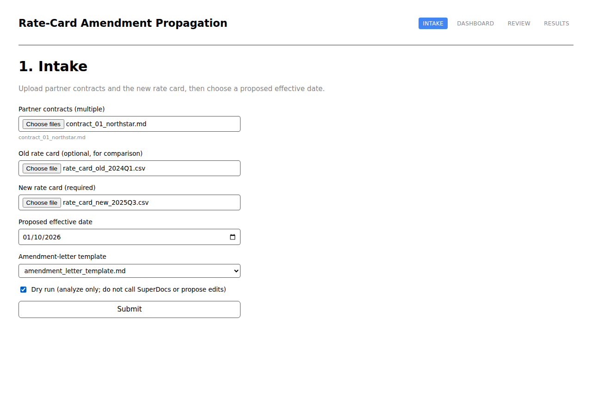
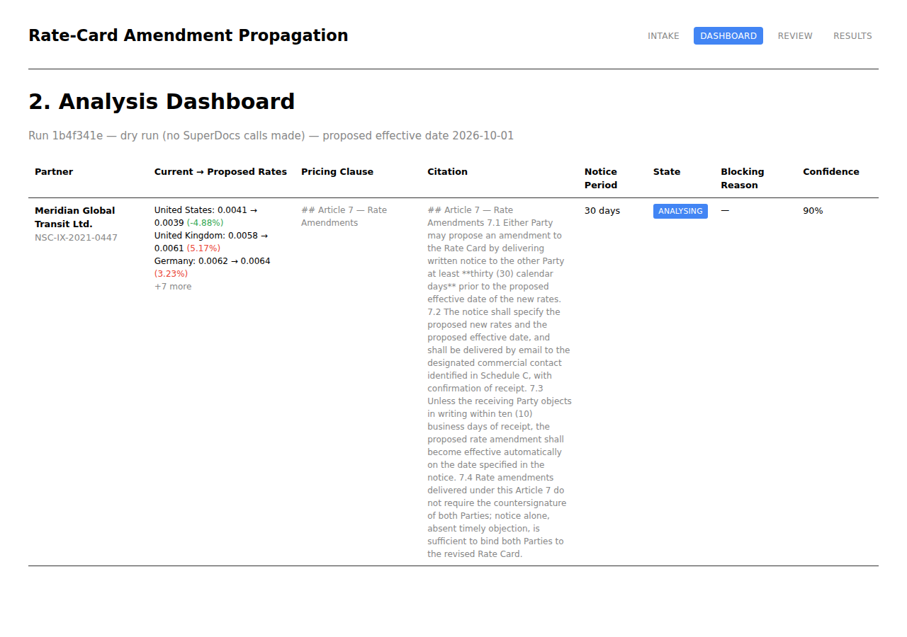

# Rate-Card Amendment Propagation

> Built for the SuperDocs task.

A small full-stack application that reviews wholesale telecom interconnect
contracts for rate-amendment eligibility, proposes the exact rate-table
edits through [SuperDocs](https://superdocs.app) under human review, and
exports the amended contract, the amendment letter, and a consolidated
control report.

This is a reference implementation for a specific, narrow use case:
**"can we unilaterally amend this partner's rate card, and if so, what does
the edited contract and notice letter actually look like?"** — not a general
contract-management tool.

This folder is fully self-contained: it does not depend on any of the
durable-orchestration/persistence/MCP infrastructure that exists elsewhere
in the parent project. Everything it needs to run is under this directory.

## Why this exists

Rate-card amendments are one of the highest-volume, most mechanical
contract-review tasks in wholesale telecom: most partner agreements allow a
unilateral rate change with notice, a few require mutual consent, and a few
are locked or ambiguous. Getting the eligibility call wrong — or editing the
wrong part of a signed contract — is expensive. This app makes the
eligibility determination **deterministic and auditable** (no model call
decides eligibility), and makes the actual document edit **scoped, reviewed,
and reversible** (nothing is written back to a contract without an explicit
human approval per change).

## Architecture

```
┌──────────────┐      ┌──────────────────────────────────────────┐      ┌───────────────┐
│   React SPA  │──────▶│              FastAPI backend               │──────▶│   SuperDocs   │
│ (4 screens)  │◀──────│  app/backend/                              │◀──────│  MCP API      │
└──────────────┘      │   routes/intake.py    → POST /runs         │      │ (real, remote)│
                       │   routes/analysis.py  → GET  /runs/.../cases│      └───────────────┘
                       │   routes/review.py    → propose/review/    │
                       │                          decisions          │
                       │   routes/results.py   → export/            │
                       │                          control-report     │
                       │                                              │
                       │  src/pipeline.py  (14-step deterministic    │
                       │   eligibility pipeline — no model calls)     │
                       │  src/rate_diff.py (old vs new rate card)     │
                       │  src/amendment_case.py (state machine +     │
                       │   orchestration)                             │
                       │  src/integrations/superdocs_client.py       │
                       │   (thin async JSON-RPC client)               │
                       └──────────────────────────────────────────┘
```

**Eligibility is never decided by SuperDocs or any model call.** It comes
entirely from the deterministic, offline, fixture-tested pipeline in `src/`
(see `docs/DOMAIN_MODEL.md`): partner/contract metadata, pricing-clause
location, notice-period extraction, pricing-lock and mutual-consent
detection, and conflict detection are all regex/parsing rules over already-
extracted text. SuperDocs is used **only** for the document-editing leg of
the flow — proposing the literal rate-table edit, holding it for approval,
and exporting the result.

## The SuperDocs flow

SuperDocs (`https://api.superdocs.app/mcp`) is a real, external MCP/JSON-RPC
document-editing service. This app talks to it through
[`src/integrations/superdocs_client.py`](src/integrations/superdocs_client.py),
a thin `httpx`-based async client — no MCP SDK dependency, easy to mock in
tests.

1. **Upload** — `upload_document_base64` loads the partner contract into a
   fresh SuperDocs session, keyed to this run + case.
2. **Send a tightly scoped instruction** — `chat_async` with
   `approval_mode="ask_every_time"`. The instruction (built by
   `src/amendment_case.py::build_instruction`) names the exact governing
   clause and lists **only the changed destinations, with their literal old
   and new rates** — SuperDocs will not fabricate a rate table it cannot see
   in the document text, so the real numbers must be supplied. The
   instruction explicitly forbids touching any other clause or heading.
3. **Retrieve proposed changes** — poll `get_job` until `awaiting_approval`.
4. **Parse proposed-change content** — each pending change carries
   `change_id`, `chunk_id`, `old_html`, `new_html`, and `ai_explanation`.
   These map directly onto the Review screen's "exact old content" / "exact
   proposed new content" panels.
5. **Display review** — the Review screen shows the diff per change, the
   generated amendment letter, and an explicit proof that no chunk outside
   the proposed set was touched.
6. **Approve only approved items** — `approve_change` is called once per
   `change_id`, individually. A case with mixed decisions lands in
   `partially_approved` and cannot be exported until every change is
   resolved.
7. **Export** — `export_document` (or `request_download_url` for binary
   docx/pdf) renders the session's current document state.

## States

```
pending → analysing ─┬─→ requires_review           (terminal: ambiguous contract,
                      │                              human must resolve out of band)
                      ├─→ blocked                    (terminal: pricing lock, mutual
                      │                              consent, or insufficient notice —
                      │                              no SuperDocs call is ever made)
                      ├─→ proposed ─┬─→ partially_approved ─┬─→ approved → exported
                      │             │                        └─→ blocked (all rejected)
                      │             └─→ approved → exported
                      └─→ approved                  (SuperDocs found nothing to change)

any state ──→ failed                                (any pipeline or SuperDocs exception)
```

`blocked` and `requires_review` are reached **before** any SuperDocs call —
pricing-lock, mutual-consent, and ambiguous/escalated contracts never open a
SuperDocs session at all.

## Setup

**Requirements:** Python 3.10+, [uv](https://docs.astral.sh/uv/), Node 18+,
a SuperDocs API key (only needed for non-dry-run submissions).

Clone-to-working-system, one command:

```bash
make install
```

This runs `uv sync`, `npm install` for the frontend, and creates `.env` from
`.env.example`. Edit `.env` and set `SUPERDOCS_API_KEY=sk_...` (skip this if
you only intend to use dry-run mode, which never calls SuperDocs).

Then, in two terminals:

```bash
make backend    # http://127.0.0.1:8000
make frontend   # http://localhost:5173
```

`GET /health` confirms the backend is up. The frontend talks to
`http://127.0.0.1:8000` (see `app/frontend/src/api.js`).

Without `make`:

```bash
uv sync
cp .env.example .env && edit it
uv run uvicorn app.backend.main:app --reload --port 8000

cd app/frontend && npm install && npm run dev
```

## Tests

One command, fully offline (no live SuperDocs calls, no network):

```bash
make test
```

```
118 passed in 1.2s
```

`tests/integration/superdocs_fixtures.py` holds **response bodies recorded
from actual live SuperDocs API calls** made during development, replayed
through a `respx`-mocked HTTP transport.

| Scenario | Test |
|---|---|
| Pricing-lock exclusion | `tests/unit/test_amendment_case.py::TestPricingLockExclusion` |
| Insufficient notice | `tests/unit/test_amendment_case.py::TestInsufficientNotice` |
| Partial approval | `tests/api/test_review_routes.py::test_partial_approval_reaches_partially_approved_state` |
| Rejected proposal | `tests/api/test_review_routes.py::test_rejected_proposal_blocks_export` |
| Missing clause | `tests/unit/test_amendment_case.py::TestMissingClause` |
| Second JSON parse for proposed changes | `tests/integration/test_superdocs_client.py::test_poll_job_raises_structured_error_on_malformed_inner_json` |
| Duplicate submission | `tests/api/test_intake_routes.py::test_duplicate_submission_returns_identical_response_without_reanalysis` |
| Unchanged negotiated clauses | `tests/integration/test_superdocs_client.py::test_export_document_returns_inline_text_and_omits_untouched_clauses_intact` |
| Prompt-injection resistance | `tests/security/test_prompt_injection_resistance.py` |
| Secret redaction | `tests/security/test_secret_redaction.py` |

## Sample synthetic contracts

Five fully synthetic wholesale interconnect contracts, an old/new rate-card
CSV pair, an amendment-letter template, and a review playbook under
`fixtures/` — see [`docs/FIXTURE_DESIGN.md`](docs/FIXTURE_DESIGN.md) and
[`docs/DOMAIN_MODEL.md`](docs/DOMAIN_MODEL.md), including a deliberately
embedded prompt-injection string (contract 5) used to verify that document
text is never treated as an instruction.

## Screenshots

**Intake** — upload contracts + rate cards, choose a proposed effective date:



**Analysis Dashboard** — deterministic eligibility result, per-partner rate
diff, governing clause citation:



These were captured from a real `dry_run=true` submission of
`contract_01_northstar.md` against the fixture rate-card pair — no SuperDocs
key required for dry runs. The case sits in `analysing` because dry run
intentionally stops before the SuperDocs propose/review/export steps.

## Expected output example

`GET /runs/{run_id}/cases` for the run above returns (abridged):

```json
{
  "case_id": "...",
  "partner_name": "Meridian Global Transit Ltd.",
  "contract_id": "NSC-IX-2021-0447",
  "state": "analysing",
  "notice_period_days": 30,
  "confidence": 0.9,
  "rate_changes": [
    {"destination": "United States", "old_rate": 0.0041, "new_rate": 0.0039, "pct_change": -4.88},
    {"destination": "United Kingdom", "old_rate": 0.0058, "new_rate": 0.0061, "pct_change": 5.17}
  ],
  "pricing_clause_citation": "## Article 7 — Rate Amendments ..."
}
```

## What works

- Full deterministic eligibility pipeline (14 steps) against all 5 fixture
  contracts, verified against `fixtures/expected_results.json`.
- Rate-card diffing (`src/rate_diff.py`), notice-period, pricing-lock,
  mutual-consent, and conflict/prompt-injection detection.
- Dry-run mode: full analysis with zero SuperDocs calls.
- Idempotent submission (`POST /runs`, `.../propose`, `.../decisions`,
  `.../export` all require an `idempotency_key`; repeats return the
  original stored response verbatim).
- Real SuperDocs propose → review → per-change approve → export flow,
  verified against recorded live-API fixtures.
- Structured failure objects (`what` / `likely_cause` / `next_action`) for
  every error path — pipeline, SuperDocs transport, state-transition, or
  idempotency conflict.
- Secret redaction (`src/integrations/redaction.py`) and prompt-injection
  resistance (contract text is never interpreted as an instruction).
- 118 offline tests, all passing, no network required.

## What does not work / limitations

- **No persistence.** Runs and cases live in an in-process, in-memory store
  (`app/backend/store.py`). A server restart loses all runs. This app does
  not run correctly across multiple backend processes.
- **No durable resume.** If the backend process dies mid-run, there is no
  checkpoint to resume from — the run must be resubmitted. (A durable,
  resumable version of this pipeline exists as a separate, private
  extension outside this folder; it is not required to run this use case.)
- **No auth.** There is no login, no multi-tenant isolation, no rate
  limiting on the API — this is a single-user reference app.
- **Supported contract formats:** plain text and Markdown (`.md`, `.txt`)
  only — no PDF or DOCX extraction. Rate cards must be `.csv`.
- **SuperDocs is a real external dependency.** Anything beyond dry-run mode
  requires a working `SUPERDOCS_API_KEY` and network access to
  `api.superdocs.app`; this app does not ship a SuperDocs mock server for
  live use, only for its own test suite.
- **Notice-period math is calendar-day, wall-clock-driven** — eligibility
  outcomes for a given contract will differ depending on the real date you
  run it (see Troubleshooting).

## Design decisions and trade-offs

- **Eligibility is deterministic, not model-driven.** A regex/rule pipeline
  over already-extracted text, rather than an LLM call, decides whether an
  amendment is legally permissible. This trades flexibility (an LLM could
  in principle handle more contract variety) for auditability and
  reproducibility — the same contract always produces the same eligibility
  verdict, and that verdict can be explained by pointing at the exact
  matched clause. This is the one invariant the rest of the design protects.
- **SuperDocs only ever proposes, never decides.** The instruction sent to
  SuperDocs supplies the literal destination/old-rate/new-rate triples
  computed by `src/rate_diff.py` — SuperDocs is not asked to infer what the
  new rates should be from the document text. This removes an entire class
  of "the model hallucinated a rate" failure.
- **In-memory store, on purpose, for this deliverable.** A real database
  would add setup friction (a service to run, migrations, connection
  config) to a reference app whose job is to demonstrate the domain logic
  and the SuperDocs integration, not to be a production system. The
  store module is a single, swappable seam (`app/backend/store.py`) —
  the durable version of this app that adds Postgres-backed persistence,
  resume, and concurrency safety exists as a separate extension, not
  bundled here, so this folder stays dependency-light and clonable in one
  command.
- **Idempotency keys over automatic dedup.** Requiring the client to supply
  an `idempotency_key` (rather than the server hashing the request body) is
  more explicit and lets legitimately-identical resubmissions (a retry
  after a timeout) be distinguished, in principle, from accidental ones —
  simpler to reason about than content-based dedup with no false-positive
  risk.
- **A thin `httpx` client instead of an MCP SDK.** `src/integrations/superdocs_client.py`
  talks JSON-RPC directly over HTTP rather than depending on an MCP client
  library. Fewer moving parts, and trivial to `respx`-mock in tests without
  a protocol-level test harness.

## AI usage disclosure

This codebase — the deterministic pipeline, the FastAPI backend, the React
frontend, the fixture contracts, and this documentation — was built with
AI assistance (Claude, via Claude Code) working from a human-specified task
brief and iterating with a human reviewer. All fixture contracts, partner
names, rates, and dates are synthetic, generated for this project — they do
not describe any real company, contract, or commercial relationship.
Screenshots in this README were captured from a real, running instance of
this app (a local FastAPI backend + Vite dev server), not mocked up.
SuperDocs itself is a real third-party service this app integrates with,
not something built as part of this task.

## Troubleshooting

**"Failed to fetch" in the browser console.** The frontend
(`http://localhost:5173`) and backend (`http://127.0.0.1:8000`) must both
be running, and the backend's CORS allowlist
(`app/backend/main.py::allow_origins`) must include the frontend's actual
origin. If port 5173 is already taken by something else on your machine,
Vite silently picks the next free port (5174, ...) — the backend will then
reject the frontend's requests with a CORS error. Free port 5173 first, or
add your actual dev-server origin to `allow_origins`.

**A contract that should be eligible shows `blocked` with "insufficient
notice".** Notice-period checks compare your chosen "proposed effective
date" against the real wall-clock date the backend is running on
(`date.today()`), not a fixed reference date — the bundled test suite uses a
frozen reference date (`docs/FIXTURE_DESIGN.md`) for reproducibility, but
the live app does not. Pick a proposed effective date far enough in the
future to clear the contract's notice period.

**A case stays in `analysing` forever.** This is correct for
`dry_run=true` submissions — dry run intentionally stops after the
deterministic pipeline and never calls SuperDocs, so the case never
transitions past `analysing`. Submit with `dry_run=false` (and a valid
`SUPERDOCS_API_KEY`) to proceed to `proposed`.

**`SUPERDOCS_API_KEY` errors on a non-dry-run submission.** Confirm `.env`
exists (copy from `.env.example`) and the key is a real, active SuperDocs
key. The key is read once at process start
(`src/integrations/superdocs_client.py`) — restart the backend after
editing `.env`.

**Tests fail with import errors.** Run `uv sync` first; the test suite
depends on `respx` and `pytest-asyncio` from `[dependency-groups].dev`.

## Non-goals

- Not a general contract-management or e-signature product.
- Not a source of legal advice — the amendment letter is a draft; the
  internal drafting checklist in
  `fixtures/templates/amendment_letter_template.md` still applies.
- All contracts, partner names, rates, and dates in `fixtures/` are
  fictional, constructed for testing document-extraction and
  contract-review pipelines.
