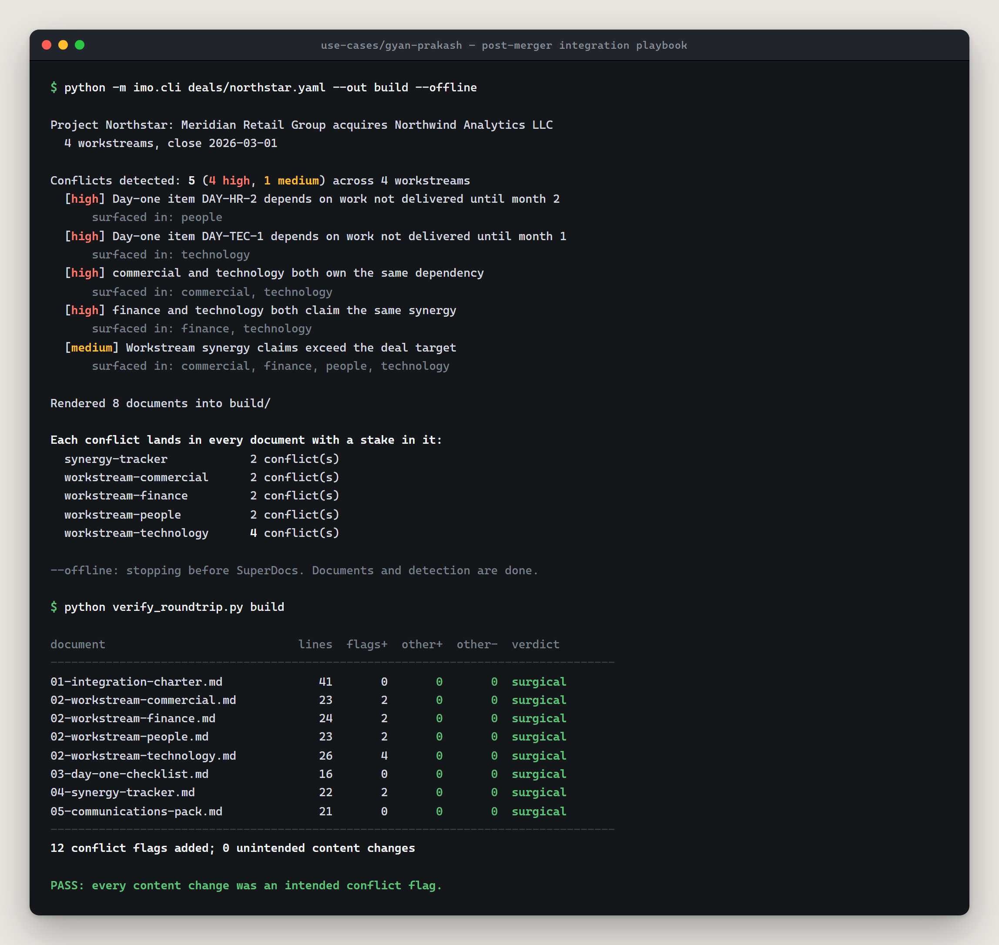

# Post-Merger Integration Playbook Document Set

Built on SuperDocs for the SuperDocs engineer task, by **Gyan Prakash**
([@Gyan0309](https://github.com/Gyan0309)).

An integration management office runs on a document set: an integration charter, a
charter per workstream, day-one readiness checklists, a synergy tracker and a
communications pack. This generates that set from a deal specification, and — the part
that matters — **finds the places where two workstreams contradict each other and
flags each contradiction in every document that has a stake in it**, rather than once
in a central list where each lead can assume it belongs to someone else.



*A real `--offline` run and its verification, captured 2026-08-20 — no API key, no network,
no ops spent. Five contradictions found across four workstreams, flagged twelve times because
each one lands in every document with a stake in it, and `verify_roundtrip.py` confirming that
nothing else in those eight documents moved.*

---

## Run it

```bash
pip install -r requirements.txt

# Detection and rendering only. No API key, no network.
python -m imo.cli deals/northstar.yaml --out build --offline

# The whole thing: upload, flag through SuperDocs, review, export.
export SUPERDOCS_API_KEY=sk_...
python -m imo.cli deals/northstar.yaml --out build

# Prove the edits were surgical.
python verify_roundtrip.py build
```

### Tests

```bash
pip install -r requirements-dev.txt
pytest -q          # 44 tests, no API key, no network
```

Every test runs offline. The whole detection and rendering half of this build is
exercised without touching SuperDocs, which is what makes it safe to change.

---

## What it found on the sample deal

Project Northstar is synthetic — fictional companies, fabricated numbers, as the brief
expects. Four workstreams, eight documents, and five conflicts planted so that every
detector has something real to catch:

| Severity | Conflict | Surfaced in |
|---|---|---|
| high | Finance and Technology both claim the same $1.8M vendor-termination saving | **finance**, **technology**, synergy tracker |
| high | Commercial and Technology both own the CRM migration | **commercial**, **technology** |
| high | `DAY-HR-2` needs payroll cutover, which lands in month 2 | **people** |
| high | `DAY-TEC-1` needs SSO, which lands in month 1 | **technology** |
| medium | Claims total $5.15M against a $4.6M target — $550k over | all four |

The bolded pairs are the requirement: one conflict, both documents.

---

## What it cost, measured

One end-to-end run over eight documents:

| | |
|---|---|
| Documents generated and uploaded | 8 |
| Conflict flags applied through SuperDocs | 12 |
| Flags that landed | **12 / 12** |
| **Unintended content changes** | **0** |
| Operations spent | **12** |

`verify_roundtrip.py` produces that last row. It normalises markdown presentation — a
markdown → HTML → markdown round trip legitimately rewrites `|---|` as `| --- |` and
`*` bullets as `-` — and then reports every remaining difference:

```
12 conflict flags added; 0 unintended content changes
PASS: every content change was an intended conflict flag.
```

Three documents with no conflicts came back **content-identical**. That is the brief's
second behaviour, measured rather than claimed: change what you meant to change, and be
able to show that nothing else changed.

---

## What SuperDocs features it uses

The whole SuperDocs half runs through the REST API. Every call below is exercised by a real
run, not just wrapped.

| Feature | Endpoint | What it does here |
|---|---|---|
| Document upload | `POST /v1/documents/upload-base64` | Sends each rendered playbook document in, with a caller-chosen `session_id` so it persists rather than being a one-off conversion |
| Session inventory | `GET /v1/sessions/{id}/documents` | Confirms the upload actually landed, instead of trusting the 200 |
| Chat editing, async | `POST /v1/chat/async` + `GET /v1/jobs/{job_id}` | Writes each conflict flag into each document that has a stake in it. Async because a multi-document edit outlives the sync gateway timeout |
| Review mode / approval gate | `POST /v1/chat/{session_id}/approve` | Per-change approval — the edit is proposed, then approved, never blind-applied |
| Continue | `POST /v1/chat/{session_id}/continue` | The other flavour of `awaiting_approval`; branching on `metadata.awaiting_kind` first is what keeps this off a `409` |
| Job listing | `GET /v1/sessions/{session_id}/jobs` | Recovers state when a run is resumed |
| Export | `POST /v1/documents/export` | Pulls the flagged documents back out as markdown into `build/exported/` |
| Account / promo | `GET /v1/agents/whoami`, `GET /v1/users/me/promotions` | Preflight, and reading remaining credits before a run spends any |

**Idempotency.** `session_id` is caller-chosen rather than server-assigned, so it doubles as the
idempotency handle: re-running a deal reuses its session instead of duplicating documents and
re-spending ops. That matters because chat edits are the only part of this that costs money.

**Not used:** MCP, and the sync `POST /v1/chat` path — the first because this build is a CLI
rather than an agent surface, the second because `ask_every_time` on sync chat returns changes
that cannot be approved (finding #1 in [`BUGS.md`](BUGS.md)).

**Demo:** no separate video for this build. It appears in the SuperDocs Engineer Task demo video
submitted through the round's form; the screenshot above is a real run of the offline path.

## How it works

```
deal.yaml ──► load & validate ──► detect conflicts ──► render documents
                                        │                     │
                                        └────────┬────────────┘
                                                 ▼
                                    upload to SuperDocs (one session per document)
                                                 ▼
                                    flag each conflict, one edit per turn
                                                 ▼
                                    per-item approve  ──►  export
```

### The deal spec is the single source of truth

Every document is a projection of `deals/*.yaml`. That is the load-bearing decision.

The card asks that *"master-to-workstream consistency holds after edits made on either
side"*, and that is not achievable between N documents that merely agreed when they were
written — each edit is a chance to drift and there is no arbiter. With a spec in the
middle, consistency is a comparison against one artifact rather than N² comparisons
between documents, and an edit on either side reconciles the same way.

A new deal, workstream, synergy or dependency is a YAML change. Never a code change.

### Detection is deterministic; editing is SuperDocs' job

The split is deliberate.

**Conflicts are found by arithmetic**, in `conflicts.py`, with no model involved. A
model asked "does anything look inconsistent here?" will find something on a clean deal
and miss something on a dirty one, and neither failure is visible. Four general
comparators — not special cases:

| Comparator | Catches |
|---|---|
| `duplicate_synergy` | two workstreams banking the same saving |
| `contested_dependency` | two workstreams owning the same deliverable |
| `synergy_over_commitment` | claims exceeding the deal target |
| `unmet_day_one` | a day-one item resting on work due later |

The first two also catch near-duplicates by description, not just identical ids, because
the realistic failure is `SYN-F2` and `SYN-T1` describing the same contract termination.

**Editing goes through SuperDocs**, because that is the product doing what it exists to
do: a targeted change landing in a real document, reviewable, with everything else
untouched.

### One conflict per chat turn

More turns, and worth it. Each proposed change is reviewable on its own — so a reviewer
can accept one flag and reject another — and a failure is attributable to a specific
conflict rather than leaving a half-edited document nobody can reason about.

---

## Honest limitations

- **Conflict detection runs on the deal spec, not on the document text.** If someone
  edits an exported charter directly and introduces a contradiction there, the next run
  re-detects from the spec and will not see it. Reading changes back out of the
  documents and into the spec is the obvious next step and is not built.
- **Near-duplicate matching is a word-overlap heuristic** with a tuned threshold. It is
  crude on purpose — a reviewer asking "why were these flagged as the same?" gets an
  answer they can check by reading — but it will miss a duplicate phrased in entirely
  different vocabulary, and the threshold is a judgement rather than a fact.
- **`--offline` covers detection and rendering only.** The SuperDocs half needs a key,
  so the flagging and approval path has no test that runs without one.
- **Readiness status is read from the spec, not from workstream submissions.** The card
  describes updating status from workstream inputs; here that is a field you edit.

---

## Bugs and rough edges

Eight findings from integrating against the API are written up in
[BUGS.md](BUGS.md) — including one blocking issue where `approval_mode:
ask_every_time` on the synchronous `/v1/chat` endpoint produces changes that cannot be
approved, because `/approve` requires a `job_id` that only the async endpoint returns.

That file also records what worked well, because a bug list on its own is a misleading
portrait.

---

## Layout

```
deals/northstar.yaml      the sample deal, conflicts planted deliberately
src/imo/deal.py           spec model and validation
src/imo/conflicts.py      the four comparators — deterministic, no model
src/imo/documents.py      rendering, and flagging through SuperDocs
src/imo/superdocs.py      API client for the four-call contract
src/imo/cli.py            the driver
verify_roundtrip.py       proves the edits were surgical
BUGS.md                   what broke, and what surprised me
```

---

*Built for the SuperDocs Full-Stack AI Engineer task. AI-assisted throughout, which the
brief encourages and I am declaring: the code was written with Claude, directed and
reviewed by me, and every measured claim above was produced by running it.*
