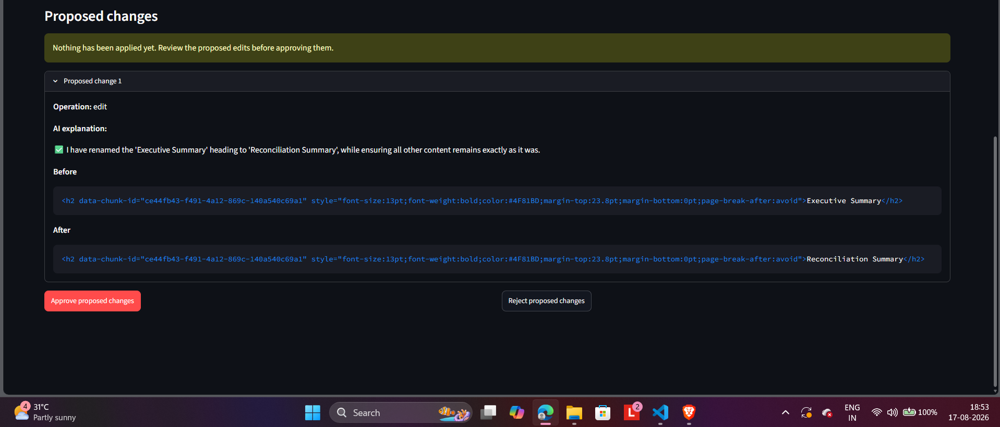

# Closing Document Reconciliation Memo

SuperDocs Round 2 — Assigned Build 1 (S3)

> Built by Kalpesh Sharma for the SuperDocs Engineer Task — Assigned Build 1: Closing Document Reconciliation Memo.

This build opens a five-document mortgage closing file in one SuperDocs session, extracts supported values from the processed document HTML, reconciles the file against its own underwriting rules, generates a side-by-side variance memo and correction request, supports read-only search/chat, sends edits through SuperDocs Review with an explicit approval gate, and exports DOCX artifacts.

## Screenshot



The screenshot shows the SuperDocs human-review surface: the proposed change is visible before anything is applied, and the user can explicitly approve or reject it.

## What the build reconciles

The workflow compares nine findings:

- loan amount
- interest rate
- loan term
- escrow
- origination fees
- title / settlement services
- cash to close
- borrower names
- property address

A finding is classified as **tolerable** or **curable only when the uploaded file's rule text supports that classification**. The build does not apply external mortgage law or infer missing values.

Origination fees are reconciled even though Scenario A does not provide a rule for classifying an origination-fee difference. Therefore a hypothetical origination mismatch is surfaced as **unclassified / human review required** rather than silently dropped or assigned an invented rule.

## Product surfaces

1. **Documents** — upload exactly five DOCX/PDF files into one shared SuperDocs session and inspect grounded extraction evidence.
2. **Reconciliation** — side-by-side values, evidence, file rule, explanation, classification, and recommended action.
3. **Memo & Correction** — generated reconciliation memo plus a separate correction request containing only curable findings.
4. **Search & Chat** — deterministic local search over SuperDocs processed HTML plus read-only SuperDocs chat. Chat is exploratory and never controls reconciliation decisions.
5. **Review** — request a surgical edit with `approval_mode="ask_every_time"`, inspect pending changes, then explicitly approve or reject.
6. **Export** — download generated DOCX files and export the approved reviewed artifact from SuperDocs.

## Architecture

```text
5 uploaded documents
        |
        v
SuperDocs /v1/documents/upload
(one shared multi-document session)
        |
        +--> processed HTML + document_id
                 |
                 v
        core/html_extraction.py
        deterministic label/value mapping
                 |
                 v
        core/extraction.py
        canonical normalization
                 |
                 v
        grounding validation
        unsupported evidence => hard stop
                 |
                 v
        core/rule_config.py
        field/reference/rule mapping as data
                 |
                 v
        core/rules.py
        parse thresholds/semantics from actual rule text
                 |
                 v
        core/workflow.py
        reconciliation
                 |
        +--------+---------+
        |                  |
        v                  v
reconciliation memo   correction request
        |                  |
        +--------+---------+
                 |
                 v
        SuperDocs Review
        ask_every_time approval gate
                 |
                 v
               export
```

### Why deterministic extraction?

During integration testing, `/v1/chat` sometimes routed structured extraction requests inconsistently even when a target `document_id` was supplied. Because unsupported extraction would be worse than a visible failure, the production path uses the **processed HTML returned by SuperDocs upload** and deterministic field-label aliases instead of depending on chat for numeric/file-rule extraction.

SuperDocs chat remains available as a visible **read-only exploratory surface**, and SuperDocs Review is used for the human-approved editing workflow.

### Rule behavior is file-driven

The workflow no longer hardcodes `$250`, `$500`, or exact-match tolerances in reconciliation code. `core/rules.py` deterministically derives supported thresholds from the actual extracted rule text:

- `must exactly match` → tolerance `0`
- `difference ... up to $X` → tolerance `X`
- `difference greater than $X` → threshold `X`

If a rule is present but a supported threshold cannot be derived, the variance remains **unclassified** and is sent to human review.

Likewise, middle-initial omission and address-abbreviation normalization are enabled only when the corresponding rule text explicitly supports those transformations. If the rule text changes, the permissive normalization is not silently retained.

## Grounding and safety behavior

- Every non-null extracted raw value must be present in the processed HTML for its source document.
- Evidence/rule quotes are checked against the source document.
- Grounding warnings stop the workflow instead of silently continuing.
- Missing values remain missing; the build does not invent them.
- File rules are fictional file-specific instructions for the synthetic demo, not legal or regulatory rules.
- The correction request includes **curable findings only**.
- Reconciliation is deterministic; chat responses do not alter classifications.
- A fee category is never dropped merely because no classification rule exists; unsupported classification becomes human review.

## Scenario A proof

| Field | Expected result |
| --- | --- |
| Loan amount | Match |
| Interest rate | Curable variance — 6.625% Closing Disclosure vs 6.500% approved rate |
| Loan term | Match |
| Escrow | Match |
| Origination fees | Match — $4,200 in Loan Estimate and Closing Disclosure |
| Title / settlement services | Tolerable variance — $150 difference, within the `$250` threshold parsed from R-005 |
| Cash to close | Curable variance — $1,350 difference, above the `$500` threshold parsed from R-006 |
| Borrower names | Match under R-007 middle-initial rule |
| Property address | Match under R-008 abbreviation rule |

Expected summary after the fee-category fix:

```text
Matches:     6
Tolerable:   1
Curable:     2
Unresolved:  0
```

The two curable items are the only items included in the revised disclosure / correction request.

## Setup

```powershell
python -m venv .venv
.\.venv\Scripts\Activate.ps1
pip install -r requirements.txt
```

Create `.env` locally with the SuperDocs API key expected by `superdocs/client.py`. Do **not** commit `.env`.

Recommended `.gitignore` entries:

```gitignore
.env
.venv/
__pycache__/
*.pyc
.pytest_cache/
outputs/*
```

## Run tests

```powershell
pytest -v
```

Regression coverage includes:

- filename-based document-type fallback
- Underwriting Approval not being misclassified because a rule mentions `Loan Estimate`
- table-cell boundaries
- `Loan Terms` not being mistaken for the `Loan Term` field
- `Applicants and Property` not becoming a borrower value
- actual SuperDocs Closing Disclosure `Property` and `Escrowed Property Costs` labels
- origination-fee mismatch detection
- rule threshold changes affecting classification
- middle-initial normalization requiring supporting rule text
- address-abbreviation normalization requiring supporting rule text
- DOCX Markdown rendering

## Run the app

```powershell
streamlit run app.py
```

Recommended demo sequence:

1. Upload the five Scenario A documents.
2. Confirm all five document types are in one SuperDocs session.
3. Confirm summary: **6 match / 1 tolerable / 2 curable / 0 unresolved**.
4. Open the rate, origination, title-fee, and cash-to-close findings and show their evidence/rules.
5. Show that the correction request contains only rate and cash-to-close.
6. Use Search to locate a grounded value.
7. Ask a read-only chat question.
8. In Review, request a surgical edit such as changing `Executive Summary` to `Reconciliation Summary`.
9. Inspect the proposed change before approving it.
10. Approve, complete the job, and export the reviewed DOCX.

## API / operation behavior

- 5 upload operations for the mortgage file.
- Deterministic extraction/reconciliation runs locally after upload.
- Search runs locally over processed HTML.
- Chat is user-triggered only.
- Review/edit operations are user-triggered only.
- Uploaded document IDs and source HTML are reused within the Streamlit session.

## Known SuperDocs integration rough edges

1. Structured extraction through chat showed intermittent routing behavior, so chat is not used as the source of truth for reconciliation.
2. Pending Review changes may arrive either as a normal list or as a JSON-encoded string. `parse_pending_changes()` defensively handles both representations.
3. Large edit requests may produce a `continue_prompt`. The demo asks users to make smaller surgical edits rather than spending unbounded operations.

These failures are surfaced to the user; the build does not fabricate a successful result.

## Key files

```text
app.py
assets/
  reconciliation.png
core/
  html_extraction.py
  extraction.py
  models.py
  normalize.py
  reconcile.py
  rule_config.py
  rules.py
  corrections.py
  memo.py
  workflow.py
superdocs/
  client.py
  parser.py
  polling.py
tests/
  test_html_extraction.py
  test_rules.py
  test_workflow.py
  fixtures/
    closing_disclosure_superdocs.html
```

## Disclaimer

All sample borrower, property, lender, and transaction details are synthetic. This project is a software demonstration and does not provide legal, lending, compliance, or regulatory advice.
