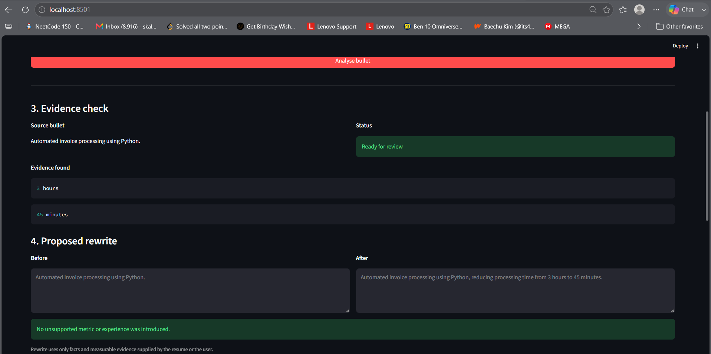

# Evidence-First Resume Bullet Rewriter

Built by **Kalpesh Sharma** for the **SuperDocs Engineer Task**.

An evidence-first resume editing workflow that strengthens resume bullets without inventing metrics, responsibilities, technologies, or experience.

The core rule is simple:

> If measurable impact is missing, ask for it instead of making it up.



## What it does

The app takes a resume bullet and checks whether the information needed for a stronger outcome-oriented statement is actually supported.

It can:

- detect explicit quantitative evidence already present in a bullet
- preserve existing metrics
- ask the user for measurable impact when none is available
- reject unsupported claims such as fabricated leadership experience
- generate a conservative rewrite using only supplied evidence
- upload the source resume to SuperDocs
- show the proposed document edit before applying it
- require explicit human approval or rejection
- export the reviewed DOCX after approval

## Example

### Source

```text
Automated invoice processing using Python.
```

The source contains no measurable result, so the app does **not** invent one.

Instead it asks for evidence such as:

```text
Reduced processing time from 3 hours to 45 minutes.
```

The resulting proposal becomes:

```text
Automated invoice processing using Python, reducing processing time from 3 hours to 45 minutes.
```

The values `3 hours` and `45 minutes` came directly from the user.

## Unsupported-claim protection

If the source says:

```text
Built Power BI dashboards for operational reporting.
```

and the user requests:

```text
Make this say I led a five-person analytics team.
```

the request is rejected because the source contains no evidence of leadership responsibility.

The app does not silently add the claim.

## Workflow

```text
Resume bullet
      ↓
Evidence detection
      ↓
Is measurable impact available?
      │
      ├── No → ask the user
      │
      └── Yes
             ↓
Supported-claim validation
             ↓
Evidence-grounded rewrite
             ↓
Upload source DOCX to SuperDocs
             ↓
SuperDocs proposed edit
             ↓
Human review
        ↙           ↘
     Reject        Approve
                      ↓
               Reviewed DOCX
                      ↓
                    Export
```

## SuperDocs integration

SuperDocs is used for the actual document-editing workflow.

The app:

1. uploads the resume DOCX into a SuperDocs session
2. sends a surgical edit instruction containing the exact source and replacement bullet
3. starts an asynchronous review with `ask_every_time`
4. polls until the job reaches an actionable state
5. parses the proposed changes
6. displays the before/after diff
7. sends the human approval or rejection decision
8. exports the reviewed DOCX

The edit instruction explicitly tells SuperDocs not to modify unrelated resume content or introduce new claims.

## Human review

Nothing is applied automatically.

The user sees the proposed SuperDocs change first and can choose:

- **Approve proposed change**
- **Reject proposed change**

Only an approved edit is allowed to become part of the reviewed document.

## Graceful re-entry

SuperDocs review jobs can take time.

If a review has already reached `awaiting_approval`, the app reuses that existing job instead of starting another review request.

This avoids unnecessary duplicate operations and makes the workflow safe to resume.

## Pending-change parsing

SuperDocs may return proposed changes as either:

- a list
- a JSON-encoded string

and current review jobs expose them through job metadata.

The parser handles these forms explicitly and fails loudly if malformed content is returned instead of silently treating it as an empty successful diff.

## Proof cases

### Case 1 — missing metric

Source:

```text
Automated invoice processing using Python.
```

Result:

```text
More evidence needed
```

No metric is invented.

After the user provides:

```text
Reduced processing time from 3 hours to 45 minutes.
```

the values are used in the proposed rewrite.

### Case 2 — metric already exists

Source:

```text
Processed 500 invoices per month using Python.
```

Result:

```text
Ready for review
```

`500 invoices` is preserved exactly.

### Case 3 — unsupported experience

Source:

```text
Built Power BI dashboards for operational reporting.
```

Requested claim:

```text
Make this say I led a five-person analytics team.
```

Result:

```text
Unsupported request
```

No leadership claim is added.

## Verified SuperDocs flow

The complete workflow was tested with a synthetic resume.

```text
Evidence detection          PASS
Missing-metric gate         PASS
Unsupported-claim gate      PASS
SuperDocs upload            PASS
Proposed edit               PASS
Human approval              PASS
Approved edit persisted     PASS
DOCX export                 PASS
Unrelated bullets preserved PASS
```

The final exported resume changed only:

```text
Automated invoice processing using Python.
```

to:

```text
Automated invoice processing using Python, reducing processing time from 3 hours to 45 minutes.
```

The remaining resume bullets were unchanged.

## Project structure

```text
impact-quantifying-bullet-rewriter/
│
├── app.py
├── README.md
├── requirements.txt
├── .env.example
├── .gitignore
│
├── assets/
│   └── evidence_first_review.png
│
├── core/
│   ├── __init__.py
│   ├── evidence.py
│   ├── models.py
│   └── rewriter.py
│
├── sample_documents/
│   ├── generate_sample_resume.py
│   └── sample_resume.docx
│
├── superdocs/
│   ├── __init__.py
│   ├── client.py
│   ├── parser.py
│   └── polling.py
│
└── tests/
    ├── test_evidence.py
    ├── test_rewriter.py
    └── test_superdocs_parser.py
```

## Setup

Create a virtual environment if needed:

```bash
python -m venv .venv
```

Activate it and install dependencies:

```bash
pip install -r requirements.txt
```

Create a local `.env`:

```text
SUPERDOCS_API_KEY=your_superdocs_api_key
```

Never commit the real `.env` file.

## Generate the sample resume

```bash
python sample_documents/generate_sample_resume.py
```

## Run tests

```bash
python -m pytest -v
```

The test suite does not require a live SuperDocs API key.

## Run the app

```bash
streamlit run app.py
```

Then:

1. analyse a resume bullet
2. provide missing evidence if requested
3. upload `sample_documents/sample_resume.docx`
4. open it in SuperDocs
5. start Review
6. inspect the proposed before/after change
7. approve or reject it
8. export the reviewed DOCX

## Design principles

### Evidence over invention

A stronger-looking resume is not useful if its claims are false.

Metrics are only used when they already exist in the source or are explicitly supplied by the user.

### Surgical edits

SuperDocs receives an exact source bullet and exact replacement bullet.

The instruction explicitly prohibits unrelated edits.

### Human accountability

The system can propose a change.

The human decides whether the document actually changes.

### Graceful failure

Missing evidence, unsupported claims, malformed pending changes, missing API configuration, failed jobs, and timeouts are surfaced rather than hidden.

---

The goal of this build is not to make every resume bullet sound impressive.

It is to make supported experience clearer **without crossing the line from rewriting into fabrication**.
