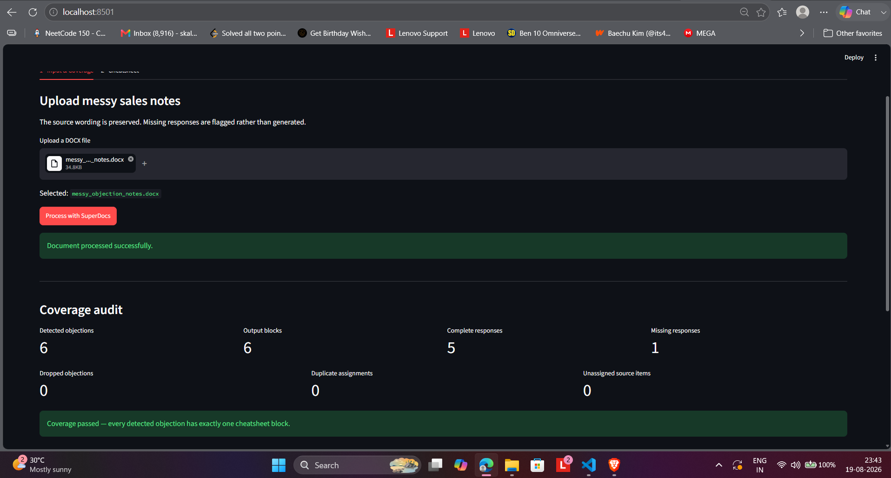

# Objection Handling Cheatsheet Builder

A SuperDocs-powered tool that converts messy, unstructured sales objection-and-response notes into a clean, scannable, exportable cheatsheet without inventing content.

> Built by Kalpesh Sharma for the SuperDocs Engineer Task — Assigned Build 2: Objection-handling Cheatsheet Builder.



## What it does

Sales notes often contain inconsistent bullets, shorthand response markers, quoted objections, irregular formatting, and objections with no answer.

This build:

- uploads raw DOCX notes through SuperDocs
- uses the processed HTML returned by SuperDocs
- deterministically detects objection/response pairs
- preserves source wording
- creates one cheatsheet block per detected objection
- flags missing responses instead of generating them
- tracks source IDs for traceability
- audits dropped and duplicate source assignments
- supports grounded SuperDocs chat
- supports Review → Approve / Reject
- exports generated and reviewed DOCX files

This is intentionally a **reformatting workflow, not a research or response-generation system**.

## Scenario A proof

The primary demo contains mixed formatting and one objection with no response.

```text
Detected objections:      6
Output blocks:             6
Complete responses:        5
Missing responses:         1
Dropped objections:        0
Duplicate assignments:     0
Unassigned source items:   0
```

The unanswered objection is:

```text
Implementation looks complicated
```

The system preserves it and displays:

```text
Missing response in source notes - human input required.
```

It does not generate a sales answer.

## Scenario B

A second fixture uses different formatting to ensure the parser is not hardcoded to Scenario A.

```text
Detected objections:    4
Complete responses:     3
Missing responses:      1
Dropped objections:     0
```

## Coverage and traceability

Every source unit receives an ID such as:

```text
SRC-001
SRC-002
```

Each cheatsheet block records the source IDs that produced its objection and response.

Generation is blocked if:

- a detected objection disappears
- a source unit is assigned more than once

This turns the "no objection silently disappears" requirement into a measurable coverage check.

## SuperDocs workflow

```text
Source DOCX
   ↓
SuperDocs upload
   ↓
Processed HTML
   ↓
Deterministic parser
   ↓
Coverage audit
   ↓
Generated cheatsheet
   ↓
Grounded SuperDocs chat
   ↓
Review proposed edit
   ↓
Human Approve / Reject
   ↓
Reviewed DOCX export
```

### Grounded chat

For Scenario A, SuperDocs correctly identifies:

```text
OBJECTION 4 — Implementation looks complicated
```

as the objection with no response.

### Human Review

The demo requests one surgical edit:

```text
Objection Handling Cheatsheet
```

to:

```text
Sales Objection Handling Cheatsheet
```

The exact before/after change is displayed before approval.

The reviewed export was verified to retain all six objections and leave the missing response unfilled.

## Supported input

Current declared input format:

```text
.docx
```

The parser supports objection/response patterns including:

```text
Objection:
OBJ:
-
*
•
quoted objections
standalone questions

Response:
resp:
answer:
ANS:
A:
->
→
```

Recognition markers are configuration-driven.

## Run locally

```powershell
python -m venv .venv
.\.venv\Scripts\Activate.ps1
pip install -r requirements.txt
```

Create a local `.env`:

```env
SUPERDOCS_API_KEY=your_real_key_here
```

`.env` is ignored by Git and must not be committed.

Generate demo files:

```powershell
python generate_samples.py
```

Run tests:

```powershell
pytest -v
```

Run the UI:

```powershell
streamlit run app.py
```

## Validation

Current automated test result:

```text
36 passed
```

Coverage includes:

- mixed objection formats
- multiple response markers
- missing-response preservation
- duplicate objections
- orphan responses
- source-ID preservation
- dropped-objection detection
- duplicate-source detection
- Scenario A real DOCX
- Scenario B different-format DOCX
- real SuperDocs processed HTML fixture
- HTML entity decoding
- DOCX formatting
- generation blocked when coverage fails
- JSON-encoded SuperDocs pending-change parsing

Tests run without requiring a live SuperDocs API key.

## Design choices

### Deterministic source-of-truth path

The objection pairing and completeness logic does not depend on an LLM. This prevents generated content from entering the lossless transformation path.

### SuperDocs processed HTML

The production path uses HTML returned by the SuperDocs upload endpoint. Local DOCX parsing is available for offline testing and graceful fallback.

### Missing information stays missing

An objection without a source response remains unanswered and is explicitly flagged for human input.

### Human-controlled edits

SuperDocs edits use an explicit approval gate. Proposed changes are shown before they are applied and may be approved or rejected.

## Key files

```text
app.py

core/
  cheatsheet.py
  config.py
  document_input.py
  docx_render.py
  html_input.py
  models.py
  parser.py
  validation.py

superdocs/
  client.py
  parser.py
  polling.py

sample_documents/
  scenario_a/
  scenario_b/

tests/
  fixtures/
  test_cheatsheet.py
  test_document_input.py
  test_docx_render.py
  test_html_input.py
  test_parser.py
  test_superdocs_parser.py
  test_validation.py
```

## Safety

- no API key is committed
- `.env` is ignored
- generated `outputs/` are ignored
- missing source content is never fabricated
- failed completeness validation blocks generation