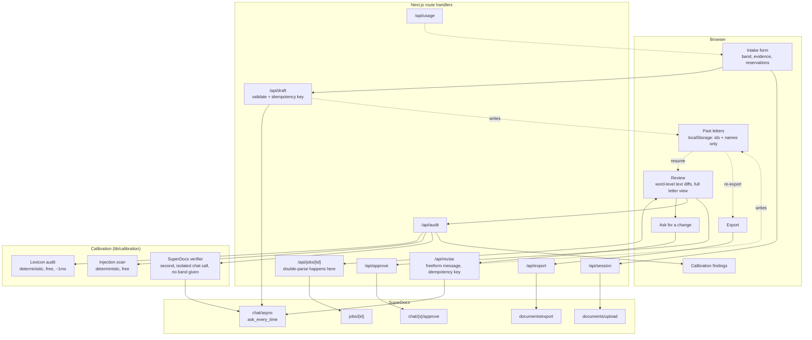

# Architecture

One page. The diagram below is the whole system; everything else on this page is what happens when a
step fails.

## Flow

The gate sits between `REVIEW` and `APPROVE`. Nothing reaches the document until a human decides each
change individually. The calibration findings arrive at the same screen as the diffs, which is the
point: they are only useful while the gate is still closed.

## Where state lives

| State | Where | Survives refresh | Survives restart |
| --- | --- | --- | --- |
| The letter | SuperDocs | yes | yes |
| Session + job id | `sessionStorage` | yes | no (tab close) |
| Intake | `sessionStorage` | yes | no (tab close) |
| Letter history: session id, job id, subject name, writer name, band, dates | `localStorage` | yes | yes |
| Idempotency keys | Node process memory | n/a | no |
| Findings | React state, recomputed | no | no |

This app stores no letters and no personal data server-side. The intake — evidence, reservations, tone
notes — is deliberately scoped to the browser tab, because it contains a third party's performance
history, and stays in `sessionStorage` only. The history list in `localStorage` is the one exception to
"nothing outlives the tab," and it is scoped tightly on purpose: two names, a band, and ids that only
resolve to anything by calling SuperDocs again.

## Failure paths

| What fails | What the system does |
| --- | --- |
| SuperDocs 5xx or timeout on a read | Retry with full-jitter backoff, up to the budget, then an error naming the cause and the fix. Session id stays valid; reload resumes. |
| SuperDocs 4xx | No retry. Retrying a malformed or unauthorised request spends the budget on the same wrong request. |
| SuperDocs 429 | No silent retry loop. The error names the operation budget and points at the eval harness's `--max-ops` rule. |
| Draft request may have been accepted but the response was lost | Not retried, by design. The idempotency key means a client retry replays the original result rather than starting a second billable job. |
| Verifier model unreachable or misconfigured | Audit degrades to deterministic checks. Report says `verifier: unavailable` or `failed` with the reason. Never reported as a pass. |
| Verifier returns non-JSON | Answer discarded rather than guessed at. Status `failed`. |
| Proposed changes arrive in an unknown shape | Zero changes shown plus a stated problem. Never a partially-populated approve card. |
| Change missing id or content | That change is refused; the others still render. |
| Job asks whether to continue a large edit | Surfaced as a choice with the cost stated. Not a dead end. |
| Page refreshed mid-draft | Session and job id persist. The review resumes against the still-running job. |
| Browser tab closed | The job keeps running on SuperDocs. `sessionStorage` is gone, but if the draft had already started, its session and job id were written to the `localStorage` history list — reachable again from "Past letters" on this machine. Without that (job never got past starting), the letter is unreachable. |
| Revision request sent while a batch is undecided | Blocked client-side with a stated reason, not sent. A second `chat/async` turn landing on top of an unresolved one would make the change queue ambiguous about which batch a decision applies to. |
| Export warnings header malformed | Noted, document still delivered. A decode bug must not lose the file the user is waiting for. |

## Cost model

| Action | SuperDocs operations | Verifier calls |
| --- | --- | --- |
| Start a session | 0 (upload) | 0 |
| Draft a letter | ~1 | 0 |
| Send a revision ("ask for a change") | ~1 | 0 |
| Run the calibration audit | 0 | ~1 (usually 0, see below) |
| Approve or reject changes | 0 | 0 |
| Export `.docx` | 0 | 0 |
| Continue a large edit | ~1 | 0 |

The deterministic half of the audit costs nothing and runs on every draft or revision. The verifier is a
second SuperDocs chat call, not a separate service — confirmed against the live API, a pure Q&A turn like
this (told not to edit its scratch document) is not billed as an operation, so its typical cost is 0. It
runs once per distinct proposal rather than once per poll, so a slow reviewer does not pay for it twice.
