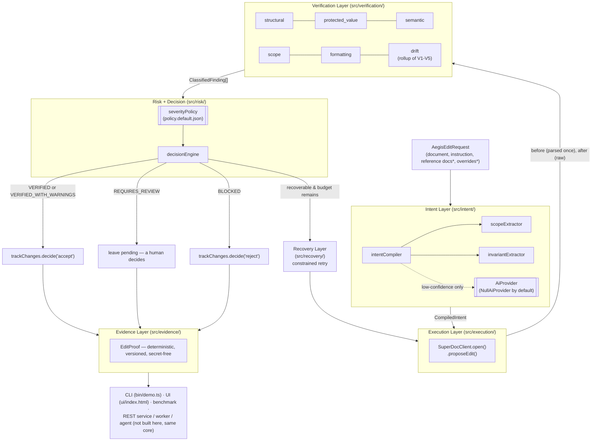

# Aegis Architecture

## Contents
1. [Layers](#layers)
2. [Data flow](#data-flow)
3. [Why a canonical document model](#why-a-canonical-document-model)
4. [The six verification layers](#the-six-verification-layers)
5. [Risk model rationale](#risk-model-rationale)
6. [Recovery behavior](#recovery-behavior)
7. [SuperDoc integration](#superdoc-integration)
8. [EditProof](#editproof)
9. [Known limitations](#known-limitations)
10. [Future extension points](#future-extension-points)

## Layers

*Reference documents and any caller-supplied `policyOverride` never enter the Intent, Execution, or Risk boxes above as anything other than inert data or a request that can be rejected — see [docs/SECURITY.md](SECURITY.md).

Domain logic (`src/intent`, `src/verification`, `src/risk`, `src/recovery`, `src/evidence`) has no dependency on `src/execution` beyond the `SuperDocClient` *interface*, and no dependency on any UI or transport code at all. `src/orchestrator/aegisEngine.ts` is the only file that wires a concrete adapter to the verification core — a REST handler, a background worker, or an agent tool would each write their own thin equivalent of `AegisEngine`, or use it as-is. Nothing about the verification logic assumes a chat interface, an HTTP request, or a CLI.

*A deliberate deviation from the brief's suggested layer list*: there is no separate `planning/` module. The brief's own architecture sketch calls it "recommended", and the two things a Planning Layer would own — the expected edit scope and the set of protected properties — are exactly what `scopeExtractor.ts` and `invariantExtractor.ts` already produce as part of `CompiledIntent`. A second layer re-deriving the same two facts from the same instruction text would be the "duplicated logic" and "speculative abstraction" the brief separately warns against (sections 29–31), not an improvement in separation of concerns.

## Data flow

Step by step, following `AegisEngine.runEdit()` (`src/orchestrator/aegisEngine.ts`):

1. **Compile intent.** `compileIntent()` runs the scope extractor and invariant extractor over the instruction text only (never the document, never reference docs) and produces a `CompiledIntent`: an inferred `ScopeSpec`, an `editKind`, `protectSemantics`/`protectValues` flags (default `true`; only an explicit release phrase turns them off), and any explicitly requested value changes.
2. **Load policy.** `loadPolicy()` merges the default severity table with any caller-supplied override, rejecting (and recording) any attempt to downgrade a non-downgradable finding kind.
3. **Parse the `before` document once** into an `AegisDocument` (`parsePseudoMarkdown`) — reused across every recovery attempt rather than re-parsed each time.
4. **Open a SuperDoc session** and **propose an edit** (`session.proposeEdit(instruction)`), which returns a tracked-change-style `resultDocument`.
5. **Run the full verification suite** (`runVerificationSuite` in `src/verification/index.ts`): parse `after`, align blocks against `before`, run all six checkers, classify every finding against policy, assess risk, decide.
6. **If not `VERIFIED`/`VERIFIED_WITH_WARNINGS` and the failure is recoverable and budget remains**: reject this attempt's tracked change, build a tightened instruction from the specific findings, and go back to step 4. Every attempt re-runs the *entire* suite — there is no partial re-check.
7. **Final commit decision**: `accept` on VERIFIED/VERIFIED_WITH_WARNINGS, `reject` on BLOCKED, leave pending on REQUIRES_REVIEW.
8. **Build the `EditProof`** from the final run's alignment, findings, risk assessment, decision, and every recovery attempt's record.

## Why a canonical document model

Aegis never diffs raw HTML/XML/DOCX strings. Every adapter — the mock one included — is responsible for producing `AegisDocument` (`src/types/document.ts`): a flat list of typed blocks (`heading`, `paragraph`, `list`, `table`), each with a positional id. Two reasons:

- **Harmless serialization differences must not look like changes.** The brief is explicit about this (section 6). A real DOCX round-trip can reformat whitespace or attribute order without changing anything a person would call "the document." Comparing a normalized structural model sidesteps that entirely, rather than trying to special-case it in a string diff.
- **The same verification core has to work for more than one input shape.** The mock adapter parses a small pseudo-markdown dialect (see `src/verification/normalize.ts` for the exact grammar); a real SuperDoc adapter would instead walk the Document API's query results (see [SuperDoc integration](#superdoc-integration)) into the same `AegisDocument` shape. Every verifier is written against that shape and has never seen either source format directly.

Alignment between a `before` and `after` `AegisDocument` (`alignBlocks`) is an LCS diff over per-block content fingerprints, with a second pass that pairs up the leftover blocks inside each gap by position — the same idea as a text diff, one level up, so a single edited paragraph reads as "modified", not "deleted, then an unrelated paragraph inserted."

## The six verification layers

| Checker | File | Deterministic mechanism |
|---|---|---|
| Structural | `structuralVerifier.ts` | Block insert/delete/type-change, heading level, table dimensions, link presence/URL, all read off the alignment |
| Protected-value | `protectedValues.ts` + `protectedValueVerifier.ts` | Priority-ordered regex extraction (currency → url → date → duration → time → identifier → percentage → decimal → integer, longest/most-specific claims its span first) + type-aware normalization, so `$1,000.00` and `$1000` compare equal but `$1,000` and `$1,200` don't |
| Semantic | `semanticVerifier.ts` | Sentence-level LCS alignment (via the `diff` package's `diffArrays`) inside each modified block, then keyword-based modality classification (obligation / permission / prohibition / none) on each aligned sentence pair, plus a lightweight actor-noun and condition/exception-clause check |
| Scope | `scopeVerifier.ts` | Resolves the compiled `ScopeSpec` into a concrete set of in-scope block ids on the **before** document, then flags any changed/inserted block outside it |
| Formatting | `formattingVerifier.ts` | Strips emphasis markers and compares; flags the change as formatting-only if the underlying text is identical, or as corrupted if markers are unbalanced |
| Drift | `driftVerifier.ts` | A small registry (`registerDriftDetector`) of detectors that *summarize or contextualize* what the other five already found — see below |

Drift is a rollup, not a seventh judge: its two built-in detectors are `textual-drift` (flags unusually broad churn relative to the stated edit kind — skipped entirely for narrowly-scoped edits, since `scopeVerifier` already owns that precisely) and `numeric-drift-rollup` (a pure count of protected-value findings, so `drift_results` in the `EditProof` always has something concrete to show — see `test/unit/driftVerifier.test.ts`). Neither one re-derives a verdict another checker already owns, per the brief's "do not create duplicate implementations merely to make the feature appear larger."

**Where AI is, and isn't, in this loop:** `src/intent/aiProvider.ts` defines an `AiProvider` interface for genuinely ambiguous semantic-comparison questions (two sentences with no shared modality keywords — is the meaning still the same?). The only implementation shipped is `NullAiProvider`, which always abstains. Every verifier is written to fall through to a conservative, deterministic result when the AI provider abstains (typically: don't assume protection was preserved), rather than silently treating "the model didn't check" as "the model checked and it's fine." No verification step in this repository calls an LLM; wiring a real one in is a documented, unexercised extension point (see below).

## Risk model rationale

Severities and recoverability live in data (`src/risk/policy.default.json`), not scattered through the checker code, specifically so the rationale is reviewable on its own. The table was built to match the brief's four worked examples exactly — formatting-only change is `LOW`, an unexpected-but-unscoped structural change is `MEDIUM`, a date/currency mutation is `HIGH`, and `SEMANTIC_OBLIGATION_TO_PERMISSION` / `UNINTENDED_SCOPE_CHANGE` are `CRITICAL` — and extends it consistently from there. Two design choices worth calling out:

- **Obligation and prohibition are treated as one "binding" tier** for modality-transition purposes (`classifyModalityTransition` in `semanticVerifier.ts`). A `shall` softening to a `may`/nothing and a `shall not` softening to a `may`/nothing are both `SEMANTIC_OBLIGATION_TO_PERMISSION` — a binding duty silently becoming non-binding — because that's the failure mode that matters, regardless of which direction the original duty pointed. The reverse direction (non-binding → binding) is `SEMANTIC_MODALITY_TIGHTENED` (`HIGH`, not `CRITICAL`): still a real rights change worth a human's attention, but not the specific "loophole" pattern the brief calls out.
- **Protected-value violations are `recoverable: false` by policy, on purpose**, even though the retry mechanics would work fine on them. Silently giving an automated loop a second try at a legally/financially meaningful mutation is a product risk independent of whether the retry logic itself is sound — see [Recovery behavior](#recovery-behavior). Everything in `nonDowngradable` in the policy file is also everything marked non-recoverable *or* the most severe semantic kinds; a caller can still ask for a retry on a `STRUCTURAL_BLOCK_INSERTED` or `UNINTENDED_SCOPE_CHANGE`.

`nonDowngradable` is enforced in code (`loadPolicy` in `severityPolicy.ts`), not just documented: an override that tries to lower one of those kinds' severity is dropped and recorded in `rejectedOverrides`, which always ends up in the final `EditProof.evidence.rejected_policy_overrides` — see `test/unit/severityPolicy.test.ts` and `test/adversarial/promptInjection.test.ts`.

The benchmark caught one real gap during development: `SEMANTIC_ACTOR_CHANGED` (an obligation quietly moving from one party to the other) was originally `MEDIUM`, which meant `adversarial-actor-swap` passed as `VERIFIED_WITH_WARNINGS` instead of being held for review. It's `HIGH` now. That's the benchmark doing its job — see `docs/BENCHMARK.md`.

## Recovery behavior

`src/recovery/recoveryController.ts` runs a bounded loop: propose → verify (full suite) → if not good and the failure is policy-recoverable and budget remains, reject the tracked change, tighten the instruction (`buildConstrainedInstruction` appends an explicit, additive constraint — it never removes or reinterprets what was originally asked), and try again. `AEGIS_RETRY_BUDGET` (default `2`) counts retries, so at most `1 + budget` total `proposeEdit` calls happen. The loop never weakens what it checks for between attempts — the same policy, the same six checkers, every time — and it never leaves a tracked change in limbo: the session's `close()` implicitly rejects anything still pending as a safety net (`test/integration/mockAdapter.test.ts`).

## SuperDoc integration

**SuperDoc is real** — an open-source (AGPLv3), self-hosted DOCX engine from Harbour Enterprises (`npm install superdoc`; docs at [docs.superdoc.dev](https://docs.superdoc.dev)) with a documented Query → Target → Mutate → Receipt operation contract and a tracked-changes review flow (`doc.trackChanges.list/get/decide`) built specifically for "an agent proposes an edit, a reviewer accepts or rejects it." `src/execution/superDocClient.ts` mirrors that shape (`proposeEdit` → tracked-change receipt → `decideTrackedChanges('accept' | 'reject')`) rather than inventing an unrelated one.

What this repository does **not** do is wrap the real package. Two concrete things came out of actually checking (`npm view superdoc`, `npm view @superdoc/docx-engine`) instead of assuming:

- The top-level `superdoc` package pulls in Vue 3, Konva (canvas rendering), Pinia, and jsdom — a browser-editor stack, not a lightweight headless client. Its lower-level `@superdoc/docx-engine` dependency is explicitly `"proprietary software. It is not open source."`
- SuperDoc is self-hosted/client-side by design — there is no SaaS API key to configure. `.env.example`'s `SUPERDOC_HOST_URL`/`SUPERDOC_HOST_TOKEN` are placeholders for whatever internal automation host a real deployment would run, not a real, documented credential this repository could exercise.

Given that, `src/execution/mockSuperDocClient.ts` is the only implementation exercised by every test, the demo, and the benchmark — clearly labeled `mode: 'mock'` everywhere it surfaces (logs, `EditProof.execution_metadata.superdoc_mode`, the UI's mode pill). A real adapter implementing the same `SuperDocClient` interface (most likely wrapping SuperDoc's headless Document API, per its "Agents & automation" docs, or the separate Python/CLI/MCP surfaces it also ships) is a drop-in replacement — nothing in the verification core changes.

## EditProof

See [`docs/EDITPROOF_SCHEMA.md`](EDITPROOF_SCHEMA.md) for the full field reference and a real, generated example. In short: every top-level field named in brief section 5 is present (`proof_version` through `execution_metadata`), the whole object is deterministically serializable (`canonicalStringify` — recursively sorted object keys, array order preserved) and self-checking (`evidence.proof_hash` is a content fingerprint computed over everything else in the proof — recomputing it from a stored proof reproduces the same value, which is what `test/integration/pipeline.test.ts`'s tamper-evidence test checks), and secrets are redacted out of `execution_metadata` by field-name pattern and by value-shape pattern (`src/evidence/redact.ts`) before the proof is ever assembled.

## Known limitations

- **No live SuperDoc client.** See above — this is a scoping decision made after checking what integrating one would actually require, not an oversight.
- **No REST service / background worker built.** The architecture supports them (same `AegisEngine`, a thin transport wrapper), but only the CLI (`bin/demo.ts`) and the static UI are actually built and exercised here.
- **No live LLM provider wired up.** `NullAiProvider` always abstains; nothing in this repository's test suite exercises actual model-based semantic reasoning, only the deterministic fallback path.
- **English, common-contract-phrasing heuristics.** The scope extractor's regexes and the semantic verifier's modality lexicon are tuned against the phrasing this repo's tests and benchmark use (itself representative of how these instructions are usually written). Very differently-phrased instructions fall through to safe defaults (`unscoped`, full protection) rather than being handled precisely.
- **No unit-conversion or backtranslation drift detectors.** `"30 days"` vs `"1 month"` compares as two unrelated protected values today (safe — it over-flags rather than missing a change — but not unit-aware). Backtranslation/multilingual drift needs a translation provider this environment has no credentials for; both are documented registry extension points in `driftVerifier.ts`.
- **Currency/date parsing covers common cases, not full i18n.** `$`-prefixed amounts and a handful of date formats (ISO, `Month D, YYYY`, `D Month YYYY`, `M/D/YYYY`) are recognized; other currency symbols and locale-specific date orderings are not.
- **`npm audit` (dev-only tooling).** `npm audit --omit=dev` reports zero vulnerabilities in the runtime dependency tree. A handful of moderate advisories remain in the ESLint 9 dev-tooling chain; these don't ship in any built or run artifact and were left as-is rather than force-upgrading a linter mid-project.

## Future extension points

- **Live SuperDoc client**: implement `SuperDocClient` against SuperDoc's headless Document API or its Agent SDK/CLI/MCP surfaces; nothing in `src/verification`, `src/risk`, `src/recovery`, or `src/evidence` would need to change.
- **Real `AiProvider`**: implement `compareMeaning()` against any LLM API (the repo's own `.env.example` sketches an Anthropic-key-shaped config for this) for the semantic verifier's genuinely-ambiguous cases.
- **REST service / worker / agent tool**: each is a thin wrapper constructing an `AegisEngine` with the appropriate `SuperDocClient` and exposing `runEdit()` over its own transport.
- **Additional drift detectors**: `registerDriftDetector()` is a stable, tested extension point (`test/unit/driftVerifier.test.ts` exercises registering one) for unit-conversion drift, backtranslation drift, or anything else that wants to summarize/contextualize existing findings.
- **Per-tenant policy files**: `loadPolicy()` already accepts an override; a straightforward next step is loading the base table from a configurable path instead of the bundled `policy.default.json`, for teams that want their own severity rationale on file.
