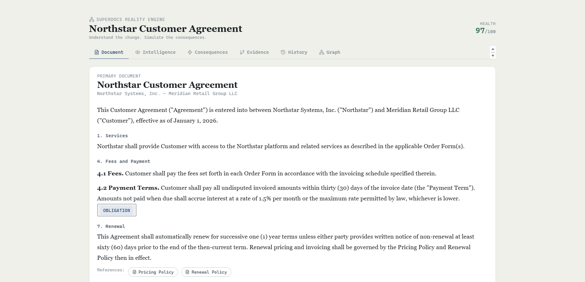
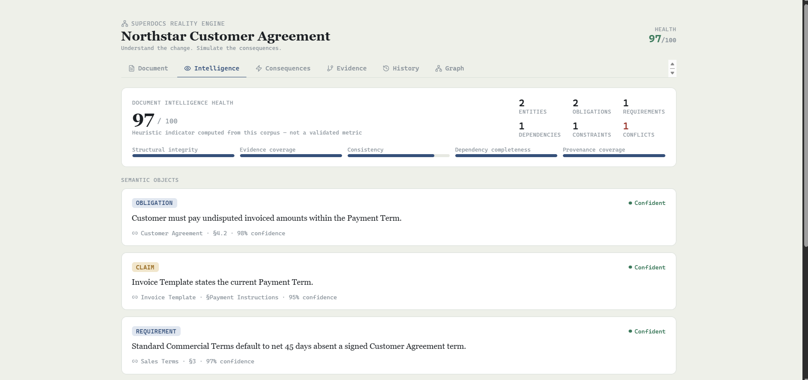
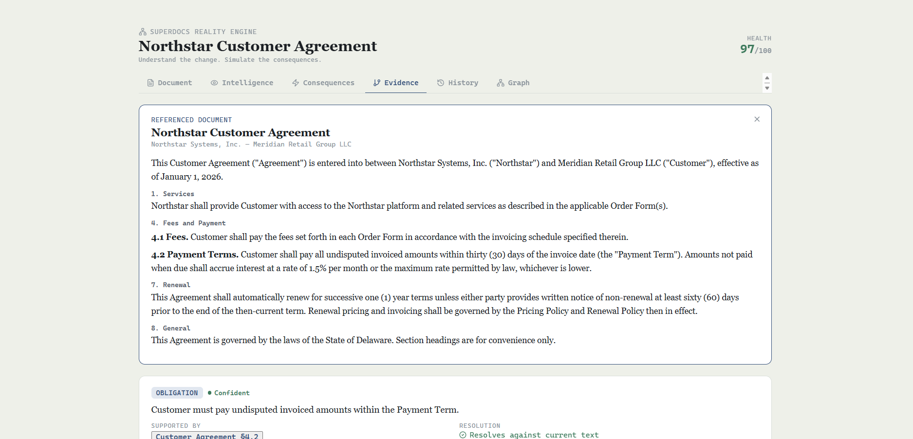
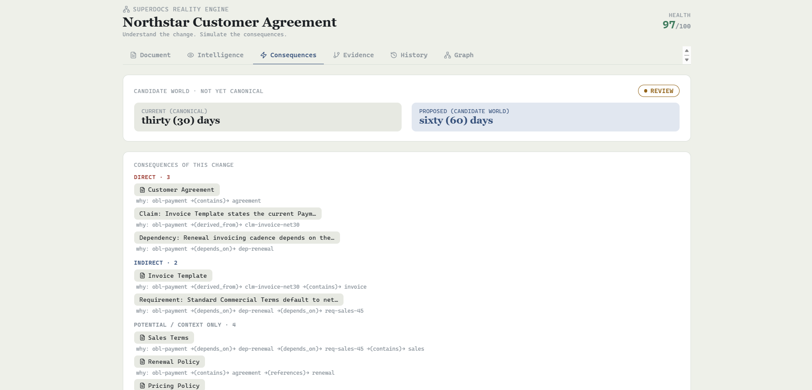
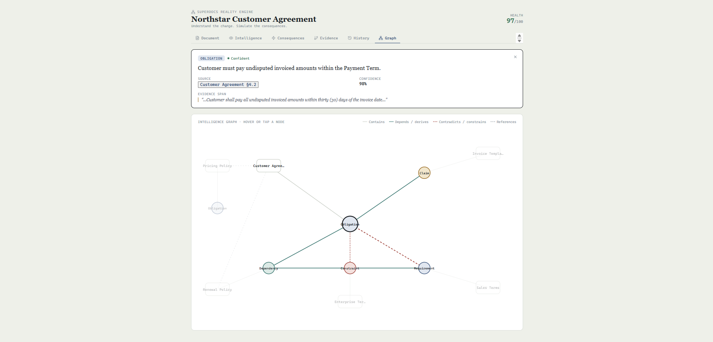

# SuperDocs Reality Engine

> Understand the change. Simulate the consequences.

Traditional document workflows usually ask "what text should change?" This engine asks "if
this changes, what else does — and does anything it touches actually
break?" — and answers with a real graph traversal and a real comparison
between two document states, not a description of one.

## What this is

A framework-free document consequence engine, plus a UI that demonstrates
it against a fictional Northstar Systems contract corpus (Customer
Agreement, Invoice Template, Sales Terms, Renewal Policy, Pricing Policy,
and an Enterprise Terms Addendum).

**What this is not:** an integration into a document-editing product. No
existing repository for one was ever supplied in the process that produced
this project — only a written product description. Everything here is a
self-contained, tested seed, built on the assumption it will be grafted
into a real document model and editor later.

## How it works

- **World model.** `buildWorld(paymentTermDays)` renders every document in
  the corpus for one specific term value. It's the only rendering path in
  the system — the primary document, a referenced document's preview, the
  diff, and verification all read from a world instead of each doing their
  own text substitution, so two views can't disagree about what "current"
  means.
- **Consequences.** `computeConsequences` traverses the relationship graph
  from the changed object, tiered by edge class and hop distance — a
  reference-only path is never treated as more than "potential," and
  conflict relationships are excluded from impact traversal and reported
  separately.
- **Simulation.** Proposing a value builds a second, independent world (the
  *candidate*) without touching the first (the *canonical*). `diffWorlds`
  compares the two directly for both a text diff and a semantic diff.
- **Forecasting.** `forecastContradictions` distinguishes a pre-existing
  conflict (may be resolved or left open by a proposal) from a genuinely
  new constraint violation a proposal introduces.
- **Verification and commit.** `runVerification` checks the actual
  candidate world against six real conditions, including that every
  document outside the change stayed byte-identical to canonical.
  `commitWorld` only ever returns a new canonical world/version when
  verification passed in full; on failure it returns nothing to commit,
  and canonical state stays exactly what it was.

## Run it

```bash
npm install       # installs devDependencies used to validate the build
npm test          # runs the unit test suite (Node's built-in test runner)
npm run build     # regenerates dist/document_os.jsx from source
npm run check     # syntax-checks the JS modules, rebuilds, and parses the
                   # resulting JSX with an actual parser
```

To view the UI locally for review/screenshots, run `preview.cmd` on
Windows. It starts a local static server and opens the browser preview at
`http://localhost:4173/preview/`. The preview loads the shipped JSX artifact
and its React runtime from pinned browser-module URLs; the application logic
itself makes no network requests. You can also open `dist/document_os.jsx`
as a single-file interactive artifact, or mount `<SuperDocsRealityEngine />`
from `src/ui.jsx` in any React 18 environment.

## Architecture

See [ARCHITECTURE.md](./ARCHITECTURE.md).

## Demo

See [DEMO.md](./DEMO.md) — a safe scenario (30 -> 60), a scenario that
resolves an existing conflict (30 -> 45), and an unsafe scenario that is
rejected by verification and rolled back (30 -> 120).

## Tests

48 tests: 33 in `tests/engine.test.js` (consequence traversal and edge-class
tiering, world rendering and immutability, evidence resolution scoped to
the correct world, world-to-world diffing including conflict-diff entries,
contradiction forecasting including the cap boundary, input validation,
verification including a tampered/missing-document case, commit/no-commit,
and health scoring) and 15 in `tests/scenario.test.js` (the state machine,
and full end-to-end safe and unsafe scenario runs). All 48 currently pass —
see the final report for the exact command output.

## Known limitations

- **Not integrated into an existing document-editing codebase** — this is
  a standalone, tested seed.
- **One scenario domain** (payment terms across a small contract corpus),
  not the technical-documentation or policy-compliance scenarios from the
  original product description.
- **The health score is an explicitly labeled heuristic average** — every
  one of its five dimensions is now computed from the actual corpus rather
  than fixed, but the overall score is still presented as an indicator, not
  a validated measurement.
- The screenshot preview is a lightweight browser harness; it is not a
  production bundler or application shell.
- No command palette, no multi-scenario comparison, no history view beyond
  the audit log described in ARCHITECTURE.md.

## Screenshots

### Reality Engine Overview



### Consequence Analysis



### Counterfactual Simulation



### Verification and Commit



### Constraint Violation and Rollback



## Credits

Built and engineered by **Vishwak**.
