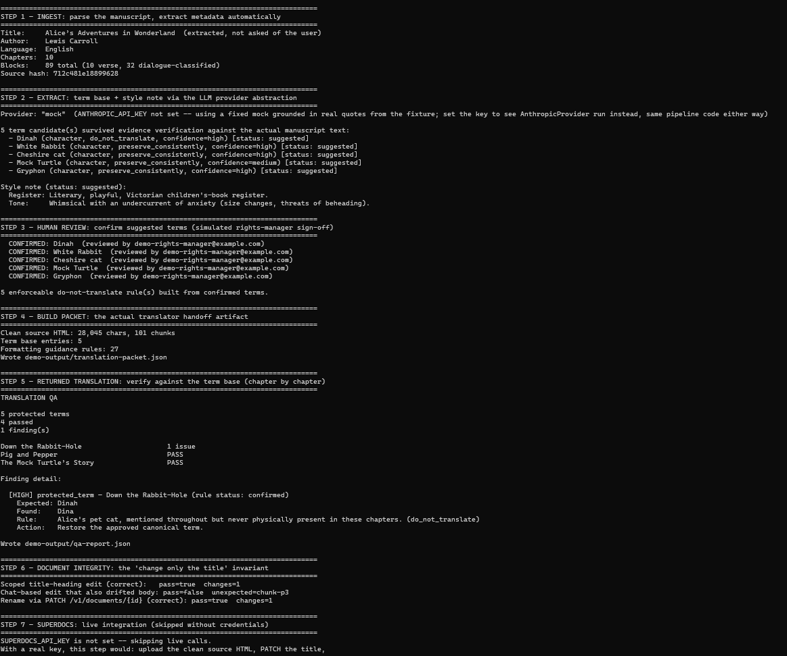
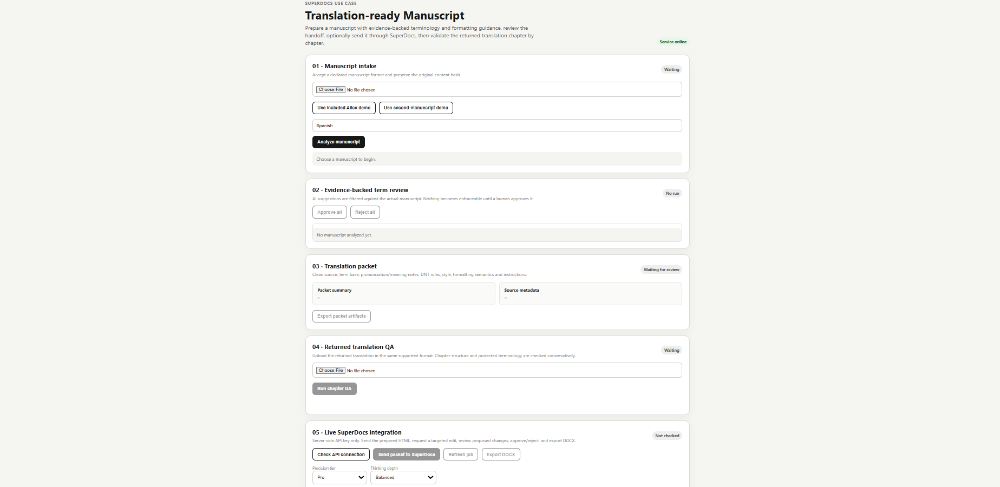

# Translation-Ready Manuscript

A focused SuperDocs Task 2 implementation for preparing a manuscript for translation and validating the returned translation.

## Overview

A rights manager or self-publishing author should be able to provide a manuscript and target language and receive a translator-ready packet containing:

- a clean source representation
- an evidence-backed term base
- pronunciation and meaning notes where supported by the source
- human-reviewable protected-term decisions
- do-not-translate rules derived only from approved terms
- style and voice guidance
- formatting-carried-meaning guidance
- a returned-translation QA report with chapter-level findings

The system is deliberately **not a translation engine** and **not a SuperDocs clone**. Its core value is translation preparation, protected terminology, returned-translation QA, and safe document operations.

## Design principle

> **AI proposes → source evidence verifies → human approval establishes policy → deterministic code enforces it.**

This boundary is intentional.

LLM output can suggest terminology and style interpretation, but it does not become authoritative merely because a model produced it. Only human-confirmed terminology can create enforceable protected-term rules.

---

## Workflow

```text
Manuscript
    │
    ▼
1. Ingest
    │  deterministic parsing
    ▼
2. Extract
    │  terminology + style interpretation
    ▼
3. Human review
    │  suggested → confirmed / rejected
    ▼
4. Build translation packet
    │  source + term base + guidance
    ▼
5. Translation occurs externally
    │
    ▼
6. Align returned translation
    │  structural matching + review-required fallback
    ▼
7. Chapter-level QA
    │  protected terms + evidence + severity
    ▼
8. Document integrity
    │  prove intended changes only
    ▼
9. SuperDocs
       upload → edit → approve → export
```

The repository's demo exercises this pipeline end-to-end.

---

## Provenance and authority model

Translation-relevant information has four explicit states:

| State | Meaning | Enforceable? |
|---|---|---|
| `extracted` | Deterministically read from the manuscript | No |
| `suggested` | Interpretation proposed by the LLM/provider | No |
| `confirmed` | Human-reviewed and approved | **Yes** |
| `rejected` | Human-reviewed and declined | No |

The distinction is enforced in code.

- `confirmTerm()` accepts only currently suggested candidates.
- `buildDoNotTranslateRules()` reads only confirmed terms.
- Rejected candidates remain recorded rather than silently disappearing.
- QA treats a confirmed protected-term violation as a high-severity policy failure.
- An unconfirmed candidate can still be surfaced for review, but it does not acquire the authority of an approved rule.

This keeps model interpretation, human policy, and deterministic enforcement separate.

---

## Architecture

```text
src/
├── ingest/       Deterministic manuscript parsing and structure recovery
├── extract/      LLM provider abstraction + evidence-verified extraction
├── rules/        Protected-term lifecycle and deterministic enforcement
├── packet/       Translator-ready packet construction
├── align/        Source/translation structural alignment
├── qa/           Chapter-level QA and actionable findings
├── diff/         Document-integrity / intended-change verification
├── superdocs/    SuperDocs REST adapter and response normalization
└── workflow/     End-to-end workflow state and orchestration
```

The modules are intentionally separated so that:

- the LLM provider can be replaced;
- SuperDocs integration is isolated behind an adapter;
- deterministic validation remains independently testable;
- a future UI/API can sit above the workflow without moving business logic into the browser.

---

## Term extraction

The extraction layer is provider-based:

```text
LlmProvider
├── MockLlmProvider
└── AnthropicProvider
```

The offline provider makes the demo deterministic and reproducible. The Anthropic implementation provides the live interpretation path.

Candidate extraction is evidence-constrained: model-provided evidence must be verifiable against the actual manuscript before a candidate is accepted into the workflow.

The resulting term model can capture:

- canonical form
- term type
- meaning
- meaning basis
- pronunciation
- pronunciation basis
- protection policy
- aliases / variants
- evidence
- confidence
- review status

The system does not treat capitalization alone as sufficient evidence that a word is a protected term.

---

## Human review

The intended authority boundary is:

```text
LLM suggestion
      │
      ▼
evidence verification
      │
      ▼
human review
   ┌──┴──┐
   ▼     ▼
confirm reject
   │
   ▼
enforceable policy
```

This avoids turning an uncertain model interpretation into an irreversible translation rule.

---

## Translation packet

The packet is the translator handoff artifact.

It combines:

1. Clean source manuscript
2. Approved term base
3. Pronunciation notes
4. Meaning notes
5. Do-not-translate rules
6. Style / voice guidance
7. Formatting-carried-meaning guidance
8. Translation instructions

The packet is generated from the manuscript and approved policy rather than requiring the user to manually restate information already present in the document.

---

## Returned-translation QA

The returned translation is checked against the approved policy.

The QA layer reports:

- chapter
- rule
- severity
- expected term
- observed term
- source / translation evidence where available
- explanation
- recommended action

The flagship demo intentionally contains a bad translation:

```text
Expected: Dinah
Found:    Dina
```

The system reports this as a high-severity protected-term finding and recommends restoring the approved canonical term.

Correctly translated protected terms pass.

The test suite also covers the distinction between confirmed policy violations and changes involving terms that were never confirmed by a human.

---

## Alignment and uncertainty

Alignment is intentionally structural rather than pretending to solve general semantic alignment.

It uses document structure and controlled fallback behavior.

When a reliable correspondence cannot be established, the system returns:

```text
reviewRequired: true
```

rather than silently guessing.

This is an explicit safety boundary: uncertainty becomes a review state, not a fabricated answer.

---

## Document integrity

The system verifies document operations against an explicit intended-change invariant.

For example:

```text
Requested: change title only
        │
        ├── title changed, body unchanged → PASS
        │
        └── title changed + unrelated body drift → FAIL
```

For title metadata changes, the implementation uses the dedicated document metadata endpoint rather than asking an AI editor to rewrite the document body.

The integrity engine compares the relevant document structure and reports unexpected changes.

This is deliberately stronger than checking only whether the requested field changed.

### Known diff boundary

The current diff engine operates at chunk/tag/text/tracked-attribute granularity. It does not claim full inline-markup semantic equivalence. For example, an inline `<em>` → `<strong>` change inside an otherwise unchanged paragraph is outside the current guarantee.

That limitation is documented and tested rather than silently overstated.

---

## SuperDocs integration

The SuperDocs integration is isolated behind the REST adapter.

The supported client surface includes:

```text
upload
chat
chatAsync
job polling
proposed-change parsing
approve
export
```

Two API details are handled explicitly:

### Proposed-change payloads

The relevant event payload contains JSON inside another JSON field. The adapter performs the required second parse and normalizes the result into the internal proposed-change representation.

### Batch approval

The approval payload includes the required top-level `approved` field in addition to per-entry approval information.

### Long-running operations

The async chat path uses job polling with bounded waiting and backoff rather than treating a multi-minute document operation as an immediate failure.

### Title-only operation

A title-only change uses the document metadata endpoint rather than an AI body edit. The repository includes both a passing scoped-edit case and a failing body-drift case.

---

## Supported input and domain

### Currently supported

- Plain text (`.txt`)
- Gutenberg-style plaintext conventions used by the fixture

### Not currently implemented

- DOCX
- PDF
- Markdown

These are intentionally not claimed as supported until they have complete parsing behavior and regression coverage.

### Domain

The extraction prompts and terminology categories are optimized for literary / narrative manuscripts.

The core parser, rules, alignment, and QA modules are data-driven rather than hardcoded to the Alice fixture, and the repository includes a second-manuscript/generalization test.

---

## Security and trust boundaries

The manuscript is treated as **data, not instructions**.

The extraction layer does not allow instruction-like content inside a manuscript to override application policy.

Evidence supplied by an LLM must be checked against the actual manuscript before the candidate can proceed.

Additional safeguards include:

- no API secrets committed to source control
- `.env` excluded from Git
- bounded SuperDocs polling
- deterministic policy enforcement
- explicit human approval state
- review-required fallback when alignment is uncertain

The repository uses only public-domain or synthetic fixture material.

---

## AI-assisted development and runtime AI

### Development assistance

Claude (Anthropic) was used during development for implementation assistance, debugging, test design, code review, and iterative refinement.

The development process included real regression discovery and fixes; those changes are recorded in the engineering notes rather than presented as unverified AI-generated claims.

### Runtime AI

The running application uses an LLM only for interpretation tasks such as terminology and style extraction, behind the `LlmProvider` interface.

The following responsibilities remain deterministic:

- manuscript parsing
- evidence verification
- review-state transitions
- protected-term rule construction
- translation alignment
- QA evaluation
- document diff/integrity checks
- SuperDocs request construction and response normalization


---

## Running locally

Requirements:

- Node.js compatible with the repository's declared engine
- npm

From a clean checkout:

```bash
npm install
npm run typecheck
npm test
npm run demo
```

The offline demo does not require credentials.

It produces reproducible artifacts under:

```text
demo-output/
├── translation-packet.json
└── qa-report.json
```

The demo exercises:

```text
ingest
→ extract
→ human-review simulation
→ packet build
→ returned-translation QA
→ document-integrity verification
→ optional SuperDocs integration
```

### Live services

Create a local `.env` from `.env.example` and provide credentials only locally.

```env
ANTHROPIC_API_KEY=
ANTHROPIC_MODEL=

SUPERDOCS_API_KEY=
SUPERDOCS_MODEL_TIER=pro
SUPERDOCS_THINKING_DEPTH=balanced
```

Leave a credential empty to keep that integration offline/skipped.

Never commit `.env`.

---

## Verification status

The latest local verification of this repository produced:

```text
TypeScript typecheck       PASS
Test files                 11 passed / 1 skipped
Tests                      100 passed / 2 skipped
Total tests                102
Main demo                  PASS
Second-manuscript coverage PASS
```

The two skipped tests are live SuperDocs integration tests that require `SUPERDOCS_API_KEY`.

Therefore the repository makes a deliberate distinction between:

```text
offline verified
live integration implemented
live integration credentialed-tested
```

A live SuperDocs run should be reported as verified only after it has actually been executed with a valid credential.

---

## Generalization

The primary demo uses an Alice's Adventures in Wonderland fixture, but the implementation does not hardcode Alice-specific terminology.

The same typed pipeline is exercised against independent synthetic / second-manuscript cases.

This matters because the product is a manuscript workflow, not an Alice-specific parser.

---

## Limitations

The current implementation intentionally has these boundaries:

- plaintext/Gutenberg-style ingestion only;
- heuristic verse/dialogue classification;
- structural rather than semantic alignment;
- chunk-level rather than complete inline-markup semantic diffing;
- live credentialed services require the corresponding credentials;
- no DOCX/PDF/Markdown ingestion is claimed;
- the local browser UI is provided for reviewing the workflow; live SuperDocs operations still require the corresponding credentials;
- no MCP adapter is claimed unless separately implemented and tested.

These are explicit scope boundaries, not hidden gaps.

---

## Submission philosophy

The implementation prioritizes correctness and evidence over feature count.

The strongest proof points are:

1. evidence-backed terminology extraction;
2. explicit human authority over protected-term policy;
3. deterministic enforcement of approved terms;
4. chapter-level returned-translation QA;
5. intentional bad-translation detection;
6. document-integrity protection against unintended edits;
7. SuperDocs adapter isolation;
8. second-manuscript/generalization coverage;
9. adversarial/prompt-injection regression coverage;
10. reproducible offline verification.

A smaller, fully tested workflow is preferable to a larger interface with unverified behavior.

---

## Task 2 scope

This repository focuses on:

> **translation preparation + protected terminology + returned-translation QA + safe document operations**

It is not intended to be:

- a general translation engine;
- a generic document editor;
- a replacement for SuperDocs;
- a claim of universal DOCX/PDF support.

---
## Product walkthrough

The workflow is designed as a guided translation-preparation pipeline: manuscript intake, evidence-backed terminology review, translator packet generation, returned-translation QA, and SuperDocs verification.

### Workflow overview



### Completed workflow



## Credit

Built by Vishwak Teja Ravula for the SuperDocs task.