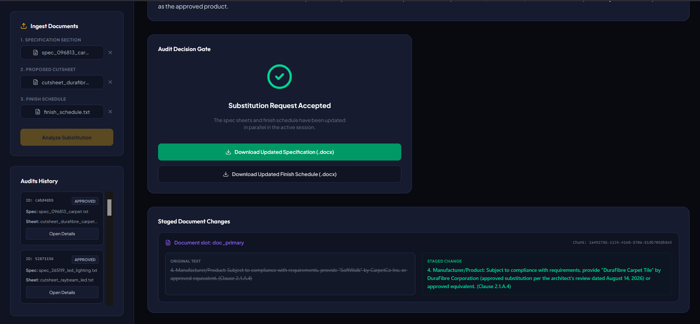

# AEC Product Substitution Auditor

**Assigned Build: Substitution Request and Response Packet**

This extension implements an automated review pipeline for product substitution requests in commercial Architecture, Engineering, and Construction (AEC) projects. It compares contractor-submitted product cutsheets against the project's specification documents and finish schedules using the SuperDocs REST API.

## 📸 Screenshot



## 🔄 Project Workflow

The auditor implements the complete engineering task flow:

```
Substitution Request + Cutsheet + Specification
                ↓
      Extract requirements
                ↓
    Compare every performance requirement
                ↓
      MET / NOT MET / UNCLEAR
                ↓
      Draft architect response
                ↓
        Human approval
                ↓
    Update specification + finish schedule
                ↓
              Export
```

## 📂 Folder Structure

```
aec-substitution-auditor/
├── backend/
│   ├── app/
│   │   ├── api/
│   │   │   └── substitution.py      # FastAPI router managing state and sessions
│   │   ├── config.py                # Setup parameters schema
│   │   ├── database.py              # Database session config
│   │   └── models.py                # SQL database models
│   └── run.py                       # App runner
└── frontend/
│    ├── src/
│    │   ├── components/
│    │   │   ├── AuditorSidebar.jsx   # Document uploads & run history panel
│    │   │   └── SubstitutionAuditor.jsx # React dashboard view
│    │   ├── services/
│    │   │   └── api.service.js       # Fetch requests service
│    │   └── App.jsx                  # Main wrapper
└── mock_substitution_2/     # Carpet Tile mock files
└── output_of_mock_substitution_2
└── screenshots
```

## 🛠️ SuperDocs Integration

The application integrates with the SuperDocs REST API to fulfill the required contract:
* **Upload a document**: Uploads both the Specification Section and Finish Schedule as primary documents, and the Cutsheet as a session attachment reference.
* **Send an edit instruction**: Submits a prompt instructing the LLM to extract specification metrics, compare them to the cutsheet values, write a response letter, and stage document edits replacing manufacturer and product names.
* **Approve proposed changes**: Pauses at a human gate to review staged diffs (original text vs proposed changes) and commits approved edits to the active session.
* **Export the finished file**: Downloads the finalized specification section and finish schedule as stylized Word `.docx` documents.

---

Built for the SuperDocs Round 2 Engineering Task.
