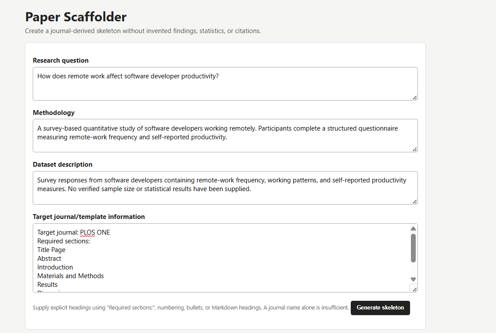
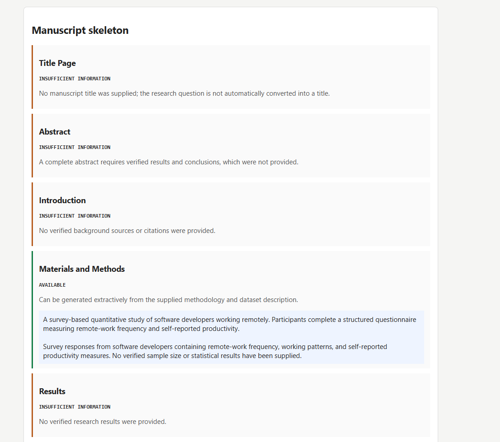
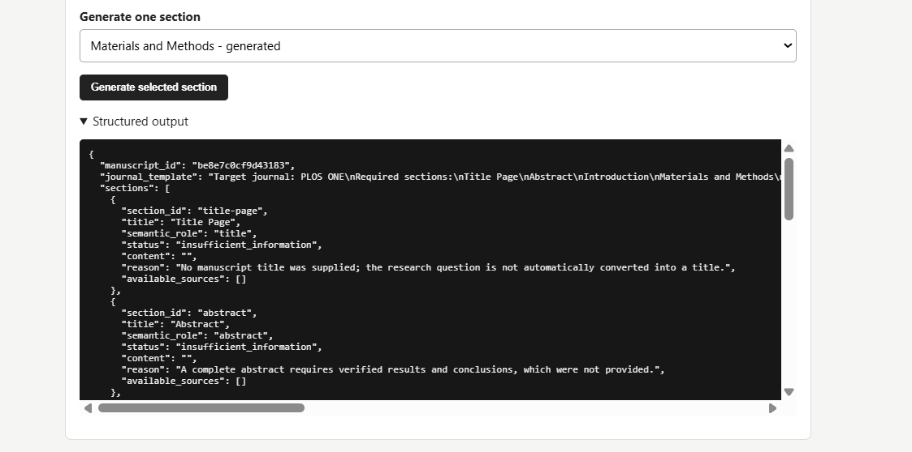
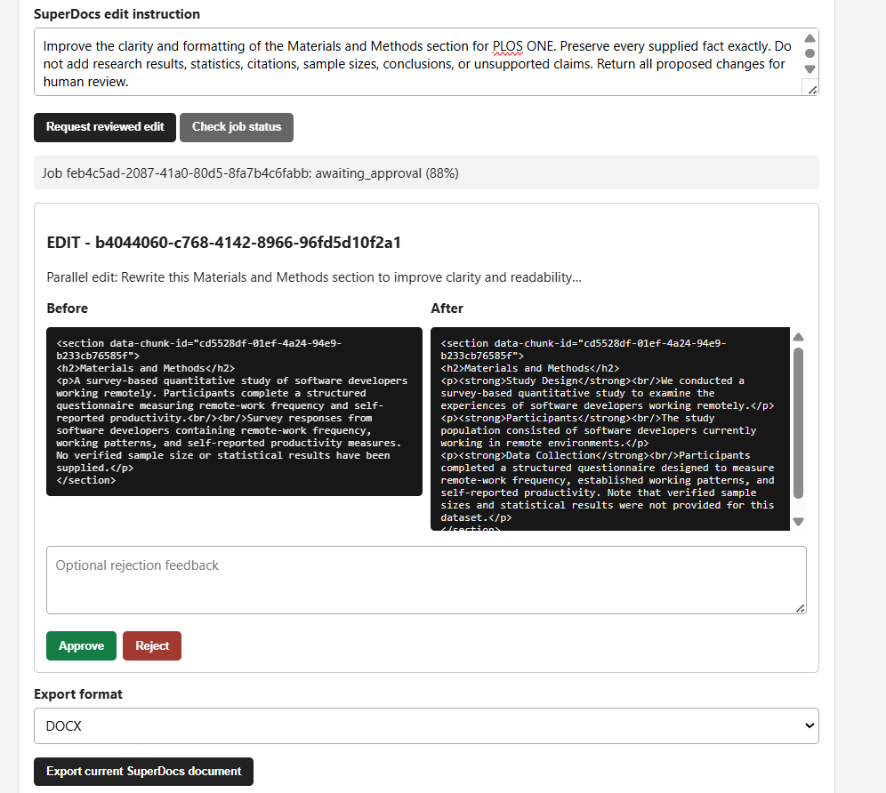
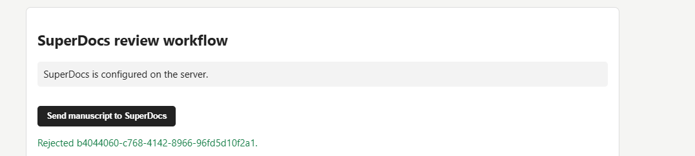
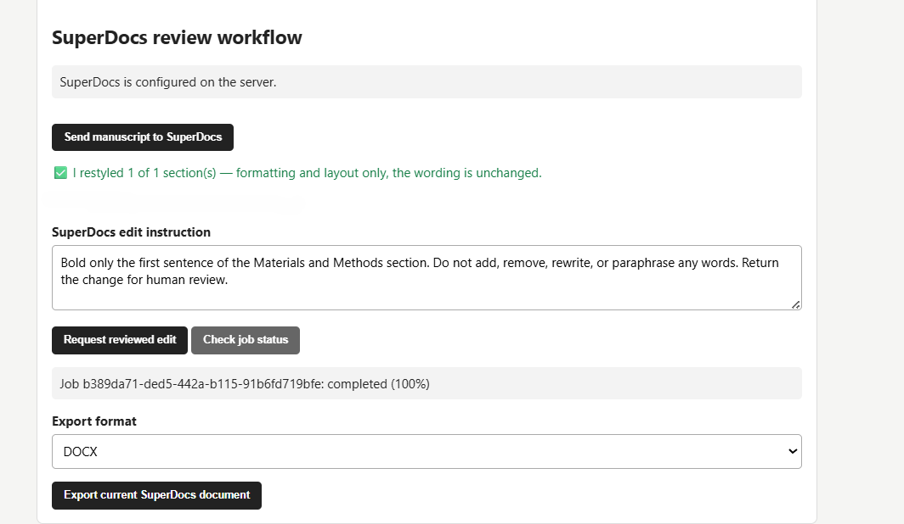
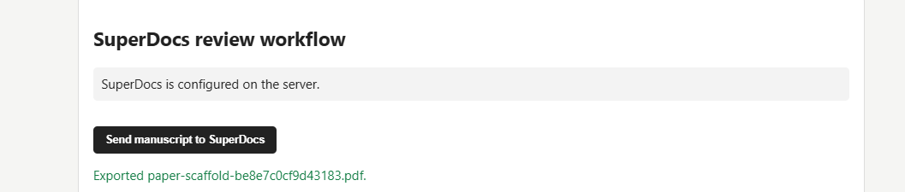

# Paper Scaffolder

> Status: Milestone 2 implements the documented SuperDocs REST workflow. Deterministic transport tests and a live SuperDocs upload/edit/review/export round trip have both passed.

Paper Scaffolder helps researchers turn a research question, supplied methodology, dataset description, and journal template or author instructions into a grounded manuscript skeleton. It runs on top of SuperDocs for document editing, human review, and export rather than recreating the SuperDocs editor.

## Demonstrated workflow

The example uses the published PLOS ONE research-article structure with a
research question, methodology, and dataset description supplied by the user.



The resulting scaffold preserves the target order, carries the supplied
methodology and dataset description into Materials and Methods, and leaves
Results explicitly empty because no verified findings were supplied.



An eligible section can also be generated independently from its listed source
material.



SuperDocs returns proposed changes for item-level human review. The proposal
below introduced completed-study language that the input did not support, so it
was rejected rather than committed.





A second, formatting-only proposal preserved the supplied wording and was
approved. The reviewed document was then exported successfully.





## Honesty contract

The application never fabricates research results, statistics, experimental findings, citations, dataset facts, methodology details, or conclusions. A section is generated only from evidence supplied for that section. Unsupported sections remain empty and carry an explicit reason, for example:

```text
Results:
[No verified research results were provided.]

Discussion:
[Cannot generate discussion because verified results are unavailable.]
```

A journal name alone is not treated as a template. The user must supply explicit headings or author instructions from which the manuscript order can be derived.

## Implemented workflow

1. Enter the research question, methodology, dataset description, and journal/template headings.
2. Generate an ordered, grounded skeleton.
3. Generate an eligible section independently when requested.
4. Convert the current grounded manuscript to semantic HTML and upload it to SuperDocs.
5. Send a targeted edit instruction in `ask_every_time` approval mode.
6. Poll the asynchronous job and display every proposed change with its before/after HTML and explanation.
7. Approve or reject each change individually; changes are never auto-approved.
8. Export the resulting SuperDocs session as DOCX, PDF, HTML, Markdown, TXT, or DOC.

## Architecture

```text
Browser UI
   |-- local scaffold/section endpoints
   |-- SuperDocs upload/edit/job/decision/export endpoints
   v
FastAPI application
   |-- ManuscriptService (validation, template parsing, grounding)
   |-- HTML manuscript renderer
   `-- SuperDocsWorkflowService
          |-- item-decision replay protection
          `-- SuperDocsHttpAdapter
                 `-- injectable HTTP transport
                        `-- official SuperDocs REST API
```

The existing manuscript business logic has no dependency on SuperDocs or FastAPI. `SuperDocsHttpAdapter` is server-side, receives an injectable transport for deterministic tests, and maps authentication, not-found, timeout, network, upload/edit/decision/export, and malformed-response failures to safe errors. API keys are not sent to the browser or printed in errors.

## Verified SuperDocs REST contract

The adapter was implemented from the official [SuperDocs API reference](https://docs.superdocs.app/api-reference/introduction), [human-in-the-loop guide](https://docs.superdocs.app/guides/human-in-the-loop), [async jobs guide](https://docs.superdocs.app/guides/async-jobs), and the published OpenAPI document at `https://api.superdocs.app/openapi.json`.

The contract checked for this milestone is:

| Operation | Documented request |
| --- | --- |
| Upload | `POST /v1/documents/upload`, multipart `file` plus optional `session_id` |
| Start edit | `POST /v1/chat/async` with `message`, `session_id`, `approval_mode: "ask_every_time"`, and `response_mode: "full"`; `document_html` is optional and omitted after upload because the session already holds the document |
| Retrieve changes | `GET /v1/jobs/{job_id}`; item proposals are read from `metadata.pending_changes` while status is `awaiting_approval` |
| Approve/reject one item | `POST /v1/chat/{session_id}/approve` with `job_id`, `change_id`, `approved`, and optional rejection `feedback` |
| Export | `POST /v1/documents/export` with `session_id`, `format`, and `options.filename`; the response is the exported binary |

Authentication is `Authorization: Bearer <SUPERDOCS_API_KEY>`. The adapter also distinguishes `metadata.awaiting_kind == "continue_prompt"` from item-level change approval. Proposed changes and nested job fields are decoded safely when SuperDocs returns a JSON-encoded string, including the documented double-parse case.

## Local API

```text
GET  /api/health
POST /api/scaffolds
POST /api/sections/generate

GET  /api/superdocs/config
POST /api/superdocs/upload
POST /api/superdocs/edits
GET  /api/superdocs/jobs/{job_id}
POST /api/superdocs/decisions
POST /api/superdocs/export
```

The SuperDocs endpoints are unavailable with a safe `503` response when server credentials are not configured. The local scaffold and section workflow remains fully usable without credentials.

## Configuration

Copy `.env.example` to the ignored local `.env` file and replace only its
placeholder values. The documented Uvicorn command loads that file server-side;
the values are never sent to the browser.

| Variable | Required | Purpose |
| --- | --- | --- |
| `SUPERDOCS_API_KEY` | For live integration | Server-side SuperDocs secret key |
| `SUPERDOCS_BASE_URL` | No | Defaults to `https://api.superdocs.app`; useful for a test server |
| `SUPERDOCS_TIMEOUT_SECONDS` | No | Request timeout, default `30` |
| `RUN_SUPERDOCS_LIVE_TESTS` | Only for opt-in live test | Must equal `1` as a second explicit live-test guard |

PowerShell setup:

```powershell
Copy-Item .env.example .env
# Edit .env locally and replace the placeholder API key.
python -m uvicorn app:app --reload --env-file .env
```

Restart the application after changing integration configuration. Do not put a
real key in `.env.example`, browser code, screenshots, or commits.

## Run locally

Requirements: Python 3.11 or newer.

```powershell
python -m venv .venv
.\.venv\Scripts\Activate.ps1
python -m pip install -r requirements.txt
python -m uvicorn app:app --reload --env-file .env
```

Open `http://127.0.0.1:8000`. To run the local scaffold without a `.env` file,
omit `--env-file .env`; skeleton and section generation still work normally and
the SuperDocs panel reports that integration is not configured.

## Input/output example

The example below uses the required ordering for a PLOS ONE research article
from the official [PLOS ONE submission guidelines](https://journals.plos.org/plosone/s/submission-guidelines).
Optional conclusions and supporting-information captions are omitted from this
minimal example. This demonstrates structural mapping; it does not claim to
validate every PLOS ONE submission or formatting requirement.

```text
Required sections:
Title Page
Abstract
Introduction
Materials and Methods
Results
Discussion
Acknowledgments
References
```

Because this structure has no separate Data section, the supplied dataset
description is included extractively in Materials and Methods after the supplied
methodology. Templates that explicitly contain a Data section keep the two inputs
in their separate corresponding sections.

The skeleton API returns ordered sections with stable IDs, a semantic role, status, directly supplied grounded content where safely mapped, a grounding reason, and available evidence sources. Unsupported sections keep empty content:

```json
{
  "section_id": "results",
  "title": "Results",
  "semantic_role": "results",
  "status": "insufficient_information",
  "content": "",
  "reason": "No verified research results were provided.",
  "available_sources": []
}
```

## Tests

The complete deterministic suite does not require an API key, paid LLM, network connection, or live SuperDocs account:

```powershell
python -m unittest discover -s tests -v
```

It covers the Milestone 1 grounding rules plus upload success/failure, edit requests in human-review mode, proposed-change retrieval, nested JSON decoding, individual approve/reject calls, export, authentication errors, malformed responses, timeouts, network failures, and idempotent decision replay. External transport behavior is provided by a deterministic fake.

The live integration test is deliberately skipped unless both guards are supplied:

```powershell
$env:SUPERDOCS_API_KEY = "sk_your_api_key_here"
$env:RUN_SUPERDOCS_LIVE_TESTS = "1"
python -m unittest tests.test_superdocs_live -v
```

The live test uploads a small grounded HTML document, requests one heading edit, rejects every proposed change, and exports HTML. It may consume API quota. It does not run as part of normal credential-free verification.

## Known limitations

- Live verification covered upload, async edit, job polling, proposed-change review, individual approval and rejection, iterative review, and HTML export. The other advertised export formats were not exercised live.
- Item-decision replay records are process-local. Restarting the FastAPI process clears them, so durable idempotency requires persistent storage in a future milestone.
- Job progress uses browser polling; streaming events are not implemented.
- A `continue_prompt` approval state is reported but not handled by a separate UI action because it is not an item-level document change.
- Template extraction accepts explicit text headings, not uploaded DOCX/PDF journal templates.
- Safe local section generation is extractive and limited to the researcher-supplied evidence mappings.
- SuperDocs edits are external AI operations. The user must inspect each proposal; the Paper Scaffolder grounding guard cannot attest to new claims introduced by an external proposal.
- There is no deployment or hosted demo.

## Credit

Built by Amit Singh Pundir (`amitpundir992`) for the SuperDocs task.
