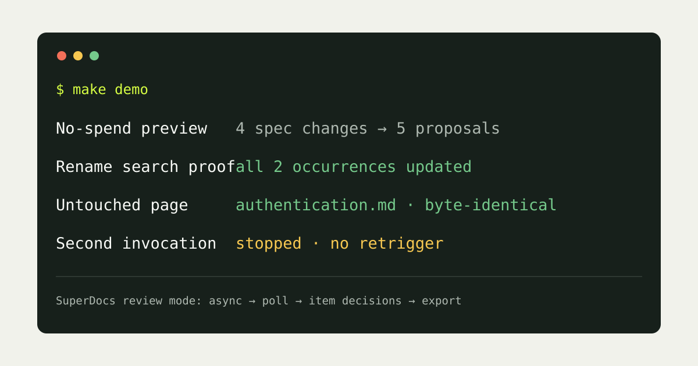

# Spec Doc Sync

Spec Doc Sync keeps human-written API reference documentation aligned with an evolving OpenAPI specification. It compares two committed specification snapshots, classifies additions/removals/renames/deprecations, locates every affected documentation reference, and creates narrow edit proposals. A writer approves or rejects each proposal. Approved intents can run through SuperDocs review mode before export; uncertain cases are escalated instead of guessed.

Built by **Ashish Huddar** for the SuperDocs task.



## Proof in one command

Install [uv](https://docs.astral.sh/uv/), then run:

```bash
make demo
```

The demo uses two committed Nimbus API snapshots and a copied documentation tree. It runs a no-spend preview, approves only high-confidence edits, applies them, proves the rename was updated everywhere, and prints SHA-256 evidence showing untouched pages remained byte-identical. No API key is needed. Run `make test` for the full offline suite.

## The workflow

```text
spec v1 + spec v2
        |
        v
semantic diff -> classify -> search every Markdown page -> proposal plan
                                                        |
                                      writer approves / rejects / escalates
                                                        |
                              local proof mode OR SuperDocs review mode
                                                        |
                         changed pages + byte-identity manifest + stop state
```

Preview is always free and makes zero network calls:

```bash
PYTHONPATH=src uv run python -m spec_doc_sync.cli plan \
  --previous fixtures/openapi-v1.yaml \
  --current fixtures/openapi-v2.yaml \
  --docs fixtures/docs \
  --out plan.json \
  --state .spec-doc-sync-state.json
```

Review and deterministic proof mode:

```bash
PYTHONPATH=src uv run python -m spec_doc_sync.cli review plan.json
PYTHONPATH=src uv run python -m spec_doc_sync.cli apply plan.json --docs fixtures/docs
```

Live SuperDocs review mode (server-side key only):

```bash
export SUPERDOCS_API_KEY=your-key-here
PYTHONPATH=src uv run python -m spec_doc_sync.cli live plan.json --docs fixtures/docs --export-dir reviewed
```

Live mode sends only approved intents to `POST /v1/chat/async` with `approval_mode: ask_every_time`, polls the durable job, renders each proposed change, posts explicit per-change decisions to `/v1/chat/{session_id}/approve`, and optionally exports the reviewed session through `/v1/documents/export`. The key is environment-only and is never returned to a browser or written to state.

For a credentialed smoke test without placing the key in shell history or a file, copy the key and pipe the clipboard directly to the verifier:

```bash
pbpaste | PYTHONPATH=src uv run python scripts/live_verify.py --output reviewed-reference.docx
```

**Live verification (22 August 2026):** SuperDocs completed the async review job, surfaced one change, accepted one explicit approval, renamed `customer_id` to `account_id`, and exported a 36,683-byte DOCX. The rendered export was visually clean and contained no remaining `customer_id` token.

## What is measured

- **Exhaustive rename:** every exact token occurrence of a confidently renamed field is counted before editing; applying a stale plan fails rather than partially updating.
- **Surgical output:** every Markdown page is hashed before and after. Untouched pages must be byte-identical.
- **Uncertainty:** zero or multiple plausible rename targets create an escalation, never a silent edit.
- **Reproducibility:** both specification snapshots and the synthetic docs are committed.
- **No re-trigger:** the state file records the processed specification-pair hashes. Generated documentation changes do not trigger another run; only a new spec snapshot pair does.
- **No-spend preview:** `plan` never imports or constructs the SuperDocs client and makes no network request.

## SuperDocs surfaces used

- API: asynchronous document editing
- Review: item-level `ask_every_time` approval
- Chat: natural-language, narrowly scoped wording instruction
- Search: local exhaustive reference discovery before any spend
- Multi-document: one plan spans every affected reference page
- Export: the live job's reviewed session can be exported through `/v1/documents/export`

## Honest boundaries

- This submission edits Markdown reference sources. SuperDocs receives structured HTML derived from a page; a production adapter should map the final chunk HTML back to the site's AST or use the document export endpoint.
- Rename inference is intentionally conservative: one removed and one structurally identical added property in the same schema. More ambiguous semantic renames escalate.
- Added-section wording uses the specification description when present. A missing description is low confidence and should be rejected or rewritten by the writer.
- The live client is implemented against the current documented async/poll/approve contract, but this repository contains no credential and the offline tests do not claim a successful paid operation.
- The tool watches specification snapshots, not its generated documentation, which is the stopping rule that prevents self-triggering loops.

## Repository layout

- `src/spec_doc_sync/diff.py` - structured OpenAPI diff and conservative rename inference
- `src/spec_doc_sync/planner.py` - cross-page reference search and uncertainty routing
- `src/spec_doc_sync/apply.py` - exact edits plus byte-identity manifest
- `src/spec_doc_sync/superdocs.py` - server-side async review client
- `fixtures/` - reproducible synthetic snapshots and reference docs
- `tests/` - offline behavioral proof
