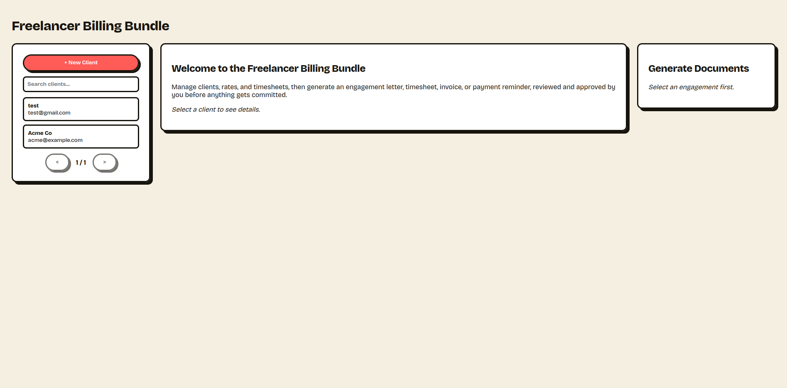
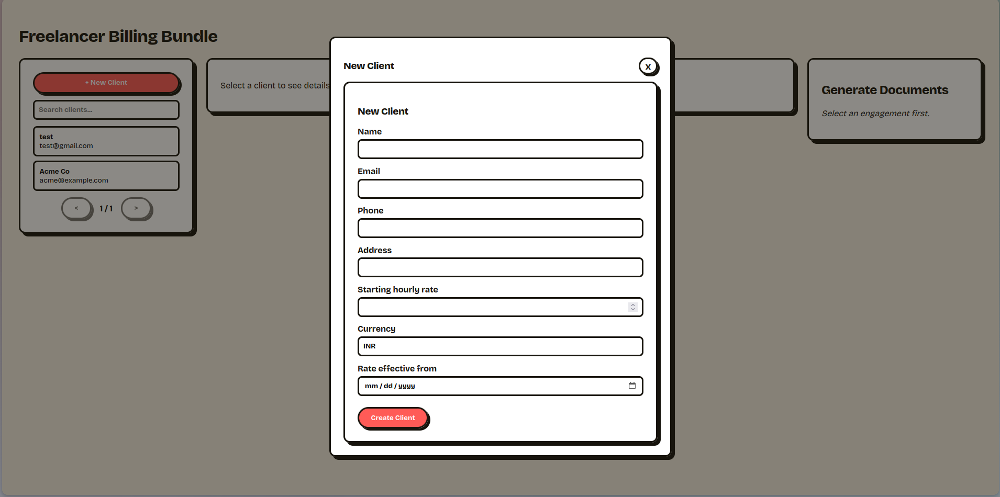
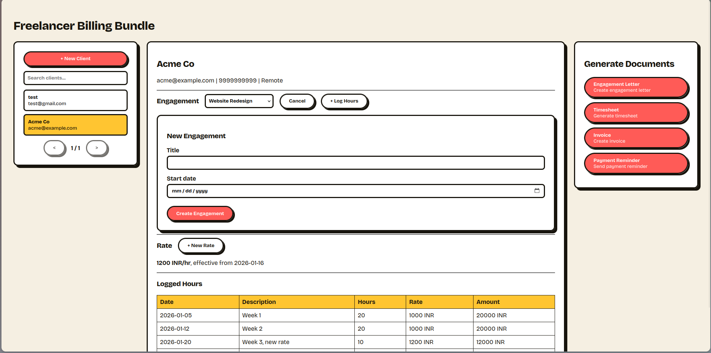
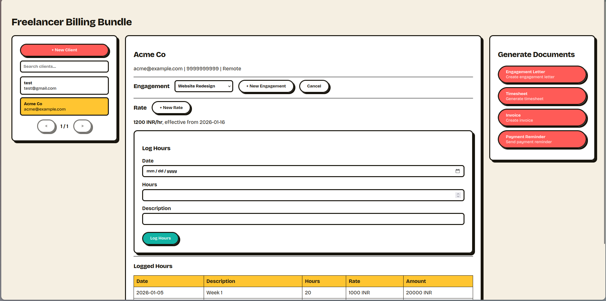
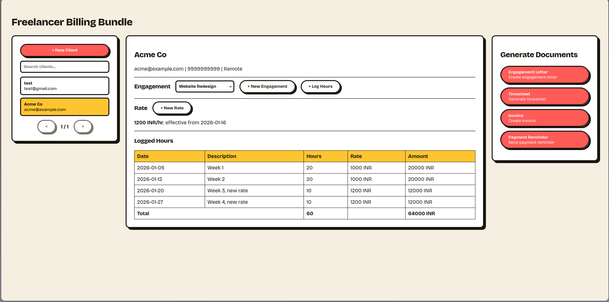
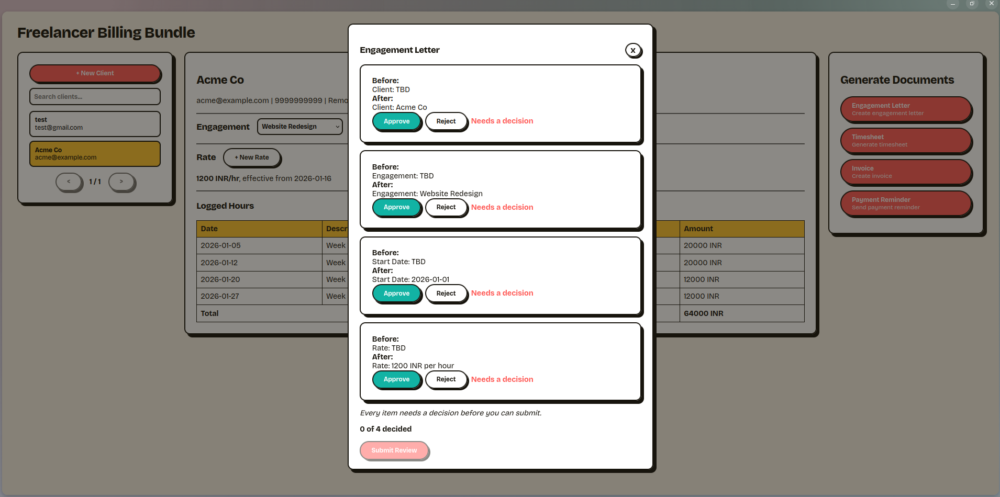
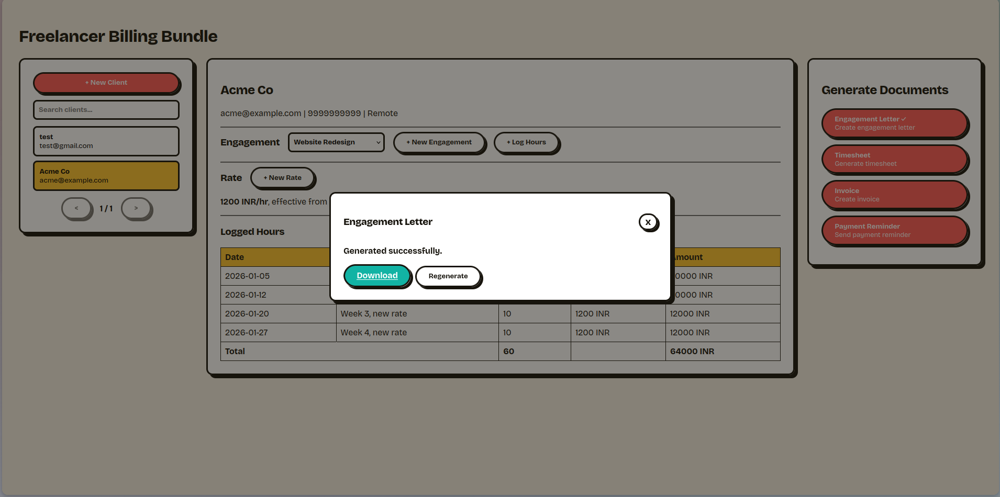

# Freelancer Engagement and Billing Bundle

A billing tool for freelancers, contractor marketplaces, and small agencies: one client record, one rate card, and four documents generated from it, engagement letter, timesheet, invoice, and payment reminder, all reconciling to the same underlying data. Built for the SuperDocs engineer task.

## The core problem this solves

A contractor's rate can change mid-engagement. Most simple invoicing tools either apply the new rate to everything retroactively, or the old rate to everything, silently getting the total wrong. This tool splits an invoice by rate period automatically: hours worked before a rate change are billed at the old rate, hours after at the new rate, and the total is always the sum of those line items, never computed independently.

## How it works

1. Create a client and set their starting hourly rate.
2. Create an engagement under that client and log hours against it as work happens.
3. If the rate changes partway through, add a new rate, effective from that date. Nothing needs to be edited retroactively.
4. Generate any of the four documents. The backend computes the real numbers first (invoice splits, totals, rate periods), then sends an instruction to SuperDocs to place those already-correct numbers into a document.
5. SuperDocs proposes edits. Review each one individually, approve or reject, then submit. Rejected fields stay blank rather than getting a guessed value.
6. Download the finished `.docx`.

The rate-split math (step 4) happens entirely in this codebase, not inside SuperDocs, so a mid-engagement rate change is never left to an AI's arithmetic.

## File structure

```
backend/
src/
billing/ rate-split invoice math, tested independently of the API
db/ Postgres connection, migrations
repositories/ one file per table, plain SQL queries
routes/ Express routes
services/ SuperDocs API client, document templates, bluff/completion detection
helpers/ snake_case -> camelCase mapping for DB rows
frontend/
src/
components/ UI pieces (sidebar, client details, document modal, forms)
hooks/ useClientDirectory, useDocumentGeneration, state + API orchestration
services/ api.js, thin fetch wrapper
utils/ stripHtml/diff formatting
```

## How to run it

**Backend:**

```bash
cd backend
npm install
cp .env.example .env
# fill in DATABASE_URL (a free Neon Postgres project works), SUPERDOCS_API_KEY, FRONTEND_URL
npm start
```

Migrations run automatically on startup.

**Frontend:**

```bash
cd frontend
npm install
cp .env.example .env
npm run dev
```

**Tests** (no live key needed):

```bash
cd backend
npm test
```

## What it uses on SuperDocs

The four required calls: upload (a skeleton HTML document with placeholder fields/rows), chat/async (an instruction filling those placeholders with real computed data), the human-in-the-loop approval flow (poll job, review `pending_changes`, submit per-item decisions), and export (styled `.docx`).

## Design decisions and honest limitations

- **Postgres over in-memory**: chosen for real persistence and rate/timesheet history, since that history is the actual subject matter of this card. No auth: this is a single-user tool, there's no second user to authenticate against.
- **A completion validator checks the exported document against known-correct values before trusting the job's own "completed" status.** This exists because we found and reproduced a real bug: a job can report `completed` while several requested fields were never actually filled in.
- **Multi-round approval is expected, not a bug.** SuperDocs sometimes proposes edits in several batches per document rather than one, the UI requires an explicit decision on every item in each batch before Submit is enabled.
- **Timesheet entries are bounded to `[engagement start date, today]`**, rate and engagement dates must be today or later. A freelancer logs hours already worked, but sets up engagements and rates looking forward.
- **No partial payment tracking.** A payment reminder's outstanding amount is the full invoice total; partial payments would need a separate table, out of scope here.

## Bugs found in SuperDocs during development

Two real, reproduced issues, full detail in `BUGS.md`:

1. A job can report `status: "completed"` while silently skipping several requested field edits.
2. A session's grip on the original instruction appears to degrade after several approval rounds, producing generic placeholder text or an incorrect number instead of the real value.

Both are defended against in this build (a bluff detector and a completion validator), not just documented.

## Screenshots

## Screenshots

Landing Page:


New client form:


New engagement form:


Logging hours, bounded to the engagement's start date:


Client details with the rate-split logged hours table:


Reviewing SuperDocs' proposed changes item by item before approving:


Downloading the finished document:

