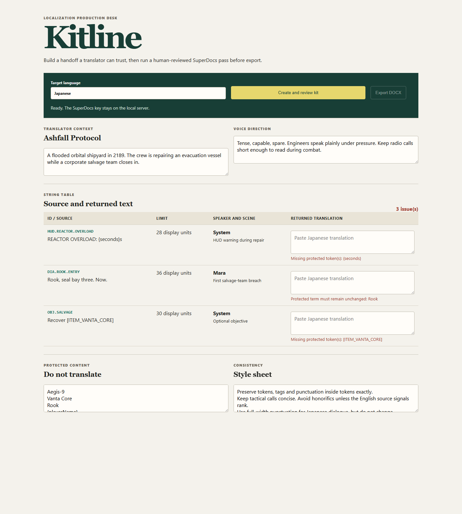

# Kitline: In-Game Text Localization Kit

Built by Dheeraj Mishra for the SuperDocs task.

Kitline is a localization-producer workbench for the moment before a game string table goes to a translation vendor. It provides reusable handoff templates, finds individual strings by ID or context, and produces a real translator handoff: world and tone context, per-string character limits, speaker and scene notes, protected tokens and proper nouns, and a style sheet. When translations return, it flags token loss, token invention, and target-script display-width breaches on the exact row.

The sample is synthetic. It is deliberately game-like, with a combat HUD warning, a named speaker, an objective tag, variables and markup. A translator who has not played the game gets enough context to translate intent instead of guessing from isolated strings.



## Why this shape

Game localization is not a generic document rewrite. The source string is kept immutable beside the returned translation and the validator runs locally, deterministically. It protects `{playerName}`, `[ITEM_VANTA_CORE]`, markup, printf-style variables and literal newlines without spending an operation. Width is measured in display units, with CJK characters taking two units and Arabic/Hebrew given a 1.35 multiplier. This is a conservative preflight, not a font-rendering engine, so the kit reports a violation for a producer to decide instead of claiming final platform fit.

SuperDocs owns the document workflow: the app sends generated HTML, including stable `data-chunk-id` attributes, for a narrow translator-readiness pass in `ask_every_time` review mode, exposes every proposed change for per-change approval, renders the approved returned HTML when the API supplies it, then exports the approved DOCX. The instruction explicitly forbids changes to string IDs, source strings, limits, context columns, protected content and glossary entries. The API key stays in the local server environment and is never sent to the browser, committed, logged or persisted.

## Run it

```bash
npm install
npm run dev
```

Copy `.env.example` to a local `.env`, then set `SUPERDOCS_API_KEY` before starting. The app calls the local server at `/api/superdocs/*`; only that server sends authenticated requests to SuperDocs. The browser never receives the key. For a production-style local run:

```bash
npm run build
npm run serve
```

The server calls:

1. `POST /v1/chat/async` with `document_html` and `approval_mode: "ask_every_time"`
2. `GET /v1/jobs/{job_id}` until review is ready
3. `POST /v1/chat/{session_id}/approve` with explicit per-change decisions
4. `POST /v1/documents/export`

Run the deterministic checks with `npm test` and produce a deployable build with `npm run build`. The six tests cover protected formatting tokens, repeated protected content, proper nouns, target-script width, string-table search and resilient parsing of normal or double-encoded proposed-change payloads.

## Verification

On 13 August 2026, a synthetic chunked localization kit completed the live SuperDocs workflow: async review, an explicit per-change approval, and a DOCX export returned HTTP 200. A second check through Kitline's own local proxy confirmed generated `data-chunk-id` HTML reaches SuperDocs and the proxy returns a DOCX export. No key or source document was committed.

## Honest limits

This is an editable demo, not a translation-management system. It accepts the configured JSON-like string model in the UI rather than parsing every vendor format, and character width is a conservative proxy for rendered pixel width. It does not translate strings or auto-approve SuperDocs changes. Those decisions remain with the localization producer.
