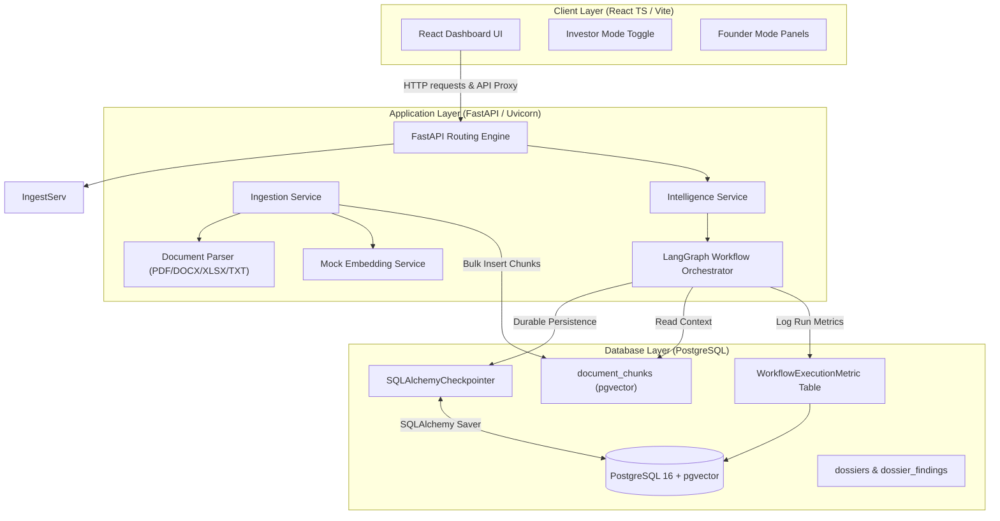

# Architecture Design: Diligence Q&A Dossier Builder

This document outlines the architecture, data flow, and design decisions of the **Diligence Q&A Dossier Builder**.

---

## 1. System Topology

The application consists of a decoupled frontend-backend model with database persistence:



---

## 2. Component Design Decisions

### A. React Dashboard (Frontend)
* **Design Philosophy**: Built with Vanilla CSS for maximum flexibility and performance. Operates under a responsive dark-theme design system.
* **Dual UI Modes**:
  * **Founder Mode**: Interactive interface for creating dossiers, uploading documents, inspecting raw findings, and executing manual review actions (Approve, Edit, Reject, Retry).
  * **Investor Mode**: Read-only, decision-oriented dashboard focused on summarizing diligence gaps, unresolved conflicts, and cost telemetry estimates.

### B. Ingestion and parsing pipeline
* **Mixed-Format Support**: Incorporates native text extraction routines for `.txt`, `.md`, `.csv`, `.docx` (via python-docx), `.xlsx` (via openpyxl), and `.pdf` (via pypdf).
* **SHA-256 Deduplication**: Prevents duplicate uploads. File contents are hashed, and matching hashes result in a duplicate file rejection error.
* **Cascading Deletion**: Deleting a document triggers a cascading delete across both physical storage and all vector chunks/embeddings in database.

### C. Mock Embedding Engine
* **Concept Mapping**: The Mock Embedding service maps 8 core due diligence concepts to specific vector indices (0–7).
* **Dilution Protection**: Individual word-vector components (indices 10–1535) are scaled to `[-0.1, 0.1]`. This ensures the concept boosts (value of `20.0` or `35.0`) dominate the vector magnitude, keeping retrieval cosine similarities of matched documents well above the `0.35` relevance threshold.

### D. LangGraph State Machine
Routes finding state through 9 deterministic and generative nodes:
1. **Query Analysis**: Normalizes query text and detects targeted metric domains.
2. **Retrieval**: Fetches relevant context from pgvector.
3. **Evidence Sufficiency**: Enforces the `0.35` similarity threshold.
4. **Conflict Detection**: Performs question-domain-aware numerical and factual checks.
5. **Answer Generation**: Synthesizes the response based strictly on grounded evidence.
6. **Citation Validation**: Matches all LLM citations against active database chunk UUIDs.
7. **Quality Gate**: Asserts correctness of state properties.
8. **Human Review**: Interrupts graph execution if a review is triggered (status `conflict`, quality failure, or confidence < 60%).
9. **Finalization**: Saves state results and marks the finding complete.

---

## 3. Workflow Interrupt and Resumption

```
 [Node: Quality Gate / Human Review Check]
                  │
                  ├──► Confidence < 60% OR Conflict Detected?
                  │         ▼
                  │    [Yes: State Interrupted]
                  │    Save Checkpoint to DB & Exit Thread
                  │         │
                  │         ├──► User Action: /approve  ──► Resume with current state
                  │         ├──► User Action: /edit     ──► Overwrite answer & Resume
                  │         └──► User Action: /retry    ──► Archive Run -> Fresh Run
                  │
                  └──► [No: Proceed to Finalization]
```

* **Durable checkpointer**: State is persisted using a custom `SQLAlchemyCheckpointer` storing binary data room thread states. This allows complete backend shutdowns and server crashes to occur without losing active human-in-the-loop dossiers.
* **Concurrency and isolation**: Every question finding runs on its own unique `workflow_thread_id` (a generated UUID). Cross-dossier transactions are strictly isolated to prevent data leaks.
