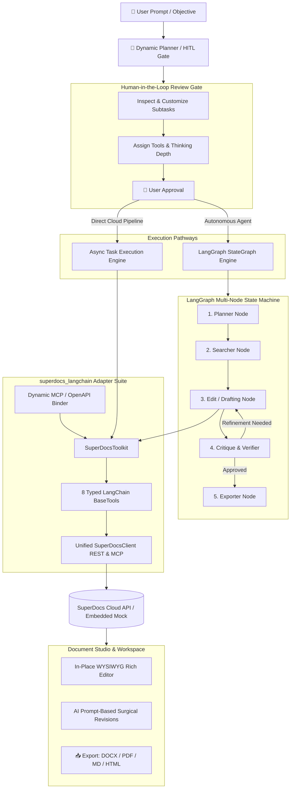
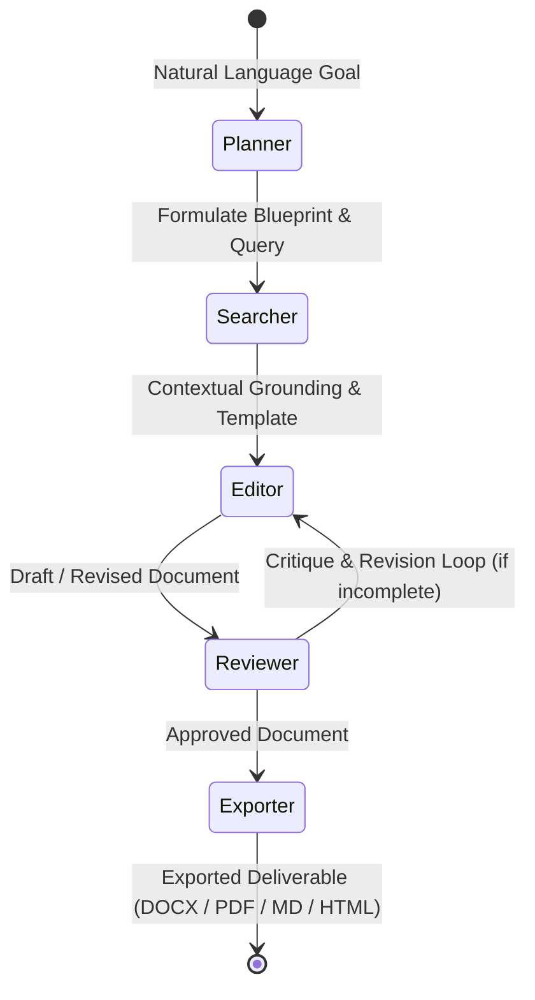

# ⚡ SuperDocs LangChain & LangGraph Studio

[](https://www.python.org/downloads/)
[](https://github.com/langchain-ai/langchain)
[](https://github.com/langchain-ai/langgraph)
[](#running-tests)
[](#architecture-overview)

A production-ready, drop-in adapter library exposing SuperDocs document management and AI generation capabilities as typed **LangChain `BaseTool` abstractions**, paired with an autonomous multi-node **LangGraph `StateGraph`** agent, a **Human-in-the-Loop (HITL) Dynamic Task Studio**, and an interactive **WYSIWYG Document Editor**.

---

## 🎯 The Agentic Task Human-in-the-Loop (HITL) Workflow

SuperDocs bridges the gap between **autonomous multi-agent planning** and **human oversight**. Rather than blindly executing complex document requests in a black box, the system puts the user in control at every critical phase:

$$\mathbf{Intent} \longrightarrow \mathbf{AI\ Synthesis} \longrightarrow \mathbf{HITL\ Gate\ (Review\ \&\ Edit)} \longrightarrow \mathbf{Cloud\ /\ LangGraph\ Execution} \longrightarrow \mathbf{Delivery\ \&\ WYSIWYG}$$

```text
  [1. Goal Intent] ➔ [2. Dynamic Plan Synthesis] ➔ [3. HITL Gate: Review / Customize / Add Subtasks]
                                                                │ (User Approval)
                                                                ▼
  [5. WYSIWYG & AI Revision] 🠔 [4. Autonomous Execution: SuperDocs Cloud / LangGraph Multi-Node]
```

### How the HITL Loop Operates:
1. **Dynamic Task Decomposition**: User inputs a high-level goal (e.g. *"Multi-Cloud Disaster Recovery Runbook"*). The `DynamicTaskPlanner` generates a structured, multi-step subtask breakdown with assigned tools, thinking parameters, and model tiers.
2. **Interactive Human Gate**: Before executing, the user can:
   - ✏️ **Edit & Reorder Subtasks**: Rename steps, modify descriptions, and refine execution scope.
   - ➕ **Add Custom Subtasks**: Inject domain-specific requirements or human-defined steps into the plan.
   - ⚙️ **Tune Models & Thinking**: Adjust model tiers (*Core, Turbo, Pro, Max*) and reasoning depths (*Fast, Balanced, Deep*) per step.
   - ❌ **Prune or Re-generate**: Remove unnecessary steps or regenerate the plan with updated context.
3. **Controlled Execution**: Only once explicitly **approved** by the user does the pipeline trigger execution—either via asynchronous SuperDocs cloud tasks or an autonomous multi-node LangGraph `StateGraph`.
4. **Post-Execution In-Place Refinement**: Deliverables stream into the interactive document studio for direct **WYSIWYG formatting** or **prompt-based surgical AI edits**.

---

## 🌟 Key Features

- 🛠️ **8+ Typed SuperDocs Tools**: Pydantic v2 schemas for document creation, section-scoped surgical edits, template instantiation, semantic search, multi-format export, revision history, and inline review comments.
- 🔮 **Dynamic Task Planner & HITL Gate**: AI-driven natural language decomposition that converts user objectives into structured, reviewable subtasks with model tier, thinking depth, and tool controls before execution.
- 🤖 **Stateful LangGraph Agent**: Autonomous multi-node state machine (`Planner` $\rightarrow$ `Searcher` $\rightarrow$ `Editor` $\rightarrow$ `Reviewer` $\rightarrow$ `Exporter`) featuring automated critique and refinement loops.
- ⚡ **Interactive Studio Web App**: Rich dual-theme (Light/Dark) dashboard with live execution telemetry, cloud job queue management (`/v1/jobs`), saved documents library, and progress tracking.
- ✏️ **Dual-Mode Document Workspace**: In-place WYSIWYG rich-text editing (H1–H3, bold, lists, tables, quotes) combined with prompt-based AI surgical revisions.
- 🔄 **Runtime Dynamic Tool Binding**: Dynamically loads schemas at runtime from **Model Context Protocol (MCP)** manifests or OpenAPI endpoints without static code generation.
- 📥 **Universal Multi-Format Export**: Native export to Word (`.docx`), PDF (`.pdf`), Markdown (`.md`), Semantic HTML (`.html`), Plain Text, and JSON.
- 🛡️ **Embedded High-Fidelity Mock Engine**: Seamlessly switch between live SuperDocs REST/MCP cloud endpoints and a local offline mock engine for zero-credential testing and CI/CD.

---

## 🏛️ Architecture Overview



---

## 📁 Repository Structure

```text
use-cases/langchain-superdocs-tool/
├── README.md                           # Comprehensive architecture and setup guide
├── pyproject.toml                      # PEP 621 package metadata & dependencies
├── superdocs_langchain/
│   ├── __init__.py                     # Clean package exports
│   ├── client.py                       # Unified REST, MCP & offline mock client
│   ├── models.py                       # Pydantic v2 data models & plan schemas
│   ├── tools.py                        # Typed LangChain BaseTool implementations
│   ├── dynamic.py                      # Dynamic MCP / OpenAPI schema binder
│   ├── dynamic_agent.py                # Autonomous dynamic planner agent
│   ├── planner.py                      # DynamicTaskPlanner for HITL decomposition
│   ├── toolkit.py                      # SuperDocsToolkit container
│   └── graph.py                        # LangGraph StateGraph agent definition
├── examples/
│   ├── app.py                          # ⚡ Full SuperDocs Task & Agent Studio Web App
│   ├── doc_agent_graph.py              # Runnable LangGraph multi-node CLI demo
│   ├── dynamic_planner_demo.py         # Dynamic task planning & HITL CLI demo
│   ├── task_execution_demo.py          # Direct task execution & progress demo
│   ├── sessions_demo.py                # Multi-session chat & document demo
│   ├── dynamic_binding_demo.py         # Dynamic MCP tool binding demo
│   └── quickstart.py                   # 10-line minimal getting started script
└── tests/
    ├── conftest.py                     # Pytest fixtures and mock client
    ├── test_client.py                  # Client REST & Mock tests
    ├── test_models.py                  # Data model serialization tests
    ├── test_tools.py                   # BaseTool execution tests
    ├── test_dynamic.py                 # Dynamic schema binding tests
    ├── test_dynamic_planner.py         # Task planning and HITL tests
    ├── test_sessions.py                # Document session management tests
    └── test_graph.py                   # End-to-end StateGraph workflow tests
```

---

## 🚀 Installation & Setup

### 1. Requirements
- Python 3.10 or higher
- `pip` or `uv`

### 2. Install Package
```bash
# Editable install from the workspace root:
pip install -e use-cases/langchain-superdocs-tool

# With development & testing dependencies:
pip install -e "use-cases/langchain-superdocs-tool[dev]"
```

### 3. Environment Configuration (Optional for Cloud API)
To connect to a live SuperDocs remote cloud instance, set:
```bash
export SUPERDOCS_BASE_URL="https://api.superdocs.com/v1"
export SUPERDOCS_API_KEY="sd_live_your_api_key_here"
```
> **Note**: If credentials are omitted, `SuperDocsClient` automatically engages its embedded, zero-dependency offline mock engine, enabling complete local execution and testing.

---

## ⚡ Interactive Web Studio (`app.py`)

SuperDocs Studio provides a web-based agentic workspace:

```bash
python use-cases/langchain-superdocs-tool/examples/app.py 8080
```
Open **`http://localhost:8080`** in your browser to access:

| Studio Component | Description |
| :--- | :--- |
| **⚡ Live Dynamic Studio** | Objective entry, dynamic decomposition, execution tracing, and live document canvas. |
| **📋 HITL Decomposition Studio** | Dedicated card grid for inspecting, customizing, adding, and approving subtasks. |
| **📄 WYSIWYG Document Canvas** | Direct in-place editing with formatting toolbar + AI surgical prompt edits. |
| **📊 Cloud Job Queue** | Live monitoring of `/v1/jobs` with real-time status and job cancellation. |
| **📁 Saved Documents** | Durable document catalog with version tracking and session inspection. |
| **🤖 LangGraph Agent Tab** | Autonomous multi-node agent with checklist updates and execution traces. |

---

## 💻 Quickstart (Minimal 10-Line Integration)

```python
from superdocs_langchain.client import SuperDocsClient
from superdocs_langchain.toolkit import SuperDocsToolkit

# 1. Initialize client (auto-falls back to embedded mock if no keys are set)
client = SuperDocsClient()

# 2. Extract typed LangChain tools
toolkit = SuperDocsToolkit(client=client)
tools = toolkit.get_tools()

# 3. Invoke document creation tool
create_tool = next(t for t in tools if t.name == "superdocs_create_document")
result = create_tool.invoke({
    "title": "System Architecture Overview",
    "content": "## Background\nAutonomous agent document workflows.\n\n## Timeline\nQ1 2026.",
})
print(result)
```

---

## 🧰 SuperDocs Typed Tool Suite

| Tool Name | LangChain Class | Description | Key Parameters |
| :--- | :--- | :--- | :--- |
| `superdocs_create_document` | `SuperDocsCreateDocumentTool` | Creates a new document with title, content, and metadata | `title`, `content`, `folder`, `metadata` |
| `superdocs_get_document` | `SuperDocsGetDocumentTool` | Fetches document body, outline tree, or specific section | `document_id`, `include_outline`, `section_id` |
| `superdocs_edit_section` | `SuperDocsEditSectionTool` | Precision section surgical edit (`replace`, `append`, `prepend`, `delete`) | `document_id`, `section_target`, `content`, `mode` |
| `superdocs_search` | `SuperDocsSearchTool` | Semantic vector and keyword search across documents | `query`, `top_k`, `tag_filter` |
| `superdocs_render_template`| `SuperDocsTemplateRenderTool`| Instantiates templates (`tech-spec`, `pr-description`, etc.) | `template_id`, `variables`, `target_title` |
| `superdocs_export_document`| `SuperDocsExportTool` | Exports document to `docx`, `pdf`, `markdown`, `html`, `text`, or `json` | `document_id`, `export_format` |
| `superdocs_add_comment` | `SuperDocsCommentTool` | Posts inline review feedback or suggestions | `document_id`, `content`, `section_id`, `author` |
| `superdocs_get_history` | `SuperDocsHistoryTool` | Inspects document revision history and snapshot versions | `document_id` |

---

## 🔮 Dynamic HITL Task Planning Example

```python
from superdocs_langchain.client import SuperDocsClient
from superdocs_langchain.planner import DynamicTaskPlanner

client = SuperDocsClient()
planner = DynamicTaskPlanner(client=client)

# 1. Synthesize plan from natural language objective
plan = planner.generate_plan(
    goal="Draft an enterprise SOC 2 compliance checklist and incident runbook",
    model_tier="pro",
    thinking_depth="deep"
)

# 2. Inspect synthesized subtasks
for item in plan.tasks:
    print(f"[{item.task_num}] {item.title} -> Tool: {item.tool_name}")

# 3. Approve and execute plan
plan.approval_state = "approved"
result = planner.execute_plan(plan)
print(f"Generated Document: {result.document_id}")
```

---

## 🤖 LangGraph Multi-Node State Machine



Run from CLI:
```bash
# Generate a technical specification in Markdown:
python use-cases/langchain-superdocs-tool/examples/doc_agent_graph.py \
    --prompt "Design high-performance distributed vector index architecture" \
    --format markdown

# Generate a Pull Request description in HTML with dynamic tool binding:
python use-cases/langchain-superdocs-tool/examples/doc_agent_graph.py \
    --prompt "PR: Add SuperDocs LangChain and LangGraph integration" \
    --format html \
    --dynamic
```

---

## 🧪 Running Tests

The test suite covers tools, client operations, dynamic schema generation, HITL planners, session state, and the LangGraph state machine:

```bash
python -m pytest use-cases/langchain-superdocs-tool/tests -v
```
Output:
```text
37 passed in 0.38s (100% test pass rate)
```

---

## 📄 License

MIT License. See LICENSE for details.
