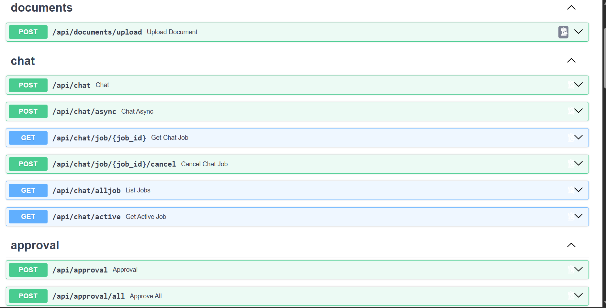
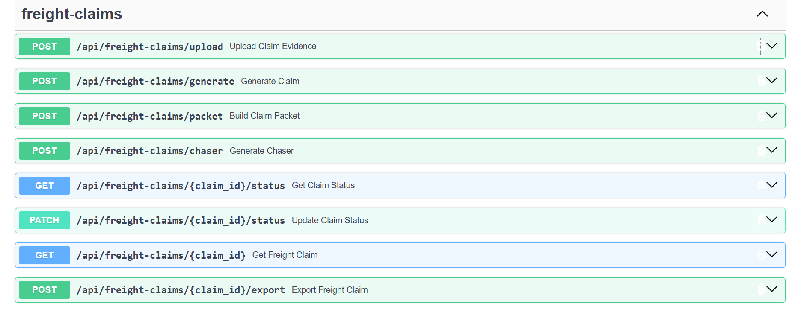
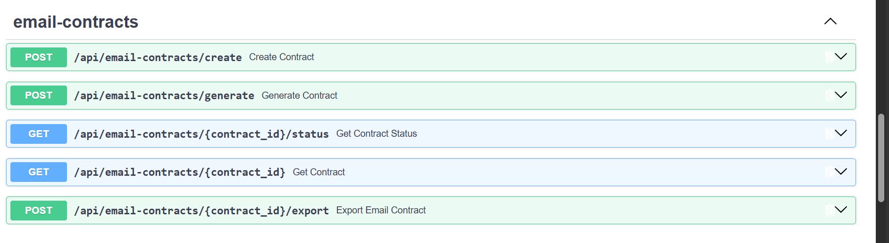

# SuperDocs Engineer Task

Implementation of the assigned SuperDocs engineering builds.

## Builds

### 1. Freight Claim Packet Assembler

A document workflow for assembling freight damage claims from uploaded evidence.

Features:
- Upload multiple evidence documents
- POD, invoice, damage photo, repair quote and salvage quote support
- Generate a freight claim
- Assemble an indexed claim packet
- Generate a follow-up chaser
- Human approval workflow
- PDF export

### 2. Email-to-Contract Agent

A workflow that converts an email negotiation thread into a first-pass editable contract.

Features:
- Accept negotiation email threads
- Select contract type
- Generate an editable contract
- Preserve only agreed negotiation terms
- Human approval workflow
- PDF export

### 3. Job Task

The third assigned build is included in this submission alongside the two SuperDocs use cases.

## Architecture

The builds share a common React frontend and FastAPI backend.

    React Frontend
          |
          v
    FastAPI Backend
          |
          v
      SuperDocs API
          |
          +-- Freight Claim
          +-- Email -> Contract
          +-- Job Task

## Tech Stack

- React
- JavaScript
- FastAPI
- Python
- SuperDocs API

## Running the project

### Backend

    cd backend

    python -m venv venv

    # Windows
    venv\Scripts\activate

    pip install -r requirements.txt

    uvicorn app.main:app --reload

### Frontend

    cd frontend

    npm install
    npm run dev

### Environment variables

Create a `.env` file using the provided `.env.example`.

Never commit API keys, tokens or passwords.

## SuperDocs Features Used

- SuperDocs API
- Document processing
- AI document generation
- Human approval workflow
- Document export

## Screenshots of Api

## Credits

Built for the SuperDocs Engineer Task.
