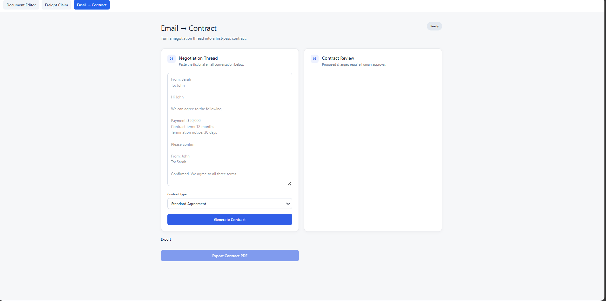

# Email-to-Contract Agent

A document workflow that converts an email negotiation thread into a first-pass editable contract using the agreed business terms from the negotiation.

## Features

- Accept a fictional email negotiation thread
- Select the contract type
- Create an email-contract session
- Generate a first-pass editable contract
- Preserve agreed business terms from the negotiation
- Mark unsupported contract fields as not specified in the negotiation
- Human approval workflow
- Export the generated contract as PDF

## Workflow

1. Paste the negotiation thread.
2. Select the contract type.
3. Create the email-contract session.
4. Generate the first-pass contract.
5. Review the generated editable document.
6. Review and approve proposed changes when required.
7. Export the final contract as PDF.

## Source Accuracy

The negotiation thread is treated as the source of business terms.

The generation instructions require the agent to:

- Include terms that were actually agreed.
- Exclude rejected or unaccepted proposals.
- Preserve agreed prices, dates, payment terms, deliverables, responsibilities and termination terms.
- Avoid inventing parties, prices, dates, obligations, penalties, warranties, governing law, addresses or other unsupported information.
- Mark unsupported normal contract fields as not specified in the negotiation.

## Architecture

The Email-to-Contract workflow uses the common application backend and frontend.

    React Frontend
          |
          v
    FastAPI Backend
          |
          v
      SuperDocs API
          |
          +-- Create contract session
          +-- Generate contract
          +-- Human approval
          +-- Export document

## Tech Stack

- React
- JavaScript
- FastAPI
- Python
- SuperDocs API

## Running

Run the application using the instructions in the main project README.

## SuperDocs Features Used

- Session-based document workflows
- AI document generation
- Editable document generation
- Human approval
- Document export

## Screenshots

## Credits

Built for the SuperDocs Engineer Task.
