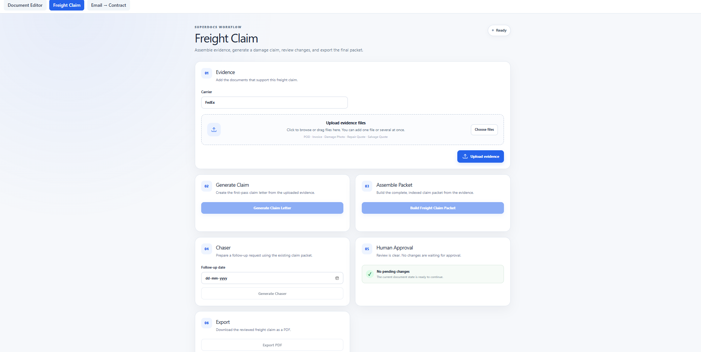

# Freight Claim Packet Assembler

A freight-claim workflow that uses uploaded evidence to prepare a claim, assemble a claim packet, generate a follow-up chaser, review proposed document changes, and export the final document.

## Features

- Upload multiple evidence files
- Support for:
  - Proof of Delivery (POD)
  - Commercial invoice
  - Damage photographs
  - Repair quote
  - Salvage quote
- Process uploaded evidence through SuperDocs
- Generate a freight cargo damage claim
- Assemble an indexed claim packet
- Generate a follow-up chaser for the carrier
- Human approval workflow
- Export the resulting document as PDF

## Workflow

1. Select the carrier.
2. Add one or more evidence files.
3. Assign an evidence type to each file.
4. Upload the evidence.
5. Generate the freight claim.
6. Assemble the claim packet.
7. Review proposed changes.
8. Approve the changes when required.
9. Generate a follow-up chaser when needed.
10. Export the final document.

## Architecture

The Freight Claim workflow uses the common application backend and frontend.

    React Frontend
          |
          v
    FastAPI Backend
          |
          v
      SuperDocs API
          |
          +-- Upload and process evidence
          +-- Generate claim
          +-- Assemble packet
          +-- Generate chaser
          +-- Human approval
          +-- Export document

## Evidence Handling

The workflow keeps the uploaded evidence associated with a single freight-claim session.

The generation prompts instruct the document agent to use the uploaded evidence as the factual source and to avoid inventing shipment information, dates, amounts, damage details, or other unsupported facts.

## Tech Stack

- React
- JavaScript
- FastAPI
- Python
- SuperDocs API

## Running

Run the application using the instructions in the main project README.

## SuperDocs Features Used

- File upload and document processing
- Session-based document workflows
- AI document generation
- Human approval
- Document export

## Screenshots

## Credits

Built for the SuperDocs Engineer Task.
