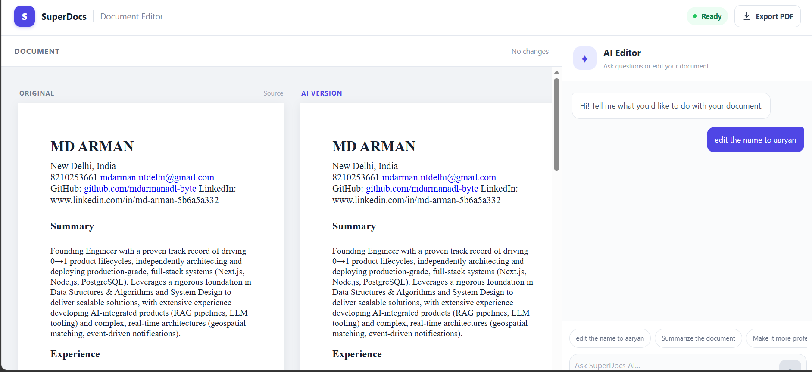

# Job Task

A document editing workflow that lets a user upload a document, ask AI to work with it, review proposed changes, approve or reject those changes, and export the resulting document.

## Features

- Upload a document
- View the uploaded document
- Ask AI to summarize the document
- Ask AI to edit or rewrite the document
- Review AI-proposed changes
- Human approval or rejection of changes
- Export the document

## Workflow

1. Upload a document.
2. Review the document in the editor.
3. Ask AI for a summary, edit, rewrite or other document operation.
4. Review the proposed result.
5. Approve or reject the proposed changes.
6. Export the resulting document.

## Human-in-the-Loop

AI-generated document changes are not treated as final automatically.

The user can review the proposed changes and explicitly approve or reject them before the document is finalized.

## Architecture

The Job Task uses the common application frontend and backend.

    React Frontend
          |
          v
    FastAPI Backend
          |
          v
      SuperDocs API
          |
          +-- Document upload
          +-- AI document operations
          +-- Human approval/rejection
          +-- Document export

## Tech Stack

- React
- JavaScript
- FastAPI
- Python
- SuperDocs API

## Running

Run the application using the instructions in the main project README.

## SuperDocs Features Used

- Document upload and processing
- AI document operations
- Editable document workflow
- Human approval
- Document export

## Screenshots

## Credits

Built for the SuperDocs Engineer Task.
